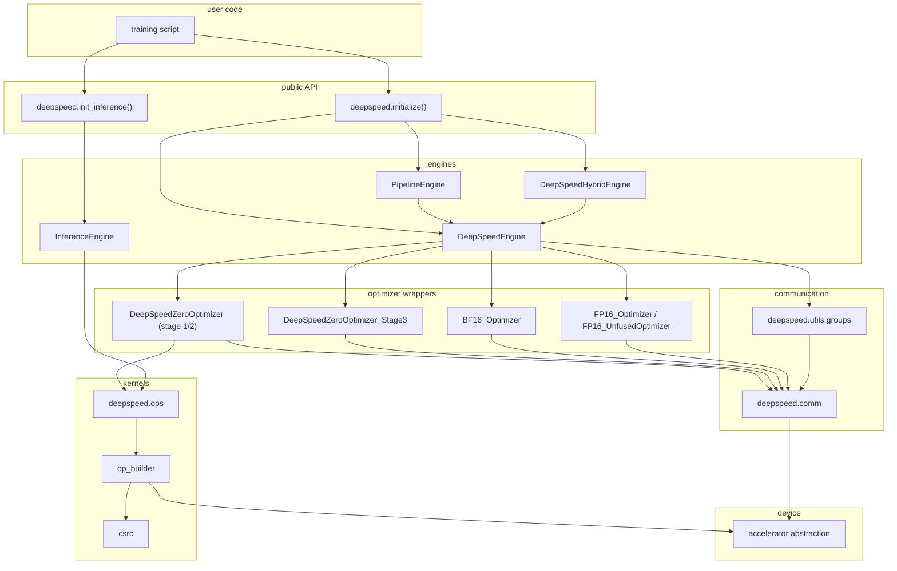
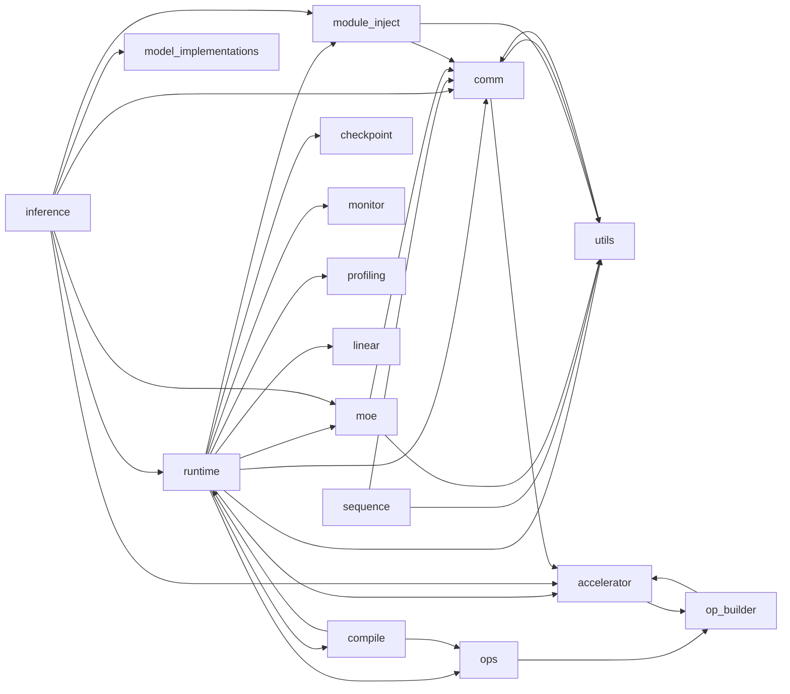
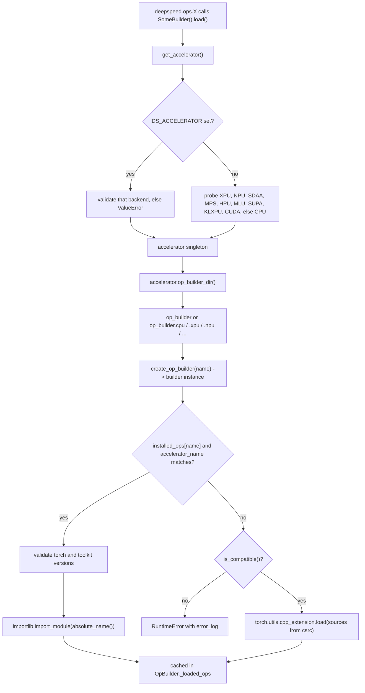
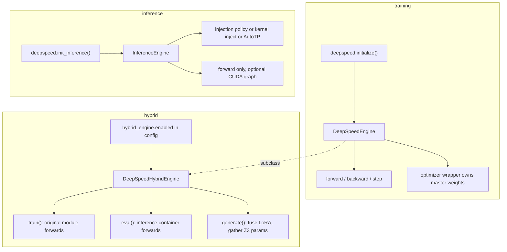
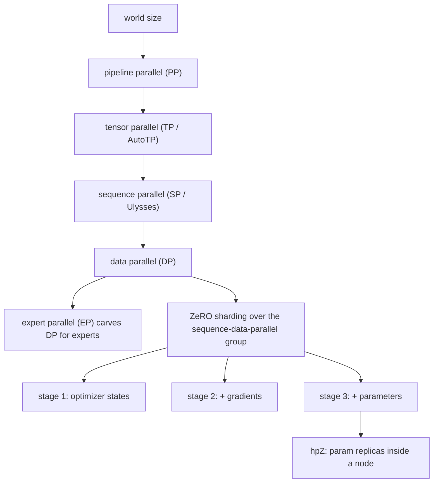
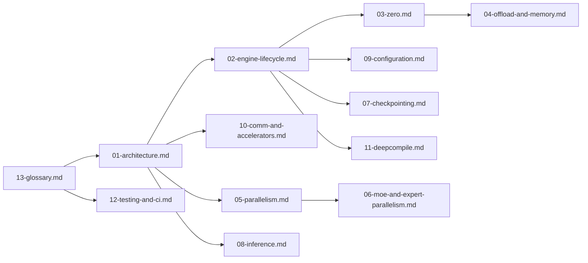

# Architecture: what DeepSpeed is made of

**What this covers.** A map of the whole repository: which package owns what, how the layers
stack from a user script down to a compiled kernel, how the accelerator abstraction and the
op-builder/JIT system work, the three distinct execution modes (training, inference, hybrid),
how the parallelism dimensions compose, and the cross-cutting invariants that a contributor
must not break.

**Source of truth.** Upstream commit `d70adc32`, DeepSpeed version `0.20.1`. Every claim below
was read out of that tree. Line numbers drift; names are the stable handles.

**Scope.** This document is a map, not a manual. It names the owner of each concern and points
at the file. The engine's control flow is in `02-engine-lifecycle.md`; ZeRO internals in
`03-zero.md`; parallelism mechanics in `05-parallelism.md`.

---

## 1. Repository layout

### 1.1 Top-level directories

DeepSpeed is not a single Python package. Four top-level directories are part of the shipped
code, and three of them are reached from inside `deepspeed/` through symlinks:

| Path | Symlinked as | Owns |
| --- | --- | --- |
| `accelerator/` | `deepspeed/accelerator` | The device abstraction: one module per backend plus the ABC and resolver |
| `op_builder/` | `deepspeed/ops/op_builder` | Build recipes for every native op, one class per op, per accelerator |
| `csrc/` | `deepspeed/ops/csrc` | The C++/CUDA/HIP/SYCL/Metal sources those recipes compile |
| `deepspeed/` | -- | All Python runtime code |
| `ci/` | -- | Trusted CI controllers and the diff-based test selector |

The symlinks matter. `deepspeed/accelerator` and `deepspeed/ops/op_builder` are not copies: they
are the same files reachable under two import names, which is why nearly every builder and
accelerator carries a `try: from op_builder import __deepspeed__ / except ImportError:` probe
to decide which spelling to use. On Windows, `setup.py` replaces the symlinks with real copies
at build time (`setup.py:216-226`).

`ci/` is worth knowing about even if you never touch it, because it decides which tests your PR
runs:

| File | Role |
| --- | --- |
| `ci/tests_fetcher.py` | Diff-based test selector. Builds a reverse import-dependency graph over `deepspeed/` and `tests/unit`, emits the impacted test paths. Fails *safe*: a shallow clone, a changed fixture, or any unexpected error runs the full scope. |
| `ci/check_paths.py` | Stdlib-only gate that decides whether a diff needs the CPU/GPU workflows at all. Docs-only diffs skip them. Deliberately run from the base branch so a PR cannot weaken its own gate. |
| `ci/torch_latest.py` | Trusted controller for the `modal-torch-latest` workflow. PR code is identified by validated repo name plus exact SHA and run in a no-secret sandbox. |
| `ci/classify_multirank_exit.py` | Maps the multi-rank CPU run's exit code to the `DS_CI_FAILURE_CLASS` sentinel the nightly report greps for. |
| `ci/accelerate.py`, `ci/install_accelerate.py` | Run HuggingFace Accelerate's DeepSpeed tests against this checkout. |

### 1.2 The `deepspeed/` subpackages

| Package | Owns | Entry points worth knowing |
| --- | --- | --- |
| `runtime/` | The training engine and everything it needs: config, ZeRO, optimizers, checkpointing, dataloader, LR schedules, compile glue | `runtime/engine.py` (`DeepSpeedEngine`), `runtime/config.py` (`DeepSpeedConfig`), `runtime/zero/`, `runtime/bf16_optimizer.py`, `runtime/fp16/`, `runtime/hybrid_engine.py`, `runtime/pipe/` |
| `inference/` | The inference engine (v1) and the newer v2 stack | `inference/engine.py` (`InferenceEngine`), `inference/config.py`, `inference/v2/engine_v2.py`, `inference/quantization/` |
| `comm/` | The communication layer. A signature-compatible stand-in for `torch.distributed`, plus comms logging and backend selection | `comm/comm.py` (the flat public API), `comm/torch.py` (`TorchBackend`), `comm/ccl.py`, `comm/mori.py` |
| `module_inject/` | Module replacement: AutoTP sharding, AutoEP expert parallelism, kernel injection policies and containers | `module_inject/auto_tp.py`, `module_inject/layers.py`, `module_inject/auto_ep.py`, `module_inject/replace_module.py`, `module_inject/replace_policy.py` |
| `moe/` | Mixture-of-experts layers, routing, and expert-parallel all-to-all | `moe/layer.py` (`MoE`), `moe/sharded_moe.py` (`MOELayer`, `TopKGate`), `moe/mappings.py` |
| `checkpoint/` | Checkpoint *re-shaping*: universal checkpoints, affine maps, 3-D reshaping. Not the save/load path itself (that is in `runtime/`) | `checkpoint/ds_to_universal.py`, `checkpoint/universal_checkpoint.py`, `checkpoint/zero_checkpoint.py`, `checkpoint/affine.py` |
| `sequence/` | Ulysses sequence parallelism and AutoSP | `sequence/layer.py` (`DistributedAttention`), `sequence/auto_sp.py`, `sequence/cross_entropy.py` |
| `compile/` | DeepCompile: graph passes that implement ZeRO/offload/prefetch inside a compiled graph | `compile/backend.py`, `compile/passes/`, `compile/init_z3.py`, `compile/config.py` |
| `ops/` | Python wrappers over the native kernels, one subpackage per op family | `ops/adam/`, `ops/aio/`, `ops/transformer/`, `ops/fp_quantizer/`, `ops/op_builder` (symlink) |
| `nvme/` | Standalone NVMe/AIO benchmarking and tuning tooling (`ds_nvme_tune`, `ds_io`) | `nvme/perf_run_sweep.py`, `nvme/test_ds_aio.py`, `nvme/ds_aio_handle.py` |
| `launcher/` | Multi-process and multi-node launch: the `deepspeed` CLI and its per-node worker | `launcher/runner.py` (`main`), `launcher/launch.py`, `launcher/multinode_runner.py` |
| `monitor/` | Metric sinks: TensorBoard, W&B, CSV, Comet | `monitor/monitor.py` (`MonitorMaster`) |
| `profiling/` | The flops profiler and its config | `profiling/flops_profiler/profiler.py` (`FlopsProfiler`) |
| `linear/` | `OptimizedLinear`: LoRA plus quantized base weights, with base-weight sharding | `linear/optimized_linear.py`, `linear/quantization.py`, `linear/context_manager.py` |
| `pipe/` | A two-line public alias for the pipeline API | `pipe/__init__.py` re-exports `PipelineModule`, `LayerSpec`, `TiedLayerSpec`, `DualPipeVModule` |
| `utils/` | Cross-cutting infrastructure: process-group registry, logging, timers, debug, pinned memory, tensor fragments | `utils/groups.py`, `utils/timer.py`, `utils/logging.py`, `utils/torch.py`, `utils/z3_leaf_module.py`, `utils/zero_to_fp32.py` |
| `autotuning/` | Offline config search (batch size, ZeRO stage, bucket sizes) | `autotuning/autotuner.py`, `autotuning/config_templates/` |
| `compression/` | Compression helpers | `compression/helper.py` |
| `datastates/` | DataStates checkpointing integration config | `datastates/config.py` |
| `io/` | File-writer and buffer abstractions used by fast checkpoint writing | `io/fast_file_writer.py`, `io/double_io_buffer.py` |
| `model_implementations/` | Model-specific inference modules (transformers, diffusers) | `model_implementations/transformers/ds_transformer.py` |
| `models/` | A small set of model-specific kernels/modules | `models/glm_moe_dsa/` |

Two cases are easy to get wrong:

- **`checkpoint/` vs save/load.** `DeepSpeedEngine.save_checkpoint` / `load_checkpoint` live in
  `runtime/engine.py:5011` / `:4513`. `deepspeed/checkpoint/` is the *offline* toolkit that
  converts and reshapes checkpoints between parallel topologies.
- **`nvme/` vs offload.** ZeRO's NVMe offload lives in `runtime/swap_tensor/` and
  `ops/aio/`; `deepspeed/nvme/` is the benchmarking CLI.

---

## 2. The layering



Read top to bottom:

1. **User script.** Calls `deepspeed.initialize(...)` for training or
   `deepspeed.init_inference(...)` for inference (`deepspeed/__init__.py:440`, `:701`).
2. **`deepspeed.initialize()`** normalises arguments, builds a `DeepSpeedConfig`, picks an engine
   class and returns a 4-tuple. It is a function, not a factory object; see
   `02-engine-lifecycle.md` section 1.
3. **`DeepSpeedEngine`** is an `nn.Module` subclass (`runtime/engine.py:516`) that holds the
   client model in `self.module`. It owns the config, the comm-group handles, the timers, the
   checkpoint engine, and the optimizer wrapper. `PipelineEngine` and `DeepSpeedHybridEngine`
   are subclasses.
4. **Optimizer wrappers** own master weights, gradient reduction, loss scaling, clipping, and
   state offload. The engine picks exactly one; see section 3 of `02-engine-lifecycle.md` for
   the selection table.
5. **`deepspeed.comm`** is the only sanctioned route to a collective. `deepspeed.utils.groups`
   is the registry that answers "which process group is the data-parallel group *here*".
6. **The accelerator abstraction** answers every device question: which device, which stream,
   which dtype is supported, which communication backend, which op-builder directory.
7. **Kernels.** `deepspeed.ops.*` are thin Python wrappers; `op_builder` decides whether a given
   op is loaded from a prebuilt extension or JIT-compiled; `csrc` is the source.

### 2.1 Package dependency map

Arrows are "imports at module scope". Taken from the import block of
`runtime/engine.py:28-149` and the subpackage `__init__` files.



Two cycles are real and deliberate:

- **`utils` <-> `comm`.** `deepspeed/utils/groups.py` imports `deepspeed.comm` at module scope
  to build groups; `deepspeed/comm/comm.py:179-190` imports `groups` *lazily inside*
  `destroy_process_group` precisely to break the cycle, with a comment saying so.
- **`accelerator` <-> `op_builder`.** `op_builder/all_ops.py:18` calls
  `get_accelerator().op_builder_dir()`, and each accelerator's `create_op_builder` imports from
  that directory. The cycle is broken by doing every import inside a function.

`runtime` is the hub: it imports from nearly everything, and nothing in `comm`, `utils`,
`accelerator` or `op_builder` imports it back. If you are adding a dependency *into* one of
those four from `runtime`, you are probably putting the code in the wrong place.

---

## 3. The accelerator abstraction

### 3.1 Why it shapes everything

DeepSpeed runs on NVIDIA CUDA, AMD ROCm, Intel XPU, Ascend NPU, Habana HPU, Apple MPS, Cambricon
MLU, Tecorigin SDAA, SUPA, KLXPU and plain CPU. There is no `torch.cuda` in the runtime path.
Every device-touching line goes through `get_accelerator()`, which returns a singleton
implementing `DeepSpeedAccelerator` (`accelerator/abstract_accelerator.py:10`).

The practical consequence for a contributor: **a change that writes `torch.cuda.*`,
`device='cuda'`, `tensor.half()` on a device-dependent path, or `torch.cuda.Stream` is a
portability bug**, even if it passes CI on an NVIDIA box. The ABC exists to give you the
portable spelling.

### 3.2 What the ABC covers

`accelerator/abstract_accelerator.py` groups its abstract methods with section comments. The
groups tell you the full surface a new backend must implement:

| Group | Lines | Representative members |
| --- | --- | --- |
| Device semantics flags (no section comment) | `:19-31` | `is_synchronized_device`, `use_host_timers`, `resolves_data_dependency`, `handles_memory_backpressure` |
| Device APIs | `:34` | `device_name`, `device`, `set_device`, `current_device`, `current_device_name`, `device_count`, `synchronize` |
| RNG APIs | `:63` | `random`, `set_rng_state`, `get_rng_state`, `manual_seed`, `manual_seed_all`, `initial_seed`, `default_generator` |
| Streams/Events | `:92` | `Stream` (property), `stream`, `current_stream`, `default_stream`, `Event` (property) |
| Memory management | `:115` | `empty_cache`, `memory_allocated`, `max_memory_allocated`, `memory_reserved`, `memory_stats`, `total_memory`, `available_memory` |
| Data types | `:168` | `is_bf16_supported`, `is_fp16_supported`, `supported_dtypes`; `is_fp64_supported` is concrete and defaults `True` |
| Misc | `:185` | `is_available`, `range_push`, `range_pop`, `lazy_call`, `communication_backend_name`, `is_triton_supported` |
| Graph operations | `:218` | `is_graph_capture_supported` / `is_current_stream_capturing` (concrete, default `False`), `create_graph`, `capture_to_graph`, `replay_graph` |
| Tensor operations | `:243` | `BFloat16Tensor`, `ByteTensor`, `DoubleTensor`, `FloatTensor`, `HalfTensor`, `IntTensor`, `LongTensor` (all properties) |
| Memory pinning | `:279` | `pin_memory`, `pin_empty`, `pin_empty_like`, `is_pinned`, `unpin_memory` (concrete), with `_torch_pin_memory` / `register_host_memory` as the per-backend hooks |
| Op builders | `:390-404` | `op_builder_dir`, `create_op_builder`, `get_op_builder`, `build_extension` |
| Env / visibility | `:408-416` | `export_envs`, `visible_devices_envs`, `set_visible_devices_envs` |
| Compile backend | `:420-424` | `get_compile_backend`, `set_compile_backend` |

Note that `communication_backend_name()` (`:203`) lives under "Misc" -- this one method is what
ties the device choice to the collective backend. `deepspeed.initialize` reads it to pick the
backend for `init_distributed` (`deepspeed/__init__.py:516-519`), and `DeepSpeedEngine` stores
it as `self.dist_backend` (`runtime/engine.py:559`).

### 3.3 Resolution: `get_accelerator()`

`accelerator/real_accelerator.py:51-264`. It memoizes into the module global `ds_accelerator`
(`:25`), so the first call in a process decides for the whole process. `set_accelerator(obj)`
(`:267-272`) can override it before anything else asks, and there is no reset path.

The supported names are a single list: `SUPPORTED_ACCELERATOR_LIST = ['cuda', 'cpu', 'xpu',
'npu', 'mps', 'hpu', 'mlu', 'sdaa', 'supa', 'klxpu']` (`:23`).

Resolution has three steps:

1. **Env override.** `DS_ACCELERATOR` (`:58-60`). Each name is validated by importing its
   backend package (`torch_npu`, `torch_sdaa`, `habana_frameworks.torch.hpu`, `torch_mlu`,
   `torch_supa`, `torch_xmlir`) or probing availability; a failure is a `ValueError`, not a
   silent fallback (`:61-113`). `ds_set_method = "override"`.
2. **Auto-detect** (`:117-218`), in order: XPU, NPU, SDAA, MPS, HPU, MLU, SUPA, KLXPU, CUDA,
   then CPU as the fallback. The ordering is not arbitrary -- SUPA (`:175-185`) and KLXPU
   (`:186-194`) must be probed *before* CUDA because their torch plugins spoof `torch.cuda`.
   CUDA is tested as `torch.cuda.device_count() > 0 and torch.cuda.is_available()` (`:205`);
   the comment at `:200-204` explains that the double check avoids both a CUDA-init error and a
   CUDA call on a machine with no devices.
3. **Instantiate** the matching class and `_validate_accelerator` it (`:221-264`). Every
   concrete accelerator module is imported *inside* its branch, so selecting CPU never loads a
   GPU module.

`is_current_accelerator_supported()` (`:47-48`) is just
`get_accelerator().device_name() in SUPPORTED_ACCELERATOR_LIST` -- it exists so a third-party
accelerator (set via `set_accelerator`) can be detected as out-of-tree.

---

## 4. Op builders and the JIT story

### 4.1 The three pieces

| Piece | What it is |
| --- | --- |
| `csrc/<op>/` | C++/CUDA/HIP/SYCL/Metal source |
| `op_builder/<op>.py` | A class per op: where the sources are, what flags to use, whether this machine can build it |
| `deepspeed/ops/<family>/` | The Python wrapper that calls `SomeBuilder().load()` and uses the returned module |

`op_builder/builder.py` has exactly two classes: `OpBuilder` (`:212`) and `CUDAOpBuilder`
(`:551`). Each per-accelerator subdirectory ships its own base class in its own `builder.py`:
`CPUOpBuilder` (`op_builder/cpu/builder.py:15`), `SYCLOpBuilder`
(`op_builder/xpu/builder.py:29`), `NPUOpBuilder` (`op_builder/npu/builder.py:34`),
`MLUOpBuilder`, `SDAAOpBuilder`, `SUPAOpBuilder`, `KLXPUOpBuilder`, `MPSOpBuilder`.

`csrc/` by subdirectory:

| Subdirectory | Contents |
| --- | --- |
| `adam/`, `adagrad/`, `lamb/`, `lion/` | CPU and fused multi-tensor optimizer kernels |
| `aio/`, `gds/`, `pin_memory/` | Async I/O (NVMe), GPUDirect Storage, and the native page-locked host allocator they share |
| `comm/` | A custom CUDA collective kernel |
| `compile/` | DeepCompile's native runtime, with one file per ZeRO stage (`z1`, `z2`, `z3`) |
| `cpu/` | CPU-accelerator kernels including SHM/CCL comm with per-ISA variants (`x86_64`, `arm64`, `riscv64`) |
| `deepspeed4science/` | The EvoFormer attention kernel (CUTLASS-based) |
| `fp_quantizer/`, `quantization/` | FP8/FP6/FP4 and INT4/INT8 quantize-dequantize kernels |
| `transformer/` | Transformer training kernels, plus `inference/` variants |
| `module_inject/`, `spatial/`, `random_ltd/`, `utils/` | Fused GLU, bias-add, token-dropping, flatten/cast helpers |
| `mps/`, `xpu/` | Metal shaders and SYCL kernels |
| `includes/` | ~31 shared headers (`conversion_utils.h`, `memory_access_utils.h`, `simd.h`, `type_shim.h`, ...) |

### 4.2 Prebuilt or JIT: the decision

`OpBuilder.load()` (`op_builder/builder.py:489-505`) is the whole decision, made **per op, at
first use**:

```python
if installed_ops.get(self.name, False) and accelerator_name == get_accelerator()._name:
    self.validate_torch_version(torch_info)
    self.validate_torch_op_version(torch_info)
    op_module = importlib.import_module(self.absolute_name())
else:
    return self.jit_load(verbose)
```

`installed_ops`, `accelerator_name` and `torch_info` come from
`deepspeed/git_version_info.py`, which first tries `git_version_info_installed` (written by
`setup.py:276-282`) and falls back to all-`False` for a non-installed checkout
(`deepspeed/git_version_info.py:19-24`). The conjunction is the important part: a wheel
pre-built for a *different* accelerator falls back to JIT rather than importing a mismatched
`.so`. Results are memoized in the class-level `_loaded_ops` dict (`builder.py:214`).

`jit_load()` (`:513-548`) gates on `is_compatible()` (raising with the accumulated
`self.error_log`), requires ninja, and then calls `torch.utils.cpp_extension.load(...)`. The
prebuilt path instead goes through `builder()` (`:479-487`), which returns a `CppExtension` /
`CUDAExtension` for `setup.py` to compile.

At install time, `setup.py` decides which ops to precompile: `BUILD_OP_DEFAULT` from
`DS_BUILD_OPS` (`setup.py:128-130`), overridable per op by that builder's `BUILD_VAR` --
`DS_BUILD_FUSED_ADAM`, `DS_BUILD_CPU_ADAM`, `DS_BUILD_TRANSFORMER`, `DS_BUILD_AIO`,
`DS_BUILD_UTILS`, `DS_BUILD_FP_QUANTIZER`, and so on (`setup.py:147-177`). A requested-but-
incompatible op is warned about and skipped rather than failing the build (`setup.py:163-167`).

### 4.3 Resolution flow



The `op_builder_dir()` indirection is how a backend swaps in its own implementation of an op
name. CUDA returns `"op_builder"` (`accelerator/cuda_accelerator.py:353-360`); CPU returns
`"op_builder.cpu"` (`accelerator/cpu_accelerator.py:449-456`); MPS returns `"op_builder.mps"`.
Every one of them returns the `deepspeed.ops.op_builder...` spelling instead when the top-level
`op_builder` package is not importable. `op_builder/__init__.py:14` sets the sentinel
`__deepspeed__ = True` that all of those probes look for.

Two deliberate laziness measures keep this machinery from breaking `import deepspeed`:

- `CUDAOpBuilder.cuda_capability_major()` returns `None` unless a CUDA context already exists
  (`op_builder/builder.py:645-661`) -- creating one at import time would poison `fork()`.
- `probe_is_compatible(builder)` (`:117-129`) swallows exceptions from `is_compatible()`, so a
  CUDA builder on a GPU box with no toolkit cannot break the import.
- `deepspeed/ops/__init__.py:28-33` defers the whole compatible-ops probe to first access of
  `deepspeed.ops.__compatible_ops__`, because probing runs compiler subprocesses.

---

## 5. Three execution modes



| | Training | Inference | Hybrid |
| --- | --- | --- | --- |
| Entry | `deepspeed.initialize()` | `deepspeed.init_inference()` | `deepspeed.initialize()` with `hybrid_engine.enabled` |
| Class | `DeepSpeedEngine` (`runtime/engine.py:516`) | `InferenceEngine` (`inference/engine.py:44`) | `DeepSpeedHybridEngine` (`runtime/hybrid_engine.py:27`) |
| Base | `torch.nn.Module` | `torch.nn.Module` | `DeepSpeedEngine` |
| Config type | `DeepSpeedConfig` (JSON/dict) | `DeepSpeedInferenceConfig` (pydantic, kwargs-mergeable) | `DeepSpeedConfig` |
| Owns an optimizer | yes | no | yes |
| Parallelism | DP + ZeRO + PP + AutoTP + SP + EP | TP (`tensor_parallel.tp_size`) + EP | whatever the training config says |
| Weight layout | one layout | one layout | two layouts, swapped by `train()` / `eval()` |

**Training** is the subject of `02-engine-lifecycle.md`.

**Inference** (`inference/engine.py:49-189`) supports exactly three mutually exclusive
replacement modes, and the `if` chain at `:136-169` is the clearest statement of them:

1. a user-supplied `injection_policy` dict -- asserts against `replace_with_kernel_inject`
   (`:138`) and validates that each named layer suffix actually exists (`:150-153`);
2. DeepSpeed kernel injection, `replace_with_kernel_inject=True` (`:157-159`);
3. automatic tensor parallelism when `tensor_parallel.tp_size > 1`, driven by
   `AutoTP.tp_parser(model)` (`:160-169`).

Other notable constraints: the dtype must be in `get_accelerator().supported_dtypes()`
(`:74-76`), CUDA graphs are rejected together with `tp_size > 1` (`:184-185`), and when TP is on
the RNG state is broadcast from rank 0 so all ranks agree (`:179-182`).

**Hybrid** (`runtime/hybrid_engine.py`) exists for RLHF: the same weights must be trained and
sampled from. It builds a second set of modules -- inference containers -- in
`create_inference_module()` (`:377`), then swaps the forward functions:

- `train(mode=True)` (`:497-509`) calls `inference_container.transform_for_training()` and
  restores each module's original `forward`.
- `eval()` (`:453-495`) calls `transform_for_inference()` and points each module's `forward` at
  the container. Under ZeRO-3 without `pin_parameters` it installs `_zero3_forward(i)`
  (`:434`), which gathers that layer's parameters on demand.
- `step()` (`:511-521`) calls `super().step()` and then `reset_params()` on every container
  (non-ZeRO-3 only), because the training update invalidated the inference copies.
- LoRA is fused for generation and unfused for training (`_fuse_lora_layer` `:161`,
  `unfuse_lora_weight` `:171`).

---

## 6. How the parallelism dimensions compose

### 6.1 The conceptual map



DP is not an independent axis you configure; it is what is left of the world after the model
axes are taken. `DeepSpeedConfig` computes it that way: `world_size` is
`mpu.get_data_parallel_world_size()`, or the mesh's `data_parallel` group size, or
`dist.get_world_size()` divided by `sequence_parallel_size`
(`runtime/config.py:459-473`). That number then has to satisfy
`train_batch_size == micro_batch * grad_acc * world_size` (`runtime/config.py:606`).

### 6.2 Who owns which dimension

| Dimension | Owner module | Key type / entry point | Group accessor |
| --- | --- | --- | --- |
| Data parallel (DP) | `deepspeed/utils/groups.py` | `_get_data_parallel_group()` (`:786`) | `_get_data_parallel_group`, `_get_data_parallel_world_size` (`:856`) |
| ZeRO sharding | `deepspeed/runtime/zero/` | `DeepSpeedZeroOptimizer` (stage 1/2), `DeepSpeedZeroOptimizer_Stage3`, `DeepSpeedZeRoOffload` | partitions over `engine.seq_data_parallel_group` (`runtime/engine.py:2779`, `:2865`) |
| ZeRO-3 hpZ | `deepspeed/utils/groups.py` + `runtime/zero/` | `_create_zero_param_parallel_group(group_size)` (`:951`) | `_get_zero_param_intra_parallel_group()` (`:981`) |
| Pipeline (PP) | `deepspeed/runtime/pipe/` | `PipelineModule` (`pipe/module.py:86`), `PipelineEngine` (`pipe/engine.py:60`), `PipelineParallelGrid` (`pipe/topology.py:251`) | `model.mpu()` (`pipe/module.py:561`) |
| Tensor parallel, training (AutoTP) | `deepspeed/module_inject/` + `deepspeed/runtime/tensor_parallel/` | `AutoTP` (`module_inject/auto_tp.py:210`), `TpTrainingManager` (`runtime/tensor_parallel/tp_manager.py:12`), sharded layers in `module_inject/layers.py` | `groups.get_tensor_model_parallel_group()` (`:245`), built by `_init_tp_mesh_device` (`:207`) |
| Tensor parallel, inference | `deepspeed/inference/` + `module_inject/` | `InferenceEngine._create_model_parallel_group` (`inference/engine.py:278`) | `config.tensor_parallel.tp_group` |
| Sequence parallel (Ulysses) | `deepspeed/sequence/` and `deepspeed/runtime/sequence_parallel/` | `DistributedAttention` (`sequence/layer.py:471`), `UlyssesSPAttentionHF` (`runtime/sequence_parallel/ulysses_sp.py:49`), `parallel_state_sp.initialize_sequence_parallel` | `groups._get_sequence_parallel_group()` (`:905`) |
| AutoSP (compiled SP) | `deepspeed/sequence/auto_sp.py` + `deepspeed/compile/` | `auto_wrap_model_for_sp` (`sequence/auto_sp.py:42`), `compile.passes` containing `autosp` | the `("data_parallel", "sequence_parallel")` mesh |
| Expert parallel (EP), explicit | `deepspeed/moe/` | `MoE` (`moe/layer.py:17`), `MOELayer` / `TopKGate` (`moe/sharded_moe.py:599`, `:509`) | `groups._get_expert_parallel_group(name)` (`:697`), name is `f"ep_size_{ep_size}"` |
| Expert parallel (EP), injected | `deepspeed/module_inject/auto_ep*.py` | `AutoEP` (`module_inject/auto_ep.py:402`), `AutoEPMoELayer` (`module_inject/auto_ep_layer.py:550`) | same, bound in `set_deepspeed_parallelism` (`auto_ep_layer.py:963`) |
| Expert-data parallel (EDP) | `deepspeed/utils/groups.py` | `_create_expert_and_data_parallel` (`:375`), `_create_expert_data_and_model_parallel` (`:618`) | `_get_expert_data_parallel_group(name)` (`:716`) |
| Quantized-gradient a2a | `deepspeed/utils/groups.py` | `_get_local_all_to_all_group()` (`:757`) | intra-node `local_<i>` and cross-node `global_<i>` groups |

### 6.3 The `mpu` / `mesh_device` duality

`deepspeed/utils/groups.py` is the single registry, and almost every accessor is a dispatcher
over two module globals: `mpu` (`:54`) and `mesh_device` (`:60`). Three different objects can
end up in the `mpu` slot:

1. a client-supplied Megatron-style mpu, passed to `deepspeed.initialize(mpu=...)` and stored
   by the engine (`runtime/engine.py:2219`);
2. `PipelineParallelGrid`, taken from `model.mpu()` for a `PipelineModule`
   (`deepspeed/__init__.py:613`);
3. the `groups` module itself, for AutoTP training -- `self.mpu = groups` followed by
   `self.mpu._init_tp_mesh_device(...)` (`runtime/engine.py:990-991`). This works because the
   un-underscored accessors in `groups.py` (`get_data_parallel_group`,
   `get_model_parallel_rank`, ...) happen to be exactly the duck-typed mpu interface.

`mesh_device` holds a torch `DeviceMesh` and, in-tree, is only ever 2-D: either
`("data_parallel", "sequence_parallel")` built in `deepspeed/__init__.py:558-576`, or
`("data_parallel", "tensor_parallel")` built in `groups.py:228-229`. Both uses write the same
global, so SP and TP cannot both be derived from one mesh -- combining them requires an `mpu`.

The dispatch precedence is *not* uniform across accessors, which is a real trap:

| Accessor | Order |
| --- | --- |
| `_get_data_parallel_group` (`:786`) | mesh, then mpu (returns `None` for an SP-style mpu), then cloned world |
| `_get_sequence_parallel_world_size` (`:884`) | mesh, then mpu, else 1 |
| `_get_sequence_parallel_rank` (`:895`) | mpu, then mesh, else 0 |
| `_get_model_parallel_world_size` (`:870`) | mpu only; never consults the mesh |

### 6.4 The composition rules that actually bite

- **ZeRO partitions and reduces over the *sequence-data-parallel* group**, not the DP group.
  The engine passes `self.seq_data_parallel_group` to every optimizer wrapper
  (`runtime/engine.py:2722`, `:2779`, `:2865`), and `groups.py:936-937` says why: with SP on,
  sharding and gradient all-reduce must span both the DP and SP dimensions. Parameter broadcast
  derives its source rank from the same group (`groups.py:813-815`).
- **EP consumes part of DP.** Expert parameters are partitioned and broadcast over the
  expert-data-parallel group (`runtime/engine.py:2151`, `:4022`), while their gradients are
  averaged with the *dense* DP world size so results do not depend on `ep_size`
  (`runtime/engine.py:4017-4038`).
- **MoE x TP is mediated by token drop/gather.** `MOELayer.forward` drops tokens along the
  capacity dimension before the first all-to-all and gathers them after
  (`moe/sharded_moe.py:686-742`), using `drop_tokens` / `gather_tokens`
  (`moe/mappings.py:105`, `:113`) over `groups.mpu`'s TP group. Both are no-ops when there is no
  mpu or TP size is 1.
- **PP excludes ZeRO 2/3 and a client mpu.** `PipelineEngine.__init__` asserts
  `zero_optimization_stage() < ZeroStageEnum.gradients` (`pipe/engine.py:76-77`), and
  `deepspeed.initialize` asserts `mpu is None` for a `PipelineModule`
  (`deepspeed/__init__.py:612`).
- **PP takes over gradient reduction.** It sets `self.enable_backward_allreduce = False`
  (`pipe/engine.py:80`) and schedules reduction itself as a `ReduceGrads` instruction
  (`_exec_reduce_grads`, `pipe/engine.py:287`). The inherited `forward()` / `backward()` /
  `step()` all raise; only `train_batch()` works (`pipe/engine.py:1287-1296`).
- **AutoSP requires DeepCompile and ZeRO stage 0 or 1**, enforced before the engine is built
  (`deepspeed/__init__.py:544-556`).
- **AutoTP sharding changes parameter shapes**, so anything derived from the full model's shapes
  must be re-derived afterwards. The Muon per-head bookkeeping is the worked example:
  `set_optimizer_flags` runs pre-shard and `resolve_per_head_muon_after_sharding` re-derives the
  head counts from the shard widths (`deepspeed/__init__.py:357`, `:391`, called from
  `runtime/engine.py:613-614`).

---

## 7. Cross-cutting invariants

These are enforced by CI hooks, by tests, or by hard-won convention. Breaking one is a review
blocker.

### 7.1 Never import torch's distributed module

`AGENTS.md` states it and the `check-torchdist` pre-commit hook enforces it
(`.pre-commit-config.yaml:38-43`, script `scripts/check-torchdist.py`). Use
`import deepspeed.comm as dist`.

The hook's exclude list is the authoritative set of files that are still allowed to do it, and
the comment says why: "Specific deepspeed/ files are excluded for now until we wrap ProcessGroup
in deepspeed.comm". Currently excluded: `deepspeed/comm/` itself,
`deepspeed/moe/sharded_moe.py`, `deepspeed/runtime/comm/coalesced_collectives.py`,
`deepspeed/launcher/launch.py`, docs, benchmarks, and two tests. Do not add to that list.

`deepspeed.comm` is signature-compatible with `torch.distributed` by design
(`deepspeed/comm/comm.py:5-20`), so this is a mechanical substitution. What you gain:

- **Comms logging.** Every collective is wrapped in `@timed_op`
  (`deepspeed/comm/comm.py:99-141`), which -- only when `comms_logger.enabled` -- measures message
  size, synchronizes the accelerator for an accurate timing, and records the call. Turned on by
  `DeepSpeedEngine.__init__` calling `dist.configure(self._config)`
  (`runtime/engine.py:618`, `comm/comm.py:68-96`), configured by the `comms_logger` config
  section (`deepspeed/comm/constants.py:21-51`).
- **Backend abstraction.** `cdb` (`comm/comm.py:43`) is the single active backend object.
  `TorchBackend` (`comm/torch.py:238`) is the only officially supported one
  (`comm/backend.py:21`); `CCLBackend` (`comm/ccl.py:35`) routes selected collectives through
  oneCCL; `comm/mori.py` is an opt-in AMD SDMA fast path for `all_gather_into_tensor` that
  returns `None` and falls back transparently on any failure.
- **Version-tolerant shims.** `reduce_scatter_fn` / `allgather_fn` and the
  `has_*` probes (`comm/comm.py:268-348`, `:664-673`) absorb torch API churn in one place.
- **Teardown that cleans the group registry.** `destroy_process_group`
  (`comm/comm.py:179-190`) also calls `groups._release_process_group_references`, which clears
  the EP/EDP/world/mesh globals.

### 7.2 `import deepspeed` must not initialize CUDA

Stated in `AGENTS.md` ("All changes must not cause `import deepspeed` to initialize CUDA; keep
heavy imports (> 0.1s) out of `import deepspeed`; avoid changing `deepspeed/__init__.py` unless
necessary"). A CUDA context created at import time poisons `fork()`-based multiprocessing.

The defences in the tree, all of which you can break by accident:

| Defence | Where |
| --- | --- |
| `os.environ.setdefault("PYTORCH_NVML_BASED_CUDA_CHECK", "1")` before importing torch, so torch's availability check uses NVML instead of `cudaGetDeviceCount` | `deepspeed/__init__.py:6-14` |
| `deepspeed.HAS_TRITON` computed on first attribute access, because importing Triton is slow | `deepspeed/__init__.py:35-41` |
| `deepspeed.ops.__compatible_ops__` computed on first access, because probing runs compiler subprocesses and queries GPUs | `deepspeed/ops/__init__.py:16-33` |
| `CUDAOpBuilder.cuda_capability_major()` returns `None` unless a context already exists and we are not in a bad fork | `op_builder/builder.py:645-661` |
| `probe_is_compatible()` swallows `is_compatible()` exceptions | `op_builder/builder.py:117-129` |
| Every concrete accelerator module imported inside its selection branch | `accelerator/real_accelerator.py:221-260` |

The practical rule: a new module-scope `import` in `deepspeed/__init__.py`, or a new
module-scope call that touches a device, is a regression even if it works on your machine.

### 7.3 Device neutrality

No `torch.cuda`, no hard-coded `'cuda'`, no `.cuda()`, no `torch.cuda.Stream` on a
device-dependent path. Use `get_accelerator()`. The portable spellings:

| Instead of | Use |
| --- | --- |
| `torch.cuda.current_device()` | `get_accelerator().current_device()` |
| `device='cuda'` | `get_accelerator().current_device_name()` or `engine.device` |
| `torch.cuda.synchronize()` | `get_accelerator().synchronize()` |
| `torch.cuda.Stream()` | `get_accelerator().Stream()` |
| `torch.cuda.is_bf16_supported()` | `get_accelerator().is_bf16_supported()` |
| `tensor.pin_memory()` | `get_accelerator().pin_memory(tensor)` |
| `torch.cuda.empty_cache()` | `get_accelerator().empty_cache()` |
| `"nccl"` | `get_accelerator().communication_backend_name()` |

Corollaries from `AGENTS.md` and the code:

- `get_accelerator().resolves_data_dependency()` exists because some accelerators order
  dependent work automatically and some need an explicit stream synchronize. Code that
  synchronizes unconditionally is slow on one class of device; code that never synchronizes is
  wrong on the other. See the guarded synchronizes in
  `deepspeed/runtime/zero/stage3.py:3409-3410` and
  `deepspeed/runtime/zero/stage_1_and_2.py:1517-1519`.
- `get_accelerator().is_synchronized_device()`, `use_host_timers()` and
  `handles_memory_backpressure()` gate timer and buffering behaviour the same way.
- Graph capture is opt-in per accelerator (`is_graph_capture_supported()` defaults to `False`,
  `accelerator/abstract_accelerator.py:225`). Do not assume CUDA graphs.

### 7.4 Parallel implementations must be checked together

From `AGENTS.md`: "DeepSpeed carries long-lived parallel implementations (ZeRO 1/2 vs 3, fp16 vs
bf16 optimizers, per-accelerator op builders). Before fixing a bug in one, check whether the
sibling paths share the defect, and state in the PR which ones you checked."

The sibling sets, concretely:

| Family | Siblings |
| --- | --- |
| ZeRO | `runtime/zero/stage_1_and_2.py` (stages 1 and 2, distinguished only by `partition_grads`), `runtime/zero/stage3.py`, `runtime/zero/parameter_offload.py`, `runtime/superoffload/superoffload_stage3.py`, `runtime/zenflow/zenflow_stage_1_and_2.py` |
| Precision wrappers | `runtime/fp16/fused_optimizer.py`, `runtime/fp16/unfused_optimizer.py`, `runtime/bf16_optimizer.py` |
| Op builders | `op_builder/*.py` plus `op_builder/{cpu,hpu,npu,xpu,mlu,sdaa,supa,klxpu,mps}/` |
| Accelerators | the ten modules in `accelerator/` |
| Tensor parallel | `module_inject/auto_tp.py` (inference-origin) and `runtime/tensor_parallel/` (training) |
| Expert parallel | `moe/` (explicit `MoE` module) and `module_inject/auto_ep*.py` (injected) |
| Sequence parallel | `sequence/layer.py` (`DistributedAttention`) and `runtime/sequence_parallel/ulysses_sp.py` (HF-facing) |
| Compile | eager runtime in `runtime/zero/` and the graph passes in `compile/passes/` that reimplement the same semantics |

### 7.5 Other hard rules from `AGENTS.md`

- New source files need the two-line license header; enforced by the `check-license` pre-commit
  hook (`.pre-commit-config.yaml:47-52`).
- Formatting is yapf with `column_limit=119` plus flake8. Never make a cosmetic-only change to
  existing code.
- Commits are signed off (`git commit --signoff`); DCO is a required CI check.
- New features need an accepted proposal issue first; new features need tests *and* docs.
- Integration tests must actually be run on devices, and the PR must report the hardware.

---

## 8. Reading order for a new contributor



If you are about to change something, the single most useful habit is to find the sibling
implementations first (section 7.4) and the accelerator-neutral spelling second (section 7.3).
Most review churn on this repository comes from missing one of those two.
