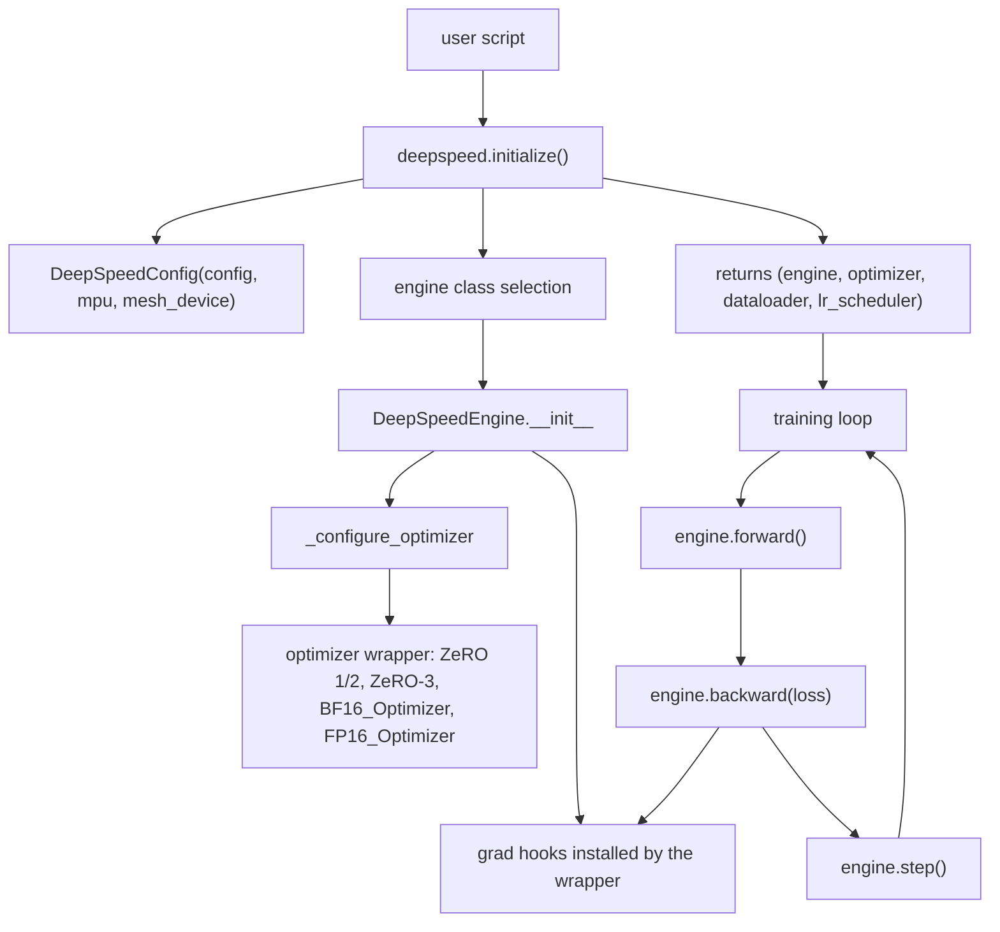
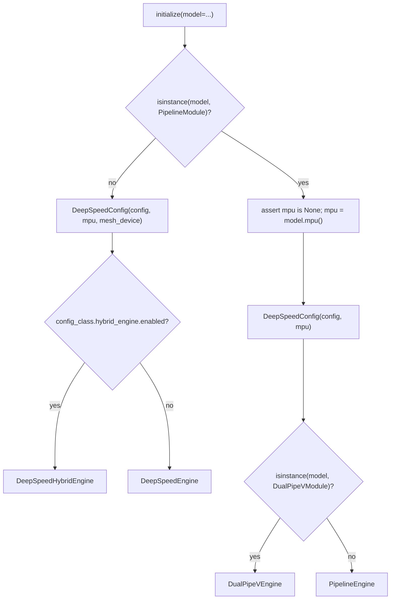
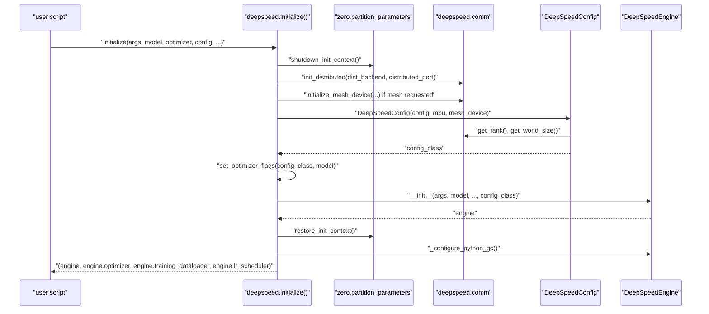
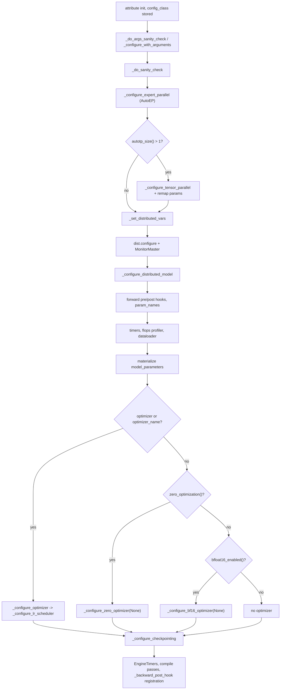
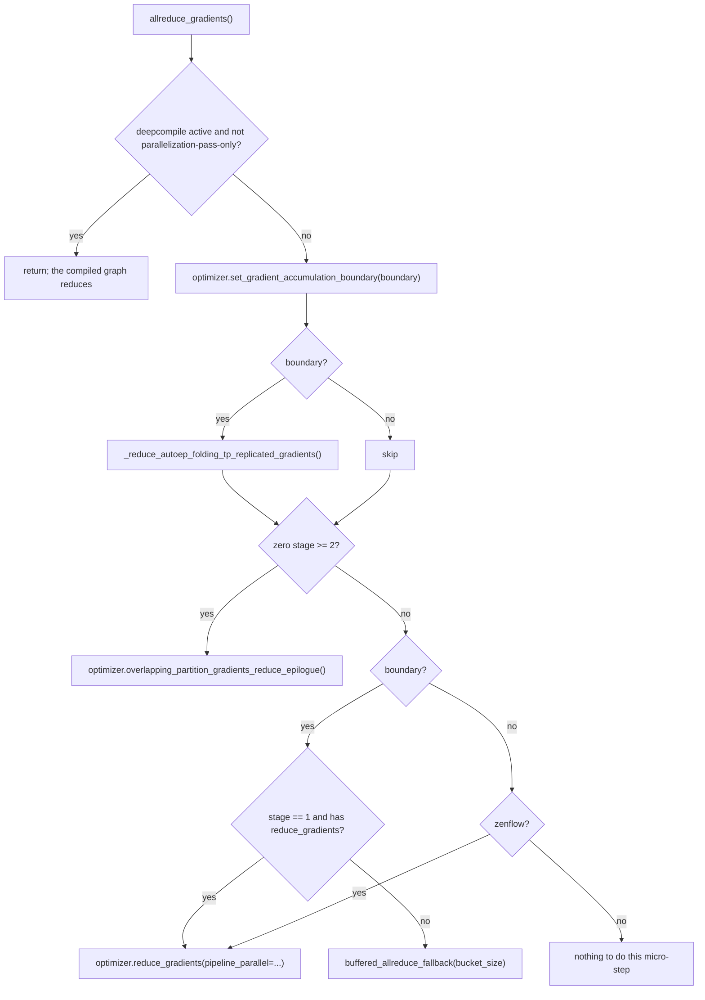
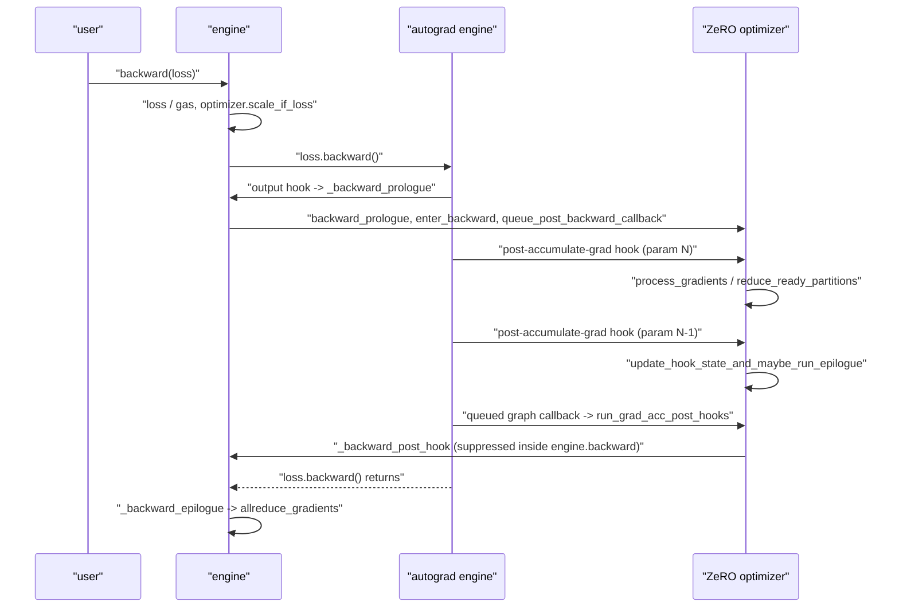
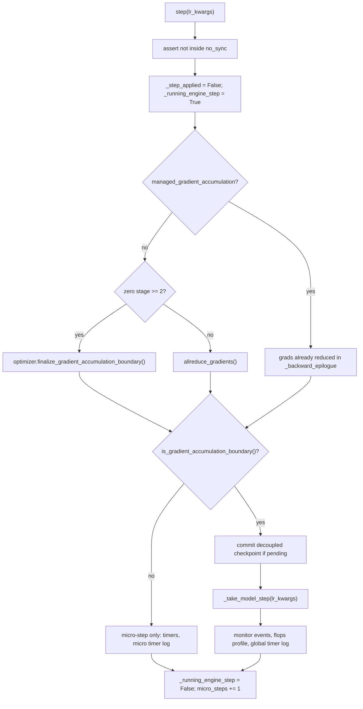

# Engine lifecycle: from `initialize()` to one global step

**What this covers.** The real control flow of a DeepSpeed training run: what
`deepspeed.initialize()` does with your arguments, the ordered phases of
`DeepSpeedEngine.__init__`, which optimizer wrapper class is picked for each ZeRO stage and
precision, and exactly what happens inside `forward()` / `backward()` / `step()` -- including
where gradient-reduction hooks are installed, when they fire, and what distinguishes a
micro-step from a global step.

**Source of truth.** Upstream commit `d70adc32`, DeepSpeed version `0.20.1`. Every line
citation below was read out of that tree. Line numbers move; the function and attribute names
are the stable handles.

**Read `01-architecture.md` first** if you do not already know what `DeepSpeedEngine`,
`deepspeed.comm` and the accelerator layer are.

---

## 0. The shape of the whole thing



Two counters drive everything in the loop:

| Counter | Where | Incremented | Meaning |
| --- | --- | --- | --- |
| `micro_steps` | `engine.py:544` | end of `step()`, `engine.py:3799` | number of `step()` calls, i.e. micro-batches seen |
| `global_steps` | `engine.py:542` | inside `_take_model_step`, `engine.py:3672` | number of applied optimizer updates |
| `global_samples` | `engine.py:543` | `engine.py:3672-3679` | samples consumed; `+= train_batch_size` per global step |
| `skipped_steps` | `engine.py:547` | `engine.py:3655` | boundary steps discarded because of overflow |

`step()` is called once per micro-batch, not once per optimizer update. The optimizer update
happens only on an *accumulation boundary*.

---

## 1. `deepspeed.initialize()`

Defined at `deepspeed/__init__.py:440-640`. It is a plain function, not a class; all it does is
normalise arguments, build a config object, choose an engine class, and hand back four things.

### 1.1 Ordered steps

| # | What | Lines |
| --- | --- | --- |
| 1 | Log version/git-hash banner | `deepspeed/__init__.py:505-507` |
| 2 | `zero.partition_parameters.shutdown_init_context()` -- suspend any active `zero.Init` so the engine sees ordinary parameters | `deepspeed/__init__.py:510` |
| 3 | `assert model is not None` | `deepspeed/__init__.py:512` |
| 4 | Bind the module-level `deepspeed.dist` to `deepspeed.comm`, then `dist.init_distributed(...)` with the backend the accelerator names | `deepspeed/__init__.py:514-519` |
| 5 | Config source resolution (see 1.2) | `deepspeed/__init__.py:523-542` |
| 6 | AutoSP validation: `compile.passes` containing `autosp` requires `compile.deepcompile` and ZeRO stage 0/1 | `deepspeed/__init__.py:544-556` |
| 7 | Device mesh construction from `mesh_param`, or from `data_parallel_size`/`sequence_parallel_size`, or implied by AutoSP | `deepspeed/__init__.py:558-576` |
| 8 | `merge_tp_model_init_into_config(config, mpu, mesh_param, dist)` -- folds any `tp_model_init()` record into the config | `deepspeed/__init__.py:578` |
| 9 | `set_autotp_mode(training=True)` when `tensor_parallel.autotp_size > 0` | `deepspeed/__init__.py:580-582` |
| 10 | Build `DeepSpeedConfig`, run `set_optimizer_flags(config_class, model)` (Muon per-parameter flags) | `deepspeed/__init__.py:584-585`, `614-615` |
| 11 | Instantiate the engine (see 1.3) | `deepspeed/__init__.py:586-627` |
| 12 | `zero.partition_parameters.restore_init_context()` | `deepspeed/__init__.py:630` |
| 13 | `engine._configure_python_gc()` | `deepspeed/__init__.py:632` |
| 14 | Return the 4-tuple | `deepspeed/__init__.py:634-640` |

Note the ordering constraint in step 4: `dist.init_distributed` runs *before* the config is
built, because `DeepSpeedConfig.__init__` calls `dist.get_rank()` / `dist.get_world_size()` to
derive the data-parallel world size (`deepspeed/runtime/config.py:459-473`).

### 1.2 Config source resolution

Only one config source may be supplied. The precedence and the errors:

| Input | Behaviour | Lines |
| --- | --- | --- |
| `config=None`, `config_params=<x>` | `config = config_params` (backwards compat) | `deepspeed/__init__.py:523-524` |
| `args.deepscale_config` set | deprecation warning, copied into `args.deepspeed_config` | `deepspeed/__init__.py:527-532` |
| `args.deepspeed_config` set **and** `config` set | assertion error | `deepspeed/__init__.py:536-537` |
| neither set | assertion error `"DeepSpeed requires --deepspeed_config"` | `deepspeed/__init__.py:539` |
| `config` is not a `dict` | `load_ds_config(config)` (path or base64) | `deepspeed/__init__.py:541-542` |

`DeepSpeedConfig` itself accepts a dict, a filesystem path parsed with `hjson`, or a
urlsafe-base64-encoded JSON blob (`deepspeed/runtime/config.py:443-454`). Duplicate keys in a
config file are a hard error (`dict_raise_error_on_duplicate_keys`,
`deepspeed/runtime/config.py:446`).

### 1.3 Engine selection



| Condition | Class | Lines |
| --- | --- | --- |
| default | `DeepSpeedEngine` | `deepspeed/__init__.py:599-610` |
| `hybrid_engine.enabled` in config | `DeepSpeedHybridEngine` (subclass of `DeepSpeedEngine`) | `deepspeed/__init__.py:586-597`, `deepspeed/runtime/hybrid_engine.py:27` |
| `model` is a `PipelineModule` | `PipelineEngine` | `deepspeed/__init__.py:616-627` |
| `model` is a `DualPipeVModule` | `DualPipeVEngine` | `deepspeed/__init__.py:616`, `deepspeed/runtime/pipe/dualpipev.py:94` |

With pipeline parallelism the caller must *not* pass `mpu`; the engine takes it from the module
(`assert mpu is None, "mpu must be None with pipeline parallelism"`,
`deepspeed/__init__.py:612-613`). Also note that `mesh_device` is only forwarded to
`DeepSpeedEngine`, not to `PipelineEngine` (`deepspeed/__init__.py:609` vs `617-627`).

### 1.4 What comes back

```python
engine, optimizer, training_dataloader, lr_scheduler = deepspeed.initialize(...)
```

These are literally `engine`, `engine.optimizer`, `engine.training_dataloader`,
`engine.lr_scheduler` (`deepspeed/__init__.py:634-640`). So:

- `optimizer` is the **wrapper**, not your optimizer. Your optimizer is `engine.basic_optimizer`
  (`engine.py:2450`).
- `training_dataloader` is `None` unless you passed `training_data`
  (`engine.py:657-660`).
- `lr_scheduler` is `None` if neither a client scheduler nor a `scheduler` config section was
  given (`engine.py:1979-1993`, `2019-2034`).

### 1.5 Sequence diagram



---

## 2. `DeepSpeedEngine.__init__`

`engine.py:519-788`. The order matters a great deal: each phase depends on state the previous
one wrote. The signature is `(args, model, optimizer, model_parameters, training_data,
lr_scheduler, mpu, dist_init_required, collate_fn, config, config_class, mesh_device,
dont_change_device)` (`engine.py:519-532`).

### 2.1 Phase table

| Phase | What happens | Lines |
| --- | --- | --- |
| A. Attribute init | counters, flags, `self._config = config_class`, `gradient_average` from `gradient_allreduce_op`, determinism hook | `engine.py:533-582` |
| B. Arg sanity | `_do_args_sanity_check(args)` requires `LOCAL_RANK` (or `OMPI_COMM_WORLD_LOCAL_RANK`) in the environment; `_configure_with_arguments(args, mpu)` sets `self.local_rank` | `engine.py:590-591`, `2049-2079` |
| C. Config sanity | `_do_sanity_check()` -- fp16/bf16 accelerator support, mixed-precision config, optimizer type checks | `engine.py:593`, `2098-2133` |
| D. AutoEP | `_configure_expert_parallel(model, ...)` detects MoE layers, creates EP groups, swaps in EP layers; client optimizer / `model_parameters` are remapped onto the replacement modules | `engine.py:596-604`, `826+` |
| E. AutoTP | if `autotp_size() > 1`: `_configure_tensor_parallel(model, tp_config)` builds the TP mesh and shards the model, then remaps the client optimizer and re-resolves Muon head counts against the shards | `engine.py:605-614`, `973-976` |
| F. Device vars | `_set_distributed_vars(args)` sets the accelerator device, `self.world_size`, `self.global_rank` | `engine.py:616`, `2036-2046` |
| G. Comm config | `dist.configure(self._config)` (comms logger) and `MonitorMaster(self._config.monitor_config)` | `engine.py:618-620` |
| H. Model wrapping | `_configure_distributed_model(model)` -- see 2.3 | `engine.py:631`, `2170-2292` |
| I. Forward hooks | `_create_module_forward_pre_hook()` / `_create_module_forward_post_hook()` on `self.module` | `engine.py:634-635`, `3017-3029` |
| J. Param name map | `self.param_names = {param: name ...}` (needed for `zero_to_fp32` reconstruction) | `engine.py:638` |
| K. Timers | `SynchronizedWallClockTimer`, `ThroughputTimer`, optional `FlopsProfiler` | `engine.py:645-655` |
| L. Dataloader | `deepspeed_io(training_data)` if `training_data` was passed | `engine.py:657-660` |
| M. Param list | default `model_parameters` to `self.module.parameters()`, materialised into a list *after* module replacement | `engine.py:667-674` |
| N. Autocast | `init_autocast_params(...)`; a `torch.amp.GradScaler` is created only for no-ZeRO + fp16 autocast | `engine.py:678-682` |
| O. ZenFlow | bind `_configure_zenflow` / `_is_zenflow_update_boundary` / `_zenflow_step` and run the configure | `engine.py:684-689` |
| P. Optimizer | `_configure_optimizer(optimizer, model_parameters)` then `_configure_lr_scheduler()`; or ZeRO-only / BF16-only fallbacks | `engine.py:691-699` |
| Q. Checkpointing | `_configure_checkpointing()` unless the "optimizer" is a bare `DeepSpeedZeRoOffload` | `engine.py:703-706`, `1995-2017` |
| R. random-LTD | `_configure_random_ltd_scheduler(...)` when enabled | `engine.py:708-712` |
| S. Engine timers | `EngineTimers(enable_micro_timers, enable_global_timers)` | `engine.py:716-720`, `190-225` |
| T. DeepCompile passes | register the built-in compile passes when `is_deepcompile_supported()` | `engine.py:734-756` |
| U. Backward style | decide `_support_torch_style_backward` and register `_backward_post_hook` on the ZeRO optimizer | `engine.py:758-782` |

### 2.2 Construction flowchart



The `elif` chain at `engine.py:691-699` is worth reading closely: with no optimizer at all but
ZeRO-3 enabled you still get an object in `self.optimizer` -- a `DeepSpeedZeRoOffload`
(`engine.py:2812-2835`), which is a parameter coordinator, not an optimizer. That is exactly why
`_configure_checkpointing` is skipped for it (`engine.py:705-706`).

### 2.3 `_configure_distributed_model`

`engine.py:2170-2292`. This is where the client model becomes the engine's model.

1. `_set_client_model(model)` registers the module in `self._modules['module']` and
   `self.__dict__['module']` so `nn.Module` machinery works without triggering the engine's
   `__getattr__` (`engine.py:2163-2168`).
2. `apply_zero_leaf_module_config(...)` applies `zero_optimization.leaf_module`
   (`engine.py:2172`).
3. `is_zero_init_model` is `True` when ZeRO-3 is on **and** any parameter already carries a
   `ds_id` -- i.e. the model was built under `deepspeed.zero.Init` (`engine.py:2173-2174`).
4. Precision cast. Under fp16/bf16 only *parameters* are cast; buffers keep their dtype unless
   `data_types.buffer_dtype` is set, and names matched by `keep_in_fp32_modules` stay fp32
   (`engine.py:2176-2185`). This replaced a blanket `module.half()`.
5. Device move: `self.module.to(self.device)` **unless** `dont_change_device` or the model came
   from `zero.Init`, which already placed parameters (`engine.py:2190-2191`).
6. MoE discovery: walk `named_modules()` for `MoE` / `AutoEPMoELayer` to set `has_moe_layers`
   and `num_experts`, then collect `TopKGate` and `MOELayer` instances
   (`engine.py:2194-2215`).
7. Parallelism handoff: `groups.mpu = self.mpu` if an mpu was given (`engine.py:2218-2219`),
   then `set_deepspeed_parallelism(...)` on every module that has it (`engine.py:2247-2252`).
8. Comm-group snapshot -- the engine caches every group it will need for the rest of its life:

| Attribute | Source | Line |
| --- | --- | --- |
| `local_all_to_all_group` | `groups._get_local_all_to_all_group()` (only if `zero_quantized_gradients`) | `engine.py:2255-2258` |
| `data_parallel_group` | `groups._get_data_parallel_group()` | `engine.py:2259` |
| `dp_world_size` | `groups._get_data_parallel_world_size()` | `engine.py:2260` |
| `seq_data_parallel_group` | `groups._get_sequence_data_parallel_group()` | `engine.py:2261` |
| `seq_dp_world_size` | `groups._get_sequence_data_parallel_world_size()` | `engine.py:2262` |
| `mp_world_size` | `groups._get_model_parallel_world_size()` | `engine.py:2263` |
| `expert_parallel_group` | `groups._get_expert_parallel_group_dict()` | `engine.py:2267` |
| `expert_data_parallel_group` | `groups._get_expert_data_parallel_group_dict()` | `engine.py:2268` |
| `sequence_parallel_size` | `groups._get_sequence_parallel_world_size()` | `engine.py:2269` |
| `seq_parallel_group` | `groups._get_sequence_parallel_group()` (only if `sequence_parallel_size > 1`) | `engine.py:2280` |

   Note the side effect at `engine.py:2279`: with Ulysses SP enabled, `communication_data_type`
   is overwritten with `seq_parallel_communication_data_type`.
9. `_broadcast_model()` unless the model came from `zero.Init`
   (`engine.py:2291-2292`). It broadcasts each parameter from the group's source rank, using
   the expert-DP group for MoE parameters and the sequence-data-parallel group otherwise
   (`engine.py:2146-2157`). Parameters that are ZeRO-3-partitioned or `OptimizedLinear` shards
   are skipped (`engine.py:2138-2144`).

### 2.4 Which `backward()` styles are allowed

`engine.py:758-782` decides whether direct `tensor.backward()` is legal. It requires both a
`ZeROOptimizer` instance *and* `check_internal_apis_for_count_used_parameters()`, which probes
for `torch.autograd.graph._get_grad_fn_or_grad_acc`, `torch._C._current_graph_task_id` and
`torch._C._will_engine_execute_node` (`deepspeed/runtime/utils.py:1506-1518`). When the probe
succeeds, `self.optimizer.register_grad_acc_post_hook(self._backward_post_hook)` wires the
engine epilogue into the optimizer's hook-counting machinery (`engine.py:782`). Otherwise
`_backward_prologue` raises on a direct `tensor.backward()` (`engine.py:3239-3243`).

---

## 3. Optimizer configuration

### 3.1 `_configure_optimizer`

`engine.py:2425-2466`.

1. No client optimizer: `_configure_basic_optimizer(model_parameters)` builds one from the
   `optimizer` config section; with MoE layers `configure_moe_param_groups` runs first
   (`engine.py:2426-2430`).
2. Client optimizer that is an `Optimizer` instance: used as-is. A callable is invoked with
   `model_parameters` (`engine.py:2431-2437`).
3. ZeRO-Offload guardrail: if the optimizer states live on CPU and the client optimizer is not
   `DeepSpeedCPUAdam` / `DeepSpeedCPULion`, `zero_force_ds_cpu_optimizer` (default on) raises
   `ZeRORuntimeException` (`engine.py:2439-2443`).
4. Empty param groups are dropped, duplicates are rejected (`engine.py:2445-2448`,
   `2378-2389`).
5. `self.basic_optimizer = basic_optimizer` (`engine.py:2450`).
6. `_do_optimizer_sanity_check(basic_optimizer)` returns a *wrapper tag*, and the tag selects
   the wrapper (`engine.py:2453-2463`).

### 3.2 Wrapper selection

`_do_optimizer_sanity_check` at `engine.py:2391-2422` returns one of the string constants from
`deepspeed/runtime/constants.py`: `ZERO_OPTIMIZATION`, `FP16`, `BFLOAT16`, `DDP_BFLOAT16`, or
`None`. `get_data_types()` supplies `(model_dtype, grad_accum_dtype)` (`engine.py:1857-1868`):
`model_dtype` comes from the fp16/bf16 flags, `grad_accum_dtype` from
`data_types.grad_accum_dtype` or defaults to `model_dtype`.

| Condition | Tag | Wrapper | Lines |
| --- | --- | --- | --- |
| `zero_optimization()` and bf16 params + fp32 grad accum + stage 1 + no CPU offload | `BFLOAT16` | `BF16_Optimizer` | `engine.py:2402-2407` |
| `zero_optimization()` otherwise | `ZERO_OPTIMIZATION` | see 3.3 | `engine.py:2408` |
| no ZeRO, `model_dtype == grad_accum_dtype == float32` | `None` | the basic optimizer, unwrapped | `engine.py:2410-2412` |
| no ZeRO, bf16 + pipeline parallelism | `BFLOAT16` | `BF16_Optimizer` (with a numerics warning) | `engine.py:2413-2417` |
| no ZeRO, fp16 | `FP16` | `FP16_Optimizer` or `FP16_UnfusedOptimizer` | `engine.py:2418` |
| no ZeRO, bf16 (non-pipeline) | `DDP_BFLOAT16` | `_configure_fp16_optimizer` with `low_precision_dtype=bfloat16` | `engine.py:2418`, `2457-2459` |
| mixed dtypes not covered above | -- | `NotImplementedError` | `engine.py:2419-2420` |

The `BFLOAT16` branch at `engine.py:2402-2407` additionally refuses
`zero_optimization.compute_grad_norm=false`.

### 3.3 `_configure_zero_optimizer`

`engine.py:2729-2898`. `zero_stage` is `self.zero_optimization_stage()`; the enum is
`ZeroStageEnum` (`deepspeed/runtime/zero/config.py`).

| Stage | Optimizer present? | Class | Lines |
| --- | --- | --- | --- |
| 0, 1, 2 (`<= ZeroStageEnum.gradients`) | required (asserts on `DummyOptim`) | `DeepSpeedZeroOptimizer`, or `ZenFlowZeroOptimizer.create(...)` when ZenFlow is on | `engine.py:2751-2804` |
| 3 (`ZeroStageEnum.weights`) | no (`DummyOptim`) | `DeepSpeedZeRoOffload` -- parameter coordination only, no updates | `engine.py:2812-2835` |
| 3 | yes | `DeepSpeedZeroOptimizer_Stage3`, or `SuperOffloadOptimizer_Stage3` when `super_offload()` | `engine.py:2836-2893` |
| other | -- | `NotImplementedError` | `engine.py:2895-2896` |
| legacy stage 1 (`zero_legacy_stage1`) | -- | hard `Exception` | `engine.py:2746-2749` |

Stages 1 and 2 share one class; they are distinguished by the `partition_grads` keyword,
`partition_grads=zero_stage == ZeroStageEnum.gradients` (`engine.py:2792`). This is the single
most important thing to know when fixing a stage-2 bug: the stage-1 path is the same file with
that flag `False`.

Other decisions made here:

- `check_grad_overflow` is `bfloat16_config.check_grad_overflow` under bf16, unconditionally
  `True` under fp16, and `False` for fp32 (`engine.py:2734-2739`).
- `overlap_comm` is force-disabled under pipeline parallelism (`engine.py:2759-2762`).
- ZeRO-3 with MoE or AutoTP goes through `_resolve_zero3_param_placement()` first, so AutoTP
  shards are partitioned over the data-parallel group only (`engine.py:2806-2811`).
- `zero_allgather_sequential` silently rewrites `prefetch_bucket_size` to 1
  (`engine.py:2839-2841`).
- The data-parallel group handed to both stage classes is `self.seq_data_parallel_group`, not
  `self.data_parallel_group` (`engine.py:2779`, `2865`).

### 3.4 fp16 and bf16 wrappers

`_configure_fp16_optimizer` (`engine.py:2651-2705`) branches on whether the basic optimizer is a
fused Adam (`apex.optimizers.FusedAdam` or DeepSpeed's `FusedAdam`):

| Basic optimizer | Wrapper | Loss-scale profile |
| --- | --- | --- |
| fused Adam | `FP16_Optimizer` (`engine.py:2678-2688`) | `LossScaleProfile.FUSED`, `initial_dynamic_scale` honoured |
| anything else | `FP16_UnfusedOptimizer` (`engine.py:2695-2703`) | `LossScaleProfile.UNFUSED`, `initial_dynamic_scale` forced to `None` |

The profile selects the dynamic-loss-scale defaults (`LossScaleProfileDefaults`,
`deepspeed/runtime/fp16/loss_scaler.py:48-72`). `FP16_UnfusedOptimizer` also receives
`fused_lamb_legacy=self.optimizer_name() == LAMB_OPTIMIZER` (`engine.py:2702`).

`_configure_bf16_optimizer` (`engine.py:2707-2727`) always builds `BF16_Optimizer`, substituting
a `DummyOptim` over `self.module.parameters()` when no optimizer was supplied
(`engine.py:2710-2711`). It gets `dp_process_group=self.seq_data_parallel_group` and
`grad_acc_dtype=self.get_data_types()[1]`.

### 3.5 LR scheduler

`_configure_lr_scheduler` (`engine.py:1979-1993`):

| Input | Result |
| --- | --- |
| `lr_scheduler` is callable | `self.client_lr_scheduler(self.basic_optimizer)` -- note: the *basic* optimizer |
| `lr_scheduler` is an object | used as-is |
| neither | `_scheduler_from_config(self.optimizer)` -- note: the *wrapper* |

`_scheduler_from_config` looks the name up in `deepspeed.runtime.lr_schedules` first, then in
`torch.optim.lr_scheduler`, and asserts if it is in neither
(`engine.py:2019-2032`). The asymmetry (client scheduler gets `basic_optimizer`,
config-built scheduler gets `self.optimizer`) is real and intentional: the wrapper exposes
`param_groups` as a property forwarding to the inner optimizer
(`deepspeed/runtime/zero/stage_1_and_2.py:3423-3429`).

---

## 4. One training iteration

The canonical loop:

```python
for micro_batch in data:
    loss = engine(micro_batch)     # forward
    engine.backward(loss)
    engine.step()
```

### 4.1 `forward()`

`engine.py:3084-3132`, wrapped in `@instrument_w_nvtx`.

1. `self.optimizer.clear_backward_seen_flag()` for ZeRO optimizers -- resets the
   multi-phase hook bookkeeping for the new iteration (`engine.py:3092-3093`, and
   `reset_for_new_step` at `deepspeed/runtime/base_optimizer.py:162-169`).
2. DeepCompile pass launch if active (`engine.py:3103-3105`).
3. `loss = self.module(*inputs, **kwargs)` inside
   `deepcompile_z3_forward_context(self)` and `autocast_if_enabled(self)`
   (`engine.py:3107-3108`).
4. `register_output_backward_hooks(loss, preprocess_once_fn=backward_prologue,
   preprocess_per_tensor_fn=self._backward_prologue_per_tensor)` (`engine.py:3120-3122`).
   This is the mechanism that makes `_backward_prologue` fire even when the user calls
   `loss.backward()` directly.

The real forward prologue/epilogue live in module hooks, not in `forward()` itself -- they were
registered in `__init__` (`engine.py:634-635`) so that they also run when the module is called
through a compiled graph:

- `_forward_prologue` (`engine.py:3031-3063`): starts flops profiling at
  `flops_profiler_profile_step`, advances the random-LTD schedule, starts the throughput timer
  when there is no DeepSpeed dataloader, starts the forward timers, sets
  `module._parameters._in_forward = True` on every submodule under ZeRO-3 (this is what enables
  automatic external-parameter discovery), and casts inputs to half when `fp16.auto_cast`.
- `_forward_epilogue` (`engine.py:3065-3081`): clears `_in_forward`, stops the forward timers,
  stops flops profiling.

### 4.2 `backward()`

`engine.py:3496-3554`.

| # | Action | Lines |
| --- | --- | --- |
| 1 | assert an optimizer exists and the loss is backward-able (`maybe_loss_for_backward`) | `engine.py:3509-3512` |
| 2 | take `_running_engine_backward_lock`, bump `_running_engine_backward_count`, set `_running_engine_backward = True` | `engine.py:3514-3516` |
| 3 | in unmanaged mode, `_unmanaged_backward_count += 1` | `engine.py:3521-3522` |
| 4 | `loss = loss / self.gradient_accumulation_steps()` when `scale_wrt_gas` (the default); the pre-loss-scale value is kept as the return value | `engine.py:3527-3528` |
| 5 | apply the loss scaler: `self.optimizer.scale_if_loss(loss)` for ZeRO, else the autocast `GradScaler` | `engine.py:3531-3534` |
| 6 | register a hook on the loss so `_ENGINE_BACKWARD_GRAPH_TRACKER` knows this graph was already gas-scaled | `engine.py:3536-3539` |
| 7 | `loss.backward(retain_graph=...)` inside `compiled_autograd(...)` | `engine.py:3541-3542` |
| 8 | `self._backward_epilogue()` -- called directly, because the post-hook path is suppressed while `_running_engine_backward` is set | `engine.py:3545` |
| 9 | `finally`: remove the tracker hook, unregister the graph state, decrement the backward counter | `engine.py:3548-3554` |

`backward()` returns the **gas-scaled but not loss-scaled** loss (`engine.py:3528`, `3547`), so
you can log it directly.

The manual alternative is `engine.scale(loss).backward()` (`engine.py:3452-3493`); `scale()`
sets `_manual_backward_expected = True` so that `_backward_post_hook` does not raise
(`engine.py:3491`, `3319-3325`).

### 4.3 The prologue / epilogue pair

`_backward_prologue` (`engine.py:3231-3265`) fires **once per backward**, from the output hook
registered in `forward()`:

- starts the backward timers (`engine.py:3234`)
- `_check_autotp_frozen_replicated_params()` -- refuses parameters unfrozen after
  `initialize()` under AutoTP (`engine.py:3235`, `3220-3229`)
- raises if this is a direct `tensor.backward()` and torch-style backward is unsupported
  (`engine.py:3239-3243`)
- sets `dw_staging.flush_on_stage` for AutoEP deferred expert-weight gradients, keyed on
  `is_gradient_accumulation_boundary()` (`engine.py:3247-3249`)
- calls `optimizer.backward_prologue()`, `optimizer.enter_backward()` and
  `optimizer.queue_post_backward_callback()` on ZeRO optimizers (`engine.py:3254-3257`)
- propagates the accumulation-boundary flag to the optimizer (`engine.py:3262-3263`)
- starts the "backward inner" timers (`engine.py:3265`)

`_backward_epilogue` (`engine.py:3267-3291`):

1. stops backward-inner timers, starts backward-reduce timers
2. `BF16_Optimizer.backward_epilogue()` runs **first**, before the all-reduce, because without
   `immediate_grad_update` it is the call that accumulates low-precision grads into the fp32
   buffer (`engine.py:3270-3275`, `deepspeed/runtime/bf16_optimizer.py:508-510`,
   `536-543`)
3. `self.allreduce_gradients()` when `enable_backward_allreduce` and not inside `no_sync()`
   (`engine.py:3277-3279`)
4. for ZeRO optimizers, `backward_epilogue()` (if not bf16) and `exit_backward()`
   (`engine.py:3281-3284`)

`_backward_prologue_per_tensor` (`engine.py:3293-3301`) divides each incoming output gradient by
`gradient_accumulation_steps()`, but only if the graph tracker says the loss was not already
scaled -- this is what makes `out.backward(out_grad)` behave like `engine.backward(loss)`.

### 4.4 `allreduce_gradients`

`engine.py:3171-3195`. This is the dispatcher for data-parallel gradient reduction.



Key asymmetry: **ZeRO stage 2 and 3 communicate on every micro-step**, because their reduce
hooks also partition gradients; stage 0/1 and plain DDP-style bf16 communicate only on the
accumulation boundary (`engine.py:3182-3193`).

`buffered_allreduce_fallback` (`engine.py:4040-4054`) collects gradients -- from
`optimizer.get_grads_for_reduction()` for the BF16 optimizer, otherwise
`_get_gradients_for_reduction()` (`engine.py:3960-3994`) which also materialises zero gradients
for parameters that produced none, so every rank reduces the same byte count. Non-expert grads
go to the sequence-data-parallel group with `dp_world_size` divided by
`sequence_parallel_size` (`engine.py:3996-4015`); expert grads go to each
`groups._get_expert_data_parallel_group(ep_name)` but are averaged with the *dense* DP world
size so the result is independent of `ep_size` (`engine.py:4017-4038`).

### 4.5 Gradient reduction hooks: where they are installed and when they fire

Nothing in `engine.py` installs per-parameter gradient hooks. The optimizer wrapper does, in its
own constructor, which runs inside `_configure_optimizer` (phase P above).

| Wrapper | Install site | Condition | Hook body |
| --- | --- | --- | --- |
| ZeRO 1/2 (`DeepSpeedZeroOptimizer`) | `deepspeed/runtime/zero/stage_1_and_2.py:722-724` -> `create_gradient_handling_hooks()` at `:1469-1498` | `partition_grads or overlap_comm or use_grad_accum_attribute or contiguous_gradients` | `grad_handling_hook` -> `process_gradients(param, i)` (`:2373`) |
| ZeRO 3 (`DeepSpeedZeroOptimizer_Stage3`) | `deepspeed/runtime/zero/stage3.py:540` -> `create_reduce_and_remove_grad_hooks()` at `:1645-1721` | always | `reduce_partition_and_remove_grads` -> `reduce_ready_partitions_and_remove_grads(param)` |
| ZeRO 3 leaf modules | `deepspeed/runtime/zero/stage3.py:1717` | `z3_leaf_module(module)` | `register_full_backward_hook` -> reduce every parameter of the leaf at once |
| `BF16_Optimizer` | `deepspeed/runtime/bf16_optimizer.py:233-235` -> `create_grad_acc_hooks()` at `:715-734` | only when `bfloat16.immediate_grad_update` | `accumulate_hp_grads_and_remove_lp` |
| fp16 fused/unfused | none | -- | reduction happens in `_backward_epilogue` -> `allreduce_gradients` |

All per-parameter hooks go through one helper, `register_grad_hook`
(`deepspeed/utils/torch.py:41-47`): on torch >= 2.1 it is
`param.register_post_accumulate_grad_hook(hook)`; below that it falls back to the classic
`param.expand_as(param).grad_fn.next_functions[0][0].register_hook(hook)` trick on the
`AccumulateGrad` node. Both fire *after* the gradient has been accumulated into `param.grad`.

ZeRO-3 additionally installs **module** hooks for parameter gathering and release, from
`DeepSpeedZeRoOffload.setup_zero_stage3_hooks()`
(`deepspeed/runtime/zero/parameter_offload.py:309-326`): a root `forward_pre_hook` that resets
the parameter coordinator's step (`:314-318`), then per-submodule forward pre/post hooks
(`:450`, `:453`) and backward hooks (`:490`, `:525`). These are what all-gather parameters
before a submodule's forward and partition them again afterwards.

The ordering that matters:



Two exit paths from a backward, and exactly one of them runs the epilogue:

- `engine.backward(loss)`: `_running_engine_backward` is `True`, so `_backward_post_hook`
  returns immediately (`engine.py:3306`), and `backward()` calls `_backward_epilogue()` itself
  at `engine.py:3545`.
- direct `tensor.backward()` / `engine.scale(loss).backward()`: `_running_engine_backward` is
  `False`, so `_backward_post_hook` validates loss scaling and then runs the epilogue
  (`engine.py:3303-3330`).

`_backward_post_hook` also bails out when `optimizer._backward_active_depth > 1`
(`engine.py:3309-3310`), which protects against an interrupted `engine.backward()` leaving
partial reduction state behind.

The hook-counting machinery that decides when "all gradients are in" lives in
`BackwardHookStateManager` (`deepspeed/runtime/base_optimizer.py:50-261`). The design point:
`register_full_backward_hook` is not usable for this, because it fires when the module's
*output* grads are ready, not when every parameter grad is ready (`engine.py:774-781`). Instead
each per-parameter hook calls `update_hook_state_and_maybe_run_epilogue(current_expected)`
(`deepspeed/runtime/base_optimizer.py:232-261`), where `current_expected` comes from
`count_used_parameters_in_backward(...)` (`deepspeed/runtime/utils.py:1521`). The maximum count
seen is tracked, not the first, because reentrant activation checkpointing adds parameters to
the graph as checkpointed regions are recomputed
(`deepspeed/runtime/base_optimizer.py:236-239`). Where the autograd engine supports it,
`queue_post_backward_callback` (`:207-230`) defers the epilogue to a graph-completion callback
instead of guessing from counts.

### 4.6 Accumulation boundaries

`is_gradient_accumulation_boundary()` (`engine.py:3556-3579`) has four behaviours:

| Situation | Result | Lines |
| --- | --- | --- |
| `set_gradient_accumulation_boundary(x)` was called | that explicit `x` | `engine.py:3570`, `3578-3579` |
| `managed_gradient_accumulation=false` | `self._running_engine_step` -- i.e. `True` only while `step()` is executing | `engine.py:3571-3573` |
| ZenFlow enabled | `_is_zenflow_update_boundary()` | `engine.py:3574-3575` |
| default | `(self.micro_steps + 1) % self.gradient_accumulation_steps() == 0` | `engine.py:3576-3577` |

`micro_steps` is incremented at the *end* of `step()` (`engine.py:3799`), hence the `+ 1`:
during the N-th micro-batch, `micro_steps` is still `N-1`.

The config key is `managed_gradient_accumulation`, default `True`
(`deepspeed/runtime/constants.py:78-79`). With it `False`, the caller owns the boundary: every
`step()` is a boundary, and `set_gradient_accumulation_boundary()` asserts rather than working
(`engine.py:3602-3604`). In that mode `step()` performs the reduction itself before the update
(`engine.py:3713-3717`), and `global_samples` advances by the number of `backward()` calls
actually made rather than by `train_batch_size` (`engine.py:3673-3679`).

`no_sync()` (`engine.py:3332-3350`) suppresses `allreduce_gradients` for the duration of the
block by setting `inside_no_sync_ctxt`. It asserts against ZeRO stage 2/3 -- those stages need
the reduction to partition -- and it is illegal to call `step()` inside it (`engine.py:3690-3691`).
`coalesce_grad_reduction()` (`engine.py:3352+`) is the ZeRO-compatible alternative: one
with-block equals one optimizer step, and the flush on exit issues a single reduction pass.

### 4.7 `step()`

`engine.py:3681-3800`.



Everything gated on the boundary: the decoupled-checkpoint commit
(`engine.py:3726-3727`), the AutoEP staged-gradient assertion (`engine.py:3729-3732`),
`_take_model_step` (`engine.py:3734`), the LR/loss-scale monitor events
(`engine.py:3746-3759`), and the global timer log (`engine.py:3786-3796`). Everything else --
throughput timer stop, micro timer log -- happens on every micro-step.

### 4.8 `_take_model_step`

`engine.py:3619-3679`. This is the only place an optimizer update happens.

1. Gradient clipping. For the plain-fp32 no-ZeRO path only, `clip_fp32_gradients()` runs here
   (`engine.py:3620-3625`). Under fp16/bf16/ZeRO the clipping is the wrapper's job -- it was
   passed `clip_grad=self.gradient_clipping()` at construction
   (`engine.py:2684`, `2720`, `2774`, `2857`). The autocast `GradScaler` is unscaled first if
   present (`engine.py:3621-3623`).
2. The update: `torch_autocast_z0_gradscaler.step(self.optimizer)` +
   `.update()`, else `self.optimizer.step()` (`engine.py:3626-3630`).
3. `self._global_grad_norm = self.optimizer._global_grad_norm` when the wrapper exposes it
   (`engine.py:3632-3633`). This is what `get_global_grad_norm()` returns
   (`engine.py:1413`).
4. Zero the gradients, by three different routes depending on precision
   (`engine.py:3637-3646`).
5. Overflow handling: `overflow = self.optimizer.overflow` if the wrapper has the attribute;
   `self._step_applied = not overflow` (`engine.py:3649-3652`). `was_step_applied()`
   (`engine.py:2911`) is the public read of this.
6. **The LR scheduler steps only when the step was applied** (`engine.py:3654-3664`). On
   overflow, `skipped_steps += 1` and the scheduler does not advance. The `TypeError` fallback
   at `engine.py:3660-3664` re-calls `lr_scheduler.step(self.train_batch_size())` for
   Megatron-style schedulers.
7. Progress report if `(global_steps + 1) % steps_per_print == 0` (`engine.py:3666-3669`).
8. `global_steps += 1` and `global_samples` advance (`engine.py:3672-3679`).

Note the asymmetry in step 6: `global_steps` increments even on an overflow step
(`engine.py:3672` is outside the `if overflow` branch), but the LR scheduler does not. If you
need "number of real updates", use `global_steps - skipped_steps`.

### 4.9 Overflow and loss scaling

| Precision / stage | Who detects overflow | Who owns the scale |
| --- | --- | --- |
| fp16 fused | `FP16_Optimizer.overflow_checker` (`deepspeed/runtime/fp16/fused_optimizer.py:122`), set in `step_fused_adam` / `step` (`:178`, `:270`) | `CreateLossScaler` -> `DynamicLossScaler.update_scale` (`deepspeed/runtime/fp16/loss_scaler.py:260`) |
| fp16 unfused | `FP16_UnfusedOptimizer` (`deepspeed/runtime/fp16/unfused_optimizer.py:106`, `160`, `205`) | same |
| ZeRO 1/2 | `check_overflow` / `_check_overflow` (`deepspeed/runtime/zero/stage_1_and_2.py:3408-3412`) | the optimizer's own `loss_scaler` (`:731-740`) |
| ZeRO 3 | `_has_inf_or_nan` and the stage-3 overflow path (`deepspeed/runtime/zero/stage3.py:3381-3383`) | `:543-547` |
| bf16 | `bfloat16.check_grad_overflow` decides whether to check at all (`engine.py:2734-2735`) | no dynamic scaling; `loss_scaler.cur_scale == 1.0` is asserted for non-fp16 dtypes (`deepspeed/runtime/zero/stage_1_and_2.py:737-740`) |
| no ZeRO + fp16 autocast | `torch.amp.GradScaler` created at `engine.py:678-682` | the `GradScaler` |

The engine never applies the loss scale itself; it asks the optimizer via
`scale_if_loss(loss)` (`engine.py:3532`, `deepspeed/runtime/base_optimizer.py:444`). The
mirror of that is `needs_scaler()` (`:430`), which `_backward_post_hook` uses to refuse a
direct `loss.backward()` that skipped scaling (`engine.py:3312-3325`).

---

## 5. Gotchas worth internalising

1. **`step()` per micro-batch.** Calling it only on boundaries breaks `micro_steps` and
   therefore the boundary predicate itself. If you want one `step()` per global batch, use
   `set_gradient_accumulation_boundary()` (`engine.py:3581-3607`) or
   `managed_gradient_accumulation=false`.
2. **The returned `optimizer` is the wrapper.** Changing `optimizer.param_groups[0]['lr']`
   works only because the wrappers forward `param_groups` to the inner optimizer
   (`deepspeed/runtime/zero/stage_1_and_2.py:3423-3429`).
3. **ZeRO 2/3 reduce on every micro-step.** Any change that assumes "communication only on the
   boundary" is wrong for them (`engine.py:3182-3195`).
4. **Stage 1 and stage 2 are one class.** Fix a bug in `DeepSpeedZeroOptimizer` and you have
   changed both; check both values of `partition_grads` (`engine.py:2792`).
5. **ZeRO-3 without an optimizer gives you `DeepSpeedZeRoOffload`.** It has no `step()`;
   checkpointing is deliberately not configured for it (`engine.py:705-706`,
   `2812-2835`).
6. **`backward()`'s return value is gas-scaled only.** It is not the loss-scaled tensor that
   autograd actually saw (`engine.py:3527-3528`, `3547`).
7. **Overflow skips the LR scheduler but not `global_steps`** (`engine.py:3654-3672`).
8. **AutoTP freezes matter at `initialize()` time.** Setting `requires_grad=False` before
   `initialize()` and `True` afterwards is caught and raised
   (`engine.py:3220-3229`, called from `_backward_prologue`).
9. **Comm groups are snapshotted into engine attributes** during
   `_configure_distributed_model` (`engine.py:2254-2280`). Re-initialising groups afterwards
   does not update the engine.
10. **Direct `tensor.backward()` is conditional.** It needs private torch APIs; on older torch
    the engine raises and tells you to use `engine.backward(loss)`
    (`engine.py:3239-3243`, `deepspeed/runtime/utils.py:1506-1518`).

---

## 6. Where to go next

| Question | Document |
| --- | --- |
| How does ZeRO actually partition and reduce? | `03-zero.md` |
| Where do offload and NVMe plug into `step()`? | `04-offload-and-memory.md` |
| What does `PipelineEngine.train_batch()` do instead of this loop? | `05-parallelism.md` |
| Which config keys feed the decisions above? | `09-configuration.md` |
| How does `engine.compile()` change the picture? | `11-deepcompile.md` |
