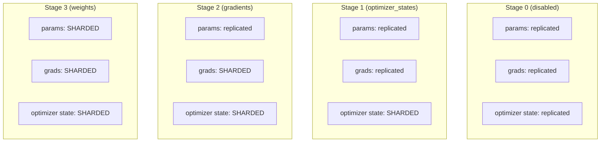
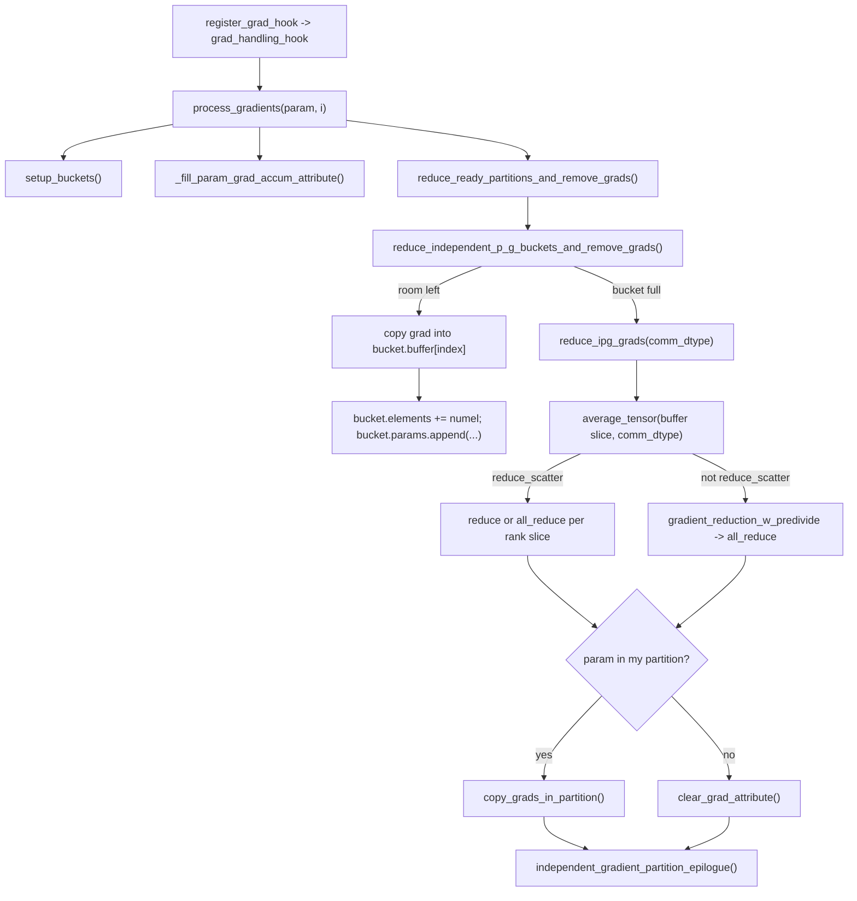
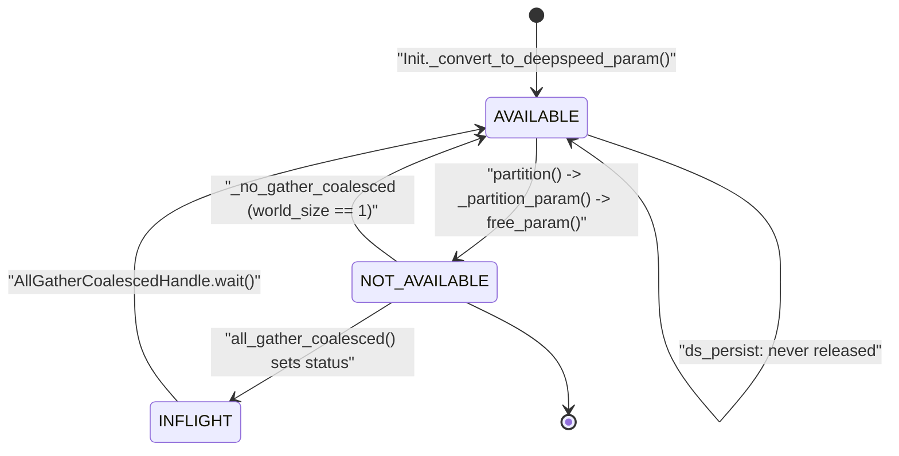
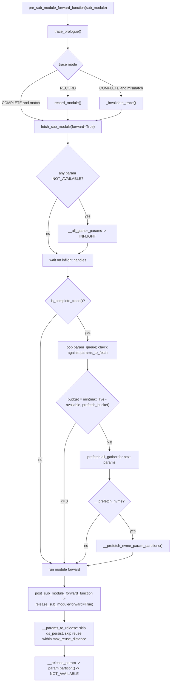
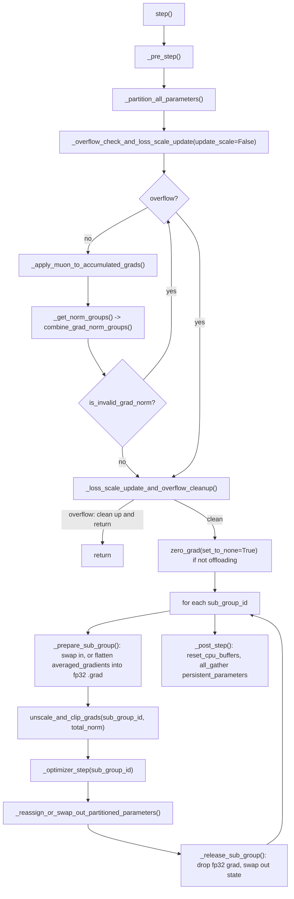

# ZeRO internals

**What this covers.** The ZeRO sharded-training implementations in this tree: the
per-rank memory model behind stages 1/2/3, the stage-1/2 optimizer
(`DeepSpeedZeroOptimizer`), the stage-3 optimizer and its parameter-coordination
machinery (`DeepSpeedZeroOptimizer_Stage3`, `Init`,
`PartitionedParameterCoordinator`, `DeepSpeedZeRoOffload`), the ZeRO config
surface, and the duplicated code paths a contributor must check when fixing a
bug. Offload, NVMe, activation checkpointing and the newer memory subsystems are
covered in `project-docs/04-offload-and-memory.md`.

**Source of truth: upstream commit d70adc32** (DeepSpeed 0.20.1), as checked out
on this fork's `intro` branch. Every claim below is cited to a file and line in
that tree. Line numbers drift; names are the durable part of a citation.

---

## 1. What each stage shards

ZeRO removes the data-parallel replication of three things: optimizer state,
gradients, and parameters. The stage number says how many of the three are
sharded.



The stage enum is `ZeroStageEnum` with members `disabled=0`,
`optimizer_states=1`, `gradients=2`, `weights=3`
(`deepspeed/runtime/zero/config.py:81`). Stages 1 and 2 share one
implementation; the only structural difference is the `partition_grads`
constructor flag, which the engine sets from
`zero_stage == ZeroStageEnum.gradients`
(`deepspeed/runtime/engine.py:2792`) and which the optimizer stores as
`self.partition_gradients` along with a human-readable
`self.zero_stage_string` of `"ZeRO-2"` or `"ZeRO-1"`
(`deepspeed/runtime/zero/stage_1_and_2.py:269`).

### 1.1 The per-rank memory model

The tree ships its own estimators, and they are the most direct statement of the
memory model. For stages 1/2 without offload
(`deepspeed/runtime/zero/stage_1_and_2.py:4176`):

```
gpu_mem = 2 * P + 18 * P / N
```

with `P` = parameter count and `N` = total ranks. The comment at
`deepspeed/runtime/zero/stage_1_and_2.py:4174` breaks the 18 down as
`2 (grads bf16/fp16) + 4 (grads fp32) + 4 (params fp32) + 8 (Adam momentum +
variance, fp32)` bytes per element. The unsharded `2 * P` is the 16-bit model
weights, which stages 1 and 2 keep replicated.

With CPU optimizer offload the GPU term collapses to just the 16-bit weights,
and the 16 sharded bytes move to host memory
(`deepspeed/runtime/zero/stage_1_and_2.py:4171`):

```
gpu_mem = 2 * P
cpu_mem = P * max(4 * N, 16) * additional_buffer_factor
```

For stage 3 (`deepspeed/runtime/zero/stage3.py:4428`), the 16-bit weights are
sharded too, so the only unsharded GPU residency is the transient all-gathered
working set, approximated by the largest layer:

```
largest_layer_memory = 4 * largest_layer_params
gpu_mem = largest_layer_memory + 18 * P / N
```

and with both optimizer and parameter offload the per-rank GPU term is just
`largest_layer_memory` (`deepspeed/runtime/zero/stage3.py:4413`).

| | params on GPU | grads on GPU | optim state on GPU | transient |
|---|---|---|---|---|
| Stage 1 | `2P` | `2P` (then `4P/N` fp32 partition) | `12P/N` | reduce bucket |
| Stage 2 | `2P` | `~2P/N` after reduce-scatter | `12P/N` | reduce bucket |
| Stage 3 | `2P/N` | `2P/N` or `4P/N` | `12P/N` | all-gather working set |

The "transient" column is what the knobs in section 5 control, and it is what
usually decides whether a configuration OOMs. In stage 1/2 it is
`reduce_bucket_size` elements (doubled when `overlap_comm` is on, see
section 2.4); in stage 3 it is bounded by `stage3_max_live_parameters` and
`stage3_prefetch_bucket_size`.

Note that the estimators are estimates and are deliberately pessimistic by
`additional_buffer_factor=1.5` on the CPU side. The authoritative statement of
what is allocated is the constructor of each optimizer.

---

## 2. Stage 1 and 2: `DeepSpeedZeroOptimizer`

File: `deepspeed/runtime/zero/stage_1_and_2.py`. Class at line 158. This is a
~4200-line class; the sections below follow the lifecycle.

### 2.1 Parameter flattening into groups

The constructor loops over `self.optimizer.param_groups`
(`deepspeed/runtime/zero/stage_1_and_2.py:425`) and, for each group `i`, builds
these parallel lists:

| list | line | contents |
|---|---|---|
| `bit16_groups[i]` | 436 | the group's trainable parameters, filtered by `is_optimized_parameter` (line 432). Each gets `param.grad_accum = None` and a `param.param_idx_in_group` (lines 433-434); the index matters because IPG bookkeeping stores `(group_idx, param_idx_in_group, param_id)` tuples, not parameter references |
| `round_robin_bit16_groups[i]` | 478 | the same parameters, possibly reordered (section 2.2) |
| `bit16_groups_flat[i]` | 511 | one flat tensor holding the whole group, from `flatten_dense_tensors_aligned` (line 1505), padded by `align_dense_tensors` to a multiple of `alignment = nccl_start_alignment_factor * world_size` (line 443) |
| `parallel_partitioned_bit16_groups[i]` | 541 | `world_size` views into the flat buffer, from `get_data_parallel_partitions` (line 2648) |
| `single_partition_of_fp32_groups[i]` | 579 | a *clone* of this rank's partition, cast to `master_weights_and_grads_dtype` and moved to `self.device` (line 562) -- the master weight |

`nccl_start_alignment_factor` is hardcoded to 2, i.e. 4 bytes at fp16
(line 389), and the code asserts afterwards that every partition's `data_ptr()`
is 4-byte aligned (line 557). The group's `param_group['params']` is replaced by
the single fp32 partition (line 586), so the wrapped optimizer only ever sees
one parameter per group. `_update_model_bit16_weights(i)` (line 911) repoints
each `param.data` at its slice of the flat buffer, so the model's parameters and
the flat buffer are the same storage.

Two details worth knowing before you touch this loop:

- **Flattening location.** The code measures `accelerator.available_memory()`
  against the flat buffer size and, if it does not fit, moves every parameter to
  CPU (`param.cpu_data`), flattens on the host, and copies the flat buffer back
  (lines 451-530). This is why `flatten_dense_tensors_aligned` has a
  `use_cpu_data` argument.
- **Per-parameter alignment.** With `parameter_alignment=True` the flat buffer
  additionally pads *between* parameters so each starts 16-byte aligned:
  `param_alignment = 16 // gcd(16, element_size)` (line 446), with the padding
  list stored in `self.round_robin_bit16_padding[i]` (line 502) and interleaved
  into the tensor list inside `flatten_dense_tensors_aligned` (line 1507). Every
  function that walks the flat buffer -- `get_partition_info`,
  `initialize_gradient_partition`, `get_grad_position` -- has to add this padding
  to its running offset, and they do (lines 2697, 1257, 1855).

### 2.2 The partitioning scheme

Partitioning is purely by flat-buffer offset. For group `i` and rank
`partition_id`, the owned range is
`[partition_size * partition_id, partition_size * (partition_id + 1))` where
`partition_size = len(bit16_groups_flat[i]) // world_size`
(`deepspeed/runtime/zero/stage_1_and_2.py:588`). Note that
`get_data_parallel_partitions` distributes a remainder by giving the first
`total_numel % dp` partitions one extra element
(`deepspeed/runtime/zero/stage_1_and_2.py:2660`), while `partition_size` above
is a floor division -- the flat buffer is pre-padded to a multiple of
`alignment`, which is itself a multiple of `world_size`, so they agree.

A parameter can straddle a partition boundary. `get_partition_info`
(`deepspeed/runtime/zero/stage_1_and_2.py:2667`) returns
`(params_in_partition, params_not_in_partition, first_offset)` where
`first_offset` is the element offset *into the first parameter* at which this
rank's partition begins. The assertion at line 2690 encodes the invariant that
at most one parameter per partition can be split at its head.

`initialize_gradient_partition`
(`deepspeed/runtime/zero/stage_1_and_2.py:1208`) builds the per-rank maps that
the reduction path consumes:

| map | meaning |
|---|---|
| `param_to_partition_ids[i][param_id]` | list of ranks that own some of this parameter's gradient |
| `grad_partition_insertion_offset[i][pid][param_id]` | offset within rank `pid`'s partition where this parameter's slice starts |
| `grad_start_offset[i][pid][param_id]` | offset within the parameter at which rank `pid`'s slice starts |
| `total_grads_in_partition[i][pid]` | number of parameters contributing to rank `pid` |

`round_robin_gradients` changes only the *order* of parameters inside the flat
buffer. `_round_robin_reorder`
(`deepspeed/runtime/zero/stage_1_and_2.py:923`) interleaves parameters so that
consecutive gradients produced during backward tend to belong to different
ranks; the comment at line 467 explains the intent (parallelising the
gradient-to-CPU copy under offload). `round_robin_bit16_indices` keeps the
mapping back to the original order.

### 2.3 The IPG bucket

"IPG" is "independent parallel gradient": the mechanism that batches gradients
produced during backward into a contiguous buffer and reduces them as soon as
the buffer is full, rather than waiting for the whole backward.

State lives in the `IPGBucket` dataclass
(`deepspeed/runtime/zero/stage_1_and_2.py:117`):

| field | purpose |
|---|---|
| `buffer` | list of 1 or 2 flat scratch tensors of `reduce_bucket_size` elements |
| `index` | which element of `buffer` is currently being filled |
| `params` | `(group_idx, param_idx_in_group, param_id)` for each parameter in the bucket |
| `grads` | the gradient tensors (used only on the non-contiguous path) |
| `elements` | how many elements of `buffer[index]` are used |
| `has_moe_params` | whether to route the reduction through an expert group |
| `ready_events` / `reuse_events` | accelerator events guarding buffer reuse under offload |
| `copy_streams` | every stream that wrote into `buffer[index]`, see below |

There is one bucket *per communication dtype*:
`self.ipg_buckets: Dict[torch.dtype, IPGBucket]`
(`deepspeed/runtime/zero/stage_1_and_2.py:618`). Normally that dict has a single
key (`self.communication_data_type`), but under `torch.amp.autocast` the dtype
set comes from `get_all_comm_dtypes` over all parameters (line 612).

Buffers are allocated lazily by `setup_buckets`
(`deepspeed/runtime/zero/stage_1_and_2.py:3377`), called from the first
gradient hook of each micro-step via `process_gradients`
(line 2376). The buffer dtype is `_gradient_reduction_buffer_dtype()`
(line 1301): the gradient-accumulation dtype when `use_grad_accum_attribute`
is set, otherwise the parameter dtype. `overlap_comm` adds a second buffer so
the host can fill one while the reduction stream reads the other
(line 3394).



**Hook installation.** `create_gradient_handling_hooks`
(`deepspeed/runtime/zero/stage_1_and_2.py:1469`) registers one
`grad_handling_hook` per trainable parameter through `register_grad_hook`
(line 1494). The hook decides whether the expected-hook count must be refreshed,
calls `process_gradients`, then calls
`update_hook_state_and_maybe_run_epilogue` (lines 1485-1492). That last call
lives in the shared `BackwardHookStateManager`
(`deepspeed/runtime/base_optimizer.py:232`) and is what fires
`independent_gradient_partition_epilogue()` once every expected hook has run --
including the reentrant-checkpointing case, where the expected count *grows*
during a single backward and the manager tracks the maximum
(`base_optimizer.py:245`).

Hooks are only installed when at least one of `partition_gradients`,
`overlap_comm`, `use_grad_accum_attribute` or `contiguous_gradients` is set
(`stage_1_and_2.py:722`). Pure ZeRO-1 with all of those off reduces from
`reduce_gradients()` (line 980) instead.

**Adding a gradient.** `reduce_independent_p_g_buckets_and_remove_grads`
(`deepspeed/runtime/zero/stage_1_and_2.py:1529`):

1. Returns early for empty parameters and for a `None` gradient -- the latter
   happens legitimately when AutoEP stages an expert gradient for a later
   backward (line 1535).
2. If `bucket.elements + param.numel() > reduce_bucket_size`, flushes with
   `reduce_ipg_grads(comm_dtype)` and, under
   `contiguous_gradients and overlap_comm`, flips `bucket.index` between 0 and 1
   (line 1546).
3. Honours `param.ds_grad_is_ready`: a parameter whose gradient is transient
   (tiled computation that calls the same submodule in a loop) is skipped
   (line 1550). Then asserts
   `params_already_reduced[param_id] == False` -- reducing a parameter twice in
   one backward is not supported (line 1555).
4. On the contiguous path, copies the gradient into
   `bucket.buffer[bucket.index].narrow(0, bucket.elements, param.numel())` and
   *repoints* `grad_reduc.data` at that slice (lines 1574-1580). After this the
   parameter's `.grad` is a view into the bucket. Under `overlap_comm` the
   producing stream is recorded into `bucket.copy_streams` (line 1583).

**Oversized gradients.** A parameter larger than `reduce_bucket_size` cannot fit
the bucket; it is stashed in `self.extra_large_param_to_reduce[comm_dtype]`
(line 1568) and reduced alone on the next `reduce_ipg_grads` call
(line 2302), with an assertion that it is the only parameter in the bucket.
Under offload the gradient is `clone()`d first because `contiguous()` may be a
no-op that leaves the storage shared (line 1565).

### 2.4 `average_tensor`: reduce-scatter vs all-reduce

`average_tensor(tensor, communication_data_type)`
(`deepspeed/runtime/zero/stage_1_and_2.py:1709`) is the reduction core. It
first picks a stream:

- offload protections on: the reduction stream (or current stream), after
  waiting on every event in `bucket.ready_events` (lines 1712-1718).
- `overlap_comm` only: `self.reduction_stream`, which waits on every stream in
  `bucket.copy_streams` before reading the bucket, then the current stream waits
  on it (lines 1719-1731). The comment there documents issue #8061: under
  `torch.compile` the gradient hooks run on several autograd streams, so waiting
  only on the current stream is a correctness bug.
- otherwise: the current stream.

`self.reduction_stream` is a dedicated stream, or `None` on synchronized devices
(`deepspeed/runtime/zero/stage_1_and_2.py:601`).

Then it branches on `self.reduce_scatter`:

**All-reduce path** (`reduce_scatter=False`, line 1737). Delegates to
`gradient_reduction_w_predivide`
(`deepspeed/runtime/zero/stage_1_and_2.py:1604`), which implements the three
scaling policies: no averaging, post-scale (divide after the all-reduce, the
default), and pre-scale (divide before). The divisor is
`dp_world_size / sequence_parallel_size` (line 1627). Result slices are then
added into the compact fp32 partition by
`_add_full_reduction_to_compact_grad_partition` (line 1443).

**Reduce-scatter path** (`reduce_scatter=True`, the default). This path does not
call a `reduce_scatter` collective. It computes, for each parameter in the
bucket, the list of `(destination_rank, bucket_offset, numel)` slices from
`param_to_partition_ids` and `grad_start_offset` (lines 1762-1799), scales the
whole bucket once by `world_size / sequence_parallel_size` (line 1801), and then
groups the slices into collectives. With `use_multi_rank_bucket_allreduce` on
(the default) they are grouped by `("allreduce", process_group)` and dispatched
to `allreduce_and_scatter` (line 1822), which all-reduces a batch of slices and
copies only the locally-owned ones out
(`allreduce_and_copy_with_multiple_ranks`, line 1635) -- trading bandwidth for
fewer, larger messages, which is exactly what the config docstring describes
(`config.py:119`). Otherwise they are grouped by
`("reduce", dst, process_group)` and sent via `allreduce_no_retain` with
`rank=dst` (line 1831), i.e. a series of `reduce` ops to the owning rank.

Adjacent slices going to the same rank through the same group with the same
consumer set are merged into one range (line 1791), which is why the loop
tracks `prev_id`, `prev_process_group`, `prev_copy_ranks`. MoE parameters are
routed to `self.expert_dp_process_group[param.group_name]` instead of the
data-parallel group when `bucket.has_moe_params` is set (line 1759).

### 2.5 `reduce_ipg_grads`

`reduce_ipg_grads(comm_dtype=None)`
(`deepspeed/runtime/zero/stage_1_and_2.py:2294`) is the flush. With no argument
it flushes every dtype bucket in `sort_dtypes` order (line 2295). Per dtype:

1. **Contiguous path** -- either reduce the stashed oversized parameter or
   `average_tensor(bucket.buffer[bucket.index].narrow(0, 0, bucket.elements))`
   (lines 2301-2318). **Non-contiguous path** --
   `buffered_reduce_fallback` over `bucket.grads` (line 2326), or
   `_buffered_reduce_fallback_preserving_fp32` when any group in the bucket uses
   the compact fp32 gradient partition (line 2321).
2. Then, on the appropriate stream, for every parameter in the bucket: mark
   `params_already_reduced[param_id] = True` and dispose of the gradient
   (lines 2342-2363). Stage 2, parameter *not* owned here:
   `clear_grad_attribute(param)`, or defer to
   `previous_reduced_grads[comm_dtype]` when
   `overlap_comm and not contiguous_gradients` because the reduction may still
   be reading it (line 2353). Stage 2, owned, `contiguous_gradients`:
   `copy_grads_in_partition(param, group_idx)`. Stage 1:
   `copy_grads_in_partition` for owned parameters only (line 2362) -- stage 1
   never frees the un-owned gradients, because the model still needs full
   gradients, and that is the whole difference from stage 2.
3. Record a `reuse_event` for `bucket.index` so the next fill waits for the
   reduction to drain (line 2365), and `bucket.clear()`.

### 2.6 Contiguous vs non-contiguous gradients

`contiguous_gradients` is forced on under CPU offload
(`deepspeed/runtime/zero/stage_1_and_2.py:302`):
`self.contiguous_gradients = contiguous_gradients or self.cpu_offload`.

With it on, gradients are copied into `bucket.buffer[index]` as produced and
`param.grad.data` is repointed at the bucket slice, so the reduction reads one
contiguous range. Owned gradients are then copied *again*, out of the volatile
bucket into `self.grads_in_partition` -- a single flat buffer sized to the total
numel of `params_in_partition`, allocated lazily on first use
(`stage_1_and_2.py:2274-2285`) -- and repointed there; the comment at line 2288
states the reason, the bucket will be overwritten. `_release_ipg_buffers`
(line 946) drops both.

With it off, the reduction goes through `buffered_reduce_fallback`
(line 2627) / `allreduce_no_retain` (line 2530), which flatten small batches on
the fly via `split_half_float_double` (line 66). Note the comment there: the
legacy implementation compared *type strings*, which silently matched nothing on
CPU and dropped every bucket; this tree compares dtypes directly.

There is a third, newer buffer shape in this tree: the **compact gradient
partition**. When the gradient-accumulation dtype is fp32 and differs from the
parameter dtype (and the group is not a Muon group),
`_use_compact_grad_partition_buffer(group_idx)` returns True
(`stage_1_and_2.py:1307`) and `_build_compact_grad_partition_buffer`
(line 1324) allocates one flat fp32 tensor of exactly `partition_size` elements,
with per-parameter views carved out at `grad_partition_insertion_offset` and
explicit `_zero_padding`-marked gaps. Reductions then accumulate *directly* into
that partition (`_add_to_grad_partition_buffer`, line 1438) instead of
materialising a per-parameter fp32 gradient. The wrapper type is
`GradPartitionBufferGroup` (line 141), a `list` subclass that also remembers the
flat tensor and the view specs so `move_flat_partition` can relocate the whole
thing between devices and rebuild the views (line 149).

### 2.7 `use_grad_accum_attribute` and `grad_accum`

Two flags, computed in the constructor
(`deepspeed/runtime/zero/stage_1_and_2.py:399-406`):

```
use_separate_grad_accum  = (param dtype != gradient_accumulation_dtype)
use_grad_accum_attribute = use_separate_grad_accum and not partition_gradients
```

So `use_grad_accum_attribute` is **ZeRO-1 only**. It means: accumulate into a
separate higher-precision buffer hanging off the parameter, named
`param.grad_accum`, instead of accumulating into `param.grad`.
`_fill_param_grad_accum_attribute(param)` (line 1282) casts `param.grad` to the
accumulation dtype, adds it into `param.grad_accum` (creating it on first use),
and sets `param.grad = None`. `get_gradient_for_reduction(param)` (line 1295)
and `get_param_gradient_attribute(param)` (line 1304) return `grad_accum` or
`grad` according to the flag; `clear_grad_attribute(param)` (line 1463) clears
whichever one is live; the bucket dtype follows via
`_gradient_reduction_buffer_dtype()` (line 1301); and `backward_epilogue` calls
`fill_grad_accum_attribute()` for every parameter when the flag is on
(line 3403), catching parameters whose hook did not fire.
`param.grad_accum` is initialised to `None` for every trainable parameter at
construction (line 433), so the attribute always exists.

### 2.8 `step()`

`step(closure=None)` (`deepspeed/runtime/zero/stage_1_and_2.py:3129`). The
sequence:

1. Reset `micro_step_id` to `INITIAL_MICRO_STEP_ID` and wait for any pending
   host offload copies (lines 3133-3134).
2. Overflow check: `check_overflow(partition_gradients=self.partition_gradients)`
   when `check_grad_overflow` is set (line 3147).
   `has_overflow(partition_gradients)`
   (line 3358) checks either the partitioned gradients or every parameter's
   gradient and all-reduces the result.
3. Norm: `scaled_global_norm()` (line 3052). Per group it calls either
   `complete_grad_norm_calculation_for_cpu_offload` (offload path, using the
   per-parameter norms cached in `self.norm_for_param_grads`) or
   `get_grad_norm_direct` (line 2736). Group norms are combined by
   `combine_grad_norm_groups`. The returned value is `norm * loss_scale` -- the
   function name says "scaled". An invalid norm (the group helpers return `-1`
   as a sentinel) is converted into an overflow (line 3160); the comment there
   warns that naively combining the sentinel could yield a finite `1.0` and let
   an unclipped step through.
4. `_update_scale(self.overflow)` and, if clean, `_commit_muon_momentum()`
   (lines 3165-3167).
5. On overflow: set `_global_grad_norm = inf`, `zero_grad(set_to_none=True)`,
   drop every entry of `self.averaged_gradients`, reset CPU buffers, and return
   without stepping (lines 3168-3189).
6. Publish the unscaled norm: `_global_grad_norm = scaled_global_grad_norm /
   prev_scale` (line 3192).
7. Per group: **offload** -- `unscale_and_clip_grads` on the fp32 partition's
   `.grad` in place, `_optimizer_step(i)`, then copy fp32 -> a pinned bf16/fp16
   staging buffer (`param_buffer_of_bit16_for_cpu_offload_groups[i]`) -> the
   device partition (lines 3199-3219). **No offload** -- free the un-owned
   gradients, flatten `self.averaged_gradients[i]` into one `partition_size`
   tensor (padding the last rank via `flatten_dense_tensors_aligned`), cast to
   the master dtype, assign as `single_partition_of_fp32_groups[i].grad`, free
   the owned gradients, `unscale_and_clip_grads`, `_optimizer_step(i)`, drop the
   fp32 gradient, and copy the updated fp32 partition back into the 16-bit
   partition view (lines 3222-3267).
8. `all_gather_dp_groups(...)` over `bit16_groups_flat` with
   `allgather_bucket_size` (line 3276), then `_update_model_bit16_weights(i)`
   for every group (line 3285).

`_optimizer_step(group_no)` (line 3083) temporarily narrows
`self.optimizer.param_groups` to the single group being stepped, so the wrapped
optimizer updates one partition at a time, and restores the list afterwards. It
also triggers the one-shot `_lazy_init_hp_params_optimizer_state()`
(line 3103) that links high-precision parameter state for universal
checkpointing.

**Unscaling and clipping.** `unscale_and_clip_grads(grad_groups_flat,
total_norm)` (`deepspeed/runtime/zero/stage_1_and_2.py:3314`):

```
combined_scale = loss_scale
if clip_grad > 0:
    clip = ((total_norm / loss_scale) + 1e-6) / clip_grad
    clip = clamp(clip, min=1.0)
    combined_scale = clip * loss_scale
grad *= 1 / combined_scale
```

Two things to note. First, `total_norm` arrives *already multiplied* by the loss
scale, hence the division inside (the comment at line 3326 says so). Second, the
function returns immediately when `clip_grad == 0.0 and loss_scale == 1.0`
(line 3315), which means in plain bf16 training with clipping off it is a no-op
and the gradients are never touched. If you add a scaling concern here, check
that early return.

---

## 3. Stage 3

Stage 3 is four cooperating pieces:

| piece | file | role |
|---|---|---|
| `Init` | `partition_parameters.py:946` | intercept module construction, convert parameters to ZeRO parameters, partition them |
| `DeepSpeedZeRoOffload` | `parameter_offload.py:136` | install forward/backward hooks, own the coordinator |
| `PartitionedParameterCoordinator` | `partitioned_param_coordinator.py:73` | decide when to all-gather, prefetch and release |
| `DeepSpeedZeroOptimizer_Stage3` | `stage3.py:147` | gradient reduce-scatter, fp32 partitions, sub-grouped step |

### 3.1 The ZeRO parameter: `ds_*` attributes

`Init._convert_to_deepspeed_param(param)`
(`deepspeed/runtime/zero/partition_parameters.py:1274`) attaches the attributes
every other part of stage 3 reads:

| attribute | set at | meaning |
|---|---|---|
| `ds_param_type` | 1277 | `ZeroParamType.PARTITIONED` |
| `ds_status` | 1280 | `ZeroParamStatus`: `AVAILABLE`, `NOT_AVAILABLE`, `INFLIGHT` (enum at line 237) |
| `ds_shape` | 1283 | the *original* `param.shape`; `param.shape` itself becomes `(0,)` when partitioned |
| `ds_numel` | 1286 | the original element count, unpadded |
| `ds_tensor` | 1289 | this rank's partition; `None` until first `partition()` |
| `ds_numel_aligned` | 1844 | `ds_numel` rounded up to a multiple of the partition world size |
| `ds_active_sub_modules` | 1292 | set of `ds_id`s of submodules currently using the parameter |
| `ds_persist` | 1297 | never partition this parameter (section 3.4) |
| `is_external_param` | 1303 | registered via `register_external_parameter` (section 3.6) |
| `ds_process_group` | 1306 | the group the parameter is sharded across |
| `ds_zero_partition_rank` / `ds_zero_partition_world_size` | 1307-1308 | cached rank/size in that group |
| `ds_secondary_tensor` | 1312 | hpZeRO secondary partition (`zero_hpz_partition_size`) |
| `nvme_swapper` | 1321 | the `AsyncPartitionedParameterSwapper`, or `None` |
| `ds_id` | 1324 | monotonically increasing id; used to order every collective |

It also attaches methods: `all_gather`, `all_gather_coalesced`, `partition`,
`reduce_gradients_at_owner`, `partition_gradients`, `aligned_size`,
`padding_size`, `partition_numel`, and `ds_summary`
(`deepspeed/runtime/zero/partition_parameters.py:1683-1699`). `param.item` is
wrapped to all-gather first (line 1697).

`ds_summary()` (line 1656) is the right thing to put in a log line or an
exception when debugging; it returns id, status, numel, ds_numel, shape,
ds_shape, requires_grad, grad shape, persist flag, active submodules and the
partition shape.

`param.ds_tensor` carries two extra attributes of its own:
`ds_tensor.status` (a `PartitionedParamStatus`) and
`ds_tensor.final_location` (`OffloadDeviceEnum.nvme` or `None`), set at
`deepspeed/runtime/zero/partition_parameters.py:1842-1843`.



The transitions are enforced, not advisory. `free_param`
(`deepspeed/runtime/zero/partition_parameters.py:309`) raises if
`ds_active_sub_modules` is non-empty, with an error message that names the usual
cause -- modifying parameters inside `GatheredParameters(modifier_rank=None)`.
`_partition_param` asserts the status is not `INFLIGHT`
(line 1787). `all_gather_coalesced` raises unless every parameter is
`NOT_AVAILABLE` (line 1583). `InflightParamRegistry.__setitem__`
(`deepspeed/runtime/zero/partitioned_param_coordinator.py:65`) raises on a
duplicate entry or a non-`INFLIGHT` parameter.

### 3.2 `zero.Init`: intercepting module construction

The problem `Init` exists to solve: a model whose fp32 weights do not fit in CPU
memory per process cannot be constructed and *then* sharded, because the
construction itself OOMs. `Init` partitions each submodule's parameters
immediately after that submodule's `__init__` returns, so peak memory is the
largest single module, not the model.

`InsertPostInitMethodToModuleSubClasses.patch_init_and_builtins`
(`deepspeed/runtime/zero/partition_parameters.py:416`) is the mechanism. Six
patches, all reverted by `unpatch_init_and_builtins` (line 612):

| patch | line | purpose |
|---|---|---|
| `cls.__init__` -> `partition_after(cls.__init__)` for every existing `Module` subclass (`_enable_class`) | 582 | run `_post_init_method` when a module finishes constructing |
| `Module.__init_subclass__` -> `_init_subclass` | 591 | wrap future subclasses too |
| `Module.apply` -> `apply_with_gather(...)` | 593 | gather, apply, broadcast rank 0, re-partition with `has_been_updated=True` (lines 460-469). Without it a parent's `apply(init_weights)` would operate on empty tensors. Gated by `override_module_apply` (`config.py:365`) |
| `_apply` hooks for `torch.nn.utils.skip_init` (`hook_for_skip_init`) | 481 | run `_post_init_method` after `to_empty()` allocates for real, then restore |
| `torch.tensor/empty/zeros/ones/full/arange/eye/randn` and `Tensor.__new__` (`_add_tensor_creation_wrappers`) | 632 | inject a default device and cast float results to `self.dtype`; selected by `tensor_overrides` (`DeepSpeedTensorOverride.dtype`/`.device`, enum at line 48, default `DEFAULT_TENSOR_OVERRIDES` at line 971) |
| `F.linear` -> `zero3_linear_wrap` (`_enable_mem_efficient_linear`) | 407 | the `memory_efficient_linear` config key; implementation in `zero/linear.py` |

`partition_after` (line 528) sets a `_ds_child_entered` marker so that in a
class hierarchy `_post_init_method` runs exactly once, after the most-derived
`__init__` completes. The comment at line 533 explains why: a child class often
tweaks weights its parent created, and partitioning at the parent's exit would
force a gather.

`__enter__`/`__exit__` reference-count nested contexts via the module-level
`zero_init_context` counter and only patch/unpatch at depth 0
(lines 353-376). `shutdown_init_context()` (line 681) and
`restore_init_context()` (line 690) exist so `deepspeed.initialize` can be
called *inside* an `Init` block: they unpatch without tearing down the context.

`_post_init_method(module)`
(`deepspeed/runtime/zero/partition_parameters.py:1227`) is the hook body. For
each direct parameter that is not already a ZeRO parameter it moves it to
`self.local_device`, optionally quantizes it, and calls `_zero_init_param`
(line 1242), which converts it, broadcasts from rank 0 of its partition group so
every rank agrees, and partitions it (lines 1195-1202).

Passing `module=` to `Init` instead of using it as a context manager takes the
other route: `_convert_to_zero_parameters(module.parameters(recurse=True))`
(line 1176) converts an already-allocated model in place.

Two placement knobs matter at `Init` time:

- `remote_device` -- where *partitions* live. Defaults from
  `offload_param.device` when a config is supplied
  (`deepspeed/runtime/zero/partition_parameters.py:1155`); validated by
  `_validate_remote_device` (line 1212). `local_device` is always the
  accelerator and is where parameters are materialised by all-gather
  (line 1133).
- `pin_memory` -- only honoured when `remote_device` is `cpu` or `nvme`
  (line 1164).

`_partition_param` (line 1786) is where a partition is first created:
`partition_size = aligned_size(param) // partition_world_size` (line 1811), the
storage is allocated on `local_device` for persistent parameters, on CPU when
the remote device is NVMe, otherwise on `remote_device` (lines 1823-1828), then
this rank's slice is copied in and `free_param(param)` drops the full tensor
(line 1872). If the partition's `final_location` is NVMe it is immediately
swapped out and the buffer released (line 1875).

### 3.3 `all_gather_coalesced`

`all_gather_coalesced(params, safe_mode=False, quantize=False)` is a closure
defined per parameter at
`deepspeed/runtime/zero/partition_parameters.py:1553`. Its preconditions are
the interesting part:

1. **Sort by `ds_id`** (line 1563). The comment at line 1556 is the most
   important in the file: the gather flattens the parameter list into one
   tensor, so a different order on different ranks silently mixes parameter
   data; and because parameters of different partition groups are gathered group
   by group, a different order also issues the per-group collectives in a
   different order and deadlocks.
2. **NVMe availability** --
   `self._ensure_availability_of_partitioned_params(params)` (line 1568) swaps
   partitions in from NVMe first (implementation at line 1718).
3. **Split by partition group** -- parameters are bucketed by
   `id(get_partition_dp_group(param))`, and multiple groups return a
   `MultipleAllGatherHandles` wrapping one handle per group (line 1573).
4. **Degenerate cases** -- an empty list or an all-world-size-1 list returns
   `_no_gather_coalesced` (lines 1564, 1579), which marks the parameters
   `INFLIGHT` and hands back a handle whose `wait()` copies `ds_tensor` into
   `param.data`.
5. **Status transition** -- every parameter goes `NOT_AVAILABLE -> INFLIGHT`
   (line 1585); a parameter in any other state raises (line 1583).
6. **hpZeRO** -- when a secondary tensor exists, the gather uses
   `zero_param_process_group` and the intra-group rank/size instead
   (line 1592).
7. **`safe_mode`** -- `assert_ints_same_as_other_ranks` over the `ds_id` list
   and the `ds_tensor.ds_numel` list (lines 1604-1607). This is the debugging
   tool for "my gradients are garbage on some ranks".
8. **Dispatch** -- `_all_gather_sequential` when `allgather_sequential` is set
   or there is exactly one parameter, otherwise `_all_gather_coalesced`
   (line 1609).

The handles are the other half. `AllGatherCoalescedHandle.wait(handle_dependency=True)`
(line 756) waits on the collective, then for each parameter concatenates the
per-rank slices of the flat buffer into `param.data.view(param.ds_shape)` and
sets `ds_status = AVAILABLE` (lines 780-791). Variants:
`AllGatherHandle` (single parameter, line 698), `NoGatherHandle` /
`NoGatherCoalescedHandle` (world size 1, lines 61, 89),
`AllReduceCoalescedHandle` (used by `use_all_reduce_for_fetch_params`,
line 818), `MultipleAllGatherHandles` (line 808).

### 3.4 Persistent parameters

A small parameter costs more in latency to gather than it costs in memory to
keep resident. Two thresholds decide:

- `param_persistence_threshold` (alias `stage3_param_persistence_threshold`,
  default `1e5`) -- per-parameter element count below which a parameter is
  persistent.
- `model_persistence_threshold` (alias `stage3_model_persistence_threshold`,
  default `sys.maxsize`) -- cap on the *total* persisted elements.

`Init._convert_to_deepspeed_param` sets `ds_persist` when
`apply_param_persistence` is on, the parameter is under the per-parameter
threshold, and the running `num_persisted_elements` plus this parameter stays
under the model threshold
(`deepspeed/runtime/zero/partition_parameters.py:1296`).
`_update_persist_config` (line 1190) divides the model threshold by
`num_partitions` before storing it.

Separately, `DeepSpeedZeRoOffload.mark_persistent_parameters`
(`deepspeed/runtime/zero/parameter_offload.py:328`) re-walks every named
parameter at engine init and applies the same two thresholds, returning the list
as `self.persistent_parameters`. That list is all-gathered once at the end of
every `step()` (`deepspeed/runtime/zero/stage3.py:3042`) and never released:
`__params_to_release` excludes `p.ds_persist`
(`deepspeed/runtime/zero/partitioned_param_coordinator.py:639`), and
`release_backward_leftovers` skips them too (line 565).

### 3.5 Hooks: `DeepSpeedZeRoOffload`

`setup_zero_stage3_hooks()`
(`deepspeed/runtime/zero/parameter_offload.py:309`) registers one
`forward_pre_hook` on the root module that calls
`coordinator.reset_step()`, then recurses with `_register_deepspeed_module`.

`_register_deepspeed_module(module)` (line 348) assigns `module.ds_id` from a
shared mutable default-argument counter, creates
`module.ds_recompute_parameters`, stops recursing at z3 leaf modules (and tags
their parameters with `ds_z3_leaf_module`), and installs four hooks per module
(lines 450-525):

| hook | registration | body |
|---|---|---|
| pre-forward | `register_forward_pre_hook` | `pre_sub_module_forward_function` |
| post-forward | `register_forward_hook` | external-param registration, then `post_sub_module_forward_function` |
| pre-backward | `register_forward_hook` returning `module.pre_bwd_fn.apply(...)` | `PreBackwardFunctionForModule.backward` -> `pre_sub_module_backward_function` |
| post-backward | `register_forward_pre_hook` returning `module.post_bwd_fn.apply(...)` | `PostBackwardFunctionModule.backward` -> `post_sub_module_backward_function` |

The backward hooks are `torch.autograd.Function`s spliced into the graph during
forward, not `register_full_backward_hook`s. The pre-backward function uses a
reference count (`applied_pre_backward_ref_cnt`) because a module may be run
several times in one forward before its backward (the comment at line 462 names
ALBERT); the post-backward function counts `ds_grads_remaining` and fires only
when it reaches zero (line 519). The four bodies are thin (lines 528-605): each
calls `trace_prologue`, conditionally `record_module`, then
`fetch_sub_module(forward=True|False)` or `release_sub_module(forward=...)`.
The ZenFlow transposes in those bodies are discussed in doc 04.

`ZeROOrderedDict` (`deepspeed/runtime/zero/parameter_offload.py:41`) replaces
`module._parameters` for every module (`_inject_parameters`, line 98). Its
`__getitem__` is the safety net for parameters accessed outside their owning
module's forward: if the parameter is `NOT_AVAILABLE` and we are inside an eager
forward, it registers the parameter as external on `FWD_MODULE_STACK[-1]` and
all-gathers it (lines 80-93). It is also careful not to do any of this while
Dynamo is tracing or evaluating guards (lines 68, 82) -- a gather during guard
evaluation would retain a full parameter before the compiled forward even
starts. `ensure_zero_ordered_dict(module)` (line 113) exists because PyTorch
2.5+ defaults `_parameters` to a plain `dict`, which rejects the `_in_forward`
attribute the forward prologue sets.

### 3.6 External parameters

A parameter used outside its owning module's `forward` is "external". Three
routes register one:

- Explicitly, by the user: `register_external_parameter(module, parameter)`
  (`deepspeed/runtime/zero/partition_parameters.py:151`), which stores it in
  `module._external_params` keyed by `id(parameter)`.
  `unregister_external_parameter` (line 203) reverses it.
- Automatically, when a module *returns* a ZeRO parameter from forward: the post
  forward hook walks the outputs, and for any ZeRO parameter not already
  external to a module on `FWD_MODULE_STACK` it sets
  `is_external_param = True`, registers it on the enclosing module, unregisters
  any nested registration, and all-gathers it
  (`deepspeed/runtime/zero/parameter_offload.py:389-409`).
- Automatically, on attribute access through `ZeROOrderedDict.__getitem__`
  (above).

`_init_external_params(module)` (`partition_parameters.py:137`) gives every
module `ds_external_parameters()` and `all_parameters()`; the coordinator's
`iter_params` uses `get_all_parameters`, which chains
`named_parameters(recurse=...)` with `ds_external_parameters()`
(`deepspeed/runtime/zero/partitioned_param_coordinator.py:44`). That is how an
external parameter ends up in the trace and gets gathered at the right time.
`release_sub_module` refuses to release an external parameter
(`partitioned_param_coordinator.py:528`).

### 3.7 `GatheredParameters`

`GatheredParameters(params, modifier_rank=None, fwd_module=None, enabled=True)`
(`deepspeed/runtime/zero/partition_parameters.py:2292`) is the user-facing
context for touching partitioned parameters outside training -- checkpoint
loading, custom init, inspection.

Construction (lines 2380-2418): normalises `params` to a list, disables itself
if no parameter is a ZeRO parameter, deduplicates and **sorts by `ds_id`** (same
deadlock reason as `all_gather_coalesced`), converts `modifier_rank` from a
DP-group rank to a global rank per parameter's process group, and registers
every parameter as external on `fwd_module` if one was given.

`__enter__` (line 2420) refuses overlapping nested contexts, all-gathers, and
increments a per-parameter depth attribute. With `modifier_rank=None` and
`enable_sanity_checks` on it snapshots `(data_ptr, _version)` per parameter.

`_exit` (line 2478) has two modes. With `modifier_rank is None`: if the snapshot
shows any parameter was modified -- locally or, after an all-reduce MAX, on any
rank -- it re-partitions and then **raises**, telling the user to pass
`modifier_rank` so the change is broadcast (lines 2494-2498); otherwise it
re-partitions with `has_been_updated=False`. With `modifier_rank` set: it checks
every parameter is still on the accelerator (NCCL cannot broadcast from CPU,
lines 2506-2512), broadcasts from the modifier rank, then re-partitions with
`has_been_updated=True` (line 2524) so the new values reach `ds_tensor`. That
flag is exactly what makes `_partition_param` re-copy into `ds_tensor` instead
of taking the "already partitioned" early return (line 1793).

### 3.8 The coordinator: fetch, prefetch, release

`PartitionedParameterCoordinator`
(`deepspeed/runtime/zero/partitioned_param_coordinator.py:73`) decides *when* to
gather and release. It is driven entirely by a recorded execution trace.

**The trace.** `ZeRoTraceMode` has three states (line 53): `RECORD`,
`COMPLETE`, `INVALID`. The coordinator starts `INVALID` (line 108).

| function | line | role |
|---|---|---|
| `trace_prologue(sub_module)` | 205 | when the trace is `COMPLETE`, asserts the executing module is `__submodule_order[__step_id]`; a mismatch or running off the end calls `_invalidate_trace()` (lines 208-222). `log_trace_cache_warnings` makes these messages visible |
| `record_module(sub_module)` | 225 | append to `__submodule_order`, push `__step_id` onto `__step_id_module_fetched_for[ds_id]` |
| `construct_parameter_trace_from_module_trace()` | 247 | flatten the module order into `__param_order`, a tuple of `__ParamInTrace(param, step_id_last_used_at)` (dataclass line 84), parameters within a module sorted by `ds_id` (line 244) |
| `reset_step()` | 254 | the state machine, called from the root forward pre-hook. If not complete: assert the module order matches across ranks (`assert_ints_same_as_other_ranks`, line 263); if the mode was `RECORD`, build the parameter trace, assert *that* matches too, freeze both into tuples and set `COMPLETE` (lines 265-274); if it was `INVALID`, set `RECORD`. Then refill `__param_queue` and zero `__step_id` / `__n_available_params` |

So: pass 1 is `INVALID` (no prefetch, gather on demand), pass 2 records, pass 3
onward prefetches. **Any** control-flow change in the model costs two passes of
degraded performance.

**Fetch.** `fetch_sub_module(current_submodule, forward)` (line 313) wraps
`_fetch_sub_module_impl` with a per-leaf-module threading lock -- during
backward, autograd may call the hook of a z3 leaf module from several threads at
once (lines 319-354). It also pushes the module into
`__active_backward_submodules` on the backward path (line 344).

`_fetch_sub_module_impl` (line 356):

1. Collect `params_to_fetch = set(iter_params(current_submodule, recurse=is_leaf))`
   and sum the partition numel of those that are `NOT_AVAILABLE` (line 367).
2. If anything is missing, `__all_gather_params(params_to_fetch, forward)`
   (line 382), which splits by quantization and by presence of a secondary
   tensor, issues `all_gather_coalesced` on the all-gather stream, and registers
   each parameter in the inflight registry (line 582, body at lines 592-613).
3. Wait: add the submodule to each `ds_active_sub_modules`, and for any
   parameter in `__inflight_param_registry` pop it and `wait()` on its handle
   inside the all-gather stream, throttled by `__ongoing_fetch_events` to
   `__max_ongoing_fetch_events = 2` (lines 391-412). The comment at line 131
   explains the throttle: the host allocates at call time but the async stream
   uses it later, so unbounded queuing causes memory pressure. Then assert every
   parameter is `AVAILABLE` (line 414).
4. Reconcile with the prefetch queue: pop exactly as many entries off
   `__param_queue` as there were not-already-fetched parameters, and raise a
   detailed "tracing error" if the sets differ (lines 428-443). This is the
   error you get when the trace says `COMPLETE` but the model did something
   else.
5. Prefetch: while the queue is non-empty and
   `numel_prefetching < min(max_n_available_params - n_available_params,
   prefetch_bucket_sz)`, pop parameters and gather the `NOT_AVAILABLE` ones
   (lines 453-486). A parameter whose partition is on NVMe breaks the loop and
   is pushed back, to preserve fetch order (line 461).
6. If `__prefetch_nvme`, call `__prefetch_nvme_param_partitions()`
   (line 488; implementation at line 666), then `__step_id += 1`.

**Release.** `release_sub_module(submodule, forward=False)` (line 495) computes
`params_to_release` from `__params_to_release(submodule, __step_id)` when the
trace is complete, or all the module's parameters otherwise (line 498). On the
backward path it adds the non-persistent members of
`submodule.ds_recompute_parameters` (line 504) and removes the module from
`__active_backward_submodules` (line 524). Then it discards the submodule from
each `ds_active_sub_modules` and calls `__release_param` for parameters in the
release set that are not external (line 528). `__release_param` (line 624) only
acts when the parameter is `AVAILABLE` *and* `ds_active_sub_modules` is empty,
then calls `param.partition(free_data=...)` and decrements
`__n_available_params`.

`__params_to_release(submodule, step_id)` (line 633) is the policy, memoized per
instance by an `lru_cache` created in `__init__` (line 163 -- the comment
explains why a class-level cache would leak every coordinator). It starts from
the module's non-persistent parameters, then removes parameters whose
`__most_recent_step_id_param_fetched_for` exceeds the current step (line 649;
the comment at line 641 explains that releasing one whose skipped reuse is still
ahead both loses the prefetch and, for NVMe, exhausts swap buffers) and
parameters that reappear within `__max_reuse_dist_in_numel` elements of the
remaining trace (lines 656-661).



### 3.9 Sub-groups and the optimizer state

Stage 3 does not keep one fp32 partition per parameter group. It splits each
group into **sub-groups** of roughly `sub_group_size` *partition* elements, so
the optimizer step (and its NVMe swap traffic) is tiled.

`_create_fp16_sub_groups(params_group)`
(`deepspeed/runtime/zero/stage3.py:1275`) first splits by partition dtype
(`_split_by_partition_dtype`, line 1267) and then accumulates parameters until
`local_sub_group_size >= sub_group_size` (line 1294). The resulting structures:

| list | contents |
|---|---|
| `fp16_groups[i]` | the parameters of sub-group `i` |
| `fp16_partitioned_groups[i]` | their `ds_tensor`s |
| `fp16_partitioned_groups_flat[i]` | one flat 16-bit buffer for the sub-group, or `None` when it lives on NVMe |
| `fp16_partitioned_groups_flat_numel[i]` | its element count |
| `fp32_partitioned_groups_flat[i]` | the fp32 master partition for sub-group `i` |
| `sub_group_to_group_id[i]` | which original `param_group` sub-group `i` came from |

`_setup_for_real_optimizer` (`deepspeed/runtime/zero/stage3.py:791`) then
allocates the gradient side. There is **one flat gradient buffer per
accumulation dtype** (line 831), because parameters named by
`keep_in_fp32_modules` accumulate in fp32 while the rest accumulate in the
configured dtype; `__param_id_to_grad_partition[param.ds_id]` is a narrow view
into the right one (line 840). The buffers are pinned when
`offload_optimizer_pin_memory` is set (line 834). IPG buckets are allocated here
too, one per communication dtype, normally of `reduce_bucket_size` elements
(line 822); the comment at line 814 explains the exception for all-fp32 buckets.

### 3.10 Gradient reduction in stage 3

`create_reduce_and_remove_grad_hooks`
(`deepspeed/runtime/zero/stage3.py:1645`) all-gathers each parameter, registers
`reduce_partition_and_remove_grads` on it, and immediately re-partitions it
(line 1689). Parameters belonging to a z3 leaf module get no per-parameter hook;
instead the leaf module gets one `register_full_backward_hook` that reduces all
of its parameters at once (lines 1692-1717), filling in zeros for parameters
that produced no gradient (line 1703).

`reduce_independent_p_g_buckets_and_remove_grads(param)`
(`deepspeed/runtime/zero/stage3.py:1749`) flushes the bucket under two
conditions, not one: when the incoming parameter belongs to a *different
partition process group* than the bucket's current contents (line 1758), and
when the bucket would overflow (line 1761). `IPGBucketZ3`
(line 123) therefore carries a `process_group` field that `IPGBucket` does not.

`__add_grad_to_ipg_bucket(param)` (line 1803) copies the gradient into the
bucket on `reduce_and_partition_stream` and repoints `param.grad.data` at the
slice (lines 1810-1822).

`__reduce_and_partition_ipg_grads(communication_data_type)` (line 1830) asserts
every parameter in the bucket shares a partition group
(`_assert_same_partition_group`, line 1837) and that
`param.grad.numel() == param.ds_numel` (line 1840) -- you cannot reduce-scatter
a gradient whose size differs from the parameter -- throttles on
`param_reduce_events` with `max_param_reduce_events = 2` (lines 1846-1849), then
picks an averaging path:

- `__avg_scatter_contiguous_grads(grad_bucket, dtype)` (line 2048) when the
  bucket is contiguous, fits, and `reduce_scatter` is **off**: scale, one
  `all_reduce` over the whole bucket, then slice each parameter's
  `chunk_sz = ceil(numel / world_sz)` range out and zero-pad it up to
  `partition_numel()` (lines 2060-2094).
- `__avg_scatter_grads(params_in_bucket, dtype)` (line 2099) otherwise: sort by
  `ds_id` first (line 1860), then `reduce_scatter_coalesced` over the full
  gradients, or `all_to_all_quant_reduce` when `all2all_process_group` is set
  and there is more than one node (lines 2115-2118).

Both apply `gradient_predivide_factor` before and after and cast each partition
to `_grad_accumulation_dtype(param)`. The result goes to
`partition_grads(params_in_bucket, grad_partitions)` (line 2193), where
accumulation happens: it skips partitions with no real data
(`partition_numel * rank >= ds_numel`, line 2199), decides
`first_grad = param.ds_id not in self._offload_boundary_param_ids` (line 2207),
and then either **copies** (first gradient of the window) or **adds** into
`__param_id_to_grad_partition[param.ds_id]` (lines 2215-2230). When the grad
buffer is on CPU the add is staged through the device, because adding directly
on the host is very slow (line 2222). Finally `param.grad = None`.

`independent_gradient_partition_epilogue` (`stage3.py:1485`) flushes every dtype
bucket, synchronizes the reduce stream, clears `params_already_reduced`, calls
`_fill_missing_grad_partitions()` at an accumulation boundary (line 1497), and
-- when not offloading -- publishes `averaged_gradients[i]` as the list of
grad-partition views for sub-group `i`, substituting
`zeros_like(param.ds_tensor)` for frozen parameters (line 1505).

`_fill_missing_grad_partitions` (line 1582) zeroes the partition of any
parameter that received no gradient in the window, matching ZeRO-1/2 semantics.
Note its guard at line 1592: it returns immediately if `partition_grads` has
been overridden, because SuperOffload and ZenFlow replace it and do not record
which partitions they wrote.

### 3.11 `step()` in stage 3



Source: `deepspeed/runtime/zero/stage3.py:3152`. Points of note:

| step | line | note |
|---|---|---|
| `_partition_all_parameters()` | 3648 | runs *before* the step, so the step operates on partitions only |
| overflow check with `update_scale=False` | 3161 | lets the loss-scale update also account for an invalid norm found afterwards (line 3167); both share one `_loss_scale_update_and_overflow_cleanup()` (line 3170) |
| `_prepare_sub_group` | 2904 | three cases: swap in from NVMe (`_optimizer_states_and_gradient_swap_in`); nothing at all under CPU offload, because the gradients are already in `fp32_partitioned_groups_flat[i].grad`; or `_prepare_fp32_grad_for_sub_group` (line 2885), which flattens `averaged_gradients[sub_group_id]` into the fp32 `.grad` and drops the list |
| `unscale_and_clip_grads(sub_group_id, total_norm)` | 3279 | multiplies the fp32 gradient by `1 / _combined_grad_scale(total_norm)`; the formula (line 3268) matches stage 1/2's. With `DeepSpeedCPUAdam` the factor can instead be handed to the kernel -- `_grad_scale_for_cpu_adam` (line 3283) decides, `_deferred_grad_scale` / `_apply_deferred_grad_scale` (line 3305) cover gradients the kernel did not consume |
| `_optimizer_step(sub_group_id, grad_scale=None)` | 3303 | narrows `optimizer.param_groups[param_group_id]['params']` to the single fp32 flat partition, steps, empties the list. Under partial offload (`offload_optimizer.ratio < 1.0`) the sub-group may be stepped by `self.backup_optimizer`, a GPU `AdamW` (line 1329) |
| `_reassign_or_swap_out_partitioned_parameters` | 3129 | copies the updated fp32 partition into the 16-bit flat partition and re-points each `ds_tensor` at its slice (`_unflatten_partitioned_parameters`, line 2994), or swaps out to NVMe when the flat buffer is `None` |
| `_post_step` | 3037 | all-gathers `self.persistent_parameters` (line 3042) -- the only parameters left resident between steps |
| allocator-flush warning | 3224 | reads `memory_stats()["num_alloc_retries"]`; a strong signal that the stage-3 knobs need lowering |

---

## 4. The config surface

File: `deepspeed/runtime/zero/config.py`. The model is
`DeepSpeedZeroConfig` (line 90), read by `get_zero_config(param_dict)`
(line 71) from the `"zero_optimization"` section (line 57). A bare boolean in
that slot is accepted through the deprecated reader at line 60.

### 4.1 Core keys

| key | default | effect |
|---|---|---|
| `stage` | `0` | `ZeroStageEnum`; selects the optimizer (`engine.py:2751`, `2806`) |
| `contiguous_gradients` | `True` | stage 1/2: stage gradients in the IPG buffer and copy owned ones into `grads_in_partition`; forced `True` under offload (`stage_1_and_2.py:302`). Stage 3: use the IPG buffer in `__add_grad_to_ipg_bucket` |
| `reduce_scatter` | `True` | stage 1/2: per-rank slice reduction instead of a plain all-reduce (`stage_1_and_2.py:1737`). Stage 3: `reduce_scatter_coalesced` instead of a bucket all-reduce (`stage3.py:1855`) |
| `reduce_bucket_size` | `5e8` | elements per IPG bucket; the main transient-memory knob (`stage_1_and_2.py:1541`, `stage3.py:819`) |
| `use_multi_rank_bucket_allreduce` | `True` | stage 1/2: group slices into all-reduces instead of per-rank reduces (`stage_1_and_2.py:1809`) |
| `allgather_partitions` | `True` | all-gather collective vs a series of broadcasts at the end of a step |
| `allgather_bucket_size` | `5e8` | elements per all-gather in `all_gather_dp_groups` (`stage_1_and_2.py:3280`); must be a multiple of `nccl_start_alignment_factor` (line 391) |
| `overlap_comm` | `None` -> `stage == 3` | dedicated reduction stream plus double IPG buffers. The default is dynamic: see the `overlap_comm_valid` validator (`config.py:393`) |
| `sub_group_size` | `1e9` | stage 3 only: tile size for the optimizer step (`stage3.py:1281`) |
| `round_robin_gradients` | `False` | stage 1/2: interleave parameters across ranks in the flat buffer (`stage_1_and_2.py:923`) |
| `parameter_alignment` | `False` | stage 1/2: pad between parameters to 16 bytes; costs flat-buffer and optimizer-state memory (`stage_1_and_2.py:446`) |
| `ignore_unused_parameters` | `True` | stage 2 only; do not error on parameters with no gradient |
| `memory_efficient_linear` | `True` | stage 3: patch `F.linear` inside `Init` (`partition_parameters.py:407`) |
| `override_module_apply` | `True` | stage 3: wrap `Module.apply` to gather/broadcast/re-partition (`partition_parameters.py:592`) |
| `offload_param` | `None` | `DeepSpeedZeroOffloadParamConfig`; stage 3 only |
| `offload_optimizer` | `None` | `DeepSpeedZeroOffloadOptimizerConfig`; stages 1, 2, 3 |
| `zenflow` | `None` | `ZenFlowConfig`; see doc 04 |
| `leaf_module` | see `leaf_module_config.py` | classes/names/suffixes treated as z3 leaf modules |

### 4.2 Stage-3 knobs

Note the aliases: the JSON key is `stage3_*`, the Python attribute is not.

| JSON key | attribute | default | effect |
|---|---|---|---|
| `stage3_prefetch_bucket_size` | `prefetch_bucket_size` | `5e7` | element budget per prefetch round (`partitioned_param_coordinator.py:453`) |
| `stage3_param_persistence_threshold` | `param_persistence_threshold` | `1e5` | per-parameter persistence cutoff (`partition_parameters.py:1296`) |
| `stage3_model_persistence_threshold` | `model_persistence_threshold` | `sys.maxsize` | total persisted elements cap; divided by `num_partitions` in `_update_persist_config` |
| `stage3_max_live_parameters` | `max_live_parameters` | `1e9` | upper bound on `__n_available_params`; caps the prefetch budget (`partitioned_param_coordinator.py:454`) |
| `stage3_max_reuse_distance` | `max_reuse_distance` | `1e9` | do not release a parameter reused within this many trace elements (`partitioned_param_coordinator.py:657`) |
| `stage3_gather_16bit_weights_on_model_save` | `gather_16bit_weights_on_model_save` | `False` | gather weights in `save_16bit_model()` |
| `stage3_module_granularity_threshold` | `module_granularity_threshold` | `0` | `> 0` selects z3 leaf modules by `params / (1 + descendants)` and enables `fast_sharding_for_leaf_module` (`parameter_offload.py:204`) |
| `stage3_use_all_reduce_for_fetch_params` | `use_all_reduce_for_fetch_params` | `False` | all-reduce instead of all-gather when fetching (`partition_parameters.py:1183`) |
| `stage3_allgather_sequential` | `allgather_sequential` | `False` | gather parameters one at a time, skipping the flattening buffer (`partition_parameters.py:1609`). The engine also forces `prefetch_bucket_size = 1` when this is set (`engine.py:2839`) |

### 4.3 Gradient-accumulation dtype

There is no `zero_optimization` key for this. The engine derives
`(model_dtype, gradient_accumulation_dtype)` from `get_data_types()` and passes
it as the `gradient_accumulation_dtype` constructor argument
(`deepspeed/runtime/engine.py:2732`, `2799`); the JSON lives in the
`data_types` section. The consequences inside ZeRO:

- Stage 1/2: `use_separate_grad_accum` and `use_grad_accum_attribute`
  (`stage_1_and_2.py:399`), the IPG buffer dtype (`line 1301`), and whether the
  compact fp32 gradient partition is used at all (`line 1307`).
- Stage 3: `_grad_accumulation_dtype(param)` (`stage3.py:1738`), which also
  returns fp32 for parameters kept in fp32, and therefore the number of flat
  gradient buffers allocated (`stage3.py:831`).

### 4.4 Correctness, debugging and precision keys

| key | default | effect |
|---|---|---|
| `compute_grad_norm` | `True` | stage 1/2 only (validator at `config.py:399`). `False` requires `gradient_clipping=0`, no ZenFlow, no optimizer offload (`stage_1_and_2.py:214-220`) |
| `retain_gpu_grad_partition_until_step` | `False` | keep the compact fp32 gradient partition resident instead of restoring it from the host each backward (`stage_1_and_2.py:1406`) |
| `enable_sanity_checks` | `False` | cross-rank `ds_id` assertions in reductions (`stage3.py:1852`) and the modification check in `GatheredParameters` (`partition_parameters.py:2402`) |
| `log_trace_cache_warnings` | `False` | force trace-invalidation messages to be logged (`partitioned_param_coordinator.py:146`) |
| `zero_hpz_partition_size` | `1` | size of the secondary (intra-node) parameter partition group (`partition_parameters.py:1113`) |
| `zero_quantized_weights` | `False` | quantize during the all-gather only |
| `zero_quantized_nontrainable_weights` | `False` | store frozen partitions quantized (`partition_parameters.py:1832`) |
| `zero_quantized_gradients` | `False` | quantized all-to-all gradient reduction |
| `save_muon_momentum_buffer_in_memory` | `False` | keep the Muon momentum buffer out of the NVMe swap (`stage3.py:1896`) |
| `legacy_stage1` | `False` | raises; the old implementation was removed in 0.5.9 (`engine.py:2746`) |
| `elastic_checkpoint` | `False` | legacy; warns under stage 3 (`config.py:412`) |
| `load_from_fp32_weights` | `True` | deprecated and ignored by `load_checkpoint` (`config.py:160`) |
| `cpu_offload`, `cpu_offload_param`, `cpu_offload_use_pin_memory` | `None` | deprecated; auto-migrated to `offload_optimizer` / `offload_param` by the `json_schema_extra` hooks (`config.py:198-230`) |

Validators to remember, all in `config.py`: `overlap_comm_valid` (line 393)
makes `overlap_comm` default to stage 3 only; `compute_grad_norm_valid`
(line 399) rejects `compute_grad_norm=False` outside stages 1/2;
`offload_ratio_check` (line 405) asserts partial offload is stage 3 only.

---

## 5. Sibling-path warning: where the twin bug lives

This tree carries long-lived parallel implementations. `AGENTS.md` makes the
rule explicit: before fixing a bug in one, check whether the sibling paths share
the defect, and state in the PR which ones you checked. This section is a map of
the pairs.

### 5.1 Stage 1/2 vs stage 3

The two files were forked from a common ancestor and have drifted. Same name,
separate implementation, repeatedly divergent behaviour:

| name | stage 1/2 | stage 3 |
|---|---|---|
| IPG bucket type | `IPGBucket` (`stage_1_and_2.py:117`) | `IPGBucketZ3` (`stage3.py:123`) -- adds `process_group`, `buffer_meta`; `buffer` is a single tensor, not a list |
| add to bucket | `reduce_independent_p_g_buckets_and_remove_grads(param, i)` (line 1529) | `reduce_independent_p_g_buckets_and_remove_grads(param)` (line 1749) + `__add_grad_to_ipg_bucket` (line 1803) |
| flush | `reduce_ipg_grads(comm_dtype)` (line 2294) | `__reduce_and_partition_ipg_grads(dtype)` (line 1830) |
| averaging | `average_tensor` (line 1709) | `__avg_scatter_grads` (line 2099), `__avg_scatter_contiguous_grads` (line 2048) |
| epilogue | `independent_gradient_partition_epilogue` (line 1038) | same name (line 1485) |
| reduction stream | `self.reduction_stream` (line 601) | `self.reduce_and_partition_stream` (line 352) |
| clip/unscale | `unscale_and_clip_grads(grad_groups_flat, total_norm)` (line 3314) | `unscale_and_clip_grads(sub_group_id, total_norm)` (line 3279) + `_combined_grad_scale` (line 3268) |
| partition info | `get_partition_info(tensor_list, partition_size, partition_id, param_padding)` (line 2667) | `get_partition_info(tensor_list, partition_size, partition_id)` (line 2530) -- no padding argument |
| `get_data_parallel_partitions` | `(tensor, group_id)` (line 2648) | `(tensor, group=None)` (line 2509) |
| overflow | `has_overflow` (line 3358), `has_overflow_partitioned_grads_serial` (line 3350) | same names (lines 3342, 3334) |
| `allreduce_bucket` / `allreduce_and_copy` / `allreduce_no_retain` | lines 2448, 2491, 2530 | lines 2455, 2482, 2491 -- near-identical bodies with different signatures |
| `get_grad_norm_direct` | line 2736 (takes `process_group`, `expert_parallel_group`) | line 2615 (does not) |
| `offload_states` / `reload_states` | lines 3970, 4071 | lines 4220, 4322 |
| memory estimator | `estimate_zero2_model_states_mem_needs*` (line 4162) | `estimate_zero3_model_states_mem_needs*` (line 4398) |
| `_handle_overflow` | line 4150 | line 4386 -- duplicated verbatim |
| `zero_reduced_gradients`, `get_grads_to_reduce`, `set_none_gradients_to_zero`, `flatten_and_print`, `sequential_execution`, `free_grad_in_param_list`, `reset_cpu_buffers` | present | present, same names, stage-3 bodies |

Inside stage 1/2 there is a second axis: `self.partition_gradients` splits the
same functions into stage-1 and stage-2 behaviour. `reduce_ipg_grads`
(line 2351 vs 2361), `reduce_ready_partitions_and_remove_grads` (line 2383) and
the `use_grad_accum_attribute` derivation (line 403) all branch on it. A fix to
"the stage 2 path" in one of these needs its stage-1 counterpart checked.

### 5.2 fp16 vs bf16 vs ZeRO optimizers

Four classes implement the step/clip/overflow cycle:

| class | file |
|---|---|
| `FP16_Optimizer` | `deepspeed/runtime/fp16/fused_optimizer.py:35` |
| `FP16_UnfusedOptimizer` | `deepspeed/runtime/fp16/unfused_optimizer.py` |
| `BF16_Optimizer` | `deepspeed/runtime/bf16_optimizer.py:39` |
| `DeepSpeedZeroOptimizer` / `_Stage3` | `stage_1_and_2.py:158`, `stage3.py:147` |

They share method names and not implementations: `step`,
`unscale_and_clip_grads` (`fused_optimizer.py:374` has an extra `apply_scale`
argument the ZeRO ones do not), `_update_scale`, `override_loss_scale`,
`refresh_fp32_params`, `state_dict` / `load_state_dict`,
`_restore_from_bit16_weights`, `zero_grad`, `backward_prologue` /
`backward_epilogue`. `BF16_Optimizer` additionally owns the
`update_hp_grads` / `clear_hp_grads` / `clear_lp_grads` family
(`bf16_optimizer.py:537`, `610`, `617`) that has no ZeRO analogue, and
`create_grad_acc_hooks` (line 724) which is the third independent
implementation of "install a per-parameter gradient hook" after
`stage_1_and_2.py:1469` and `stage3.py:1645`.

Shared ground that is *not* duplicated, and is therefore the right place to fix
cross-cutting bugs: `ZeROOptimizer` and `BackwardHookStateManager` in
`deepspeed/runtime/base_optimizer.py` own the accumulation-boundary mirror
(`is_gradient_accumulation_boundary`, line 274), the hook-count state machine
(line 232), `get_param_comm_dtype` (line 424), and
`_configure_master_weights` (line 515), which both ZeRO optimizers call
(`stage_1_and_2.py:338`, `stage3.py:316`).

### 5.3 Other duplicated pairs in the ZeRO tree

- **Coordinator vs manual release.** `release_sub_module`
  (`partitioned_param_coordinator.py:495`), `release_and_reset_all` (line 537)
  and `release_backward_leftovers` (line 554) each decide independently whether
  to skip persistent and external parameters.
- **Gather handles.** `AllGatherHandle`, `AllGatherCoalescedHandle`,
  `NoGatherHandle`, `NoGatherCoalescedHandle`, `AllReduceCoalescedHandle`
  (`partition_parameters.py:698`, `730`, `61`, `89`, `818`) each repeat the
  "assert INFLIGHT, then set AVAILABLE" dance and the dequantize branch.
- **Partition vs secondary partition.** `_partition_param` (line 1786) and
  `_partition_param_sec` (line 1883) are parallel implementations of the same
  copy-and-free logic for the primary and hpZeRO partitions.
- **Dtype iteration.** Both stages loop over a `Dict[dtype, bucket]`. A fix that
  forgets `sort_dtypes(...)` (`stage_1_and_2.py:2295`, `stage3.py:1487`) will be
  order-dependent across ranks.
- **`_configure_moe_settings`**: `stage_1_and_2.py:884` and
  `bf16_optimizer.py:141`. **Muon**: `stage_1_and_2.py:2051`
  (`_muon_all_gather_partitions`), `stage3.py:1880` (`_muon_update_sub_group`),
  `bf16_optimizer.py:440` (`_prepare_muon_updates`).

A practical checklist when you change gradient-reduction or step behaviour:
stage 1 (no `partition_grads`), stage 2, stage 3, stage 3 + sub-groups, each of
those with and without `overlap_comm`, with and without `contiguous_gradients`,
with and without optimizer offload, fp16 vs bf16, and the BF16/FP16 non-ZeRO
optimizers if the change touches a shared name.

---

## 6. Where to look first

| symptom | first file:line |
|---|---|
| "The parameter ... has already been reduced" | `stage_1_and_2.py:1555`, `2345` |
| "tracing error at step N" | `partitioned_param_coordinator.py:438` |
| "Invalidate trace cache @ step N" | `partitioned_param_coordinator.py:209`, `218`; enable `log_trace_cache_warnings` |
| "expected param ... to be inflight" | `partition_parameters.py:778`; a rank-order mismatch in a gather list |
| "Cannot free a ZeRO-3 parameter while it is still active" | `partition_parameters.py:312` |
| "Detected in-place modification ... with modifier_rank=None" | `partition_parameters.py:2496` |
| "N pytorch allocator cache flushes since last step" | `stage3.py:3230`; lower `stage3_max_live_parameters` / `reduce_bucket_size` |
| "Cannot reduce scatter gradients whose size is not same as the params" | `stage3.py:1841` |
| silent wrong gradients under `torch.compile` with `overlap_comm` | `stage_1_and_2.py:1722` (the `copy_streams` wait) |
| per-rank memory sizing | `stage_1_and_2.py:4162`, `stage3.py:4398` |
