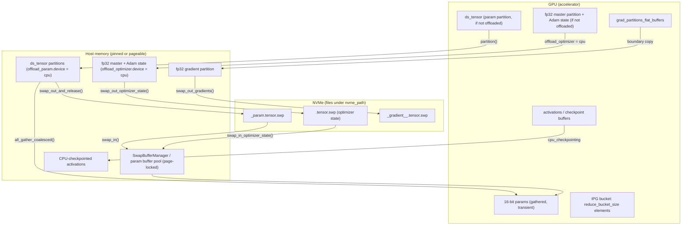
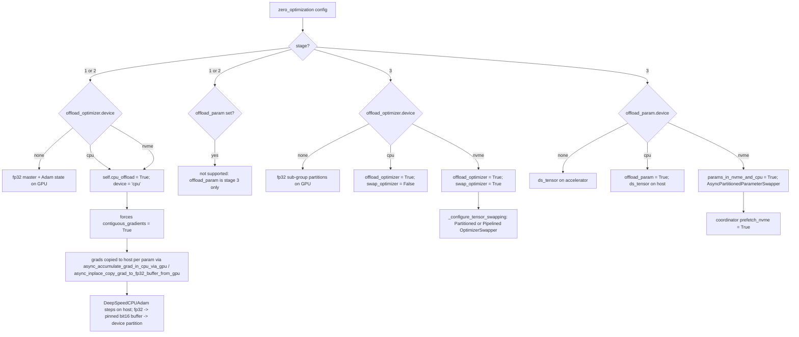
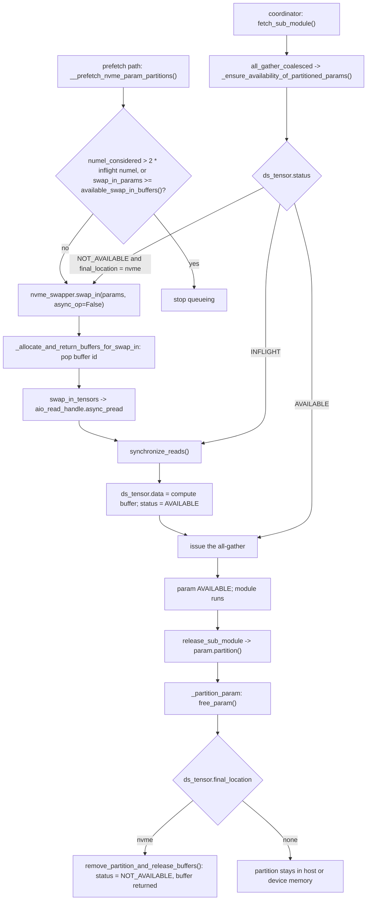
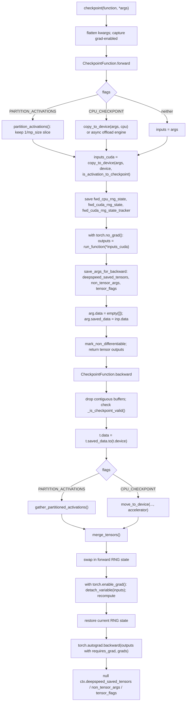

# Offload and memory

**What this covers.** Everything in this tree that moves tensors off the
accelerator or accounts for what is left on it: CPU and NVMe offload of
parameters and optimizer state (`offload_config.py`, `swap_tensor/`,
`AsyncIOBuilder`, `deepspeed/nvme/`), the dynamic `offload_states` /
`reload_states` API, activation checkpointing, the two newer memory subsystems
in this tree (ZenFlow and SuperOffload), the memory-accounting and debugging
helpers, and a symptom-to-subsystem troubleshooting table. The ZeRO stages
themselves are covered in `project-docs/03-zero.md`.

**Source of truth: upstream commit d70adc32** (DeepSpeed 0.20.1), as checked out
on this fork's `intro` branch. Every claim is cited to a file and line in that
tree. Only this checkout was read, so nothing below claims what the stock
0.20.1 release does or does not contain.

---

## 1. The memory hierarchy



Three devices, named by `OffloadDeviceEnum`: `none`, `cpu`, `nvme`
(`deepspeed/runtime/zero/offload_config.py:14`). Two independent targets:
parameters (`offload_param`) and optimizer state (`offload_optimizer`).
A pinned-host buffer pool always sits between the accelerator and NVMe --
`libaio` cannot read into pageable memory, so every NVMe transfer stages through
`new_cpu_locked_tensor` buffers unless GDS is enabled, in which case the staging
buffers live on the device instead
(`deepspeed/runtime/swap_tensor/partitioned_param_swapper.py:123-131`).

---

## 2. The offload config surface

### 2.1 `DeepSpeedZeroOffloadParamConfig`

`deepspeed/runtime/zero/offload_config.py:21`. Valid only with stage 3.

| key | default | line | effect |
|---|---|---|---|
| `device` | `"none"` | 24 | `cpu` or `nvme`. Becomes `Init.remote_device` (`partition_parameters.py:1156`) and `DeepSpeedZeRoOffload.offload_device` (`parameter_offload.py:177`) |
| `nvme_path` | `None` | 30 | root of the swap folder tree; asserted non-`None` when the remote device is NVMe (`partition_parameters.py:1224`) |
| `buffer_count` | `5` | 33 | number of swap-in buffers -> `param_buffer_count` (`partitioned_param_swapper.py:106`) |
| `buffer_size` | `1e8` | 36 | elements per buffer -> `elements_per_buffer` (`partitioned_param_swapper.py:104`) |
| `max_in_cpu` | `1e9` | 39 | elements kept in host memory when NVMe offload is on -> `self.max_params_in_cpu` (`stage3.py:876`) |
| `pin_memory` | `True` | 45 | page-lock the partitions. The docstring at line 47 is explicit: required for async full-bandwidth transfer, disable only under tight `ulimit -l` |

### 2.2 `DeepSpeedZeroOffloadOptimizerConfig`

`deepspeed/runtime/zero/offload_config.py:55`. Valid with stages 1, 2 and 3.

| key | default | line | effect |
|---|---|---|---|
| `device` | `"none"` | 58 | `cpu` or `nvme`. The docstring at line 61 is important: **optimizer computation moves to the CPU regardless of which of the two you pick** |
| `nvme_path` | `None` | 64 | swap folder root; `<nvme_path>/zero_stage_3` is created by `_configure_tensor_swapping` (`stage3.py:882`) |
| `buffer_count` | `4` | 67 | buffers in the `SwapBufferManager` pool. Docstring at line 68: at least the number of states per parameter (Adam needs 4: param, grad, momentum, variance) |
| `pin_memory` | `True` | 75 | page-lock host buffers -> `offload_optimizer_pin_memory` (`stage3.py:867`), which also pins the flat gradient buffers (`stage3.py:834`) |
| `pipeline_read` | `False` | 84 | prefetch the next sub-group's state while computing the current one |
| `pipeline_write` | `False` | 90 | write the previous sub-group's state while computing the current one |
| `fast_init` | `False` | 96 | fast optimizer init when offloading to NVMe -> `offload_optimizer_fast_init` (`stage3.py:869`) |
| `ratio` | `1.0` | 99 | fraction of sub-groups whose state lives on CPU; `< 1.0` is stage-3 only (`config.py:405`) and builds a GPU `backup_optimizer` (`stage3.py:325`) |
| `super_offload` | `False` | 102 | select `SuperOffloadOptimizer_Stage3`; section 7 |
| `cpuadam_cores_perc` | `0.8` | 105 | CPU cores for CPU Adam; only with stage 3 + `super_offload` |

**A synthetic field worth knowing about.** The validator `set_pipeline`
(`offload_config.py:108`) writes `pipeline = pipeline_read or pipeline_write`
straight into `self.__dict__` (line 111) -- it is not a declared pydantic field,
but it is the switch that picks the swapper class
(`stage3.py:887`). If you add a field here, that trick is why `extra="forbid"`
does not reject it.

### 2.3 The `aio` section

Separate top-level ds_config section, not under `zero_optimization`. Constants
in `deepspeed/runtime/swap_tensor/constants.py`, parsed by `get_aio_config`
(`deepspeed/runtime/swap_tensor/aio_config.py:20`), stored as
`DeepSpeedConfig.aio_config` (`deepspeed/runtime/config.py:576`) and exposed as
`DeepSpeedEngine.aio_config()` (`deepspeed/runtime/engine.py:1851`), which stage
3 receives as the `aio_config` constructor argument
(`deepspeed/runtime/engine.py:2878`).

All line numbers in this table are in `deepspeed/runtime/swap_tensor/constants.py`.

| key | constant | default | line |
|---|---|---|---|
| `block_size` | `AIO_BLOCK_SIZE` | `1048576` | `swap_tensor/constants.py:19` |
| `queue_depth` | `AIO_QUEUE_DEPTH` | `8` | `swap_tensor/constants.py:21` |
| `intra_op_parallelism` | `AIO_INTRA_OP_PARALLELISM` | `1` | `swap_tensor/constants.py:23` |
| `single_submit` | `AIO_SINGLE_SUBMIT` | `False` | `swap_tensor/constants.py:25` |
| `overlap_events` | `AIO_OVERLAP_EVENTS` | `True` | `swap_tensor/constants.py:27` |
| `use_gds` | `AIO_USE_GDS` | `False` | `swap_tensor/constants.py:29` |

Two things to flag:

- **`thread_count` is not a key in this version.** It was replaced by
  `intra_op_parallelism`. `get_aio_config` never reads `thread_count`, so
  passing it is silently ignored. `docs/_pages/config-json.md:727` and `:744`
  still document the old name, and `use_gds` is not documented there at all.
- `use_gds=True` asserts the accelerator is CUDA, with the message
  `'GDS currently only supported for CUDA accelerator'`
  (`aio_config.py:38`).

`intra_op_parallelism` is load-bearing beyond the handle: it sets
`aligned_bytes = AIO_ALIGNED_BYTES * intra_op_parallelism` and therefore
`numel_alignment` in both the parameter swapper
(`partitioned_param_swapper.py:101`) and the optimizer swapper
(`swap_tensor/optimizer_utils.py:181`). Change it and every swap file's
alignment changes with it.

---

## 3. How offload interacts with each stage



### 3.1 Stages 1 and 2

Only `offload_optimizer` applies. `offload_param` is documented as stage-3 only
(`offload_config.py:22`).

The switch is at `deepspeed/runtime/zero/stage_1_and_2.py:222`: any
`offload_optimizer_config` whose `device` is not `none` sets
`self.cpu_offload = True` and `self.cpu_offload_pin_memory` from the config.
Consequences, all in `stage_1_and_2.py`:

- `self.device = 'cpu'` (line 280) -- the fp32 master partition is allocated
  there (line 562) and optionally pinned (line 567).
- `self.deepspeed_adam_offload = self.cpu_offload` (line 278).
- `contiguous_gradients` is forced on (line 302).
- A staging buffer per group,
  `param_buffer_of_bit16_for_cpu_offload_groups[i]`, holds the 16-bit copy of
  the updated partition so the host-to-device copy can be one contiguous
  non-blocking transfer (lines 569-577, used at line 3215).
- Two scratch buffers sized to the largest parameter are allocated up front:
  `temp_grad_buffer_for_cpu_offload` (pinned, line 662) and
  `temp_grad_buffer_for_gpu_offload` (line 668).
- `get_grad_position(group_id, params_in_partition, first_offset, partition_size)`
  (line 1854) builds `self.grad_position[param_id] = [group, source_offset,
  dest_offset, num_elements]`, the map every host copy uses.

Gradients reach the host through:
`async_accumulate_grad_in_cpu_via_gpu(param)` (line 1923) for non-boundary
micro-steps, `set_norm_for_param_grad_in_gpu(param)` (line 1968) to cache the
per-parameter norm so `complete_grad_norm_calculation_for_cpu_offload`
(line 2009) never needs the gradient again, and
`async_inplace_copy_grad_to_fp32_buffer_from_gpu(param)` (line 1983) at the
boundary. `copy_grads_in_partition` (line 2237) dispatches between them.
Completion is tracked with recorded events: `_record_offload_copy` (line 1842)
and `_wait_for_offload_copies` (line 1849), the latter called first thing in
`step()` (line 3134) and in `destroy()` (line 763).

This tree adds the **compact gradient partition** path, which changes the host
traffic shape. When the accumulation dtype is fp32 and differs from the
parameter dtype, reductions accumulate straight into one flat fp32 partition
(see `03-zero.md` section 2.6) and the host copy happens once per group in
`_offload_compact_grad_partitions` (line 1370) rather than once per parameter.
That function then **frees the GPU partition** and records the group in
`_host_owned_compact_partitions` (lines 1409-1410), so between accumulation
windows the fp32 gradient lives only on the host; `_restore_compact_grad_partition`
(line 1412) brings it back when another backward arrives. Two guards control
this:

- `_host_grad_holds_accum_exactly(host_dtype, accum_dtype)` (line 1316) -- the
  partition is only freed when the host copy can restore it bit for bit.
- `retain_gpu_grad_partition_until_step` (config, `config.py:150`) -- set it to
  keep the partition resident, trading one fp32 partition of GPU memory per rank
  for avoiding the per-request copy and restore.

`offload_optimizer.device = nvme` at stages 1/2 does not engage the
`swap_tensor` machinery: the comment at `stage_1_and_2.py:232` says ZeRO-1 and
NVMe offload use the same CPU gradient path. There is no
`PartitionedOptimizerSwapper` in the stage-1/2 constructor.

### 3.2 Stage 3

`_configure_offloading(offload_optimizer_config, offload_param_config)`
(`deepspeed/runtime/zero/stage3.py:863`) sets the four flags:

| flag | set when | line |
|---|---|---|
| `offload_optimizer` | `offload_optimizer.device != none` | 866 |
| `swap_optimizer` | `offload_optimizer.device == nvme` | 868 |
| `offload_param` | `offload_param.device != none` | 873 |
| `params_in_nvme_and_cpu` | `offload_param.device == nvme` | 875 |

`self.device` becomes `OffloadDeviceEnum.cpu` under optimizer offload
(line 345), which is where the fp32 sub-group partitions and the flat gradient
buffers are then allocated (line 833). `swap_optimizer` triggers
`_configure_tensor_swapping(offload_optimizer_config, aio_config)` (line 881),
which creates `<nvme_path>/zero_stage_3` and instantiates
`PipelinedOptimizerSwapper` if `offload_optimizer_config.pipeline` else
`PartitionedOptimizerSwapper` (line 887).

On the parameter side, `Init` reads `offload_param.device` as its
`remote_device` (`partition_parameters.py:1156`) and builds an
`AsyncPartitionedParameterSwapper` when that is NVMe
(`partition_parameters.py:1169`). The coordinator gets
`prefetch_nvme=self.offload_device == OffloadDeviceEnum.nvme`
(`parameter_offload.py:218`), which is what enables
`__prefetch_nvme_param_partitions` in the fetch loop
(`partitioned_param_coordinator.py:488`).

---

## 4. `swap_tensor/`: the NVMe machinery

Nine files. Sizes: `utils.py` 258, `optimizer_utils.py` 559,
`partitioned_param_swapper.py` 418, `pipelined_optimizer_swapper.py` 280,
`partitioned_optimizer_swapper.py` 223, `async_swapper.py` 174,
`aio_config.py` 43, `constants.py` 30, `__init__.py` 5.

### 4.1 Buffer plumbing: `swap_tensor/utils.py`

Three constants (`utils.py:14-16`): `MIN_AIO_BYTES = 1024**2`,
`AIO_ALIGNED_BYTES = 1024`, `MIN_SWAPPABLE_BYTES = MIN_AIO_BYTES`. The last is
the only thing `__init__.py` re-exports (`swap_tensor/__init__.py:5`).

Two free functions wrap the handle: `swap_in_tensors(swap_handle,
tensor_buffers, swap_paths)` asserts `async_pread(buffer, path, 0) == 0` per
tensor (`utils.py:19`), and `swap_out_tensors` does the same with `async_pwrite`
(`utils.py:24`).

Three classes form a hierarchy:

| class | line | role |
|---|---|---|
| `SwapBuffer` | 37 | wraps one pinned buffer and sub-allocates aligned slices. `allocate_tensor(swap_path, numel, aligned_numel)` (line 55) returns a `(swap_tensor, compute_tensor)` pair: the swap tensor is the aligned narrow libaio reads or writes, the compute tensor the first `numel` elements the optimizer uses. `insert_tensor` (line 50) is allocate plus `copy_` |
| `SwapBufferPool` | 96 | spans several buffers, advancing `current_index`. Constructor asserts every buffer is pinned per the handle (line 100); `swap_out` (153) and `swap_in` (163) assert `len(swap_tensors) == aio_handle.wait()` when synchronous |
| `SwapBufferManager` | 180 | the pool owner. Allocates `count` buffers of `num_elems` via `aio_handle.new_cpu_locked_tensor(num_elems, dtype_example).zero_()` (line 192 -- the `zero_()` is deliberate, comment at line 188), tracks `free_buffer_index` / `used_buffer_index`, and in `__del__` explicitly calls `free_cpu_locked_tensor` for every buffer (line 231) |

`SwapBufferManager.allocate` (line 201) returns `None` rather than raising when
the pool is exhausted, which is why callers like
`PipelinedOptimizerSwapper._swap_in_optimizer_state` assert with *"ran out of
swap buffers, try increasing 'buffer_count'"*
(`pipelined_optimizer_swapper.py:253`).

Two sharp edges in this file, both verified: `SwapBuffer.get_swap_path(offset)`
calls a dict as a function (`self.swap_paths(offset, None)`, `utils.py:92`) and
would raise `TypeError`; it has no in-repo caller. And
`SwapBufferPool.has_space(numel)` (line 143) *mutates* `current_index`, so it is
not a pure query.

### 4.2 Parameter swapping: `AsyncPartitionedParameterSwapper`

`deepspeed/runtime/swap_tensor/partitioned_param_swapper.py:37`. One instance
per rank, created by `Init` when `remote_device == nvme`.

`PartitionedParamStatus` (line 26) is the per-partition status, distinct from
the per-parameter `ZeroParamStatus`: `AVAILABLE = 1` (in memory and ready),
`NOT_AVAILABLE = 2` (on a non-memory device), `INFLIGHT = 3` (being read). It is
stored on the partition, as `param.ds_tensor.status`
(`partition_parameters.py:1842`).

`_configure_aio(ds_config)` (line 83) sets up everything:

- **Swap folder** `<nvme_path>/zero_stage_3/<dtype>params/rank<N>`, with
  `<dtype>` from `str(self.dtype).split(".")[1]` (lines 85-87), e.g.
  `/mnt/nvme/zero_stage_3/bfloat16params/rank0`. It is
  `shutil.rmtree(..., ignore_errors=True)`d and recreated at construction
  (lines 88-89) -- a restart does not reuse old files. Parameter files inside it
  are named `<param_id>_param.tensor.swp` (line 156), cached in
  `self.id_to_path`.
- **Handle class** `GDSBuilder().load(verbose=False).gds_handle` when `use_gds`,
  otherwise `AsyncIOBuilder().load(verbose=False).aio_handle` (lines 96-97);
  then **two handles**, `aio_read_handle` (line 111) and `aio_write_handle`
  (line 117), each built with all five aio config values.
- **Alignment** `min_aio_bytes = max(MIN_AIO_BYTES, block_size)` (line 100),
  `aligned_bytes = AIO_ALIGNED_BYTES * intra_op_parallelism` (line 101),
  `numel_alignment = aligned_bytes // swap_element_size` (line 102).
- **One flat buffer pool** of
  `aligned_elements_per_buffer * param_buffer_count` elements, on the
  accelerator under GDS (then `pin_device_tensor`, line 129) or on CPU
  (then `new_cpu_locked_tensor`, line 131).

The API surface, with the state transitions each one performs:

| method | line | effect |
|---|---|---|
| `swappable_tensor(param=None, numel=None)` | 136 | `min_aio_bytes <= numel * element_size` |
| `get_buffer(param, numel)` | 352 | reserve a buffer and return its compute view; asserts `numel <= elements_per_buffer` |
| `swap_in(params, async_op=True, swap_in_buffers=None)` | 291 | asserts every param is `NOT_AVAILABLE`, allocates buffers, issues `swap_in_tensors`, marks `INFLIGHT` |
| `synchronize_reads()` | 213 | asserts `pending_reads == aio_read_handle.wait()`, repoints `ds_tensor.data` at the compute buffer, marks `AVAILABLE` |
| `swap_into_buffer(param, dest_buffer)` | 326 | synchronous; writes directly into `dest_buffer` only when it is pinned *and* IO-aligned (lines 329-330), otherwise stages through an internal buffer and releases it |
| `swap_out_and_release(params, async_op=False, force_buffer_release=False)` | 274 | asserts `force_buffer_release` when `async_op` |
| `synchronize_writes()` | 204 | asserts `pending_writes == aio_write_handle.wait()`, then releases the written params' buffers |
| `remove_partition_and_release_buffers(params)` | 236 | returns buffer ids to the pool, points `ds_tensor.data` at the 1-element `invalid_buffer` and marks `NOT_AVAILABLE` |
| `available_swap_in_buffers()` | 80 | `len(self.available_buffer_ids)` -- the prefetcher's budget (`partitioned_param_coordinator.py:683`) |
| `reserve_available_buffers()` / `release_reserved_buffers()` | 370 / 381 | used around optimizer init (`stage3.py:1240`, `:1246`) |
| `reserve_partitioned_swap_space(partition_num_elems)` | 393 | one locked buffer wrapped in a `SwapBufferPool`, for `swap_out_partitioned_params` |
| `swap_out_partitioned_params(dst_fp16_params, src_fp32_params)` | 400 | writes updated fp32 partitions out and marks the fp16 params `NOT_AVAILABLE` (`stage3.py:1362`) |



The prefetch budget is worth reading in the source
(`partitioned_param_coordinator.py:666-692`): it walks `__param_queue`, skips
parameters with no swapper, stops at `2 * numel_in_flight` or when it has as
many candidates as there are free swap-in buffers (line 682), and deduplicates
because the queue holds a parameter once per *use* while `swap_in` takes it once
(comment at line 685).

The other direction of coupling: `_partition_param`
(`partition_parameters.py:1814`) asks `param_swapper.swappable_tensor(numel=
partition_size)` before deciding `final_location = nvme`, so a partition below
`min_aio_bytes` stays in host memory even with NVMe param offload configured.
And `__all_gather_params_` releases swap buffers for *persistent* NVMe
parameters right after gathering them, because they will never be released
again (`partitioned_param_coordinator.py:615-620`).

### 4.3 Optimizer swapping: `OptimizerSwapper` and subclasses

`deepspeed/runtime/swap_tensor/optimizer_utils.py:159` is the base class. Its
record types:

- `OptimizerStateSwapInfo` (line 44) -- per parameter: `tensors`, `param_id`,
  `swap_folder`, `swapped_gradients`, `unswapped_gradients`, `tensor_numel`,
  `tensor_dtype`, `tensor_device`, `has_state_tensors`, `swap_buffers`.
- `SwapTensorContext` (line 28) -- one swapped tensor, whose path is
  `os.path.join(swap_folder, f'{OptimizerSwapper.parameter_id(tensor)}.tensor.swp')`
  (line 33).
- `FlattenedTensorSwapInfo` (line 20) -- `path`, `offset`, `length` for one
  swapped gradient fragment.

`parameter_id(param)` is `param.ds_id` (line 161), and state tensors get
synthetic ids: `_get_state_tensors` sets
`value.ds_id = state_name + '-' + parameter.ds_id` (line 511). So the on-disk
layout is:

```
<nvme_path>/zero_stage_3/optimizer/rank<N>/
    <sub_group_ds_id>.tensor.swp                        # the fp32 partition
    exp_avg-<sub_group_ds_id>.tensor.swp                # Adam momentum
    exp_avg_sq-<sub_group_ds_id>.tensor.swp             # Adam variance
    <param_id>_gradient_<offset>_<length>.tensor.swp    # gradient fragments
```

Folder from `optimizer_utils.py:174`, state file name from line 33, gradient
file name from `get_or_create_gradient_paths` (line 106). Unlike the parameter
folder, this one is only `makedirs(exist_ok=True)`d -- it is **not** wiped at
construction.

Base-class behaviour worth knowing:

- `is_swappable_tensor(tensor=None, numel=None)` (line 225) applies the same
  `min_aio_bytes` threshold, and honours a per-tensor `swappable` attribute as
  an opt-out (lines 229-230). `stage3._swappable_optimizer_subgroup(i)`
  (`stage3.py:1337`) calls it with the sub-group's numel -- a sub-group smaller
  than `min_aio_bytes` is never swapped even with NVMe optimizer offload.
- `_adjust_for_misaligned_lengths(tensors, offsets)` (line 464) splits a tensor
  into an aligned part plus a remainder; the remainder goes to
  `unswapped_gradients` and is carried in host memory
  (`read_unswapped_gradients` line 133, `write_unswapped_gradients` line 142).
- `_swap_in_fp16_params` (line 336) stages padded partitions through a locked
  tensor when direct I/O alignment demands it (lines 358-364).

`PartitionedOptimizerSwapper` (`partitioned_optimizer_swapper.py:26`) is the
simple one: it loads AIO once (line 29) and uses **a single handle for both
reads and writes** (lines 30-34), plus an `AsyncTensorSwapper` as
`self.gradient_swapper` (line 40). Its API is what `stage3.py` calls:
`swap_in_optimizer_state(parameter, async_parameter)` (line 72),
`swap_out_optimizer_state(parameter, async_swap)` (line 134),
`swap_out_gradients(parameter, gradient_offsets, gradient_tensors)` (line 153),
`writeback_optimizer_state_and_gradients` (line 120), `release_swap_buffers`
(line 63). Buffer accounting:
`required_buffer_count = num_tensors() + (1 if has_gradients() else 0)`
(line 79).

`PipelinedOptimizerSwapper` (`pipelined_optimizer_swapper.py:52`) is the
`pipeline_read` / `pipeline_write` version. It creates **two** handles,
`write_aio_handle` (line 56) and `read_aio_handle` (line 62), hands the write
handle to the base class (line 68), and keeps a `self.swap_ops` dict keyed by
`SYNC_SWAP_IN` / `ASYNC_SWAP_IN` / `SYNC_SWAP_OUT` / `ASYNC_SWAP_OUT`
(lines 40-43). `swap_in_optimizer_state` (line 102) promotes a pending
`ASYNC_SWAP_IN` to synchronous if it matches the requested parameter, otherwise
issues a fresh read, and prefetches `async_parameter` when `pipeline_read` is
set. That `async_parameter` comes from
`next_swappable_fp32_partitioned_groups[sub_group_id]` (`stage3.py:2925`), built
by `_create_next_swappable_fp32_groups` (`stage3.py:1091`).

`AsyncTensorSwapper` (`async_swapper.py:18`) is the gradient path: a
buffer-recycling, swap-out-only engine with four buffer slots
(`free_buffer_index`, `swapping_buffer_index`, `ready_buffer_index`,
`current_buffer_index`, lines 20-33). `swap_out_tensors(tensor_list, path_list)`
(line 67) is the entry point; `_flush_buffers_until_complete` (line 119) and
`_wait_for_swap_complete` (line 138, asserting
`aio_handle.wait() == num_pending_swaps`) drain it; `release_buffers()`
(line 53) flushes and hands the raw pinned buffers back. Its timer is
`ASYNC_SWAPPER_WAIT_TIMER = 'async_swap_gradient_wait'` (line 15).

Where stage 3 calls into all this during the step:
`_optimizer_states_and_gradient_swap_in(sub_group_id)` (`stage3.py:2912`),
`_optimizer_states_and_gradient_swap_out` (`stage3.py:2963`),
`_release_swap_buffers` (`stage3.py:2985`), `_writeback_swap_state`
(`stage3.py:2989`), and on the gradient side
`_swap_out_offload_fp32_gradients(offload_fp32_gradients, offload_fp32_offsets)`
(`stage3.py:1542`), fed by `_offload_grad_partition_at_boundary`
(`stage3.py:1524`). `_offload_grad_partitions_at_boundary`
(`stage3.py:1550`) deliberately flushes every `reduce_bucket_size` elements
rather than once for the whole model (comment at line 1553).

### 4.4 `AsyncIOBuilder`: loading and failure modes

There is **no `op_builder/async_io.py`** in this tree. `op_builder/__init__.py`
reflects builder names out of accelerator-specific subpackages via
`builder_closure` (lines 28-42), which at runtime returns
`get_accelerator().get_op_builder(member_name)` (line 40).
`deepspeed/ops/aio/__init__.py:6` re-exports `AsyncIOBuilder` from
`..op_builder`.

The canonical implementation is `op_builder/cpu/async_io.py:12`:
`BUILD_VAR = "DS_BUILD_AIO"` (line 13), `NAME = "async_io"` (line 14),
`extra_ldflags()` returns `['-laio', '-fopenmp']` (line 45),
`is_compatible()` probes `has_function('io_submit', ('aio',))` and warns about
the missing dev package (lines 76-92), and `load(verbose=False)` **loads
`PinMemoryBuilder` first** so the shared pin-manager symbols resolve
(lines 69-73). The CUDA accelerator reuses the CPU builders by injecting
`["CPUAdamBuilder", "CPUAdagradBuilder", "CPULionBuilder", "AsyncIOBuilder"]`
into its class dict (`accelerator/cuda_accelerator.py:390-393`). Per-accelerator
variants exist at `op_builder/npu/async_io.py:12`, `op_builder/xpu/async_io.py:12`,
`op_builder/supa/async_io.py:10`, `op_builder/klxpu/async_io.py:10`.

Loading is **lazy**: it happens only inside a swapper constructor, i.e. only
when `offload_param.device == nvme`
(`partition_parameters.py:1167-1169`) or `offload_optimizer.device == nvme`
(`stage3.py:469` -> `stage3.py:881-895`). `import deepspeed` never fails on a
missing libaio, because compatibility is probed defensively --
`probe_is_compatible(builder, verbose=False)` catches any exception and reports
"not compatible" (`op_builder/builder.py:118-129`), and
`deepspeed.ops.__compatible_ops__` is built on first attribute access
(`deepspeed/ops/__init__.py:15-30`).

If libaio is genuinely absent, `OpBuilder.jit_load` raises
`RuntimeError(f"Unable to JIT load the {self.name} op due to it not being
compatible due to hardware/software issue. {self.error_log}")`
(`op_builder/builder.py:514-517`), and a missing ninja raises the analogous
message at line 518. On an accelerator with no implementation the op maps to
`NotImplementedBuilder`, whose `load()` raises
`ValueError("This op had not been implemented on CPU backend.")`
(`op_builder/cpu/no_impl.py:20`).

The gate to copy when writing conditional code or a test is
`deepspeed.ops.__compatible_ops__[AsyncIOBuilder.NAME]`, as in
`tests/unit/runtime/zero/test_nvme_checkpointing.py:39`.

### 4.5 GDS

`op_builder/gds.py:11` is `GDSBuilder(CUDAOpBuilder)`:
`BUILD_VAR = "DS_BUILD_GDS"` (line 12), `NAME = "gds"` (line 13). It composes an
`AsyncIOBuilder()` instance as `self.async_io` (line 19) and reuses its sources
and flags, adding `-lcufile` (line 31) and `-lcuda -lcudart -lcufile`
(lines 39-44). `is_compatible` rejects ROCm (lines 53-56), requires
`CUDA_HOME` (lines 58-70) and probes `cuFileDriverOpen` in `libcufile`
(lines 72-78).

The `gds_handle` bindings mirror `aio_handle` and add device-memory
registration: `new_pinned_device_tensor`, `free_pinned_device_tensor`,
`pin_device_tensor`, `unpin_device_tensor`
(`csrc/gds/py_lib/py_ds_gds.cpp:123-139`).

Note the asymmetry: **only the parameter swapper can use GDS.** The optimizer
swappers always build `AsyncIOBuilder` handles
(`partitioned_optimizer_swapper.py:29-34`,
`pipelined_optimizer_swapper.py:55-66`). The checkpoint writer also honours
`use_gds` (`deepspeed/runtime/model_checkpointing/writer_factory.py:29`,
`:87-95`).

### 4.6 `deepspeed/nvme/`: the DeepNVMe benchmark package

Not part of the training path; it is the tool for sizing the `aio` section
before you turn offload on. Exports `sweep_main`, `parse_sweep_arguments`,
`generate_main`, `ds_io_main` (`deepspeed/nvme/__init__.py:6-8`).

| file | role |
|---|---|
| `ds_aio_constants.py` | engine names `aio_handle`, `aio_basic`, `torch_io`, `torch_fastio` (lines 6-10) and context keys |
| `ds_aio_args.py` | the CLI: `--io_size` (required), `--block_size` (default `1M`), `--queue_depth` (32), `--io_parallel`, `--gpu`, `--use_gds`, `--engine`, `--loops` (lines 116-196) |
| `io_engine.py` | engine dispatch and the multiprocess tasklet (lines 17-125) |
| `ds_aio_handle.py` | `AIOHandle_Engine` (line 19) -- `pread`/`pwrite` plus optional bounce buffer |
| `ds_aio_basic.py` | `AIOBasic_Engine` (line 16) using the module-level `aio_read`/`aio_write` |
| `torch_io.py` / `torch_fastio_engine.py` | `torch.load`/`torch.save` baseline; `Torch_FastIO_Engine` (line 15) is write-only |
| `perf_run_sweep.py` | the sweep driver; `async_io_setup()` is `AsyncIOBuilder().is_compatible()` (line 250), `gds_io_setup()` the GDS equivalent (line 254) |
| `perf_generate_param.py` | turns sweep results into an aio config dict (`convert_to_param`, line 41) |
| `parse_nvme_stats.py` | post-processing |
| `validate_async_io.py` | two asserts: `is_compatible()` then `load()` (lines 8-10) |

One gotcha: `perf_generate_param.convert_to_param` emits a key named
`num_threads` (`perf_generate_param.py:41-49`), which matches neither the live
key `intra_op_parallelism` nor the legacy `thread_count`. Generated parameters
need manual translation. A near-duplicate legacy copy of this suite also
survives under `csrc/aio/py_test/`; `deepspeed/nvme/` is the current one.

---

## 5. `offload_states` / `reload_states`

A separate feature from the ZeRO offload config: it moves the engine's *resident
buffers* to host memory on demand, for example to free the GPU between training
and generation in an RL loop. It is not NVMe-capable.

`OffloadStateTypeEnum` (`deepspeed/runtime/zero/offload_config.py:115`):
`optim_states`, `hp_params`, `lp_params`, `lp_grads`, `contiguous_grad_buffer`.

Primitives in `deepspeed/runtime/zero/offload_states.py`:

| function | line | behaviour |
|---|---|---|
| `_make_offload_state_key(key)` | 13 | `f"{key}_offload_buffer"` |
| `offload_optimizer_states(optimizer, device, pin_memory=False, non_blocking=False)` | 17 | every tensor in `optimizer.state`, either into a `pin_empty_like` host buffer or via `.to(device)` |
| `reload_optimizer_states(optimizer, device, non_blocking=False)` | 29 | **returns the replaced host tensors**; the docstring at line 30 says why -- a non-blocking copy may still be reading them |
| `unpin_offloaded_optimizer_states(optimizer)` | 44 | unpins host state tensors; the docstring notes offload pins them regardless of config, so `destroy()` must release them |
| `offload_adam_states(optimizer, device, pin_memory, non_blocking)` | 59 | DeepSpeed-Adam specific: creates `exp_avg_offload_buffer` / `exp_avg_sq_offload_buffer` and repoints `state[key].data` |
| `reload_adam_states(optimizer, device, non_blocking)` | 78 | reverses it |
| `get_state_devices(model, state)` | 91 | the inspection helper: per state type, the set of devices currently holding it |

Engine API (`deepspeed/runtime/engine.py`):

- `_refine_include_states(include)` (line 6157) defaults `include` to every enum
  member, and when a CPU optimizer is in use removes `hp_params` and
  `optim_states` -- plus `lp_grads` at stage 3 -- because they are already on the
  host (lines 6160-6165).
- `offload_states(include=None, device=OffloadDeviceEnum.cpu, pin_memory=True,
  non_blocking=False)` (line 6169) asserts parameter offload is off
  (*"Moving states across devices is not supported for offloaded parameters."*,
  line 6183), asserts the optimizer is not a bare `DeepSpeedZeRoOffload`
  (line 6186), warns and returns on `device=none`, and **raises
  `ValueError("NVMe offload is not supported for offloading states.")`** on
  `device=nvme` (line 6195). Then delegates to `self.optimizer.offload_states`.
- `reload_states(non_blocking=False)` (line 6199) delegates straight through.

Both ZeRO optimizers implement the pair:
`stage3.py:4220` / `stage3.py:4322`, and
`stage_1_and_2.py:3970` / `stage_1_and_2.py:4071`.

The stage-3 implementation is the one to read if you add a state type
(`stage3.py:4220-4320`): it calls `empty_partition_cache()` first (line 4227),
asserts the optimizer is `FusedAdam` for `optim_states`/`hp_params`
(line 4232), raises `NotImplementedError` for mixed-dtype `lp_params`/`lp_grads`
(lines 4236-4240), and then handles four groups in turn with dedicated pinned
buffers -- `hp_params_pin_buffers`, `lp_param_contiguous_pin_buffer`,
`lp_grad_partitions_flat_pin_buffers`, and for the IPG bucket it stashes
`bucket.buffer_meta` as a meta tensor (line 4306) so `reload_states` can rebuild
the right shape. It ends with `gc.collect()` plus `empty_cache()`
(lines 4319-4320).

The stage-1/2 implementation additionally has to relink: `reload_states`
(`stage_1_and_2.py:4071`) keeps a `pending_host_buffers` list alive across the
non-blocking copies, calls `_link_all_hp_params()` and rebuilds
`parallel_partitioned_bit16_groups`. `_clear_hp_buffer_references`
(line 3926) and `_clear_lp_params_references` (line 3955) exist because the
flat buffers are aliased from several places and a stale view pins the old
storage.

---

## 6. Activation checkpointing

File: `deepspeed/runtime/activation_checkpointing/checkpointing.py` (1264
lines). The RNG handling is adapted from Megatron-LM's `mpu/random.py`
(see the header comment at lines 5-13).

### 6.1 Entry points

| name | line | notes |
|---|---|---|
| `checkpoint(function, *args, **kwargs)` | 1047 | the public wrapper. Decorated `@compiler.lazy_disable` (line 1046). Flattens kwargs into positionals through an inner `function_with_kwargs` (lines 1054-1065) so keyword tensors participate in autograd, captures `_checkpoint_grad_enabled = torch.is_grad_enabled()` (line 1067), then `CheckpointFunction.apply(function, all_outputs, *args)` |
| `non_reentrant_checkpoint(function, *args)` | 787 | the `saved_tensors_hooks` implementation. No `**kwargs`. Docstring at lines 788-799 lists its five deltas from torch's version |
| `configure(mpu_, deepspeed_config=None, partition_activations=None, contiguous_checkpointing=None, num_checkpoints=None, checkpoint_in_cpu=None, synchronize=None, profile=None)` | 1151 | the only way the globals get set |
| `reset()` | 1090 | drops the contiguous buffers; call during eval, where forwards run without backwards |
| `is_configured()` | 1254 | returns the `deepspeed_checkpointing_enabled` global |
| `partition_activations_in_checkpoint(partition_activation)` | 1078 | sets `PARTITION_ACTIVATIONS` directly |
| `set_num_layers(nlayers)` | 1085 | sets `num_layers` |
| `model_parallel_cuda_manual_seed(seed)` | 211 | `offset = seed + 2718`; model-parallel seed is `offset + tp_rank`, data-parallel seed is `seed` (lines 232-234) |
| `get_cuda_rng_tracker()` | 206 | the `CudaRNGStatesTracker` (class at line 134), default state name `'model-parallel-rng'` (line 75) |
| `_set_cuda_rng_state(new_state, device=-1)` | 101 | torch's `set_rng_state` **without** the clone; the docstring says cloning caused major slowdowns above 4 GPUs |

The module is re-exported at the package root as `deepspeed.checkpointing`
(`deepspeed/__init__.py:59`).

### 6.2 The five global flags

Declared at `checkpointing.py:59-63`, all default `False`, plus
`num_layers = None` (line 47):

| flag | mechanism |
|---|---|
| `PARTITION_ACTIVATIONS` | forward calls `partition_activations(...)` (line 612) so each tensor-model-parallel rank keeps `1/mp_size` of each checkpointed activation; backward calls `gather_partitioned_activations` (line 706). Also changes the `merge_tensors` flag bookkeeping (lines 354-362), because the saved list interleaves `(tensor, size)` pairs |
| `CPU_CHECKPOINT` | moves the checkpoint inputs to host memory. Three sub-paths: partition+cpu (`buffer_device = torch.device('cpu')`, line 403, `partition.cpu()` at line 436), the async engine (lines 635-637), and the blocking `copy_to_device(args, device=torch.device('cpu'), ...)` (line 614) with `get_cpu_activations_for_backward` (line 639) |
| `CONTIGUOUS_CHECKPOINTING` | routes partitions into preallocated per-layer buffer lists instead of fresh allocations (lines 405-434). Asserted to require `PARTITION_ACTIVATIONS` **and** a non-`None` `num_layers` (lines 1227-1230) |
| `SYNCHRONIZE` | `get_accelerator().synchronize()` at entry and exit of both forward (lines 588, 647) and backward (lines 672, 775) |
| `PROFILE_TIME` | lazily builds a `SynchronizedWallClockTimer` (lines 591-592) and times `FORWARD_GLOBAL_TIMER` (`'fwd'`) and a literal `'backward'` timer (lines 594, 674) |

### 6.3 Partitioned activations

`partition_activations(args, cpu_checkpoint, contiguous_checkpoint)`
(`checkpointing.py:387`):

1. Skips anything `is_activation_to_checkpoint` rejects, counting it in
   `num_non_fp_tensors` so the buffer index `i` stays stable (lines 394-399).
   The predicate (line 377) is: a tensor, floating point,
   `numel >= mp_size`, and not carrying `no_checkpointing=True`.
2. Slices
   `item.detach().contiguous().view(-1).narrow(0, get_partition_start(item),
   partition_size).clone()` (line 401). `get_partition_start` is at line 260 and
   `get_partition_size` at line 268, the latter asserting
   `size % mp_size == 0` (line 271).
3. Either stores it into the contiguous buffer or appends it directly, moving to
   CPU when `CPU_CHECKPOINT` (line 436).

`get_partitioned_activations_for_backward(args, inputs, contiguous_checkpoint)`
(line 442) is the trick that actually frees the memory: it sets
`arg.data = torch.empty([], device=arg.device).data` and stashes
`arg.saved_data = inp.data` (lines 456-457), so the original tensor object
survives in the autograd graph with no storage. It appends `(tensor, size)`
pairs, giving an even-length list that backward asserts on (line 633).
`get_cpu_activations_for_backward` (line 484) does the same without the size
entries. `gather_partitioned_activations(tensors, device=None)` (line 276) is
the inverse: it asserts an even tensor count (line 278), short-circuits to a
plain `view` when `mp_group is None or mp_size == 1` (lines 291-296), and
otherwise allocates a flat tensor of `partition_size * mp_size` and calls
`dist.all_gather_into_tensor(flat_tensor, part, group=mp_group)` (line 308).

**Note for anyone porting older code or docs: `get_full_inputs` does not exist
in this version.** `gather_partitioned_activations` is its replacement.

Non-tensor outputs are handled by `extract_tensors(all_objects)` (line 315),
which returns `(tensor_objects, non_tensor_objects, tensor_flags)` preserving
relative order, and `merge_tensors(...)` (line 335), which re-interleaves them
and, under `PARTITION_ACTIVATIONS`, first strips the flags belonging to the
interleaved size tensors (lines 351-364).

### 6.4 Contiguous checkpointing

Four module globals (`checkpointing.py:50-54`):
`contiguous_data_buffers`, `data_offsets`, `contiguous_size_buffers`,
`size_offsets`.

`contiguous_data_buffers[i]` is a **list of `num_layers` flat tensors** of
`partition_size`, allocated with `torch.tensor(()).new_empty(...)` on
`buffer_device` (lines 407-419); `data_offsets[i]` is the layer cursor,
incremented once per use (line 433). The pre-touch at lines 428-430 writes `0`
every `mmap.PAGESIZE / element_size()` elements before the copy, because
`new_empty` returns uninitialised pages and populating them during `cudaMemcpy`
would show up as copy time -- the comment at lines 421-427 explains it.
`contiguous_size_buffers[i]` is one flat tensor of `numel * num_layers` holding
the saved shapes, with `size_offsets[i] += numel` (lines 463-476). Both are
dropped at the start of backward (lines 677-689) and by `reset()`
(lines 1101-1113).

### 6.5 `CheckpointFunction` forward and backward



Source: `CheckpointFunction` at `checkpointing.py:567`, `forward` at line 578,
`backward` at line 665. Points that matter:

- The RNG state is saved in forward (lines 620-622) and swapped in and back out
  around the recompute (lines 725-743). Without this, dropout masks would differ
  between the two passes.
- Backward raises when `not torch.autograd._is_checkpoint_valid()`:
  *"Checkpointing is not compatible with .grad(), please use .backward() if
  possible"* (lines 692-694).
- `ctx.deepspeed_saved_tensors`, `ctx.non_tensor_args` and `ctx.tensor_flags`
  are explicitly nulled at the end *"to prevent a memory leak in certain
  scenarios"* (lines 765-768).
- `backward` returns `[None, None] + per-input grads` (line 777), matching the
  two leading non-tensor arguments of `forward`.

`non_reentrant_checkpoint` (line 787) is the alternative: it wraps the forward
in `torch.autograd.graph.saved_tensors_hooks(checkpoint_pack,
checkpoint_unpack)` (lines 1004-1005), stores `Holder` placeholders
(class at line 849) in a `weakref.WeakKeyDictionary` (line 855), and replays the
forward inside `checkpoint_unpack` (line 876) under a nested
`saved_tensors_hooks` pair (lines 971-972). It raises
*"Attempt to retrieve a tensor saved by autograd multiple times without
checkpoint recomputation being triggered in between..."* at lines 984-986.
Unlike the reentrant version it saves its args **after** the forward
(fork comment at lines 1007-1008).

### 6.6 Config and wiring

`deepspeed/runtime/activation_checkpointing/config.py`. ds_config section name
is `activation_checkpointing` (`ACT_CHKPT`, line 45).

| JSON key | default | line |
|---|---|---|
| `partition_activations` | `False` | 27 |
| `number_checkpoints` | `None` | 30 |
| `contiguous_memory_optimization` | `False` | 33 |
| `synchronize_checkpoint_boundary` | `False` | 36 |
| `profile` | `False` | 39 |
| `cpu_checkpointing` | `False` | 42 |

`ACT_CHKPT_DEFAULT` at lines 47-54 is used when the section is absent. The
`ACTIVATION_CHKPT_FORMAT` help string at lines 13-25 misspells the first key as
`"partitioned_activations"`; the parsed key is `partition_activations`.

**`deepspeed.initialize` does not wire this up.** The config object is built
(`deepspeed/runtime/config.py:507`) and reachable as
`DeepSpeedConfig.activation_checkpointing_config`, but its only consumer is
`_configure_using_config_file` (`checkpointing.py:1120`), which runs from
`configure()`. Grep `engine.py` for `activation_checkpointing` and there are no
hits -- **the user must call `deepspeed.checkpointing.configure(...)`
themselves.**

The in-tree consumers are the pipeline engine and module:
`PipelineModule` defaults `activation_checkpoint_func=checkpointing.checkpoint`
(`deepspeed/runtime/pipe/module.py:135`) with
`activation_checkpoint_interval=0` (line 134), and uses it at lines 372-390.
`use_reentrant: false` swaps in the other implementation:
`self.module.activation_checkpoint_func = ds_checkpointing.non_reentrant_checkpoint`
(`deepspeed/runtime/pipe/engine.py:214`). `ds_checkpointing.reset()` is called
at `pipe/engine.py:728`.

### 6.7 The async CPU offload engine

This tree adds an asynchronous activation-offload engine, in
`deepspeed/runtime/activation_checkpointing/offload_activations.py`
(`CheckpointActivationOffloadStats` at line 33,
`CheckpointHiddenStatesOffload` at line 390), driven from
`checkpointing.py` via `_get_cpu_offload_engine()` (line 498),
`_reset_cpu_offload_engine()` (line 514),
`get_offloaded_activations_for_backward(args, engine)` (line 519) and
`restore_offloaded_activations(tensors, engine)` (line 550).

It engages only when `cpu_checkpointing` is on **without**
`partition_activations`, and only on a non-synchronized accelerator
(`checkpointing.py:505-511`). There is no ds_config key for it; it is implied by
`cpu_checkpointing`. `restore_offloaded_activations` mutates `t.data` in place
specifically to preserve autograd identity (line 550), and
`get_offloaded_activations_for_backward` only empties the original storage after
every offload is registered (lines 542-545).

---

## 7. The newer memory subsystems in this tree

### 7.1 ZenFlow

Files: `deepspeed/runtime/zenflow/` -- `zenflow_config.py` (72 lines),
`engine.py` (151), `zenflow_utils.py` (190),
`zenflow_stage_1_and_2.py` (828), `engine_stage3.py` (647). Plus the
optimizers: `deepspeed/ops/adam/zenflow_cpu_adam.py` (`ZenFlowCPUAdam`,
line 10) and `deepspeed/ops/adam/zenflow_torch_adam.py`
(`ZenFlowSelectiveAdamW` line 42, `ZenFlowSelectiveAdamW_stage3` line 276).

**What it is.** ZenFlow splits each 2-D parameter's gradient by *column* into an
important part and a remainder, and gives them different update schedules:

1. Column importance is the L1 norm of the gradient column:
   `sum_array = sum_per_column.abs().sum(dim=1)` then `torch.topk(sum_array,
   num_select)` (`zenflow_stage_1_and_2.py:228-230`). Stage 3 computes the same
   per-column sums, all-gathers them, and runs a global `topk`
   (`engine_stage3.py:221-248`). The column count is
   `_num_selected_columns(num_columns, topk_ratio) = max(1, int(num_columns *
   topk_ratio))` (`zenflow_stage_1_and_2.py:47`).
2. The selected columns are updated **every micro-step on the accelerator** by
   `ZenFlowSelectiveAdamW.group_step()`, which writes back only those columns:
   `param.data[:, param.selected_indices] = params_with_grad[i]`
   (`deepspeed/ops/adam/zenflow_torch_adam.py:267-268`). Called from
   `_process_selected_fp32_groups_grad` (`zenflow_stage_1_and_2.py:437`,
   `engine_stage3.py:328`).
3. The remainder accumulates and is applied on the CPU by the ordinary
   ZeRO-Offload CPU Adam step, but only once every `update_interval` micro-steps.
   ZenFlow achieves that by **rewriting the engine's accumulation steps**:
   `engine._config.gradient_accumulation_steps = engine.update_interval`
   (`deepspeed/runtime/zenflow/engine.py:69`) and replacing the boundary
   predicate (`deepspeed/runtime/engine.py:3573-3575`).
4. With `overlap_step=True` the CPU step runs asynchronously in a dedicated
   process with double-buffered gradients (`overlap_grad[0]`/`[1]`) and a
   `stale_param` snapshot, so the host step overlaps the next forward/backward;
   the training process copies back the *previous* step's result
   (`wait_last_update_and_copy`).
5. `update_interval: "auto"` tracks per-parameter `avg_critic_sum` versus
   `non_critic_sum` and triggers an update once `auto_ratio` of parameters ask
   for one (`zenflow_stage_1_and_2.py:419-433`,
   `engine_stage3.py:310-324`).

**Layout consequence.** ZenFlow transposes every non-1-D parameter
(`p.data = p.data.t().contiguous()`, `engine_stage3.py:85`) so columns are
contiguous, and installs transpose-aware flatten/unflatten
(`zenflow_utils.py:19-52`, selected at
`deepspeed/runtime/zero/stage_1_and_2.py:265-266`). Stage 3 re-transposes
parameter views around every submodule fetch and release, which is what the four
`param.data = param.data.t() if len(param.ds_shape) != 1 else param.data`
blocks in `deepspeed/runtime/zero/parameter_offload.py:542-545, 557-560,
581-584, 596-599` are doing. This is also why the ZeRO-1/2 IPG copy has a
ZenFlow branch (`stage_1_and_2.py:1576-1580`) and the stage-3 one does too
(`stage3.py:1812-1816`).

**Config.** `ZenFlowConfig` (`deepspeed/runtime/zenflow/zenflow_config.py:12`),
attached as `zero_optimization.zenflow`
(`deepspeed/runtime/zero/config.py:189`), read by
`DeepSpeedEngine.zenflow_config()` (`engine.py:1854`). Non-`None` means enabled.

| key | default | line | notes |
|---|---|---|---|
| `topk_ratio` | `0.1` | 15 | `gt=0.0, lt=1.0` |
| `select_strategy` | `"auto"` | 18 | one of `auto`/`step`/`epoch` (validator line 54) |
| `select_interval` | `"auto"` | 22 | a string must be `"auto"` |
| `update_interval` | `"auto"` | 26 | a string must be `"auto"`; an int must be `>= 1` |
| `overlap_step` | `False` | 30 | run the CPU step in a separate process |
| `offload` | `False` | 33 | offload the *selective* optimizer states to CPU |
| `auto_ratio` | `0.99` | 36 | threshold for the auto strategy |
| `full_warm_up_rounds` | `0` | 39 | rounds with no selection at all |
| `pt_reserved_cores_perc` | `0.5` | 42 | cores kept for PyTorch; the rest go to the ZenFlow worker |
| `steps_per_epoch` | `None` | 46 | internal, `exclude=True`, set at runtime |

**Hard requirements.** ZenFlow requires CPU optimizer offload at stages 1/2
(`raise ValueError("Zenflow must be used with cpu offload")`,
`zenflow_stage_1_and_2.py:115`) and torch >= 2.1
(`deepspeed/runtime/zenflow/engine.py:28-31`). `zenflow.offload=True` requires
`overlap_comm=True` (`zenflow_stage_1_and_2.py:75`,
`engine_stage3.py:100`). It is rejected together with
`gradient_allreduce_op="sum"` (`deepspeed/runtime/config.py:697`),
`zero_optimization.compute_grad_norm=false`
(`deepspeed/runtime/zero/stage_1_and_2.py:216`) and
`deferred_dw_flush_period` (`deepspeed/runtime/engine.py:865`). It also disables
the ZeRO offload gradient protections (`stage_1_and_2.py:234, 242-243`) and the
deferred grad-scale fast path (`stage3.py:3295`).

**How it hooks in.** Three different mechanisms, which is the thing to know
before changing it:

- **Engine**: four lambdas bound in `__init__`
  (`deepspeed/runtime/engine.py:684-689`) wrapping the free functions in
  `zenflow/engine.py`, then `self._configure_zenflow()` immediately.
- **Stage 1/2**: a real subclass. `ZenFlowZeroOptimizer(DeepSpeedZeroOptimizer)`
  (`zenflow_stage_1_and_2.py:53`) with a factory
  `ZenFlowZeroOptimizer.create(zenflow_config)` (line 87) returning
  `ZenFlowZeroOptimizerParallel` when `overlap_step` else
  `ZenFlowZeroOptimizerSequential`. Selected at
  `deepspeed/runtime/engine.py:2763`.
- **Stage 3**: no subclass at all. `create_zenflow_hooks()`
  (`deepspeed/runtime/zero/stage3.py:613`) binds 11 free functions from
  `engine_stage3.py` onto the instance with
  `setattr(self, name, partial(fn, self))`, and when `overlap_step=True`
  `_initialize_zenflow_stage3_epilogue` replaces eight more instance methods
  with lambdas (`engine_stage3.py:103-117`), including `step`,
  `partition_grads` and `unscale_and_clip_grads`.

That last point is why `_fill_missing_grad_partitions` guards on
`partition_grads` still being the base-class function
(`stage3.py:1592`).

**Processes.** With `overlap_step=False` (the default) ZenFlow spawns nothing;
the CPU step is `ZenFlowCPUAdam._sequential_step` in-process
(`zenflow_cpu_adam.py:18-19`). With `overlap_step=True` it spawns exactly one
daemon process per rank, lazily on the first CPU step:
`start_optimizer_process(zf_optimizer)` (`zenflow_utils.py:138`) uses
`get_context("spawn")`, shares `param.data`, `param.stale_param.data` and
`param.overlap_grad[0/1].data` through `share_memory_()` (lines 156-165) plus a
shared-memory control block (lines 167-169), and waits on a readiness `Event`
with a 600-second timeout before terminating (lines 181-184). The child
(`zenflow_optimizer_process`, line 110) disables the accelerator, pins its CPU
affinity, sets `OMP_NUM_THREADS`, and enters the native
`zenflow_adam_run_worker` loop; `_compute_zf_pt_affinity` / `_split_affinity`
reserve `ceil(pt_reserved_cores_perc * n)` cores for PyTorch (lines 73-107).
The handshake is `zenflow_adam_submit(...)` plus
`zenflow_adam_wait(ctrl, ZENFLOW_OPTIMIZER_WAIT_POLL_SECONDS=60)`
(`zenflow_utils.py:16`), which polls liveness and raises if the worker died
(`zenflow_stage_1_and_2.py:696-708`).

The CPU optimizer class itself is swapped at
`deepspeed/runtime/engine.py:2482-2483`:
`CPUAdam = ZenFlowCPUAdam if self.zenflow else DeepSpeedCPUAdam`, with
`optimizer_kwargs['overlap_step'] = self.overlap_step` added at line 2495.
`ZenFlowCPUAdam` is whitelisted in
`deepspeed/runtime/zero/utils.py:13, 46`.

Docs and tests in-tree: `docs/_tutorials/zenflow.md`,
`blogs/deepspeed-zenflow/README.md`,
`blogs/zenflow-corebinding/README.md`,
`tests/unit/runtime/zenflow/test_zf.py`,
`tests/unit/runtime/zenflow/test_zf_config.py`,
`tests/unit/ops/adam/test_zf_torch_adam.py`. Note that
`docs/_pages/config-json.md` mentions ZenFlow only as a restriction and carries
no key table for it.

### 7.2 SuperOffload

Files: `deepspeed/runtime/superoffload/superoffload_stage3.py` (394 lines,
`SuperOffloadOptimizer_Stage3` at line 27) and
`superoffload_utils.py` (315 lines, `SuperOffloadCPUOptimizer` at line 182).

**What it is: speculate-then-validate async CPU Adam during backward.** As soon
as every gradient partition of a sub-group has arrived --
`sub_group_grad_partition_counts[i] == sub_group_to_param_num[i]`
(`superoffload_stage3.py:168-170`) -- and if that sub-group is CPU-resident
**and `clip_grad` is falsy**, its Adam step is submitted to the worker process
immediately inside `partition_grads` (lines 172-192), i.e. *before* the global
gradient norm and inf/NaN check exist. Results are drained opportunistically via
`get_result()` into `_reassign_or_swap_out_partitioned_parameters_async`
(line 136), which copies the updated fp32 partition back with
`non_blocking=True`.

`step()` (line 201) then validates:

- `_wait_for_async_operations()` first, with a 60-second timeout that raises
  (lines 275-307).
- On overflow or an invalid norm, `_handle_overflow_rollback()` undoes every
  speculative step via `optimizer.rollback_subgroup(...)` (line 353, worker
  branch at `superoffload_utils.py:141-145`).
- `_step_without_clipping` (line 244) is the fast path: the CPU work is already
  done, so only non-CPU sub-groups actually step.
- `_step_with_clipping` (line 253) is for `clip_grad > 0`, where nothing was
  speculated: unscale, clip, then **synchronous** CPU steps via
  `_sync_cpu_optimizer_step` (line 335).

The GPU/CPU split reuses stage 3's partial-offload machinery: `_optimizer_step`
(line 98) only drives `self.backup_optimizer` for sub-groups whose
`subgroup_to_device[sub_group_id] != 'cpu'` (lines 109-113).
`_create_fp16_sub_groups` is overridden (line 63) to record
`sub_group_to_param_num` and `max_grad_numel`, so the worker can preallocate one
reusable host gradient buffer.

`SuperOffloadCPUOptimizer` (`superoffload_utils.py:182`) uses
`mp.get_context('spawn')`, two `SimpleQueue`s (`param_queue`, `result_queue`)
and one daemon process running `superoffload_optimizer_worker` (line 48). The
worker builds a real `DeepSpeedCPUAdam` on a one-element dummy parameter
(lines 76-91), preallocates `grad_buffer` -- pinned iff
`offload_optimizer.pin_memory` (lines 39-45, 99) -- and loops on
`step_subgroup(sub_group_id)` / `rollback_subgroup(sub_group_id)`
(lines 141-145). `None` is the shutdown sentinel; `close()` does
join(5) -> terminate -> kill (lines 286-315). Affinity: `_set_cpu_affinity`
(line 207) gives the last `cpuadam_cores_perc` fraction of the rank's cores to
the worker.

**Requirements.** CUDA only:
`_validate_superoffload_accelerator` asserts
`get_accelerator().device_name() == 'cuda'`
(`superoffload_stage3.py:20-24`), called first in `__init__` (line 38). ZeRO
stage 3 only -- it is reachable only from the
`zero_stage == ZeroStageEnum.weights` branch
(`deepspeed/runtime/engine.py:2845-2847`) -- and it depends on
`DeepSpeedCPUAdam`'s `step_subgroup` / `rollback_subgroup` API
(`deepspeed/ops/adam/cpu_adam.py:260`, `:297`). It needs `offload_optimizer`
enabled (it reads `offload_optimizer_pin_memory`, `subgroup_to_device`,
`fp32_partitioned_groups_flat`), and the GPU half needs
`self.backup_optimizer`, which stage 3 only builds when
`offload_optimizer and partial_offload != 1.0` (`stage3.py:325`).

It has **no NVMe dependency**: its `partition_grads` writes straight into
`fp32_partitioned_groups_flat[i].grad` with no `swap_out_gradients` call
(`superoffload_stage3.py:160-168`), and
`_reassign_or_swap_out_partitioned_parameters` only reaches
`_partitioned_params_swap_out` in the None-flat case (lines 128-133). Nothing on
the SuperOffload path asserts `swap_optimizer` is off. It also has no ZenFlow
dependency, and nothing validates the combination.

**Config.** Two keys on `DeepSpeedZeroOffloadOptimizerConfig`:
`super_offload` (default `False`, `offload_config.py:102`) and
`cpuadam_cores_perc` (default `0.8`, `offload_config.py:105`). So:
`zero_optimization.offload_optimizer.super_offload: true`. Engine accessors at
`deepspeed/runtime/engine.py:1630-1634`.

A default inconsistency to be aware of: the pydantic default is `0.8`
(`offload_config.py:105`), the stage-3 constructor kwarg default is `0.8`
(`stage3.py:205`), `SuperOffloadOptimizer_Stage3`'s
`kwargs.get("cpuadam_cores_perc", 0.8)` is `0.8`
(`superoffload_stage3.py:57`), but the engine getter's fallback is `0.9`
(`engine.py:1634`). The getter default only applies when `offload_optimizer` is
absent entirely. There is no `super_offload` entry in
`docs/_pages/config-json.md`, and no `docs/_tutorials/superoffload.md`; the
reference material is `blogs/deepspeed-superoffload/README.md`.

---

## 8. Memory accounting and debugging tools

### 8.1 `deepspeed/runtime/utils.py`

Two module aliases bound at import:
`torch_memory_reserved = get_accelerator().memory_reserved` (line 36) and
`torch_max_memory_reserved = get_accelerator().max_memory_reserved`
(line 37).

| helper | line | what it prints or does |
|---|---|---|
| `see_memory_usage(message, force=False)` | 903 | the workhorse. Returns immediately unless `force` (line 904) and only on rank 0 (line 906). Runs an explicit `gc.collect()` (line 910) -- the comment says Python's lazy GC otherwise makes the RAM numbers wrong. Prints `MA / Max_MA / CA / Max_CA` in GB (lines 914-917) plus `CPU Virtual Memory: used / percent` from `psutil.virtual_memory()` (lines 919-921), then `reset_peak_memory_stats()` (line 924) |
| `memory_status(msg, print_rank=-1, reset_max=False)` | 840 | one `RANK=<r> MEMSTATS` line with current/delta/max for alloc and cache (lines 873-876); deltas against the module globals `mem_alloced` / `mem_cached` (lines 836-837) |
| `get_ma_status()` | 879 | `memory_allocated()` on rank 0, else `0` |
| `empty_cache()` | 885 | `empty_cache()` then `reset_peak_memory_stats()` |
| `get_tensor_bytes(item)` | 1132 | recursive byte count over tensor/list/tuple/dict |
| `copy_to_device` / `move_to_device` | 151 / 175 | the CPU-checkpointing movers |
| `offload_adam_states` / `reload_adam_states` | 1233 / 1252 | re-exports used by the compile path |
| `align_dense_tensors(tensor_list, alignment)` | 1069 | the flat-buffer padder used by every ZeRO flatten |
| `PartitionedTensor` | 743 | `from_meta` (757), `full` (790), `to_meta` (809) -- pipeline activation partitioning |
| `CheckOverflow` | 243 | `check_using_norm` (259), `check` (278), `has_overflow` (303) |
| `get_global_norm_of_tensors` | 984 | the bf16 path's norm |
| `clip_tensors_by_global_norm` | 1049 | note the name: `clip_grad_norm_` (358) has a trailing underscore and there is no `clip_grad_norm` |

Names that do **not** exist here, despite appearing in older docs:
`get_memory_usage`, `print_memory_usage`, `memory_summary`, `clip_grad_norm`.

`see_memory_usage` is called with `force=False` almost everywhere inside ZeRO,
which means it is a no-op unless the caller passes `force=True`. The engine's
own call sites are gated on the `memory_breakdown` ds_config flag
(`MEMORY_BREAKDOWN` at `deepspeed/runtime/constants.py:327`, parsed at
`deepspeed/runtime/config.py:355`, accessor
`DeepSpeedEngine.memory_breakdown()` at `deepspeed/runtime/engine.py:1543`).
So the practical way to get the ZeRO memory trace is to set
`"memory_breakdown": true` and, if you need the internal ZeRO calls too, flip
the `force` argument locally.

### 8.2 `deepspeed/utils/`

| file | relevance |
|---|---|
| `timer.py` | `SynchronizedWallClockTimer` (line 25) with a static `memory_usage()` (lines 135-143) returning allocated/max-allocated/cached/max-cached. Timer names at lines 12-21 (`fwd`, `bwd`, `step`, and their `_microstep` variants). `ThroughputTimer` (line 206) can log `vm %` and `swap %` from psutil when `monitor_memory=True` (lines 282-292) -- but the engine constructs it with `monitor_memory=False` (`deepspeed/runtime/engine.py:650`). **In this tree `SynchronizedWallClockTimer.log` accepts `memory_breakdown=` and ignores it** (lines 145-155), even though `engine.py:3784` passes it |
| `debug.py` | the ZeRO-3 debugging kit. `WeakIdNameMap` (line 14) maps modules and parameters to names without keeping them alive; `debug_extract_module_and_param_names(model)` (line 71) populates it; then `debug_param2name_id_shape` (121), `debug_param2name_id_numel` (129, the one for per-parameter memory accounting), `debug_param2name_id_shape_status` (133). `printflock` (137) serialises printing across ranks with an flock; `log_rank_file(rank, *msgs)` (172) |
| `tensor_fragment.py` | the supported way to inspect sharded or offloaded state without materialising the model: `safe_get_full_fp32_param` (135), `safe_get_full_optimizer_state` (170), `safe_get_full_grad` (208), `safe_get_local_grad` (259), `safe_get_local_fp32_param` (289), and the `safe_set_*` counterparts |
| `z3_leaf_module.py` | the prefetch-granularity knob: `set_z3_leaf_modules` (149), `set_z3_leaf_modules_by_name` (89), `set_z3_leaf_modules_by_suffix` (120), `apply_zero_leaf_module_config` (182) |
| `pin_memory_tracker.py` | host-memory accounting: `track_pinned_memory(num_bytes)` (62) and `pinned_memory_summary(tag="")` (66). The latter is called after ZeRO-3 param-offload init (`parameter_offload.py:235`) and after stage-3 optimizer init (`stage3.py:845`) |
| `pin_memory.py` | `NativePinnedMemory` (19) with `pin` (41), `unpin` (102); `get_native_pinned_memory()` (187) |
| `nvtx.py` | `instrument_w_nvtx`, which decorates most of the ZeRO-3 hot path; the way to correlate a memory spike with a phase in Nsight |
| `init_on_device.py` | `OnDevice`, meta/device init to avoid a CPU peak |
| `zero_to_fp32.py` / `zero_to_torch.py` | offline checkpoint consolidation, so you never need to gather a full model in memory |

### 8.3 The profilers' role

The **flops profiler** (`deepspeed/profiling/flops_profiler/profiler.py`) counts
FLOPs, MACs, parameters and latency by patching `torch.nn.functional`, tensor
methods and misc ops (`_patch_functionals` line 890, `_patch_tensor_methods`
line 949). Entry points: `FlopsProfiler` (line 30) with `start_profile`
(line 74) / `stop_profile` (line 134) / `print_model_profile` (line 286), and the
standalone `get_model_profile(...)` (line 1196). ds_config section
`flops_profiler` (`deepspeed/profiling/constants.py:26`), keys `enabled`
(default `False`), `recompute_fwd_factor` (`0.0`), `profile_step` (`1`),
`module_depth` (`-1`), `top_modules` (`1`), `detailed` (`True`),
`output_file` (`None`) -- constants at lines 28-47. Engine wiring at
`deepspeed/runtime/engine.py:654`, `:3040`, `:3077`, `:3762`.

**It does not report memory.** A case-insensitive grep for `memory` in
`profiler.py` returns nothing; `bytes_to_string` (line 1165) is a unit
formatter. Its role in a memory investigation is indirect: the per-module
parameter counts tell you where the weights are, and enabling it forces
wall-clock breakdown on (`deepspeed/runtime/config.py:537`).

The **partitioned-parameter profiler**
(`deepspeed/runtime/zero/partitioned_param_profiler.py:10`) is the ZeRO-3
parameter-traffic counter. Per named event it keeps an `EventCounter(name,
count, num_elem)` (line 12) and logs
`f'{name}: count = {count}, numel = {num_elem}'` on rank 0 (line 54). The
coordinator instruments eight events with it:
`forward_fetch_submit`, `forward_fetch_wait`, `forward_prefetch_submit`,
`backward_fetch_submit`, `backward_fetch_wait`, `backward_prefetch_submit`,
`forward_all_gather`, `backward_all_gather`
(`partitioned_param_coordinator.py:74-81`). It counts **elements, not bytes**,
and is gated on an `ENABLE_PROFILER` flag plus a non-`None` `timers`
(`partitioned_param_coordinator.py:143`), i.e. it needs
`wall_clock_breakdown`.

The **memory estimators** in the ZeRO optimizers are the fastest way to answer
"will this fit": `estimate_zero2_model_states_mem_needs_all_live(model,
num_gpus_per_node, num_nodes)` (`stage_1_and_2.py:4188`) and
`estimate_zero3_model_states_mem_needs_all_live(...)`
(`stage3.py:4450`), plus `*_all_cold` variants that take a parameter count
instead of a model. The formulas are reproduced in `03-zero.md` section 1.1.

### 8.4 Accelerator memory API

All DeepSpeed memory reporting goes through `get_accelerator()`, never
`torch.cuda.*` directly. The abstract contract
(`deepspeed/accelerator/abstract_accelerator.py`, CUDA implementation in
`cuda_accelerator.py`):

| method | abstract | cuda |
|---|---|---|
| `empty_cache()` | 117 | 141 |
| `memory_allocated(device_index=None)` | 121 | 144 |
| `max_memory_allocated(...)` | 125 | 147 |
| `reset_max_memory_allocated(...)` | 129 | 150 |
| `memory_cached(...)` | 133 | 153 |
| `max_memory_cached(...)` | 137 | 156 |
| `reset_max_memory_cached(...)` | 141 | 159 |
| `memory_stats(...)` | 145 | 162 |
| `reset_peak_memory_stats(...)` | 149 | 166 |
| `memory_reserved(...)` | 153 | 170 |
| `max_memory_reserved(...)` | 157 | 174 |
| `total_memory(...)` | 161 | 178 |
| `available_memory(...)` | 165 | 196 |

`empty_cache` is the only one with no `device_index` parameter.
`available_memory()` is what the stage-1/2 constructor uses to decide whether to
flatten on the accelerator or on the host
(`deepspeed/runtime/zero/stage_1_and_2.py:453`), and `memory_stats()` is what
stage 3 reads for `num_alloc_retries` to warn about allocator flushes
(`stage3.py:3224`).

---

## 9. Where does my memory go

| symptom | likely subsystem | config keys / code to check |
|---|---|---|
| OOM during model construction, before the first step | parameters materialised in full | use `deepspeed.zero.Init` (`partition_parameters.py:946`); set `offload_param.device` so partitions land off-GPU; `OnDevice` (`deepspeed/utils/init_on_device.py`) |
| OOM in the stage-1/2 constructor, at "Flattening param group" | the flat buffer plus the live parameters need 2x group size | nothing to set -- the code already falls back to CPU flattening when `available_memory()` is short (`stage_1_and_2.py:453-530`); check the log line at line 506 vs line 514 |
| OOM during backward, grows with model size | the IPG bucket, doubled by `overlap_comm` | lower `reduce_bucket_size`; try `overlap_comm: false` (halves the bucket buffers, `stage_1_and_2.py:3394`) |
| high steady GPU use at stage 2 that does not shrink | `grads_in_partition`, the second contiguous gradient buffer | `contiguous_gradients: false` trades fragmentation for the buffer (`stage_1_and_2.py:2274`) |
| stage 1 uses much more than stage 2 | by design: stage 1 keeps full gradients | move to `stage: 2`; see `reduce_ipg_grads` branches at `stage_1_and_2.py:2351` vs `:2361` |
| gradient memory doubles when you set an fp32 accumulation dtype | the separate `grad_accum` buffer (stage 1) or the compact fp32 partition | `use_grad_accum_attribute` (`stage_1_and_2.py:403`); `_use_compact_grad_partition_buffer` (`:1307`); `retain_gpu_grad_partition_until_step` (`config.py:150`) |
| "N pytorch allocator cache flushes since last step" | stage-3 transient working set exceeds what the allocator can serve | lower `stage3_max_live_parameters`, `stage3_prefetch_bucket_size`, `reduce_bucket_size` (warning emitted at `stage3.py:3230`) |
| stage-3 GPU use spikes at one specific layer | one module's gathered parameters are too large | `stage3_max_live_parameters`; mark the module a z3 leaf only if you want the opposite; check `stage3_param_persistence_threshold` is not keeping it resident |
| stage-3 memory never drops between steps | persistent parameters | lower `stage3_param_persistence_threshold` / `stage3_model_persistence_threshold`; the count is logged by `mark_persistent_parameters` (`parameter_offload.py:342`) |
| stage-3 peak grows with batch but weights are sharded | activations | `activation_checkpointing.partition_activations` + `cpu_checkpointing`; remember you must call `deepspeed.checkpointing.configure()` (`checkpointing.py:1151`) |
| checkpointed-activation memory is fine but fragmented | non-contiguous per-layer partitions | `contiguous_memory_optimization: true` (requires `partition_activations` and `number_checkpoints`, asserted at `checkpointing.py:1227`) |
| optimizer state dominates | fp32 master plus Adam moments, `12 bytes/elem/rank` | `offload_optimizer.device: cpu`; for stage 3 also `offload_optimizer.ratio < 1.0` for a partial split |
| host RAM OOM or `cannot allocate memory` after enabling offload | pinned buffers are not pageable | `offload_optimizer.pin_memory: false`, `offload_param.pin_memory: false`; raise `ulimit -l`; inspect with `pinned_memory_summary()` (`deepspeed/utils/pin_memory_tracker.py:66`) |
| "ran out of swap buffers, try increasing 'buffer_count'" | optimizer swap pool exhausted | `offload_optimizer.buffer_count` (default 4, needs >= states per parameter); message at `pipelined_optimizer_swapper.py:253` |
| NVMe param offload configured but partitions stay in RAM | partition below `min_aio_bytes` | `MIN_AIO_BYTES = 1MB` (`swap_tensor/utils.py:14`) and `aio.block_size`; decision at `partition_parameters.py:1814`; also `offload_param.max_in_cpu` |
| NVMe optimizer offload configured but sub-groups are not swapped | sub-group below the swappable threshold | `sub_group_size`; `_swappable_optimizer_subgroup` (`stage3.py:1337`) -> `is_swappable_tensor` (`optimizer_utils.py:225`) |
| `RuntimeError: Unable to JIT load the async_io op` | libaio missing | install `libaio-dev` / `libaio-devel`; check `python -c "import deepspeed; print(deepspeed.ops.__compatible_ops__)"`; builder probe at `op_builder/cpu/async_io.py:76` |
| NVMe throughput far below device spec | aio parameters untuned | sweep with `deepspeed/nvme/perf_run_sweep.py`; tune `aio.block_size`, `queue_depth`, `intra_op_parallelism`, `single_submit`, `overlap_events`; consider `use_gds` on CUDA |
| passing `aio.thread_count` has no effect | the key was renamed | use `intra_op_parallelism` (`swap_tensor/constants.py:23`); the stale docs are `docs/_pages/config-json.md:727, 744` |
| `ValueError: NVMe offload is not supported for offloading states.` | `offload_states` is CPU-only | `engine.offload_states(device=OffloadDeviceEnum.cpu)`; raise site `engine.py:6195` |
| `offload_states` leaves GPU memory behind | parameter offload is on, or the state type was filtered out | the assertion at `engine.py:6183`; `_refine_include_states` drops `hp_params`/`optim_states`/`lp_grads` under a CPU optimizer (`engine.py:6160`). Verify with `get_state_devices(model, state)` (`offload_states.py:91`) |
| memory grows across steps with gradient checkpointing and eval | contiguous checkpoint buffers never released | call `deepspeed.checkpointing.reset()` (`checkpointing.py:1090`) |
| host memory grows across `offload_states`/`reload_states` cycles | pinned state buffers not released | `unpin_offloaded_optimizer_states` (`offload_states.py:44`) runs in `destroy()`; the `*_offload_buffer` keys persist by design (`offload_states.py:13`) |
| ZenFlow enabled and host RSS jumps | double-buffered gradients plus the `stale_param` snapshot, all in shared memory | `zenflow.overlap_step: false` removes the worker process and the double buffers (`zenflow_utils.py:156-165`) |
| ZenFlow or SuperOffload is slower than plain offload | CPU cores split between PyTorch and the worker | `zenflow.pt_reserved_cores_perc` (`zenflow_config.py:42`), `offload_optimizer.cpuadam_cores_perc` (`offload_config.py:105`) |
| SuperOffload gives no speedup | gradient clipping disables the speculative path entirely | `_step_with_clipping` (`superoffload_stage3.py:253`); the submit condition is `subgroup_to_device[i] == 'cpu' and not self.clip_grad` (`:172`) |
| cannot see any ZeRO memory logging | `see_memory_usage` is `force=False` almost everywhere | set `"memory_breakdown": true` (`deepspeed/runtime/constants.py:327`) for the engine's own calls |
| want per-parameter gather traffic | the partitioned-param profiler | enable `wall_clock_breakdown` and `ENABLE_PROFILER` (`partitioned_param_coordinator.py:143`); events listed at `:74-81` |

---

## 10. Sibling-path notes for this area

The duplication rule from `AGENTS.md` applies here too. Pairs to check together:

- **`offload_states` / `reload_states`** exist twice with the same signature and
  different bodies: `stage_1_and_2.py:3970` / `:4071` and
  `stage3.py:4220` / `:4322`. The shared primitives live in
  `offload_states.py`; prefer fixing there.
- **Optimizer swappers.** `PartitionedOptimizerSwapper` and
  `PipelinedOptimizerSwapper` reimplement
  `swap_in_optimizer_state`, `swap_out_optimizer_state`,
  `swap_out_gradients`, `writeback_optimizer_state_and_gradients` and
  `release_swap_buffers` independently
  (`partitioned_optimizer_swapper.py:72, 134, 153, 120, 63` vs
  `pipelined_optimizer_swapper.py:102, 129, 155, 161, 190`). One uses a single
  handle, the other two.
- **Buffer pools.** `SwapBufferManager` (`utils.py:180`) and
  `AsyncPartitionedParameterSwapper`'s own flat pool
  (`partitioned_param_swapper.py:123-131`) are separate implementations of
  "allocate N page-locked buffers and hand out ids"; `AsyncTensorSwapper`
  (`async_swapper.py:18`) is a third, with its own four-slot recycling.
- **Adam state offload.** `offload_adam_states` / `reload_adam_states` exist in
  `deepspeed/runtime/zero/offload_states.py:59, 78`, are re-exported from
  `deepspeed/runtime/utils.py:1233, 1252`, and the compile path has its own
  `sync_offload_states` / `sync_reload_states`
  (`deepspeed/compile/passes/offload_adam_states.py:200, 210`).
- **Checkpointing implementations.** `CheckpointFunction`
  (`checkpointing.py:567`) and `non_reentrant_checkpoint` (line 787) are two
  independent implementations of the same contract, selected by the pipeline
  engine's `use_reentrant` flag (`pipe/engine.py:210-214`). A fix to the RNG,
  partition or CPU-offload handling in one usually needs the other.
- **`partition_grads` overrides.** The base
  `DeepSpeedZeroOptimizer_Stage3.partition_grads` (`stage3.py:2193`),
  `SuperOffloadOptimizer_Stage3.partition_grads`
  (`superoffload_stage3.py:141`) and ZenFlow's lambda replacement
  (`engine_stage3.py:103-117`) all reimplement the copy-or-add accumulation.
  `_fill_missing_grad_partitions` already guards against this
  (`stage3.py:1592`); new code in the base version needs the same treatment.
- **Three gradient-hook installers**: `stage_1_and_2.py:1469`,
  `stage3.py:1645`, `bf16_optimizer.py:724`.
- **Three CPU-affinity splitters**: ZenFlow's
  `_compute_zf_pt_affinity` / `_split_affinity`
  (`zenflow_utils.py:73-107`), SuperOffload's `_set_cpu_affinity`
  (`superoffload_utils.py:207`), and `deepspeed/utils/numa.py`.
