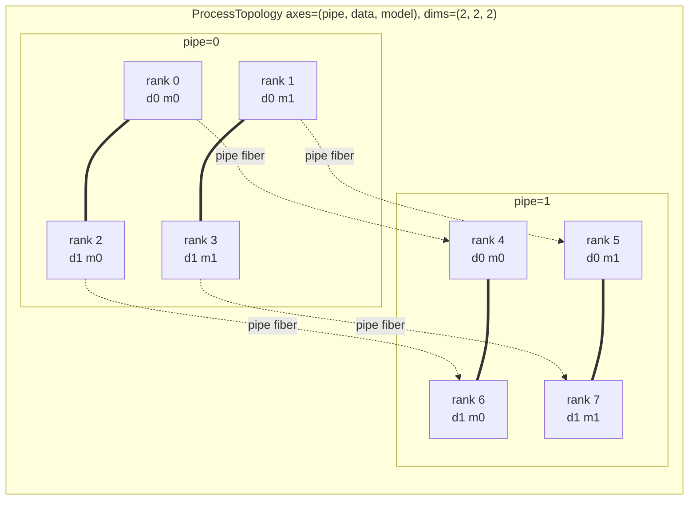
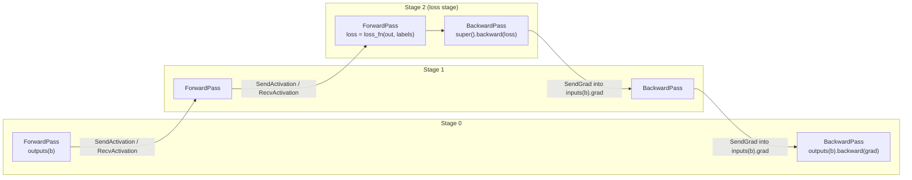
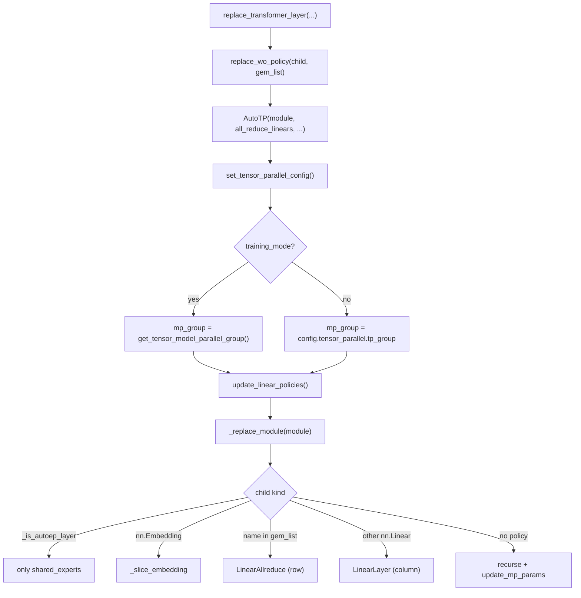
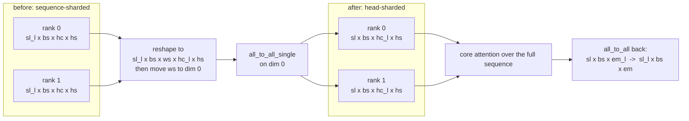

# Parallelism: process groups, pipeline, tensor, and sequence

What this covers: how DeepSpeed in this tree creates and looks up the process
groups for each parallel dimension (`deepspeed/utils/groups.py`,
`deepspeed/runtime/pipe/topology.py`); pipeline parallelism end to end
(`deepspeed/runtime/pipe/`); tensor parallelism / AutoTP
(`deepspeed/runtime/tensor_parallel/`, `deepspeed/module_inject/auto_tp.py`,
`deepspeed/module_inject/layers.py`); both Ulysses sequence-parallel
implementations present in the tree (`deepspeed/sequence/layer.py` and
`deepspeed/runtime/sequence_parallel/ulysses_sp.py`); and how the dimensions
compose with ZeRO and with the batch-size arithmetic in
`deepspeed/runtime/config.py`. Expert parallelism gets its own file:
`project-docs/06-moe-and-expert-parallelism.md`.

Source of truth: upstream commit d70adc32

---

## 1. The dimensions and where each one lives

| Dimension | Group accessor | Created by | Notes |
| --- | --- | --- | --- |
| Data (DP) | `groups._get_data_parallel_group()` (`deepspeed/utils/groups.py:786`) | `mpu`, `mesh_device`, or a world clone | Resolution order is `mesh_device` -> `mpu` -> `_clone_world_group()` |
| Tensor (TP) | `groups.get_tensor_model_parallel_group()` (`deepspeed/utils/groups.py:245`) | `groups._init_tp_mesh_device()` (`deepspeed/utils/groups.py:207`) | Module global `_TENSOR_MODEL_PARALLEL_GROUP` |
| Pipeline (PP) | `PipelineParallelGrid.get_pipe_parallel_group()` (`deepspeed/runtime/pipe/topology.py:422`) | `PipelineParallelGrid.__init__` (`deepspeed/runtime/pipe/topology.py:274`) | Built from a `ProcessTopology`, not from `groups.py` |
| Model (slice) | `PipelineParallelGrid.get_slice_parallel_group()` (`deepspeed/runtime/pipe/topology.py:469`) | same | Megatron-style tensor slicing inside a PP job |
| Sequence (SP) | `groups._get_sequence_parallel_group()` (`deepspeed/utils/groups.py:905`) | `mpu` or `mesh_device` mesh dim `sequence_parallel` | New SP path builds it in `parallel_state_sp.initialize_sequence_parallel()` (`deepspeed/runtime/sequence_parallel/parallel_state_sp.py:25`) |
| Sequence+data (SDP) | `groups._get_sequence_data_parallel_group()` (`deepspeed/utils/groups.py:934`) | derived | The group ZeRO shards over and gradients all-reduce over when SP is on |
| Expert (EP) | `groups._get_expert_parallel_group(name)` (`deepspeed/utils/groups.py:697`) | `groups._create_expert_and_data_parallel()` (`deepspeed/utils/groups.py:375`) | Keyed by the string `ep_size_<n>` |
| Expert data (EDP) | `groups._get_expert_data_parallel_group(name)` (`deepspeed/utils/groups.py:716`) | same | See file 06 |
| ZeRO param intra (hpZ) | `groups._get_zero_param_intra_parallel_group()` (`deepspeed/utils/groups.py:981`) | `groups._create_zero_param_parallel_group()` (`deepspeed/utils/groups.py:951`) | `zero_hpz_partition_size` |
| Local/global all-to-all | `groups._get_local_all_to_all_group()` (`deepspeed/utils/groups.py:757`) | same | Only used when `zero_quantized_gradients` is on |

Two distinct mechanisms create groups, and they do not know about each other:

1. **`deepspeed/utils/groups.py`** holds module-level globals and dicts. TP, EP,
   EDP, hpZ and the all-to-all groups live here. The engine caches handles out
   of it in `_configure_distributed_model` (`deepspeed/runtime/engine.py:2259`).
2. **`deepspeed/runtime/pipe/topology.py`** builds a `PipelineParallelGrid`
   object that *is* the `mpu` for pipeline jobs
   (`PipelineModule.mpu()`, `deepspeed/runtime/pipe/module.py:561`), and
   `deepspeed.initialize` passes it in as `mpu`
   (`deepspeed/__init__.py:613`). `groups.mpu` is then set from it
   (`deepspeed/runtime/engine.py:2218`).

So in a pipeline job, `groups._get_data_parallel_group()` delegates to
`PipelineParallelGrid.get_data_parallel_group()`, while TP-via-AutoTP uses the
separate `_TENSOR_MODEL_PARALLEL_GROUP` global. Mixing both in one job is not
wired up: `_configure_expert_parallel` rejects a non-trivial
`bwc_tensor_model_parallel_world_size(mpu)` (`deepspeed/runtime/engine.py:844`).

### 1.1 TP group creation

`groups._init_tp_mesh_device(tensor_model_parallel_size, data_parallel_size)`
(`deepspeed/utils/groups.py:207`) is the single entry point. It is idempotent
(returns early if `_TENSOR_MODEL_PARALLEL_GROUP` is already set,
`deepspeed/utils/groups.py:214`) and has three paths:

| Condition | Path | Cite |
| --- | --- | --- |
| `TORCH_DISTRIBUTED_DEBUG=DETAIL` | `_init_tp_groups_with_new_group` | `deepspeed/utils/groups.py:220` |
| DeviceMesh split unsupported by the backend | fall back to `_init_tp_groups_with_new_group` | `deepspeed/utils/groups.py:227` |
| otherwise | `dist.initialize_mesh_device((dp, tp), ("data_parallel", "tensor_parallel"))` | `deepspeed/utils/groups.py:225` |

The explicit-rank fallback (`deepspeed/utils/groups.py:159`) lays ranks out as
a row-major `(data_parallel, tensor_parallel)` mesh: TP groups are contiguous
blocks of `tp_size` ranks (`deepspeed/utils/groups.py:190-195`) and DP groups
are strided by `tp_size` (`deepspeed/utils/groups.py:184-188`).
`_MODEL_PARALLEL_GROUP` is aliased to the TP group
(`deepspeed/utils/groups.py:202`, and again at
`deepspeed/utils/groups.py:240`) -- the comment at
`deepspeed/utils/groups.py:237` notes this is only correct in the 2D DP+TP case.

`get_tensor_model_parallel_world_size()` and `...rank()` prefer the override
globals `_MPU_TENSOR_MODEL_PARALLEL_WORLD_SIZE` / `..._RANK` when set
(`deepspeed/utils/groups.py:274`, `deepspeed/utils/groups.py:292`), otherwise
they query the group. `get_tensor_model_parallel_src_rank()` computes
`(global_rank // tp_size) * tp_size` (`deepspeed/utils/groups.py:304`), which
assumes contiguous TP blocks -- consistent with the mesh layout above.

### 1.2 Teardown

`_release_process_group_references(group=None)`
(`deepspeed/utils/groups.py:93`) is the only sanctioned way to drop handles.
With `group=None` it clears every dict and global and reaches the
sequence-parallel module through `sys.modules` -- deliberately avoiding an
import, so teardown never forces that module to load
(`deepspeed/utils/groups.py:111-113`). With an explicit group it only removes
entries whose cached handle *is* that group
(`deepspeed/utils/groups.py:132-156`).

---

## 2. `ProcessTopology` and the pipeline grid

`ProcessTopology(axes, dims)` (`deepspeed/runtime/pipe/topology.py:12`) maps
n-dimensional coordinates to linear ranks with a **row-major** layout: the
*last* axis is the fastest-varying, because the mapping is built from
`itertools.product` over the dim ranges in axis order
(`deepspeed/runtime/pipe/topology.py:41-47`).

| Helper | Returns | Cite |
| --- | --- | --- |
| `get_rank(**coords)` | global rank; raises on partial coords | `deepspeed/runtime/pipe/topology.py:49` |
| `get_coord(rank)` | `ProcessCoord` namedtuple (linear scan) | `deepspeed/runtime/pipe/topology.py:110` |
| `get_axis_comm_lists(axis)` | one list per fiber along `axis`; `[]` if axis absent | `deepspeed/runtime/pipe/topology.py:127` |
| `get_axis_list(axis, idx)` | all ranks whose `axis` coord is `idx` | `deepspeed/runtime/pipe/topology.py:193` |
| `filter_match(**coords)` | ranks matching a partial coordinate | `deepspeed/runtime/pipe/topology.py:167` |
| `get_rank_repr(rank, omit_axes=['data','pipe'])` | checkpoint filename fragment, e.g. `model_01` | `deepspeed/runtime/pipe/topology.py:69` |

Two specializations ship:

- `PipeDataParallelTopology(num_pp, num_dp)` -> `axes=['pipe','data']`
  (`deepspeed/runtime/pipe/topology.py:240`). Data is the last axis so DP
  fibers are contiguous, which the docstring justifies as keeping gradient
  all-reduces on intra-node links
  (`deepspeed/runtime/pipe/topology.py:232-238`).
- `PipeModelDataParallelTopology(num_pp, num_mp, num_dp)` ->
  `axes=['pipe','data','model'], dims=[num_pp, num_dp, num_mp]`
  (`deepspeed/runtime/pipe/topology.py:247`). Note the argument order and the
  axis order differ: `model` is last (fastest-varying) even though it is the
  second positional argument.



Solid double lines are `data` fibers (`get_axis_comm_lists('data')`), dotted
lines are `pipe` fibers; `model` fibers are the adjacent pairs inside each
`pipe=*` box. The docstring example at
`deepspeed/runtime/pipe/topology.py:131-138` gives exactly these pipe fibers:
`[[0,4],[1,5],[2,6],[3,7]]`.

### 2.1 `PipelineParallelGrid`

Constructed by `PipelineModule` (`deepspeed/runtime/pipe/module.py:183`). Its
`__init__` (`deepspeed/runtime/pipe/topology.py:274`) builds, in order:

| Attribute | Content | Cite |
| --- | --- | --- |
| `ds_model_proc_group` | ranks sharing one `data` index (used for overflow detection) | `deepspeed/runtime/pipe/topology.py:304-314` |
| `dp_proc_group` / `dp_group` | gradient all-reduce group from `get_axis_comm_lists('data')` | `deepspeed/runtime/pipe/topology.py:317-323` |
| `p2p_groups` | `[rank, next_rank_in_pipe_fiber]` pairs, wrapping around | `deepspeed/runtime/pipe/topology.py:371` |
| `pp_proc_group` / `pp_group` | pipe fiber group | `deepspeed/runtime/pipe/topology.py:331-341` |
| `slice_proc_group` / `slice_group` | model fiber group, or a singleton group per rank when `model_parallel_size == 1` | `deepspeed/runtime/pipe/topology.py:348-363` |

When there is no topology argument it invents one by splitting the prime
factorization of the world size alternately into PP and DP
(`deepspeed/runtime/pipe/topology.py:284-290`). `_is_grid_valid()` asserts the
product of all dims equals the world size
(`deepspeed/runtime/pipe/topology.py:388`).

`stage_to_global(stage_id, **kwargs)`
(`deepspeed/runtime/pipe/topology.py:396`) takes the caller's own coordinate,
replaces `pipe` (and any axes given in `kwargs`), and maps back to a rank. It is
what p2p uses to find a peer (`deepspeed/runtime/pipe/p2p.py:52`).

The grid also implements the Megatron `mpu` surface:
`get_pipe_parallel_{rank,world_size,group}`,
`get_data_parallel_{rank,world_size,group}`,
`get_model_parallel_{rank,world_size,group}`, and
`get_slice_parallel_*` / `get_tensor_model_parallel_*` aliases
(`deepspeed/runtime/pipe/topology.py:405-470`). Note that
`get_model_parallel_*` returns the *`ds_model_*`* values (all ranks sharing a
`data` coordinate, i.e. PP x MP), while `get_tensor_model_parallel_*` returns
the `slice`/`model` axis.

---

## 3. Pipeline parallelism

### 3.1 `PipelineModule`: specs and partitioning

`PipelineModule(layers, ...)` (`deepspeed/runtime/pipe/module.py:86`) takes a
flat sequence whose elements may be:

| Element type | Handling in `_build()` | Cite |
| --- | --- | --- |
| `PipelineModule` | `NotImplementedError` | `deepspeed/runtime/pipe/module.py:246` |
| `nn.Module` instance | registered under `str(layer_idx)` | `deepspeed/runtime/pipe/module.py:250` |
| `TiedLayerSpec` | built once per `key` into `self.tied_modules`; optional `forward_fn` wrapped with `functools.partial` | `deepspeed/runtime/pipe/module.py:257-268` |
| `LayerSpec` | `layer.build()` then registered | `deepspeed/runtime/pipe/module.py:271` |
| anything else (lambda, function) | appended to `forward_funcs` unregistered | `deepspeed/runtime/pipe/module.py:280` |

`LayerSpec` (`deepspeed/runtime/pipe/module.py:30`) stores `typename` plus
args/kwargs and refuses non-`nn.Module` types
(`deepspeed/runtime/pipe/module.py:58`). Deferring construction is what makes
`_count_layer_params()` cheap: it builds one layer at a time to weigh it
(`deepspeed/runtime/pipe/module.py:302`). `TiedLayerSpec`
(`deepspeed/runtime/pipe/module.py:77`) adds `key`, `forward_fn`, and
`tied_weight_attr` (defaulting to `['weight']`, coerced from a bare string at
`deepspeed/runtime/pipe/module.py:83`).

Partitioning (`_partition_layers`, `deepspeed/runtime/pipe/module.py:395`):

| `partition_method` | Behaviour | Cite |
| --- | --- | --- |
| `'uniform'` | `ds_utils.partition_uniform(num_layers, num_stages)` | `deepspeed/runtime/pipe/module.py:405` |
| `'parameters'` (default) | `partition_balanced(weights=param_counts, ...)` | `deepspeed/runtime/pipe/module.py:408` |
| `'type:<regex>'` | binary weights over layers whose class name matches, then `partition_balanced` | `deepspeed/runtime/pipe/module.py:411` |
| `'profile'` | `NotImplementedError` | `deepspeed/runtime/pipe/module.py:417` |

`partition_uniform` and `partition_balanced` live in
`deepspeed/runtime/utils.py:681` and `deepspeed/runtime/utils.py:702`. The
result is `self.parts`, a list of `num_stages + 1` boundaries; this rank gets
`[parts[stage_id], parts[stage_id+1])` via `_set_bounds`
(`deepspeed/runtime/pipe/module.py:446`).

Tied weights: `_index_tied_modules()` (`deepspeed/runtime/pipe/module.py:480`)
returns `{}` when `pipe == 1` (`deepspeed/runtime/pipe/module.py:483`), sorts
the tie keys so every rank iterates in the same order
(`deepspeed/runtime/pipe/module.py:491`), and for every `(dp, mp)` fiber builds
a `dist.new_group` over the stages owning that key
(`deepspeed/runtime/pipe/module.py:503-511`). Non-owner replicas get
`p.ds_pipe_replicated = True` (`deepspeed/runtime/pipe/module.py:524-526`) so
the fp16/bf16 optimizer counts them once; every other pipeline parameter is
explicitly marked `False` (`deepspeed/runtime/pipe/module.py:286`).
`_synchronize_tied_weights()` broadcasts from `min(ranks)` at build time and
after loading (`deepspeed/runtime/pipe/module.py:471`,
`deepspeed/runtime/pipe/module.py:658`);
`allreduce_tied_weight_gradients()` sums `weight.grad` over the tie group
(`deepspeed/runtime/pipe/module.py:456`).

Activation checkpointing inside the module is interval-based.
`forward()` either runs one range function over all layers when the interval is
0 (`deepspeed/runtime/pipe/module.py:372`) or zips contiguous blocks against
the cached `is_checkpointable_results`
(`deepspeed/runtime/pipe/module.py:378`). That cache is rebuilt whenever the
interval changes (`_precompute_checkpointable_values`,
`deepspeed/runtime/pipe/module.py:221`, called from `set_checkpoint_interval`,
`deepspeed/runtime/pipe/module.py:550`). `_is_checkpointable`
(`deepspeed/runtime/pipe/module.py:660`) special-cases `GPTModelPipe` /
`GPT2ModelPipe` to require `ParallelTransformerLayerPipe` (or a name listed in
`checkpointable_layers`), honours an explicit `checkpointable_layers` list
otherwise, and finally falls back to "any block with parameters".

### 3.2 `PipelineEngine`: buffers and the instruction loop

`PipelineEngine.__init__` (`deepspeed/runtime/pipe/engine.py:72`) asserts:

- the module is a `PipelineModule` (`deepspeed/runtime/pipe/engine.py:74`);
- `zero_optimization_stage() < ZeroStageEnum.gradients`, i.e. ZeRO-2 and ZeRO-3
  are rejected (`deepspeed/runtime/pipe/engine.py:76`);
- `dp_world_size == grid.data_parallel_size`
  (`deepspeed/runtime/pipe/engine.py:103`);
- `train_batch_size == micro_batch_size * micro_batches * dp_size`
  (`deepspeed/runtime/pipe/engine.py:104`).

It disables the engine's own backward all-reduce
(`enable_backward_allreduce = False`,
`deepspeed/runtime/pipe/engine.py:80`) because reductions are scheduled
explicitly, and it overrides `is_gradient_accumulation_boundary()` to return
the `_force_grad_boundary` flag
(`deepspeed/runtime/pipe/engine.py:658`), which `_exec_reduce_grads` and
`_exec_optimizer_step` raise around their work
(`deepspeed/runtime/pipe/engine.py:288`,
`deepspeed/runtime/pipe/engine.py:1217`).

`forward`, `backward` and `step` all raise `PipelineError`
(`deepspeed/runtime/pipe/engine.py:1287-1297`); the only entry points are
`train_batch()` (`deepspeed/runtime/pipe/engine.py:332`) and
`eval_batch()` (`deepspeed/runtime/pipe/engine.py:409`).

Four parallel buffer lists are kept
(`deepspeed/runtime/pipe/engine.py:172-177`):

| Buffer | Written by | Freed by |
| --- | --- | --- |
| `inputs` | `_exec_load_micro_batch` (stage 0), `_exec_recv_activations` | `_exec_send_grads` (`deepspeed/runtime/pipe/engine.py:1102`) |
| `labels` | `_exec_load_micro_batch` (last stage) | overwritten cyclically |
| `outputs` | `_exec_forward_pass` | `_exec_backward_pass` (`deepspeed/runtime/pipe/engine.py:863`) |
| `output_tensors` | `_exec_forward_pass` when `is_pipe_partitioned` | `_exec_backward_pass` (`deepspeed/runtime/pipe/engine.py:862`) |

`_reserve_pipe_buffers(n)` only extends the lists with `None`; it never
allocates tensors (`deepspeed/runtime/pipe/engine.py:300`). The count comes
from the schedule: `_exec_schedule` calls
`pipe_schedule.num_pipe_buffers()` once at the top
(`deepspeed/runtime/pipe/engine.py:1366`).

Receive buffers are separate and reused: `pipe_recv_buf` for activations and
`_grad_layer_buf` for gradients. `_allocate_or_extend_buffers(idx, shape, dtype)`
(`deepspeed/runtime/pipe/engine.py:1275`) keeps a per-index buffer and
re-views it when the new shape is smaller, only reallocating when `numel`
grows. `reset_activation_shape()` (`deepspeed/runtime/pipe/engine.py:316`)
clears all of them plus the four `pipe_partition_*_meta_cache` entries; it must
be called when sequence length changes (curriculum learning), unless the module
was built with `dynamic_shape=True`, which forces a meta exchange on every
send (`deepspeed/runtime/pipe/engine.py:1029`,
`deepspeed/runtime/pipe/engine.py:1114`).

`_exec_schedule` is the whole driver (`deepspeed/runtime/pipe/engine.py:1364`):
for each step it looks the instruction type up in `_INSTRUCTION_MAP`
(`deepspeed/runtime/pipe/engine.py:1351`), binds the handler with
`MethodType`, and calls it with `cmd.kwargs`. An unmapped instruction is a
`RuntimeError` (`deepspeed/runtime/pipe/engine.py:1374`) -- which is why
`CommitP2P` only works under `DualPipeVEngine`, whose map adds it
(`deepspeed/runtime/pipe/dualpipev.py:282`).

| Instruction | Handler | Cite |
| --- | --- | --- |
| `LoadMicroBatch` | `_exec_load_micro_batch` | `deepspeed/runtime/pipe/engine.py:886` |
| `ForwardPass` | `_exec_forward_pass` | `deepspeed/runtime/pipe/engine.py:698` |
| `BackwardPass` | `_exec_backward_pass` | `deepspeed/runtime/pipe/engine.py:791` |
| `SendActivation` | `_exec_send_activations` | `deepspeed/runtime/pipe/engine.py:1015` |
| `RecvActivation` | `_exec_recv_activations` | `deepspeed/runtime/pipe/engine.py:1107` |
| `SendGrad` | `_exec_send_grads` | `deepspeed/runtime/pipe/engine.py:1051` |
| `RecvGrad` | `_exec_recv_grads` | `deepspeed/runtime/pipe/engine.py:1150` |
| `ReduceTiedGrads` | `_exec_reduce_tied_grads` | `deepspeed/runtime/pipe/engine.py:269` |
| `ReduceGrads` | `_exec_reduce_grads` | `deepspeed/runtime/pipe/engine.py:287` |
| `OptimizerStep` | `_exec_optimizer_step` | `deepspeed/runtime/pipe/engine.py:1212` |

### 3.3 `TrainSchedule`: 1F1B

`PipeSchedule` (`deepspeed/runtime/pipe/schedule.py:11`) is a generator of
lists of `PipeInstruction`. The contract stated in the docstring is that a
barrier may be inserted between successive yielded steps without deadlock
(`deepspeed/runtime/pipe/schedule.py:16-19`).

`TrainSchedule.steps()` (`deepspeed/runtime/pipe/schedule.py:197`) runs
`2 * (micro_batches + stages - 1)` steps
(`deepspeed/runtime/pipe/schedule.py:200`). `_step_to_micro_batch(step_id)`
(`deepspeed/runtime/pipe/schedule.py:258`) decides forward vs backward purely
from the parities of `step_id` and `stage_id`:

| `step_id` | `stage_id` | direction | micro-batch id |
| --- | --- | --- | --- |
| even | even | forward | `step//2 - stage//2` (`:280`) |
| odd | odd | forward | `(step-1)//2 - stage//2` (`:285`) |
| even | odd | backward | `step//2 - stages + (stage+1)//2` (`:290`) |
| odd | even | backward | `(step-1)//2 - stages + 1 + stage//2` (`:295`) |

Out-of-range micro-batch ids are filtered by `_valid_micro_batch`
(`deepspeed/runtime/pipe/schedule.py:80`), which is what produces the warm-up
and drain phases. Within a step the order is fixed: gradient/activation
exchange first, then the first/last-stage data load, then the compute, then
(on the final step only) `ReduceTiedGrads`, `ReduceGrads`, `OptimizerStep`
(`deepspeed/runtime/pipe/schedule.py:213-241`).

Buffer count: `num_pipe_buffers()` returns
`max(2, min(stages - stage_id, micro_batches))`
(`deepspeed/runtime/pipe/schedule.py:255`) -- the number of in-flight forwards
a stage must remember, which shrinks toward the last stage. `_buffer_idx`
is a plain `micro_batch_id % num_pipe_buffers()`
(`deepspeed/runtime/pipe/schedule.py:111`).

The x axis below is the schedule step index, not wall time; every cell is the
`ForwardPass`/`BackwardPass` that `_step_to_micro_batch` yields for that
`(step_id, stage_id)` pair with `stages=3, micro_batches=4` (12 steps).

```mermaid
gantt
  title TrainSchedule with stages=3 and micro_batches=4 (F forward, B backward)
  dateFormat X
  axisFormat %s
  section Stage 0
  F0 :0, 1
  F1 :2, 3
  F2 :4, 5
  B0 :5, 6
  F3 :6, 7
  B1 :7, 8
  B2 :9, 10
  B3 :11, 12
  section Stage 1
  F0 :1, 2
  F1 :3, 4
  B0 :4, 5
  F2 :5, 6
  B1 :6, 7
  F3 :7, 8
  B2 :8, 9
  B3 :10, 11
  section Stage 2
  F0 :2, 3
  B0 :3, 4
  F1 :4, 5
  B1 :5, 6
  F2 :6, 7
  B2 :7, 8
  F3 :8, 9
  B3 :9, 10
```



The last stage alternates `F B F B` with no gaps -- that is the "1F1B" steady
state. Earlier stages start their backward later and so hold more live
activations, which is exactly the `stages - stage_id` buffer formula. The
empty steps on stage 0 are the parity slots whose micro-batch id fell outside
`[0, micro_batches)`.

The other schedules in the file:

| Schedule | Steps | Buffers | Cite |
| --- | --- | --- | --- |
| `InferenceSchedule` | `micro_batches + stages - 1` | 2 | `deepspeed/runtime/pipe/schedule.py:135` |
| `DataParallelSchedule` | `micro_batches` | 1 | `deepspeed/runtime/pipe/schedule.py:301` |
| `DualPipeVSchedule` | 8 phases; requires `micro_batches >= 2 * stages` | `2 * micro_batches` | `deepspeed/runtime/pipe/schedule.py:327` |

### 3.4 `p2p.py`: the wire

`p2p.init_process_groups(grid)` (`deepspeed/runtime/pipe/p2p.py:27`) asserts
`pipe_parallel_size > 1` and only materializes the per-pair groups when
`can_send_recv()` is false, i.e. torch < 1.8
(`deepspeed/runtime/pipe/p2p.py:21`, `deepspeed/runtime/pipe/p2p.py:33`). On
any modern torch the broadcast-emulation path is dead and `send`/`recv` go
straight to `dist.send` / `dist.recv`
(`deepspeed/runtime/pipe/p2p.py:60`, `deepspeed/runtime/pipe/p2p.py:81`).

Both `send` and `recv` assert `async_op == False`
(`deepspeed/runtime/pipe/p2p.py:48`, `deepspeed/runtime/pipe/p2p.py:69`), so
the `isend`/`irecv` branches below those asserts are unreachable. They also
validate adjacency: `_is_valid_send_recv` allows only `|src - dest| == 1` or
the first<->last wraparound (`deepspeed/runtime/pipe/p2p.py:37`).

Shapes are discovered, not assumed. `_send_tensor_meta`
(`deepspeed/runtime/pipe/engine.py:930`) packs a fixed-size
`TENSOR_META_SIZE = 256` int32 buffer
(`deepspeed/runtime/pipe/engine.py:45`) containing a type tag (0 = tensor,
2 = tuple), dtype ids from `DTYPE_TO_ID`
(`deepspeed/runtime/pipe/engine.py:70`), ndims and sizes, and asserts it fits
(`deepspeed/runtime/pipe/engine.py:948`). `_recv_tensor_meta`
(`deepspeed/runtime/pipe/engine.py:975`) decodes it and returns allocated
buffers. This happens once per direction unless `dynamic_shape` is set.

Bool tensors are the main wart: NCCL will not send `torch.BoolTensor`, so the
trailing attention mask is cast to `half()` before the send and back to
`bool()` after (`deepspeed/runtime/pipe/engine.py:1024-1027`,
`deepspeed/runtime/pipe/engine.py:1043-1046`,
`deepspeed/runtime/pipe/engine.py:1137`), and dropped entirely from the
gradient send (`deepspeed/runtime/pipe/engine.py:1078-1081`). The engine
auto-detects this for `GPT2ModelPipe` (`deepspeed/runtime/pipe/engine.py:224`)
and otherwise relies on the `has_bool_tensors` constructor flag or
`set_has_attention_mask()` (`deepspeed/runtime/pipe/engine.py:255`).



Direction of each instruction, read off the handlers: `SendActivation` targets
`self.next_stage` (`deepspeed/runtime/pipe/engine.py:1034`), `RecvActivation`
reads from `self.prev_stage` (`deepspeed/runtime/pipe/engine.py:1118`),
`SendGrad` targets `self.prev_stage` (`deepspeed/runtime/pipe/engine.py:1085`)
and `RecvGrad` reads from `self.next_stage`
(`deepspeed/runtime/pipe/engine.py:1200`). `_exec_send_grads` skips any input
that is not floating point and asserts the rest have a `.grad`
(`deepspeed/runtime/pipe/engine.py:1093-1099`); the receiving side builds
`grad_layer` from the same `is_floating_point()` filter over `outputs`
(`deepspeed/runtime/pipe/engine.py:1192`), which is how the two sides agree on
message count without extra communication. The long comment at
`deepspeed/runtime/pipe/engine.py:1173-1186` explains why the
`is_grad_partitioned` case has to bypass that filter: the partition metadata
tensor is a `LongTensor` and would be filtered out.

### 3.5 Loss and gradient flow

Only the last stage computes a loss. `_exec_forward_pass` there calls
`self.module.loss_fn(outputs, labels)` when both a loss function and
`_compute_loss` are set and otherwise treats the module output as the loss
(`deepspeed/runtime/pipe/engine.py:753-759`), accumulating `self.total_loss`
plus, if the module implements `get_additional_losses()`, a dict of named
extras (`:780-789`). `_exec_backward_pass` on that stage simply calls
`super().backward(self.loss)` (`:797`); every other stage calls
`outputs.backward(gradient=grad_tensors)` with the received gradient, using
`retain_graph` for all but the last tensor of a tuple (`:845-852`), wrapped in
`self._running_engine_backward = True` so the engine's post-backward hook does
not reject it (`:841`).

Gradient-accumulation scaling is applied once, at the loss stage:
`_backward_prologue_per_tensor` delegates to the base engine only
`if self.is_last_stage()` and otherwise passes the gradient through unchanged
(`deepspeed/runtime/pipe/engine.py:518-522`), so upstream stages receive
already-scaled gradients.

`_aggregate_total_loss()` (`deepspeed/runtime/pipe/engine.py:573`) runs after
the schedule. On the last stage it scales by GAS, all-reduces over the DP group
and divides by `dp_world_size`, packing the main loss and any additional losses
into one flat tensor for a single collective
(`deepspeed/runtime/pipe/engine.py:594-610`), then broadcasts
`[dp_group_loss, agg_loss, *additional]` over the pipe group
(`deepspeed/runtime/pipe/engine.py:616-618`). Other stages allocate
`2 + n_additional_losses` floats and receive that broadcast
(`deepspeed/runtime/pipe/engine.py:627-628`). The source rank is
`_loss_stage_global_rank()`, i.e. `grid.stage_to_global(num_stages - 1)`
(`deepspeed/runtime/pipe/engine.py:506`).

DP reduction of weight gradients happens in `_exec_reduce_grads`
(`deepspeed/runtime/pipe/engine.py:287`): the BF16 optimizer path goes through
`buffered_allreduce_fallback` (`deepspeed/runtime/pipe/engine.py:298`), the
rest through `allreduce_gradients(bucket_size=MEMORY_OPT_ALLREDUCE_SIZE)`.
Tied-weight gradients are reduced separately in `_exec_reduce_tied_grads`
(`deepspeed/runtime/pipe/engine.py:269`), which reads `weight._hp_grad` under
the BF16 optimizer and `weight.grad` otherwise
(`deepspeed/runtime/pipe/engine.py:283`). That handler also calls
`optimizer.overlapping_partition_gradients_reduce_epilogue()` when gradients
are partitioned, with a comment explaining it is a ZeRO-2 workaround
(`deepspeed/runtime/pipe/engine.py:271-279`).

### 3.6 Optional activation/gradient partitioning across the slice group

When `model_parallel_size > 1` and both config flags are on, the first
activation tensor is partitioned across the slice group to cut p2p volume:
`is_pipe_partitioned` / `is_grad_partitioned`
(`deepspeed/runtime/pipe/engine.py:137-138`) read
`self._config.pipeline['pipe_partitioned']` and `['grad_partitioned']`, both
defaulting to `True` (`deepspeed/runtime/config.py:279-280`). The send side
emits `PartitionedTensor.to_meta()` plus `.data()`
(`deepspeed/runtime/pipe/engine.py:742-747`) and replaces the large tensor's
`.data` with a 1-element zero tensor while keeping its autograd graph in
`output_tensors` (`:744-745`); the receive side calls
`PartitionedTensor.from_meta(...).full()` (`:710-714`).

### 3.7 DualPipeV

`deepspeed/runtime/pipe/dualpipev.py` adds a V-shaped schedule in which each
rank holds two stages: its own, and the mirror `2*stages - 1 - stage_id`
(`DualPipeVModule._partition_layers`, `deepspeed/runtime/pipe/dualpipev.py:41-45`;
`activate_phase`, `:62`). Rank 0 holds both the first stage (phase 0) and the
loss stage (phase 1), so `is_last_stage()` is overridden to mean "rank 0,
phase 1" (`:117-121`), with an `_INIT` sentinel so the parent's p2p warm-up
still sees the topological answer (`:23`). Communication is batched:
`_queue_p2p` appends `dist.P2POp`s (`:174`) and `_exec_commit_p2p` drains them
through `dist.batch_isend_irecv` (`:179`) -- hence the `CommitP2P` instruction
(`deepspeed/runtime/pipe/schedule.py:631`) and the rule that an instruction's
communication is incomplete until the next `CommitP2P` runs
(`deepspeed/runtime/pipe/schedule.py:338-340`). `DualPipeVEngine.__init__`
(`deepspeed/runtime/pipe/dualpipev.py:98-107`) requires
`micro_batches >= 2 * stages` and rejects `pipe_partitioned`,
`grad_partitioned`, `dynamic_shape` and bool tensors.

---

## 4. Tensor parallelism / AutoTP

### 4.1 Entry points

| Path | Trigger | Cite |
| --- | --- | --- |
| Training, via the engine | `tensor_parallel.autotp_size > 0` in the DS config; `set_autotp_mode(training=True)` then `_configure_tensor_parallel` | `deepspeed/__init__.py:580-582`, `deepspeed/runtime/engine.py:973` |
| Training, standalone | `TpTrainingManager(model, tp_size, dtype)` | `deepspeed/runtime/tensor_parallel/tp_manager.py:12` |
| `tp_model_init` | records args, merged into the config at `deepspeed.initialize` | `deepspeed/runtime/tensor_parallel/init_utils.py:36`, `:79` |

`TpTrainingManager.__init__` is the compact version of the whole flow: parse
the model with `AutoTP.tp_parser` (`:22`), create the TP mesh via
`groups._init_tp_mesh_device(tp_size)` (`:65`), broadcast the RNG state from
`groups.get_tensor_model_parallel_src_rank()` so all TP ranks agree (`:31`),
then apply one injection policy per detected block through
`replace_transformer_layer(..., training_mode=True)` (`:53`).

`_configure_tensor_parallel_states` does the same mesh init
(`deepspeed/runtime/engine.py:991`), sets `self.mpu = groups`
(`deepspeed/runtime/engine.py:990`), and installs a one-shot forward pre-hook
that broadcasts the first batch within the TP group and asserts every rank saw
identical inputs (`deepspeed/runtime/engine.py:995-1038`).

### 4.2 Matching: which modules get replaced

`AutoTP.tp_parser(model)` (`deepspeed/module_inject/auto_tp.py:343`) returns a
list of `(block_type, gem_list)` policies. It walks
`AutoTP.get_module_list(model)` -- one representative module per distinct class
found inside any `nn.ModuleList` (`deepspeed/module_inject/auto_tp.py:280`) --
flattens each block's children into a `layer_list` of `.`-prefixed `nn.Linear`
names and the literal `"ln"` for norms
(`deepspeed/module_inject/auto_tp.py:354-361`), then picks the *row-parallel*
("all-reduce") members by name:

| Rule | Cite |
| --- | --- |
| the layer immediately before a norm | `deepspeed/module_inject/auto_tp.py:363-365` |
| `out_proj`, `o_proj`, `down_proj` | `deepspeed/module_inject/auto_tp.py:366-371` |
| `attention.dense` on GPTNeoX, `self_attention.dense` on Falcon/ChatGLM, `self_attn.dense` on Phi | `deepspeed/module_inject/auto_tp.py:372-383` |
| `w2` on Mixtral, `dense_4h_to_h` on ChatGLM | `deepspeed/module_inject/auto_tp.py:378`, `:384` |

Everything else that reaches `_replace` becomes column-parallel.
`AutoTP.supported(model)` rejects a hardcoded list of architectures
(`deberta`, `flaubert`, `fsmt`, `gpt2`, `led`, `longformer`, `xlm`, `xlnet`)
(`deepspeed/module_inject/auto_tp.py:293-304`).

`update_linear_policies()` (`deepspeed/module_inject/auto_tp.py:1020`) sets the
type-dispatch table: `{nn.Linear: self._replace, nn.Embedding: self._slice_embedding}`
normally (`:1035`), or `{transformers.pytorch_utils.Conv1D: self._replace}`
with `conv_linear_layer = True` for GPT-2 blocks (`:1028-1031`).

`_replace_module` (`deepspeed/module_inject/auto_tp.py:1057`) is the recursive
walk. Its routing per child, in order:

1. children marked `_is_autoep_layer` are skipped except for their
   `shared_experts` / `shared_experts_gate`
   (`deepspeed/module_inject/auto_tp.py:1062-1065`, handled by
   `_replace_autoep_shared_experts`, `:1037`);
2. `Loading.is_load_module(child)` plus a `state_dict` triggers a sharded
   weight load instead of a structural replacement
   (`deepspeed/module_inject/auto_tp.py:1074-1080`);
3. with a `partition_config`, routing is purely pattern-based
   (`deepspeed/module_inject/auto_tp.py:1084-1104`): embeddings go to
   `_slice_embedding` only if a spec matches, 2-D weights go to
   `_replace_with_config`, everything else recurses;
4. without one, the type table decides, with an `isinstance` fallback pass for
   subclasses such as `FalconLinear`
   (`deepspeed/module_inject/auto_tp.py:1106-1119`);
5. subtrees with no matching policy recurse and then get `update_mp_params`
   (`deepspeed/module_inject/auto_tp.py:1121-1124`).

`update_mp_params` (`deepspeed/module_inject/auto_tp.py:989`) rewrites the
config-ish integer attributes a block caches (`num_heads`, `hidden_size`,
`num_key_value_heads`, ... -- the full list is at
`deepspeed/module_inject/auto_tp.py:1005-1009`) to their per-rank values. It
bails out if no descendant parameter actually carries TP metadata
(`:992`) or if any parameter has `dim() >= 3`
(`:998-1004`), since AutoTP does not shard those.



### 4.3 Row vs column sharding, and where the all-reduce goes

Every replacement subclasses `TensorParallel_Layer`
(`deepspeed/module_inject/layers.py:372`), which caches `tp_world_size` /
`tp_index` from `mp_group` (`deepspeed/module_inject/layers.py:409-414`) and
freezes the split once at construction via `_freeze_partition_sizes`
(`deepspeed/module_inject/layers.py:584`). That tuple is then the single source
of truth for the forward gather, the parameter gather, and the
universal-checkpoint metadata.

| Layer | Weight dim sharded | Forward collective | Backward collective | Bias | Cite |
| --- | --- | --- | --- | --- | --- |
| `LinearAllreduce` (row) | dim 1 (input features) | all-reduce on the output | none | replicated, added after the reduce | `deepspeed/module_inject/layers.py:888`, forward `:906` |
| `LinearLayer` (column) | dim 0 (output features) | none (optional output all-gather) | all-reduce on the input gradient | sharded dim 0 | `deepspeed/module_inject/layers.py:983`, forward `:1001` |
| `LinearAllreduceWithReplicatedInput` | dim 1 | scatter input, then row all-reduce | all-reduce in the scatter's backward | replicated | `deepspeed/module_inject/layers.py:969` |
| `VocabParallelLinear` | dim 0 (vocab) | none; logits stay rank-local | handled by the distributed loss | n/a | `deepspeed/module_inject/layers.py:1093` |
| `VocabParallelEmbedding` | dim 0 (vocab) | all-reduce of partial lookups | - | n/a | `deepspeed/module_inject/layers.py:1119` |
| `HiddenParallelEmbedding` | hidden dim | shares a row-parallel head's shard | - | n/a | `deepspeed/module_inject/layers.py:1238` |
| `_slice_embedding` result | dim 1 (hidden) | plain `nn.Embedding`, no collective | - | n/a | `deepspeed/module_inject/auto_tp.py:895` |

The collectives themselves are four `torch.autograd.Function`s:

| Function | forward | backward | Cite |
| --- | --- | --- | --- |
| `RowParallel` | all-reduce (`inference_all_reduce` when inference or the input needs no grad) | identity | `deepspeed/module_inject/layers.py:206` |
| `ColumnParallel` | identity | all-reduce of `grad_output` | `deepspeed/module_inject/layers.py:293` |
| `AsyncColumnParallel` | matmul + bias | async all-reduce overlapped with the weight-gradient GEMM | `deepspeed/module_inject/layers.py:264` |
| `GatherFromTensorParallelRegion` | pad-to-max, `all_gather_into_tensor`, trim, concat on dim -1 | narrow to this rank's shard | `deepspeed/module_inject/layers.py:323` |
| `ScatterToTensorParallelRegion` | narrow dim -1 | zero-fill + all-reduce | `deepspeed/module_inject/layers.py:242` |

Two subtleties before editing these. `RowParallel.forward` copies the reduced
result back into the caller's tensor when `contiguous()` handed back a different
object (`deepspeed/module_inject/layers.py:226-231`). And `LinearLayer.forward`
picks between the two column paths on the class-level `tp_overlap_comm` flag
(`deepspeed/module_inject/layers.py:1003`), set by
`configure_tensor_parallel_runtime` from
`tensor_parallel.tp_overlap_comm` (`deepspeed/module_inject/layers.py:677`,
`deepspeed/runtime/tensor_parallel/config.py:50`).

Shard sizes are not simply `total // tp_size`.
`get_shard_size(total_size, mp_size, meta, name, rank)`
(`deepspeed/module_inject/tp_shard.py:95`) has two regimes:

- if the model's `num_kv_heads` is known, divides `total_size` and
  `num_kv_heads` so KV groups stay intact -- but only when the layer name is
  not an MLP, not `lm_head`/`embed_out`, and not one of
  `gate_proj|up_proj|down_proj|w1|w2|w3`
  (`deepspeed/module_inject/tp_shard.py:110-127`);
- otherwise quantizes to `tp_grain_size` and gives the remainder to the last
  rank (`deepspeed/module_inject/tp_shard.py:129-137`).

`get_shard_size_list` asserts the shards tile the dimension exactly
(`deepspeed/module_inject/tp_shard.py:148`). Because the split depends on the
layer *name*, `update_mp_params` must be called with the same name as the
weights it describes -- the comment at
`deepspeed/module_inject/auto_tp.py:1015-1016` says so explicitly.

### 4.4 ZeRO-3 interaction

A model built under `deepspeed.zero.Init` holds an empty 1-D placeholder as
each parameter's data, so slicing it would slice nothing.
`AutoTP._gather_zero3_params(module)`
(`deepspeed/module_inject/auto_tp.py:521`) gathers each such weight once under
`GatheredParameters(..., modifier_rank=None)`, replaces it with an ordinary
`nn.Parameter`, re-points every module that aliased it so ties survive
(`:546-552`), and records the swap in `self.replacement_sources` for the
engine's optimizer remap (`:553-554`).
`_shape_before_zero3_partition(param)`
(`deepspeed/module_inject/layers.py:510`) reads `ds_shape` when present, which
is what lets the layers compute logical shapes either way.

### 4.5 Replicated parameters applied to sharded activations

A parameter left replicated but applied to per-rank activations (Qwen3's
`q_norm` / `k_norm` over local heads) accumulates a different partial gradient
on each TP rank. `register_replicated_grad_hooks(model)`
(`deepspeed/module_inject/auto_tp.py:940`) installs a `register_hook` that
all-reduces such gradients, driven by `spec.grad_allreduce` in the
`partition_config`; it is a no-op without a `partition_config` or with
`mp_size <= 1` (`:953`) and returns the frozen parameters it skipped so the
engine can reject them if they are later unfrozen (`:966-987`).

---

## 5. Sequence parallelism (Ulysses)

Two implementations coexist in this tree. They do not share the attention
module, only the low-level differentiable all-to-all.

| | `deepspeed/sequence/layer.py` | `deepspeed/runtime/sequence_parallel/ulysses_sp.py` |
| --- | --- | --- |
| Public class | `DistributedAttention` (`:471`) | `UlyssesSPAttentionHF` (`:49`) |
| Exchange | `_SeqAllToAll` autograd Function (`:377`) -> `single_all_to_all` (`:276`) | `_dim_zero_all_to_all` custom op (`deepspeed/sequence/layer.py:357`) |
| Accepted layouts | `[b, s, h, d]` or `[s, b, h, d]`, selected by `batch_dim_idx` | only `[sl, bs, hc, hs]`, asserted |
| Uneven head counts | supported via `uneven_heads_all2all` (`:163`) | not supported; divisibility required |
| Groups | caller-supplied `sequence_process_group` | `parallel_state_sp.initialize_sequence_parallel` |
| Data loader | caller's | `UlyssesSPDataLoaderAdapter` (`:566`) |
| Integration | Megatron-style Q/K/V module | monkey-patches `ALL_ATTENTION_FUNCTIONS` |

The newer module's own docstring says it is a "Re-Implementation of
deepspeed.sequence.layer.DistributedAttention" whose purpose is to be less
error-prone and to remove apparent bugs with `batch_size > 1` and differing
flash-attention versions
(`deepspeed/runtime/sequence_parallel/ulysses_sp.py:50-56`). For HF Transformers
training it is the current path: it is what `register_with_transformers`
installs (`deepspeed/runtime/sequence_parallel/ulysses_sp.py:390`) and what the
`tests/unit/ulysses_alst/` suite exercises
(`tests/unit/ulysses_alst/test_ulysses_sp_hf.py:9`). The older module remains
the only option for Megatron-style Q/K/V attention and for uneven head counts,
and it is still what `deepspeed/sequence/__init__.py:13` re-exports and what
AutoSP's ViT/LLM wrappers reference
(`deepspeed/sequence/auto_sp.py:23`, `deepspeed/sequence/autosp_vit.py`).

### 5.1 The transposition

Ulysses swaps which dimension is sharded: before attention each rank holds the
whole head set for a slice of the sequence; after the all-to-all it holds a
slice of the heads for the whole sequence.



Shapes, from the newer implementation's annotations
(`deepspeed/runtime/sequence_parallel/ulysses_sp.py:59-68`,
`:168-228`):

| Step | Shape | Cite |
| --- | --- | --- |
| HF hands in q/k/v | `[bs, hc, sl_l, hs]` | `:253` |
| rearranged | `[sl_l, bs, hc, hs]` | `:273-275` |
| kv replicated when `kv_replication_factor > 1` | `[sl_l, bs, hc * f, hs]` | `:185` |
| reshaped for the exchange | `[sl_l, bs, ws, hc_l, hs]` | `:188-189` |
| permuted | `[ws, sl_l, bs, hc_l, hs]` | `:191` |
| after `_dim_zero_all_to_all` + reshape | `[sl, bs, hc_l, hs]` | `:196` |
| into core attention | `[bs, hc_l, sl, hs]` | `:305-307` |
| context out, flattened | `[sl, bs, em_l]` where `em_l = hs * hc / ws` | `:372-373` |
| reshaped back | `[ws, sl_l, bs, em_l]` | `:214-219` |
| after the return exchange | `[sl_l, bs, ws, em_l]` -> `[sl_l, bs, em]` | `:222-225` |
| returned to HF | `[bs, sl_l, em]` | `:383-385` |

The older implementation computes the same permute/reshape plan in
`_generate_layout_params(scatter_idx, batch_dim_idx, seq_world_size, input)`
(`deepspeed/sequence/layer.py:49`), returning
`(pre_permute_idx, pre_inp_shape, post_permute_idx, post_res_shape)` for four
cases. `scatter_idx < 2` means "scatter the sequence, gather the heads" (the
q/k/v direction); `scatter_idx >= 2` is the reverse (the output direction).

| `batch_dim_idx` | `scatter_idx` | pre-shape | pre-permute | post-permute | post-shape | Cite |
| --- | --- | --- | --- | --- | --- | --- |
| 0 | `< 2` | `[bs, ws, s/ws, h_l, d]` | `(1,0,2,3,4)` | `(1,2,0,3,4)` | `[bs, s/ws, ws*h_l, d]` | `:56-64` |
| 0 | `>= 2` | `[bs, s_l, ws, h/ws, d]` | `(2,0,1,3,4)` | `(1,0,2,3,4)` | `[bs, ws*s_l, h/ws, d]` | `:66-72` |
| 1 | `< 2` | `[ws, s/ws, bs, h_l, d]` | `None` | `(1,2,0,3,4)` | `[s/ws, bs, ws*h_l, d]` | `:75-85` |
| 1 | `>= 2` | `[s_l, bs, ws, h/ws, d]` | `(2,0,1,3,4)` | `None` | `[s_l*ws, bs, h/ws, d]` | `:87-92` |

`pre_all2all_fun` (`deepspeed/sequence/layer.py:112`) applies the reshape then
the optional permute; `post_all2all` (`deepspeed/sequence/layer.py:97`) applies
the optional permute then the reshape. The collective in between is a plain
`dist.all_to_all_single` into a `torch.empty_like(input_t)`
(`deepspeed/sequence/layer.py:302-303`).

### 5.2 Divisibility and head-count checks: exactly which file enforces what

Older path, `deepspeed/sequence/layer.py`:

| Check | Message | Cite |
| --- | --- | --- |
| `global_seq_len % seq_world_size == 0` (scatter direction, `batch_dim_idx == 0`) | "Sequence length (...) must be divisible by the sequence parallel size" | `deepspeed/sequence/layer.py:57` |
| `num_total_head % seq_world_size == 0` (gather direction, `batch_dim_idx == 0`) | "Number of heads (...) must be divisible by the sequence parallel size" | `deepspeed/sequence/layer.py:67` |
| `global_seq_len % seq_world_size == 0` (scatter direction, `batch_dim_idx == 1`) | same sequence message | `deepspeed/sequence/layer.py:76` |
| `num_total_head % seq_world_size == 0` (gather direction, `batch_dim_idx == 1`) | same head message | `deepspeed/sequence/layer.py:88` |
| `num_kv_heads >= seq_world_size` | "a smaller count leaves a rank with no head to attend over" | `deepspeed/sequence/layer.py:35` |
| `batch_dim_idx in [0, 1]` (uneven path only) | "batch_dim_idx must be either 0 or 1" | `deepspeed/sequence/layer.py:169` |
| `async_op == False` when the head count is indivisible | "uneven head sp does not support async op" | `deepspeed/sequence/layer.py:293` |
| `input.shape[0] == world_size` in `_dim_zero_all_to_all` | "Dim 0 ... is not world size" | `deepspeed/sequence/layer.py:372` |
| optional: equal q/k/v sequence shards across ranks (`validate_shards=True`) | "DistributedAttention requires equal sequence shards across ranks" | `deepspeed/sequence/layer.py:535` |

Note the asymmetry: the four `_generate_layout_params` asserts only fire for the
path they sit on, so an indivisible *head* count is never seen in the scatter
branch and an indivisible *sequence* length is never seen in the gather branch.
`_resolve_kv_heads` (`deepspeed/sequence/layer.py:19`) reads the count off
`input.shape[2]` only in the gather direction and only when it is already
indivisible (`:27-32`); the resolved value is stashed on the autograd context
(`:401`) so `backward` replays it rather than re-deriving it from an
already-sharded tensor (`:398-399`, `:466-468`). `single_all_to_all` routes to
`uneven_heads_all2all` only when the count is known *and* indivisible
(`deepspeed/sequence/layer.py:292`) -- an evenly-divisible explicit count stays
on the fast path, which is also the only path that supports `async_op`.

Newer path, `deepspeed/runtime/sequence_parallel/ulysses_sp.py`:

| Check | Where | Cite |
| --- | --- | --- |
| `transformers >= 4.51.3` | `__init__` | `:140-145` |
| `attn_head_count % world_size == 0` | `__init__`, `ValueError` | `:147-148` |
| `kv_head_count % world_size == 0` **or** `world_size % kv_head_count == 0` | `__init__`, `ValueError` | `:149-152` |
| `query.shape == required_query_shape` | `forward`, assert | `:294-296` |
| `key.shape == value.shape == required_key_value_shape` | `forward`, assert | `:297-299` |
| `"position_ids" in kwargs` | `forward`, assert with a long remediation message | `:282-288` |
| `context_layer.shape == required_context_shape` | `forward`, assert | `:375-377` |
| `world_size % sequence_parallel_size == 0` | `parallel_state_sp.initialize_sequence_parallel` | `deepspeed/runtime/sequence_parallel/parallel_state_sp.py:37` |
| `sequence_parallel_size > 1` | same | `:34` |
| `world_size >= sequence_parallel_size` | same | `:31` |
| `seq_length % sp_world_size == 0` per batch | `UlyssesSPDataLoaderAdapter.refill` | `:701-702` |
| `position_ids` present in every DL batch | same | `:661-666` |
| every tensor in the batch has the same dim-1 length as `input_ids` | same | `:679-681` |
| `core_attn_implementation` not in `["eager", "paged|eager"]` | `register_with_transformers` | `:463-469` |
| model config `_attn_implementation` matches the requested one | same (loaded models only) | `:453-459` |

The second row is the interesting one: the newer path *allows*
`kv_head_count < world_size` by replicating KV heads.
`kv_replication_factor = world_size // kv_head_count`
(`deepspeed/runtime/sequence_parallel/ulysses_sp.py:134`); when it exceeds 1
each rank keeps exactly one KV head (`:135-138`), the KV tensors are expanded
with `repeat_interleave(..., dim=2)` before the exchange (`:185`), and
`module.num_key_value_groups` is patched to match the post-exchange ratio
(`:311-312`). The older path instead rejects `num_kv_heads < seq_world_size`
outright (`deepspeed/sequence/layer.py:35`).

Also note what the newer path deliberately *drops*: a 4-D tensor
`attention_mask` is replaced with `None` in the wrapper
(`deepspeed/runtime/sequence_parallel/ulysses_sp.py:540-541`), because a mask
built for the local shard is invalid after the gather and a full-sequence 4-D
mask is `O(n^2)` memory. Causality is carried by `position_ids`, which are
all-gathered inside `forward` (`:289-291`). A `flex_attention` `BlockMask` is
the exception: it is preserved and rebuilt for the gathered length, with a
hardcoded causal `mask_mod` (`:319-347`, including the `XXX` note that sliding
windows would need the original `mask_mod`).

### 5.3 The differentiable exchange

`_dim_zero_all_to_all` (`deepspeed/sequence/layer.py:357`) is a
`torch.library.custom_op` with an explicitly registered autograd rule
(`deepspeed/sequence/layer.py:332-354`). The docstring explains why
(`:358-369`): `torch.compile` inlines an autograd Function that fills a
caller-allocated buffer with a collective, and the traced body yields an output
with no data dependence on the input -- the gradient silently becomes zero
while the forward stays correct. Because a process group cannot appear in an
operator schema, the group is addressed by name through the
`_all_to_all_groups` registry (`:319`), written once by
`register_all_to_all_group` outside any compiled region (`:322`, called from
`deepspeed/runtime/sequence_parallel/ulysses_sp.py:109`).
`tests/unit/ulysses_alst/test_dim_zero_all_to_all.py:22` pins the gradient and
`:44` the forward slice movement, both with and without compilation.

---

## 6. Composition with ZeRO, and the batch-size arithmetic

### 6.1 What composes with what

| Combination | Status | Cite |
| --- | --- | --- |
| PP + ZeRO-1 | supported | `deepspeed/runtime/pipe/engine.py:76` allows stages `< gradients` |
| PP + ZeRO-2/3 | rejected at engine construction | `deepspeed/runtime/pipe/engine.py:76`; also noted in `deepspeed/runtime/pipe/module.py:106` |
| PP + BF16 optimizer | supported, ZeRO stage 1 only | `deepspeed/runtime/pipe/engine.py:290-292` |
| AutoTP + ZeRO-3 | supported; checkpoint paths gather over both DP and TP | `deepspeed/runtime/engine.py:985-988` |
| AutoTP + MoE/AutoEP | AutoEP layers are skipped by AutoTP except their shared experts | `deepspeed/module_inject/auto_tp.py:420-421`, `:1062-1065` |
| AutoEP + `mpu` TP | rejected | `deepspeed/runtime/engine.py:844-848` |
| SP + ZeRO | ZeRO shards over the sequence-data-parallel group | `deepspeed/utils/groups.py:934`, `deepspeed/runtime/engine.py:2261` |
| AutoSP + DeepCompile | AutoSP requires DeepCompile and ZeRO stage 0/1 | `deepspeed/__init__.py:544-556` |
| DualPipeV + partitioned activations | rejected | `deepspeed/runtime/pipe/dualpipev.py:104` |

The SP/ZeRO interaction is worth spelling out. `_get_sequence_data_parallel_group`
(`deepspeed/utils/groups.py:934`) returns, in order: the `mpu`'s
`get_sequence_data_parallel_group()` if it has one; a *world* clone when a
`mesh_device` exists and `mpu` does not -- with the comment that the
`(data_parallel, sequence_parallel)` mesh covers every rank
(`deepspeed/utils/groups.py:940-942`); else the plain DP group. The engine
caches that as `seq_data_parallel_group`
(`deepspeed/runtime/engine.py:2261`) and uses it for non-expert gradient
reduction, dividing by `world_size / sequence_parallel_size` so the SP
dimension sums rather than averages
(`deepspeed/runtime/engine.py:4002-4003`). Non-expert parameter broadcasts at
init go over the same group (`deepspeed/runtime/engine.py:2156-2157`).

A pipeline job takes a different branch there: `_reduce_non_expert_gradients`
uses `self.mpu.get_data_parallel_group()` and the plain group world size when
`self.pipeline_parallelism` is set (`deepspeed/runtime/engine.py:3998-4000`).

### 6.2 `world_size` in `DeepSpeedConfig`

The batch arithmetic uses a single `self.world_size`, which is the **data**
dimension, not the global world size. `DeepSpeedConfig.__init__`
(`deepspeed/runtime/config.py:441`) derives it:

| Condition | `self.world_size` | Cite |
| --- | --- | --- |
| `mpu` given, without `get_data_parallel_world_size` (the Ulysses-SP `mpu`) | `dist.get_world_size() / mpu.get_sequence_parallel_world_size()` | `deepspeed/runtime/config.py:462-463` |
| `mpu` given, with `get_data_parallel_world_size` | `mpu.get_data_parallel_world_size()` | `deepspeed/runtime/config.py:465` |
| `mesh_device` given | `dist.get_world_size(mesh_device.get_group(mesh_dim="data_parallel"))` | `deepspeed/runtime/config.py:467` |
| neither, but `"sequence_parallel_size"` in the config dict | `dist.get_world_size() / config["sequence_parallel_size"]` | `deepspeed/runtime/config.py:471` |
| neither | `dist.get_world_size()` | `deepspeed/runtime/config.py:473` |
| distributed not initialized (`RuntimeError`/`AssertionError`/`AttributeError`) | `1`, with `global_rank = 0` | `deepspeed/runtime/config.py:474-476` |

Two of those branches use `/` rather than `//`, so `self.world_size` can be a
float; the equality assert below still holds for exact divisions.
`parallel_state_sp` is exactly the `mpu` the first branch is written for -- it
exposes `get_sequence_parallel_world_size`
(`deepspeed/runtime/sequence_parallel/parallel_state_sp.py:81`) and no
`get_data_parallel_world_size`. Note also that
`groups._get_data_parallel_group()` returns `None` for such an `mpu`
(detected by `hasattr(mpu, 'initialize_sequence_parallel')`,
`deepspeed/utils/groups.py:793-794`), and `_get_model_parallel_world_size()`
returns 1 for it (`deepspeed/utils/groups.py:873`).

### 6.3 The three batch parameters

`_configure_train_batch_size()` (`deepspeed/runtime/config.py:654`) runs
`_set_batch_related_parameters()` then `_batch_assertion()`. The invariant is

```text
train_batch_size == train_micro_batch_size_per_gpu
                    * gradient_accumulation_steps
                    * world_size
```

asserted at `deepspeed/runtime/config.py:606-609` along with all three being
positive (`:600-604`). `_set_batch_related_parameters`
(`deepspeed/runtime/config.py:611`) fills in whichever is missing:

| Given | Derived | Cite |
| --- | --- | --- |
| all three | nothing | `:618-619` |
| `train_batch`, `micro_batch` | `grad_acc = train_batch // micro_batch // world_size` | `:622-625` |
| `train_batch`, `grad_acc` | `micro_batch = train_batch // world_size // grad_acc` | `:628-631` |
| `micro_batch`, `grad_acc` | `train_batch = micro_batch * grad_acc * world_size` | `:634-637` |
| `train_batch` only | `grad_acc = 1`, `micro_batch = train_batch // world_size` | `:640-642` |
| `micro_batch` only | `train_batch = micro_batch * world_size`, `grad_acc = 1` | `:645-647` |
| neither `train_batch` nor `micro_batch` | `assert False` | `:650-652` |

Because the derivations use integer division but the assert uses equality, a
non-divisible combination is reported by the assert rather than silently
rounded.

For pipeline jobs the engine re-checks the same identity against the grid
(`deepspeed/runtime/pipe/engine.py:104-105`) and binds
`micro_batches = gradient_accumulation_steps()`
(`deepspeed/runtime/pipe/engine.py:93`). `PipelineEngine.set_train_batch_size`
changes the global batch by changing the accumulation count only, keeping the
micro-batch size fixed (`deepspeed/runtime/pipe/engine.py:487-498`).

So, reading the dimensions together for a world of `W` ranks:

```text
W = pp_size * dp_size * tp_size            (pipeline grid, _is_grid_valid)
W = dp_size * tp_size                      (AutoTP mesh, _init_tp_mesh_device)
W = dp_size * sp_size                      (Ulysses mesh / parallel_state_sp)
config.world_size = dp_size                (the batch-math dimension)
train_batch_size  = micro * grad_acc * dp_size
```

and `W = stage_size * pp_size` with `stage_size = tp_size * dp_size =
ep_size * etp_size * edp_size` once expert parallelism enters, which is the
folding spec built in
`deepspeed/module_inject/auto_ep_folding.py:81` -- see file 06.
