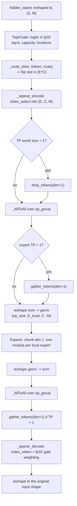
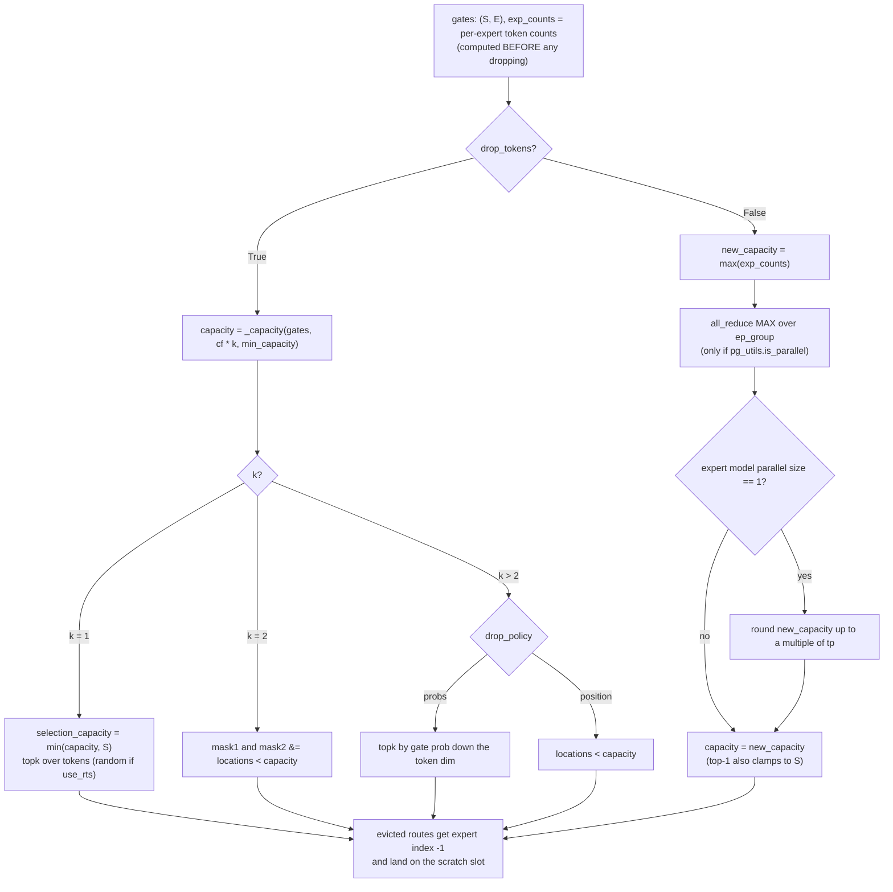
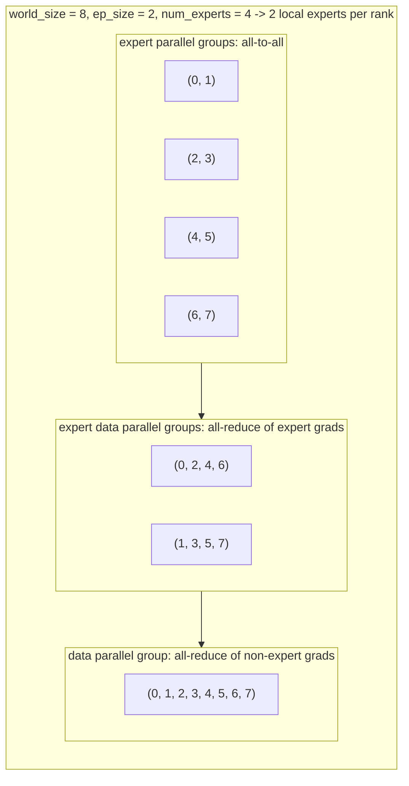
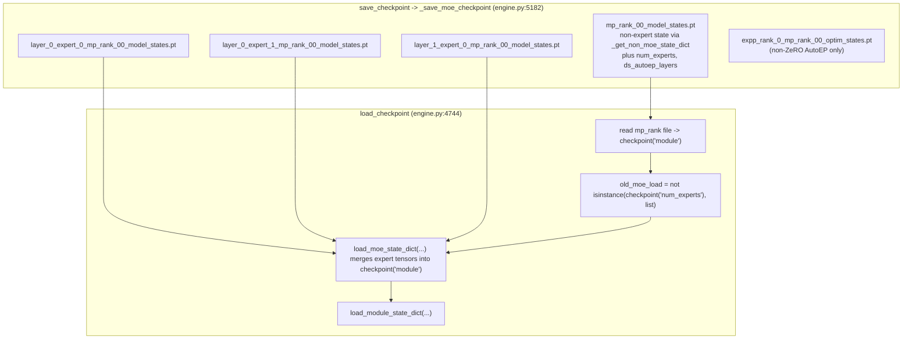

# MoE and expert parallelism

What this covers: the two Mixture-of-Experts stacks in this tree -- the native
`deepspeed.moe` layers (`deepspeed/moe/layer.py`,
`deepspeed/moe/sharded_moe.py`, `deepspeed/moe/experts.py`,
`deepspeed/moe/mappings.py`) and AutoEP
(`deepspeed/module_inject/auto_ep.py`,
`deepspeed/module_inject/auto_ep_layer.py`, `deepspeed/moe/ep_*.py`); how
expert-parallel and expert-data-parallel groups are built in
`deepspeed/utils/groups.py` and how they compose with DP, TP and ZeRO; the
AutoEP+AutoTP folding topology; MoE checkpoint file layout and
`load_moe_state_dict`; and the sharp edges visible in the code. Process
groups, pipeline, tensor and sequence parallelism are covered in
`project-docs/05-parallelism.md`.

Source of truth: upstream commit d70adc32

---

## 1. Two MoE stacks

| | Native MoE | AutoEP |
| --- | --- | --- |
| User-facing API | wrap your expert in `deepspeed.moe.layer.MoE(...)` yourself | `"expert_parallel": {"enabled": true, ...}` in the DS config |
| Entry point | `MoE.__init__` (`deepspeed/moe/layer.py:38`) | `DeepSpeedEngine._configure_expert_parallel` (`deepspeed/runtime/engine.py:826`) |
| Replacement class | n/a (you build it) | `AutoEPMoELayer` (`deepspeed/module_inject/auto_ep_layer.py:550`) |
| Router | `TopKGate` (`deepspeed/moe/sharded_moe.py:509`) | `TokenChoiceTopKRouter` (`deepspeed/moe/ep_router.py:27`) |
| Expert storage | `nn.ModuleList` of deep copies (`deepspeed/moe/experts.py:18`) | fused `[E_local, ...]` tensors `w1/w2/w3` (`deepspeed/moe/ep_experts.py:851-853`) |
| Routing model | capacity-limited; tokens can be dropped | capacity-free; all-to-all-v with variable splits |
| Dispatch | fixed `[e, c, m]` buffer + `all_to_all_single` | `_AllToAllV` with per-rank split sizes (`deepspeed/module_inject/auto_ep_layer.py:365`) |
| Expert GEMM | per-expert `nn.Module` forward | grouped GEMM (`torch._grouped_mm`, Triton, or a loop) |
| TP composition | `drop_tokens` / `gather_tokens` over the `mpu` TP group (`deepspeed/moe/mappings.py`) | AutoEP+AutoTP folding (`deepspeed/module_inject/auto_ep_folding.py`) |
| Load balancing loss | `l_aux` returned from `forward` | none; optional `expert_bias` buffer only |

Both are recognised by the engine: `_configure_distributed_model` sets
`has_moe_layers` and appends `module.num_experts` for either class
(`deepspeed/runtime/engine.py:2198-2204`), and both get
`set_deepspeed_parallelism(...)` called on them
(`deepspeed/runtime/engine.py:2247-2252`). They cannot be mixed under ZeRO-3
checkpointing: `_save_moe_checkpoint` raises if it finds both
(`deepspeed/runtime/engine.py:5228-5230`, `:5282-5284`).

---

## 2. Native MoE

### 2.1 `MoE`: construction

`MoE(hidden_size, expert, num_experts, ep_size, k, ...)`
(`deepspeed/moe/layer.py:38`) asserts `num_experts % ep_size == 0`
(`deepspeed/moe/layer.py:59`), derives
`num_local_experts = num_experts // ep_size` (`:63`), and names the group
`f"ep_size_{ep_size}"` (`:61`). It then builds `Experts(expert,
num_local_experts, expert_group_name)` and a `MOELayer` wrapping a `TopKGate`
(`:72-80`).

| Argument | Default | Meaning | Cite |
| --- | --- | --- | --- |
| `num_experts` | 1 | total experts across the EP group | `deepspeed/moe/layer.py:41` |
| `ep_size` | 1 | ranks in the expert-parallel group | `:42` |
| `k` | 1 | top-k; `k=1` and `k=2` take dedicated gating functions | `:43` |
| `capacity_factor` | 1.0 | train-time capacity multiplier | `:44` |
| `eval_capacity_factor` | 1.0 | eval-time multiplier | `:45` |
| `min_capacity` | 4 | capacity floor (note: `TopKGate`'s own default is 8, `deepspeed/moe/sharded_moe.py:533`) | `:46` |
| `use_residual` | False | residual MoE; adds a dense `mlp` branch and a 2-way `coefficient` gate | `:47`, forward `:124-131` |
| `noisy_gate_policy` | None | `None` / `'None'` / `'Jitter'` / `'RSample'`; validated at `:69` | `:48` |
| `drop_tokens` | True | False means "infinite capacity" | `:49` |
| `use_rts` | True | random token selection inside the capacity top-k | `:50` |
| `use_tutel` | False | Tutel fast dispatcher, silently ignored if not installed | `:51` |
| `enable_expert_tensor_parallelism` | False | selects which group-creation helper runs | `:52` |
| `top2_2nd_expert_sampling` | True | Gumbel noise before picking the 2nd expert | `:53` |

`forward` returns a 3-tuple `(output, l_aux, exp_counts)`
(`deepspeed/moe/layer.py:105-132`) -- callers must add `l_aux` to their loss
themselves; nothing in the engine does it.

`Experts.forward` chunks its input along dim 1 into `num_local_experts`
pieces, runs each through its own module, and concatenates
(`deepspeed/moe/experts.py:28-38`). `MOELayer` reshapes the post-all-to-all
buffer to `[ep_size, num_local_experts, C', M]` first
(`deepspeed/moe/sharded_moe.py:716`), so dim 1 is the local-expert axis here --
not the capacity axis that `drop_tokens(..., dim=1)` splits a few lines
earlier. Every expert parameter is tagged
`param.allreduce = False` and `param.group_name = expert_group_name`
(`deepspeed/moe/experts.py:25-26`); `is_moe_param(p)` is exactly the test
`hasattr(p, "allreduce") and not p.allreduce`
(`deepspeed/moe/utils.py:27`).

### 2.2 Group creation

`MoE.set_deepspeed_parallelism()` -> `_create_process_groups`
(`deepspeed/moe/layer.py:86-103`) is idempotent on the group-name key and picks
one of two helpers:

| Condition | Helper | Cite |
| --- | --- | --- |
| `groups.mpu is None` or `not enable_expert_tensor_parallelism` | `groups._create_expert_and_data_parallel(ep_size, use_data_before_expert_parallel_=...)` | `deepspeed/moe/layer.py:93-97` |
| otherwise | `groups._create_expert_data_and_model_parallel(ep_size, mpu=groups.mpu, ...)` | `deepspeed/moe/layer.py:98-101` |

It then binds the handle into the layer with
`deepspeed_moe._set_ep_group(...)` (`deepspeed/moe/layer.py:103`), which also
forwards it to the gate (`deepspeed/moe/sharded_moe.py:645-647`). Note
`TopKGate._set_ep_group` asserts the group is not already set
(`deepspeed/moe/sharded_moe.py:556`), so calling
`set_deepspeed_parallelism` twice on the same layer fails.

### 2.3 `MOELayer.forward`

`MOELayer.forward` (`deepspeed/moe/sharded_moe.py:649`) flattens the input to
`[S, M]` (`:660`) and calls the gate with `sparse_routes=True` always
(`:662-663`: the third positional argument to
`TopKGate.forward(input, used_token, sparse_routes, use_tutel)`). So the gate
returns the 7-tuple
`(l_aux, capacity, num_experts, indices, locations, gates, exp_counts)`, not
the dense 4-tuple. The capacity tensor is converted to a Python `int` once
(`:667`) with a comment noting that every later use would otherwise force its
own device-to-host sync.



The dispatch/combine pair. With `sparse_routes=True` the layer uses three
index-based helpers instead of the one-hot einsums:

| Helper | What it does | Cite |
| --- | --- | --- |
| `_route_slots(indices, locations, E, C)` | `indices * C + locations`, with evicted routes (`indices < 0`) parked on one extra scratch slot `E*C` so the scatter/gather stay branch-free | `deepspeed/moe/sharded_moe.py:177` |
| `_sparse_encode(x, slots, E, C)` | inverts the routing map into a per-slot source-token vector, appends a zero pad row, and does one `index_select` -> `[E, C, M]` | `deepspeed/moe/sharded_moe.py:188` |
| `_sparse_decode(expert_out, slots, gates, S)` | `index_select` back, multiply by the fp32 gates, sum over routes, cast back | `deepspeed/moe/sharded_moe.py:204` |

The docstrings state the motivation: the dense one-hot einsum
`'sec,sm->ecm'` costs `O(s*e*c*m)` to move only `s*k*m` elements
(`deepspeed/moe/sharded_moe.py:191-194`), and summing routes in the input dtype
instead of fp32 measurably loses precision in bf16/fp16
(`deepspeed/moe/sharded_moe.py:209-212`).

The einsum path still exists. `einsum(rule, a, b)`
(`deepspeed/moe/sharded_moe.py:119`) with `USE_EINSUM = True`
(`deepspeed/moe/sharded_moe.py:114`) and the `combine_weights` /
`dispatch_mask` returns at `deepspeed/moe/sharded_moe.py:315-319`,
`:402-412`, `:500-506` are only reachable with `sparse_routes=False`, which
`MOELayer` never passes. Treat them as the reference implementation (and the
surface a direct caller of `top1gating`/`top2gating`/`topkgating` would hit),
not the hot path. The einsum dimension letters are documented at
`deepspeed/moe/sharded_moe.py:92-93`: `(g)roup, (s)equence, (e)xpert,
(m)odel, (c)apacity`.

The Tutel branch replaces only the encode/decode: `fast_dispatcher(E, C, M)`
is created lazily, `update(...)` is fed the unbound per-route tensors, and
`encode()` returns a flat `[E*C, M]` that is immediately viewed as `[E, C, M]`
so the TP `drop_tokens` below splits capacity rather than the model dimension
(`deepspeed/moe/sharded_moe.py:669-678`, `:744-745`).

### 2.4 Gating: top-1, top-2, top-k

`TopKGate.forward` (`deepspeed/moe/sharded_moe.py:559`) casts the input to
fp32, optionally applies multiplicative jitter when
`noisy_gate_policy == 'Jitter'` *and* `self.training`
(`:570-571`), and computes `logits` with `self.wg.weight.float()`
(`:572`). The comment "everything is in fp32 in this function" appears in each
gating function (`:229`, `:330`, `:427`). It then dispatches on `k`:

| `k` | Function | Capacity factor used | Cite |
| --- | --- | --- | --- |
| 1 | `top1gating` | `capacity_factor` | `deepspeed/moe/sharded_moe.py:216`, call at `:575` |
| 2 | `top2gating` | `capacity_factor * 2` | `deepspeed/moe/sharded_moe.py:322`, call at `:580` |
| other | `topkgating` | `capacity_factor * k` | `deepspeed/moe/sharded_moe.py:415`, call at `:584` |

In train mode `capacity_factor` is used, in eval `eval_capacity_factor`
(`:575`, `:580`, `:586`). Likewise `noisy_gate_policy` is passed through only
while training (`:576`).

Differences worth knowing before editing:

| Behaviour | top-1 | top-2 | top-k |
| --- | --- | --- | --- |
| aux loss `l_aux` | `sum(me * ce) * E` (`:264`) | `mean(me * ce) * E * E` (`:357`) | `mean(me * ce) * E * E / k` (`:442`) |
| 2nd-expert noise | n/a | Gumbel added to `logits` in place when `top2_2nd_expert_sampling` (`:338-341`) | none |
| capacity selection | `topk(mask1 * uniform, k=capacity, dim=0)` when `use_rts` (`:267-286`) | `locations < capacity` (`:365-366`) | `drop_policy` (`:449-463`) |
| `used_token` mask | supported (`:241-242`) | not a parameter | not a parameter |
| `use_tutel` cumsum | `tutel_moe.fast_cumsum_sub_one` (`:297`) | no | no |
| capacity clamped to token count in the no-drop path | yes (`:259`) | no | no |

`topkgating` has two `drop_policy` values
(`deepspeed/moe/sharded_moe.py:449-463`):

- `"probs"` (default): keep, per expert, the `capacity` tokens with the highest
  gate probability, via a `topk` down the token dimension;
- `"position"`: keep the first `capacity` tokens in sequence order
  (`locations < capacity`).

Only `"probs"` and `"position"` are accepted; anything else raises
(`:463`). Note `drop_policy` is a parameter of `topkgating` but is **not**
plumbed through `TopKGate` or `MoE` -- the call at
`deepspeed/moe/sharded_moe.py:584` does not pass it, so from the `MoE` API
the policy is always `"probs"`.

### 2.5 Capacity and token dropping

`_capacity(gates, capacity_factor, min_capacity)`
(`deepspeed/moe/sharded_moe.py:152`) is

```text
capacity = max(ceil(num_tokens / num_experts * capacity_factor), min_capacity)
```

computed with `torch.maximum` rather than an `if`, because `torch.jit.trace`
(used by the TorchScript ONNX export) would otherwise bake in whichever branch
was taken while tracing (`deepspeed/moe/sharded_moe.py:159-161`).



Three things in that flow are easy to get wrong:

1. **`exp_counts` is pre-drop.** It is computed from the unmasked `mask1`
   (top-1, `deepspeed/moe/sharded_moe.py:245`), from `mask1 + mask2` before the
   capacity mask (top-2, `:360`), and from `mask` before the capacity mask
   (top-k, `:437`). The value `MoE.forward` returns as `exp_counts` is
   therefore the *routing* histogram, not the number of tokens the experts
   actually processed.
2. **`drop_tokens=False` still collectivises.** It takes a
   `dist.all_reduce(..., ReduceOp.MAX, group=ep_group)` guarded by
   `pg_utils.is_parallel(ep_group)` (`:251-252`, `:370-371`, `:468-469`) so
   every EP rank sizes the same buffer, and when the *experts* are not
   tensor-parallel it rounds the capacity up to a multiple of the TP size so
   the duplicate-token `drop_tokens()` below divides evenly (`:253-257`,
   `:372-376`, `:470-474`). It is "no dropping", not "no synchronization".
3. **`min_capacity` interacts with batch size.** `top1gating` asserts
   `logits.shape[0] >= min_capacity` with the message "No. of tokens
   (batch-size) should be greater than min_capacity"
   (`deepspeed/moe/sharded_moe.py:278-279`). `top2gating` and `topkgating`
   have no such assert.

Eviction is encoded as a negative expert index. Each gating function, under
`sparse_routes`, replaces the index of an evicted route with `-1`
(`:289-293` for top-1 via a `min` against `mask1.sum(1)*E - 1`,
`:394-397` for top-2, `:492-493` for top-k) and `_route_slots` maps every
negative index to the scratch slot `E*C` (`:183-185`). `_sparse_encode`
allocates that one extra row and then drops it with `source[:-1]`
(`:197-201`), and `_sparse_decode` reads a zero row for it (`:207-208`). So a
dropped token contributes nothing and receives nothing -- it passes through the
MoE as zeros (or, with `use_residual`, as the dense branch alone).

### 2.6 `mappings.py`: MoE under tensor parallelism

With a TP `mpu`, every TP rank in a group sees identical tokens, so the
dispatch buffer is duplicated `tp_size` times. `MOELayer.forward` drops the
duplicates before the first all-to-all and re-gathers afterwards:

| Call site | Condition | Cite |
| --- | --- | --- |
| `drop_tokens(dispatched_input, dim=1)` | `tensor_model_world_size > 1` | `deepspeed/moe/sharded_moe.py:686-698` |
| `gather_tokens(dispatched_input, dim=1)` | `tp > 1` **and** `expert_model_parallel_world_size > 1` | `:709-713` |
| `drop_tokens(expert_output, dim=1)` | same condition | `:720-724` |
| `gather_tokens(expert_output, dim=1)` | `tensor_model_world_size > 1` | `:738-742` |

`gather_tokens` / `drop_tokens` (`deepspeed/moe/mappings.py:105`, `:113`) are
no-ops when `groups.mpu is None` or the TP world size is 1, and otherwise wrap
`_GatherTokens` / `_DropTokens`, each of which is the other's backward
(`deepspeed/moe/mappings.py:71-102`). `_drop_tokens` asserts the chosen
dimension is divisible by the TP world size
(`deepspeed/moe/mappings.py:64-65`) -- which is why the `drop_tokens=False`
capacity path pads to a TP multiple. `expert_model_parallel_world_size` is
just the module global `expert_tensor_parallel_world_size`
(`deepspeed/utils/groups.py:946`), set only by
`_create_expert_data_and_model_parallel` (`deepspeed/utils/groups.py:636-637`),
so it is 1 unless expert tensor parallelism was explicitly enabled.

---

## 3. Expert parallel groups

### 3.1 Naming and storage

Group handles live in four module-level dicts in
`deepspeed/utils/groups.py:38-48`, all keyed by the string
`f"ep_size_{ep_size}"`:

| Dict | Holds | Accessor |
| --- | --- | --- |
| `_EXPERT_PARALLEL_GROUP` | this rank's EP group handle | `_get_expert_parallel_group(name)` (`:697`) |
| `_EXPERT_PARALLEL_GROUP_RANKS` | its rank list | `_get_expert_parallel_group_ranks(name)` (`:704`) |
| `_EXPERT_DATA_PARALLEL_GROUP` | this rank's EDP group handle | `_get_expert_data_parallel_group(name)` (`:716`) |
| `_EXPERT_DATA_PARALLEL_GROUP_RANKS` | its rank list | `_get_expert_data_parallel_group_ranks(name)` (`:723`) |
| `_EXPERT_DATA_PARALLEL_GROUP_TABLE` | *every* EDP group with that name, in creation order | `_get_expert_data_parallel_group_table(name)` (`:730`) |

The table exists so a rank can locate other ranks' replicas without a
collective -- every rank builds every group anyway
(`deepspeed/utils/groups.py:45-47`).

The name is parsed back into a number by string split:
`_get_max_expert_size()` does `int(key.split('_')[index])` with a hardcoded
`index = 2` (`deepspeed/utils/groups.py:676-684`), and
`_get_max_expert_size_name()` reassembles `f'ep_size_{...}'`
(`:687`). Any new group name must keep the `ep_size_<n>` shape or this breaks;
checkpointing calls it for "the largest EP group"
(`deepspeed/runtime/engine.py:5401`).

### 3.2 `_create_expert_and_data_parallel`

Signature:
`_create_expert_and_data_parallel(expert_parallel_size_, mp_size=None, pp_size=None, mp_mode="tp", use_data_before_expert_parallel_=False, folding_spec=None)`
(`deepspeed/utils/groups.py:375`). It resolves `pp_size` from the argument or
from `bwc_pipeline_parallel_world_size(mpu)` (`:414-417`), computes
`pp_stride = world_size // pp_world_size` and asserts
`pp_stride % ep_size == 0` (`:421-422`). Then one of four layouts:

| Path | Condition | EP groups | EDP groups | Cite |
| --- | --- | --- | --- | --- |
| legacy E+D | `mp_size <= 1`, `use_data_before_expert_parallel_=False` | contiguous blocks of `ep_size` | strided by `ep_size` within a PP stage | `:470-478`, `:443-444` |
| legacy D+E | `mp_size <= 1`, `use_data_before_expert_parallel_=True` | strided by `ep_stride` | contiguous blocks of `ep_stride` | `:459-468`, `:441-442` |
| TP-strided | `mp_size > 1`, `mp_mode == "tp"`, no folding spec | blocks of `ep_size` over TP-lane-reordered ranks | transpose of those | `:515-530` |
| folded | `folding_spec is not None` | from `expected_folding_group_tables` | same | `:507-511` |

`use_data_before_expert_parallel_` is rejected when `mp_size > 1`
(`deepspeed/utils/groups.py:482-483`). When the group already exists the
function returns early, but with a `folding_spec` it first asserts the cached
rank lists match the spec (`:485-495`).

Worked example for the legacy E+D path, `world_size = 8`, `ep_size = 2`,
`pp_size = 1` -- the same shape as the docstring at
`deepspeed/utils/groups.py:391-395`:



Reading it off the code: EDP is `range(pp_start + i, pp_start + pp_stride,
ep_size)` for `i in range(ep_size)` (`:444`), EP is
`range(i * ep_size, (i+1) * ep_size)` for `i in range(world_size // ep_size)`
(`:471`). Rank 0 and rank 1 hold *different* experts (so they all-to-all);
rank 0 and rank 2 hold the *same* experts (so they all-reduce).

The TP-strided path reorders the stage's ranks by TP lane before cutting EP
blocks (`deepspeed/utils/groups.py:515-522`): for `world_size = 8`,
`mp_size = 2`, `ep_size = 2`, the ordered list is `[0, 2, 4, 6, 1, 3, 5, 7]`,
giving EP groups `[0,2] [4,6] [1,3] [5,7]` and EDP groups
`[0,4,1,5] [2,6,3,7]`.

### 3.3 `_create_expert_data_and_model_parallel`

The expert-tensor-parallel variant (`deepspeed/utils/groups.py:618`) reads the
TP size off the `mpu` via `bwc_tensor_model_parallel_world_size`, stores it in
the module global `expert_tensor_parallel_world_size` (`:636-637`), and asserts
`world_size % tp == 0` and `dp_world_size % ep_size == 0` (`:644-645`).
The rank math is in `_get_expert_parallel_ranks`
(`deepspeed/utils/groups.py:549`): build DP groups first, then cut each into
`ep_size`-wide slices and `zip(*)` those slices to get EDP
(`:604-613`). For the docstring's `world_size=16, tp=2, ep=4` case
(`:624-631`) that yields `mp_group = [0,1] [2,3] ...`,
`dp = [0,2,...,14] [1,3,...,15]`, `ep = [0,2,4,6] [8,10,12,14] ...`,
`edp = [0,8] [2,10] [4,12] [6,14] ...`.

### 3.4 How EP composes with DP and ZeRO

Gradients split into two reductions. `_get_gradients_for_reduction`
(`deepspeed/runtime/engine.py:3960`) partitions parameters with
`is_moe_param(param)` into `expert_grads[param.group_name]` and
`non_expert_grads` (`:3989-3992`), then:

- `_reduce_non_expert_gradients` reduces over the sequence-data-parallel group
  (or `mpu.get_data_parallel_group()` under pipeline parallelism), dividing by
  `world_size / sequence_parallel_size`
  (`deepspeed/runtime/engine.py:3996-4015`);
- `_reduce_expert_gradients` reduces each named bucket over
  `groups._get_expert_data_parallel_group(ep_name)` but divides by the **plain
  DP world size**, with the comment "to maintain the gradients value unaffected
  by ep_size setting" (`deepspeed/runtime/engine.py:4017-4020`).

That asymmetry is deliberate: the EDP group is `dp_size / ep_size` ranks wide,
so summing over it and dividing by `dp_size` gives each expert the same
effective average it would have had at `ep_size = 1`.

Parameter broadcast at init follows the same split: expert parameters are
broadcast from `groups._get_expert_broadcast_src_rank(p.group_name)` over the
EDP group, everything else from `_get_broadcast_src_rank()` over the
sequence-data-parallel group (`deepspeed/runtime/engine.py:2148-2157`).

ZeRO needs the optimizer's param groups split accordingly.
`split_params_into_different_moe_groups_for_optimizer`
(`deepspeed/moe/utils.py:72`) collects every distinct `param.group_name`, makes
one `{'name': <group_name>, 'moe': True, ...}` group per original group per EP
group name, moves the expert params into it, and optionally splits each by
`max_group_size` (default `178956971` elements, `deepspeed/moe/utils.py:74`).
`configure_moe_param_groups` (`deepspeed/moe/utils.py:156`) is the entry point
that accepts either a flat parameter list or an existing list of param groups
and leaves the latter alone if any group already carries a `'moe'` key.

ZeRO-1/2 then re-points those groups at the EDP process group:
`_configure_moe_settings` (`deepspeed/runtime/zero/stage_1_and_2.py:884`)
asserts at least one group is marked MoE (`:894-896`), that every parameter in
a MoE group is a MoE parameter (`:900-901`), and sets
`real_dp_process_group[i] = expert_dp_process_group[group['name']]` plus the
matching `partition_count` (`:902-903`). It also asserts
`contiguous_gradients` under ZeRO-2 (`:886-887`) and `reduce_scatter`
(`:892`), and warns that ZeRO-1 + MoE is experimental (`:889-891`).

ZeRO-3 for AutoEP experts partitions them over the EDP group instead of the
global DP group: `_partition_autoep_zero3_experts`
(`deepspeed/runtime/engine.py:955`) sets
`param.ds_zero_partition_process_group =
groups._get_expert_data_parallel_group(group_name)` for each `w1/w2/w3`
(`:962`) before converting them to ZeRO parameters, and forces a `gc.collect()`
so the discarded full-weight source layer cannot accumulate (`:964-966`).

---

## 4. AutoEP

### 4.1 Pipeline

```text
engine.__init__
  -> _configure_expert_parallel(model)            engine.py:826
       validate_autoep_config(...)                auto_ep_config.py:111
       build_folding_spec(...)                    auto_ep_folding.py:81
       validate_folding_global(...)               auto_ep_folding.py:184
       groups._create_expert_and_data_parallel(...) groups.py:375
       AutoEP(model, config).ep_parser()          auto_ep.py:417
       auto_ep.replace_moe_layers(specs, ...)     auto_ep.py:695
  -> _configure_distributed_model(model)
       AutoEPMoELayer.set_deepspeed_parallelism() auto_ep_layer.py:963
```

`ep_parser()` (`deepspeed/module_inject/auto_ep.py:417`) walks
`model.named_modules()` against each candidate preset's
`moe_layer_pattern` (a full-match regex, `:426-429`) and requires, in order: an
`experts_pattern` child that is either an `nn.ModuleList` or has 3-D expert
parameters (`:433-453`), a `router_pattern` child (`:456-463`), a derivable
`num_experts` (from the config attribute, cross-checked against the router
weight's dim 0, `:472-490`), a derivable `top_k` (`:492-497`), and successful
shape inference for `hidden_size` / `ffn_hidden_size` (`:500-508`). Mismatches
between the config and the weights are hard errors
(`:482-485`, `:511-514`, `:517-519`). The result is one `MoELayerSpec` per
layer (`:580-617`), and duplicates are rejected
(`_raise_if_duplicate_moe_specs`, `:73`).

Detection failing is fatal only when a preset was actually selected --
`_requires_selected_preset_detection()` (`:740`) returns True if
`preset_model` or `moe_layer_pattern` was set explicitly, or if the HF
`model_type` is one AutoEP knows; otherwise it logs a warning and returns no
specs (`:622-625`).

`replace_moe_layers` (`deepspeed/module_inject/auto_ep.py:695`) swaps each
module in place on its parent (`:642-668`) and, optionally, returns a
`ReplacementSourceMap` naming the pre-shard source parameter behind each new
one so a caller-supplied optimizer can be re-pointed
(`:702-712`, `collect_replacement_sources` at `:1385` in
`auto_ep_layer.py`). The map keeps the discarded full expert weights alive, so
the engine only asks for it when there is such an optimizer
(`deepspeed/runtime/engine.py:933-934`).

### 4.2 What `AutoEPMoELayer` does differently

| | `deepspeed.moe.layer.MoE` | `AutoEPMoELayer` |
| --- | --- | --- |
| Capacity | fixed `[E, C, M]` buffer; tokens dropped | no capacity; `_AllToAllV` with computed split sizes (`deepspeed/module_inject/auto_ep_layer.py:1320`) |
| Token order | slot index = `expert * C + location` | `argsort(selected_experts, stable=True)` then a per-local-expert permute (`:1237`, `permute_by_local_expert` at `:411`) |
| Expert weights | one `nn.Module` per local expert | three fused parameters `w1 [E_l, ffn, h]`, `w2 [E_l, h, ffn]`, `w3 [E_l, ffn, h]` (`deepspeed/moe/ep_experts.py:851-853`) |
| GEMM | per-expert matmul | grouped GEMM: Triton kernel, `torch._grouped_mm`, or a loop (`deepspeed/moe/ep_experts.py:800-888`) |
| Gate dtype | fp32 logits and fp32 combine | router scores cast to fp32 for softmax/sigmoid only (`deepspeed/moe/ep_router.py:157-160`) |
| Aux loss | `l_aux` returned to the caller | none; an optional `expert_bias` buffer when `load_balance_coeff` is set (`deepspeed/module_inject/auto_ep_layer.py:749-756`) |
| Group-limited routing | no | yes: `num_expert_groups` / `num_limited_groups`, scored by `max` or DeepSeek-V3's `top2_sum` (`deepspeed/moe/ep_router.py:82-130`) |
| Shared experts | `use_residual` + a learned 2-way coefficient | adopts the source module's `shared_experts` / `shared_experts_gate` as-is (`deepspeed/module_inject/auto_ep_layer.py:716-719`) |
| Return shape | `(output, l_aux, exp_counts)` | HF contract: `[B,S,H]`, or `([B,S,H], router_logits)` (`:1170-1182`) |
| Alternate backend | Tutel | DeepEP (`comm_backend="deepep"`, `_deepep_route` at `:1032`) |

`_forward` (`deepspeed/module_inject/auto_ep_layer.py:1199`) in the default
`comm_backend="comm"` path:

1. optional `average_gradient_over_tp` on the input when TP is folded
   (`:1202-1207`);
2. router -> `RouterOutput(top_scores, selected_experts, num_tokens_per_expert)`
   (`:1220`);
3. accumulate the `tokens_per_expert` buffer under `no_grad` (`:1229-1230`);
4. sort routes by expert id (`:1237-1239`);
5. gather the routed rows `x[token_indices // top_k]` and, if
   `score_apply == "pre"`, scale them by the gate now (`:1285-1288`);
6. `compute_split_plan(...)` -> `_AllToAllV` -> `permute_by_local_expert` ->
   `_run_experts` -> `unpermute_by_local_expert` -> `_AllToAllV` back
   (`:1311-1327`); with `ep_size == 1` steps 6's collectives are skipped
   (`:1290-1297`);
7. `combine_from_routed` scatters rows back and, if
   `score_apply == "post"`, applies the gate and sums over `top_k`
   (`:1344-1352`, implementation at `:504`).

`permute_by_local_expert` pads each expert's row block up to
`TOKEN_GROUP_ALIGN_SIZE_M` so the grouped GEMM sees aligned groups
(`:444-449`), and the padding rows read a zero row; `unpermute_by_local_expert`
strips them (`:479-501`).

The router itself: `TokenChoiceTopKRouter.forward`
(`deepspeed/moe/ep_router.py:136`) projects with `self.gate`, casts to fp32 for
`sigmoid`/`softmax` (`:157-160`), adds the dynamic `expert_bias` and the static
`e_score_correction_bias` to the *choice* scores only
(`:164-168`), optionally masks non-selected expert groups to `-inf`
(`:171-172`), takes `topk` over the biased scores but gathers the *unbiased*
scores as weights (`:175-178`), optionally renormalizes with a `1e-20` floor
(`:181-183`), scales by `route_scale` (`:185`), and counts tokens per expert
with `count_tokens_per_expert` -- a `scatter_add_` into a pre-sized buffer,
chosen over `torch.bincount` to avoid the device-to-host sync bincount needs to
size its output (`deepspeed/moe/ep_count.py:10-24`).

Unsupported router features are refused rather than silently ignored:
`ep_parser` warns when the model config sets `router_jitter_noise` or
`router_z_loss_coef` (`deepspeed/module_inject/auto_ep.py:566-575`), and the
layer raises on a nonzero router bias the preset lists as unsupported
(`deepspeed/module_inject/auto_ep_layer.py:631-637`) or on
`load_balance_coeff` for a preset without expert-bias support (`:626-628`).

### 4.3 Config keys

Parsed by `parse_autoep_config(param_dict)`
(`deepspeed/module_inject/auto_ep_config.py:44`) from the `expert_parallel`
section.

| Key | Default | Notes |
| --- | --- | --- |
| `enabled` | `False` | `:50`; nothing happens unless true |
| `autoep_size` | `1` | `:51`; the EP degree |
| `expert_tensor_parallel_size` | `1` | `:52`; `etp` in the folding spec |
| `preset_model` | `None` | `:55`; selects a preset instead of sniffing `model_type` |
| `moe_layer_pattern` / `expert_pattern` / `router_pattern` | `None` | `:56-58`; override the preset's regexes |
| `top_k`, `score_func`, `route_norm`, `route_scale`, `routed_scaling_factor` | `"auto"` / `None` / `1.0` | `:61-62`, `:77-78`, `:88` |
| `num_expert_groups`, `num_limited_groups` | `None` | `:75-76`; group-limited routing |
| `score_apply` | `"auto"` | `:63`; `pre` or `post` |
| `combine_impl` | `"auto"` -> `weighted_sum` | `:64`, resolved at `auto_ep_layer.py:109` |
| `row_weighting_impl` | `"auto"` -> `eager` | `:65`, resolved at `auto_ep_layer.py:118` |
| `use_grouped_mm` | `True` | `:59` |
| `disable_triton_grouped_mm` | `False` | `:60` |
| `gate_up_impl` | `"separate"` | `:66`; `"fused"` needs `torch._grouped_mm` |
| `overlap_weight_grad` | `False` | `:67` |
| `deferred_dw_flush_period` / `deferred_dw_rows_per_expert` | `1` / `0` | `:68-69` |
| `comm_backend` | `"comm"` | `:70`; or `"deepep"` |
| `comm_num_sm`, `comm_qp_margin`, `comm_max_tokens_per_rank` | `12`, `4`, `0` | `:71-73` |
| `skip_recompute_combine` | `False` | `:74` |
| `async_split_plan` | `False` | `:54` |
| `validate_folding_routing` | `False` | `:53` |
| `expert_w1` / `expert_w2` / `expert_w3` | `None` / `None` / `_UNSET` | `:89-95`; `expert_w3: null` means "fused gate-up", an absent key means "preset default" |
| `load_balance_coeff` | `None` only | `:79-87`; any non-null value raises |

Several keys have cross-cutting preconditions checked up front:
`deferred_dw_flush_period > 1` requires `managed_gradient_accumulation`, no
ZenFlow and no DeepCompile (`deepspeed/runtime/engine.py:858-871`);
`skip_recompute_combine` requires a preset in
`SKIP_RECOMPUTE_COMBINE_PRESETS` (`deepspeed/module_inject/auto_ep_layer.py:582-585`)
and reentrant HF per-layer gradient checkpointing at runtime
(`_assert_recompute_skip_contract`, `:1012-1030`);
`async_split_plan` is refused under folded TP (`:1225`).

### 4.4 AutoEP + AutoTP folding

`build_folding_spec` (`deepspeed/module_inject/auto_ep_folding.py:81`) turns
the public sizes into a `ParallelFoldingSpec` (`:38`) with the invariants

```text
stage_size = world_size / pp_size
dp_size    = stage_size / tp_size
edp_size   = stage_size / (ep_size * etp_size)
```

and raises with the list of valid divisors when either division is non-integral
(`:100-115`). `expected_folding_group_tables(spec)` (`:130`) then derives four
rank tables per PP stage, with no process groups involved:

| Table | Layout | Cite |
| --- | --- | --- |
| `tp_groups` | contiguous blocks of `tp_size` | `:140-142` |
| `dense_dp_groups` | `stage_ranks[tp_lane::tp_size]` | `:143-144` |
| `ep_groups` | contiguous blocks of `ep_size` | `:146-148` |
| `edp_groups` | position `pos` taken from each EP group | `:150-151` |

For `world_size = 8`, `pp = 1`, `tp = 2`, `ep = 4`, `etp = 1` that gives
`tp = [0,1] [2,3] [4,5] [6,7]`, `dense_dp = [0,2,4,6] [1,3,5,7]`,
`ep = [0,1,2,3] [4,5,6,7]`, `edp = [0,4] [1,5] [2,6] [3,7]`.
`local_folding_ranks(global_rank, spec)` (`:161`) is the per-rank lookup, and
`assert_group_matches_spec` (`:506`) is what `groups.py` uses to verify a
pre-existing group agrees with the spec (`deepspeed/utils/groups.py:486-494`).

The folded groups are handed to the layers as a `FoldingGroupHandles`
(`deepspeed/module_inject/auto_ep_folding.py:59`) assembled in
`_configure_distributed_model` (`deepspeed/runtime/engine.py:2227-2244`) and
passed into `set_deepspeed_parallelism`
(`deepspeed/runtime/engine.py:2249-2250`). With handles present the layer
takes them verbatim and derives `ep_rank` from the group
(`deepspeed/module_inject/auto_ep_layer.py:972-990`); without them it creates
the groups itself, inferring `mp_size` as
`max(model_parallel_world_size, sequence_parallel_world_size)` and
`mp_mode` as `"tp"` only when the model-parallel size exceeds 1
(`:992-1006`).

Folding changes what each parameter family needs. Expert parameters are *not*
TP-replicated, but the folded forward all-gathers expert outputs into a
replicated view in `restore_combined`, whose backward injects a spurious
`tp_size` factor; so they take the `expert_tp_cancel` strategy -- divide by
`tp_size`, no TP all-reduce -- while the replicated router takes `average`,
which cancels the same factor. The reasoning is spelled out at
`deepspeed/module_inject/auto_ep_folding.py:26-34`; the strategy constants are
`AUTOEP_FOLDING_GRAD_REDUCE_{SKIP,SUM,AVERAGE,EXPERT_TP_CANCEL}`
(`:23-34`) and the parameters are tagged by
`mark_autoep_folding_router_parameter` and friends (`:275`, `:291`, `:308`),
called from the layer at `deepspeed/module_inject/auto_ep_layer.py:735`.

Two combinations are explicitly refused when folded TP is active:
`combine_impl="fused_weighted_sum"` (`:974-978`) and
`comm_backend="deepep"` (`:979-985`), both because the folded
assignment-metadata restore path cannot consume their output layout.

Parameter tagging in `AutoEPMoELayer.__init__`
(`deepspeed/module_inject/auto_ep_layer.py:721-744`):

| Family | `allreduce` | Extra marks |
| --- | --- | --- |
| `experts.w{1,2,3}` | `False` | `group_name = ep_size_<n>`, `ds_zero_placement_family = "autoep_expert"`, `ds_zero_partition_group_name` |
| `router.*` | `True` | `mark_autoep_folding_router_parameter`, `ds_zero_placement_family = "replicated"` |
| `shared_experts.*`, `shared_experts_gate.*` | `True` | `ds_zero_placement_family = "replicated"` |

Because `allreduce = False` is exactly what `is_moe_param` tests
(`deepspeed/moe/utils.py:27`), AutoEP expert weights flow through the same
`expert_grads[group_name]` bucket and the same ZeRO param-group machinery as
native MoE experts.

AutoTP and AutoEP meet through a marker: `AutoEPMoELayer._is_autoep_layer = True`
(`deepspeed/module_inject/auto_ep_layer.py:553`), and
`AutoTP._replace` returns such children untouched
(`deepspeed/module_inject/auto_tp.py:420-422`) while `_replace_module`
descends only into their `shared_experts` / `shared_experts_gate`
(`deepspeed/module_inject/auto_tp.py:1062-1065`,
`_replace_autoep_shared_experts` at `:1037`). AutoEP in turn rejects tensor
model parallelism coming from an `mpu` rather than from AutoTP
(`deepspeed/runtime/engine.py:844-848`).

---

## 5. MoE and checkpointing

### 5.1 File layout

Names come from three helpers in `deepspeed/runtime/engine.py`:

| Helper | Pattern | Cite |
| --- | --- | --- |
| `_get_ckpt_name` | `<dir>/<tag>/mp_rank_<mp:02d>_model_states.pt`, or `zero_pp_rank_<n>_mp_rank_<mp:02d>_model_states.pt` under ZeRO-3 | `:4454` |
| `_get_expert_ckpt_name` | `<dir>/<tag>/layer_<layer_id>_expert_<expert_id>_mp_rank_<mp:02d>_model_states.pt`; with `layer_id <= -1` the legacy `expert_<id>_mp_rank_<mp:02d>_model_states.pt` | `:4486` |
| `_get_optimizer_ckpt_name` | `<dir>/<tag>/expp_rank_<expp_rank>_mp_rank_<mp:02d>_optim_states.pt` | `:4480` |

`layer_id` is a counter over MoE modules in `named_modules()` order, not a
transformer layer index (`deepspeed/runtime/engine.py:5222`, incremented at
`:5278`, `:5391`). `expert_id` is **global**:
`expp_rank * num_local_experts + local_expert_id`
(`:5256-5257`, `:5365`).



The main file deliberately excludes expert weights.
`_get_non_moe_state_dict(full_state_dict)`
(`deepspeed/runtime/engine.py:5126`) removes, per module: for native MoE every
key containing `'expert'` except `moe.gate.wg.weight` (`:5142-5146`), and for
AutoEP exactly the three keys `<prefix>experts.w1|w2|w3` (`:5147-5152`).
Router weights, shared experts and `expert_bias` survive in the main file.

Who writes the expert files: native MoE gates on
`checkpoint_engine.is_data_parallel_writer(exp_dp_rank)`
(`deepspeed/runtime/engine.py:5235`), while AutoEP uses
`autoep_expert_writer()`, which under folded TP instead requires
`groups._get_data_parallel_rank() < folding_spec.ep_size` so there is one shard
per `(TP rank, EP rank)` (`:5210-5213`, `:5355-5356`). Under ZeRO-3 AutoEP
writes no per-expert files at all -- expert state is restored from the ZeRO
shards (`:5357-5359`) -- and the layer metadata records that with
`AUTOEP_ZERO3_EXPERT_STATE_FORMAT_KEY` set to the partitioned format rather
than `'per_expert_files'` (`:5331-5335`).

Key shapes inside an expert file:

| Stack | Key | Tensor |
| --- | --- | --- |
| native MoE | `<module>.deepspeed_moe.experts.deepspeed_experts.<global_expert_id>.<param>` | whatever the expert module holds |
| AutoEP | `<module>.experts.w1\|w2\|w3.<global_expert_id>` | 2-D slice `param[local_expert_id]` |
| AutoEP, folded TP | plus `FOLDING_METADATA_KEY` | `family="routed_expert"`, `zero_partition_group="edp"` |

AutoEP also writes a `ds_autoep_layers` list into the main checkpoint
(`deepspeed/runtime/engine.py:5312-5348`, stored at `:5467`) carrying per layer:
`moe_layer_id`, `module_path`, `num_experts`, `num_local_experts`, `ep_size`,
the expert placement descriptor, affine maps for `w1/w2/w3`, the expert key
prefix, `ep_group_name`, `ep_rank`, the EDP rank and world size, and the
`[global_expert_start, global_expert_end)` range. Only one EP group size is
allowed across a checkpoint (`:5350-5353`). For universal checkpointing the
expert parameters are described by the pattern
`r'.*\.experts\.w[123]$'` (`:5462`).

### 5.2 `load_moe_state_dict`

`DeepSpeedEngine.load_moe_state_dict(checkpoint_path, tag, state_dict, old_moe_load, model=None, mpu=None, num_experts=1, checkpoint_engine=..., autoep_layers=None, folding_spec=None, checkpoint_mp_rank=None)`
(`deepspeed/runtime/engine.py:4252`) mutates `state_dict` in place, adding the
expert tensors this rank must hold. It is a `@staticmethod` and is called from
`load_checkpoint` at `deepspeed/runtime/engine.py:4760`, guarded by
`self.has_moe_layers and not self.load_universal_checkpoint()`
(`:4744`) -- universal checkpoints restore experts from the `zero/` layout
instead.

`old_moe_load` is decided by a type check on the saved metadata:
`not isinstance(checkpoint['num_experts'], list)`
(`deepspeed/runtime/engine.py:4746-4747`).

| Path | Behaviour | Cite |
| --- | --- | --- |
| legacy (`old_moe_load=True`) | reads `expert_<global_id>_mp_rank_<mp>` files using `_get_max_expert_size_name()`, rewrites global expert ids to local ones in the `.deepspeed_moe.experts.deepspeed_experts.<id>` prefix | `:4279-4300` |
| legacy + AutoEP layers present | `RuntimeError`: convert with Universal Checkpointing first | `:4276-4278` |
| current, native `MoE` module | per local expert, load `layer_<moe_layer_id>_expert_<global_id>` and rewrite the id to local | `:4313-4335` |
| current, `AutoEPMoELayer` | per local expert, load the file, validate folding metadata, require each `experts.w{1,2,3}.<global_id>` key to exist and be 2-D, collect, then `torch.stack(..., dim=0)` into the fused `[E_local, ...]` key | `:4337-4384` |

Note the asymmetry in strictness: the native path will happily skip a missing
file (it lets the loader raise), while the AutoEP path raises
`FileNotFoundError` with the expected layer/expert ids
(`:4354-4356`), `RuntimeError` on a missing key ("Expert checkpoint file is
corrupt", `:4370-4372`), and `RuntimeError` on a non-2-D tensor
(`:4374-4376`). Both rewrite global expert ids to this rank's local ids, so the
same checkpoint can be reloaded at a different `ep_size` only to the extent
that `num_local_experts` divides evenly -- there is no re-sharding in this
function.

A missing `ds_autoep_layers` key is tolerated with a warning
("Loading AutoEP expert weights using best-effort module detection",
`:4308-4310`); when present it is validated by
`_validate_autoep_zero3_partitioned_metadata`
(`:4304-4307`).

Under ZeRO-3 with partition-native expert state, `load_moe_state_dict` is
skipped entirely and the expert parameter names are passed to
`load_module_state_dict` as `allowed_missing_keys`
(`deepspeed/runtime/engine.py:4752-4758`), which tightens rather than loosens a
strict load: anything missing *outside* that set, or any unexpected key, is a
`RuntimeError` (`:4413-4422`).

---

## 6. Sharp edges

Ordered roughly by how likely each is to bite.

1. **`exp_counts` is pre-drop.** The third element of `MoE.forward`'s return
   counts routing decisions, not processed tokens
   (`deepspeed/moe/sharded_moe.py:245`, `:360`, `:437`). Load-balance
   dashboards built on it will not show dropped tokens.
2. **Dropped tokens are silently zero.** Eviction is encoded as expert index
   `-1`, routed to a scratch slot, and read back as a zero row
   (`deepspeed/moe/sharded_moe.py:183-185`, `:197-201`, `:207-208`). No
   warning, no counter. With `use_residual` the dense branch still contributes,
   which masks the effect further.
3. **`drop_tokens=False` is not free and not local.** It adds a
   `ReduceOp.MAX` all-reduce on the EP group every forward and sizes buffers
   from the worst-case expert, so memory tracks the most loaded expert
   (`deepspeed/moe/sharded_moe.py:249-259`, `:367-377`, `:466-475`).
4. **`l_aux` is yours to use.** `MoE.forward` returns it
   (`deepspeed/moe/layer.py:132`) and nothing in the engine adds it to the
   loss. AutoEP does not compute one at all.
5. **`min_capacity` defaults differ.** `MoE` defaults to 4
   (`deepspeed/moe/layer.py:46`) but `TopKGate` to 8
   (`deepspeed/moe/sharded_moe.py:533`). A direct `TopKGate` user gets a
   different capacity floor than a `MoE` user who left the argument alone, and
   only `top1gating` asserts the batch is at least `min_capacity`
   (`deepspeed/moe/sharded_moe.py:278-279`).
6. **Gate dtype.** The native gate forces fp32 for the projection, the
   softmax, the location one-hots and the combine
   (`deepspeed/moe/sharded_moe.py:568-572`, `:311-315`, and the fp32 note at
   `:209-212`). AutoEP's router casts only the scoring function's input to fp32
   (`deepspeed/moe/ep_router.py:157-160`) while `self.gate(x)` runs in the
   module dtype. If you change either, expect bf16 convergence to move.
7. **`drop_policy` is unreachable from the public API.** `topkgating` accepts
   `"probs"` or `"position"` (`deepspeed/moe/sharded_moe.py:449-463`) but
   `TopKGate.forward` does not forward it
   (`deepspeed/moe/sharded_moe.py:584-590`), so `MoE(k>2)` is always `"probs"`.
8. **Group names are parsed by string split.** `ep_size_<n>` is load-bearing:
   `_get_max_expert_size()` takes `key.split('_')[2]`
   (`deepspeed/utils/groups.py:676-684`). The name is minted independently in
   three places -- `deepspeed/moe/layer.py:61`,
   `deepspeed/module_inject/auto_ep_layer.py:599`,
   `deepspeed/runtime/engine.py:909` -- and must agree.
9. **One EP size per job, in practice.** The dicts are keyed by name so several
   sizes can coexist, but AutoEP checkpointing rejects more than one
   (`deepspeed/runtime/engine.py:5350-5353`) and ZeRO-3's expert partitioning
   assumes a single group name per parameter
   (`deepspeed/runtime/engine.py:958-962`).
10. **`_set_ep_group` is one-shot.** `TopKGate._set_ep_group` asserts the group
    is not already set (`deepspeed/moe/sharded_moe.py:556`), so a second
    `set_deepspeed_parallelism()` on the same `MoE` raises.
11. **Expert gradients are divided by the DP world size, not the EDP one.**
    `_reduce_expert_gradients` reduces over EDP but normalizes by
    `dist.get_world_size(groups._get_data_parallel_group())`
    (`deepspeed/runtime/engine.py:4017-4020`). Intentional, but surprising if
    you are matching gradients against a non-EP run by hand.
12. **`use_data_before_expert_parallel_` changes the rank layout.** It swaps
    which of EP/EDP is contiguous (`deepspeed/utils/groups.py:441-444`,
    `:458-468`) and is unsupported once `mp_size > 1`
    (`deepspeed/utils/groups.py:482-483`). Checkpoints written under one layout
    are not interchangeable with the other.
13. **AutoEP's `expert_id` is global and files are per-expert.** Changing
    `ep_size` between save and load keeps working only because ids are
    translated on the fly (`deepspeed/runtime/engine.py:4347-4382`); nothing
    re-shards a fused tensor, so a load with a different `num_local_experts`
    will simply look for files that do not exist.
14. **Legacy checkpoints and AutoEP are incompatible.**
    `old_moe_load` plus any `AutoEPMoELayer` is a hard `RuntimeError`
    directing you to Universal Checkpointing
    (`deepspeed/runtime/engine.py:4276-4278`).
15. **ZeRO-3 + AutoEP has carve-outs.** No frozen expert parameters
    (`deepspeed/runtime/engine.py:5301-5309`), no NVMe optimizer swapping
    (`:5285-5287`), and no mixing with native `MoE` layers
    (`:5228-5230`, `:5282-5284`).
16. **Tutel failures are silent-ish.** An import failure sets
    `TUTEL_INSTALLED = False` with no log
    (`deepspeed/moe/sharded_moe.py:44-52`); `MOELayer` then warns once if
    `use_tutel` was requested (`deepspeed/moe/sharded_moe.py:641-643`) and
    proceeds on the normal path.
17. **Grouped-GEMM availability is a constructor error, not a fallback.**
    `GroupedExperts` raises when `use_grouped_mm=True` and neither
    `torch._grouped_mm` nor the Triton path is available
    (`deepspeed/moe/ep_experts.py:868-873`), and `gate_up_impl="fused"` raises
    unless the native `torch._grouped_mm` path was selected
    (`:878-882`).
