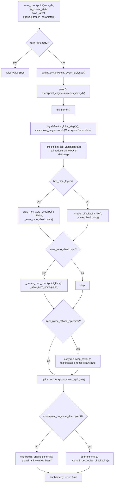
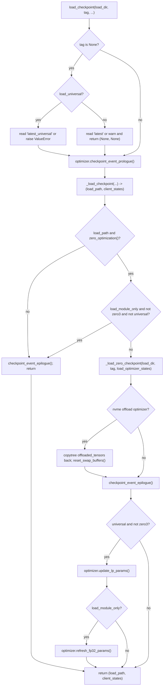
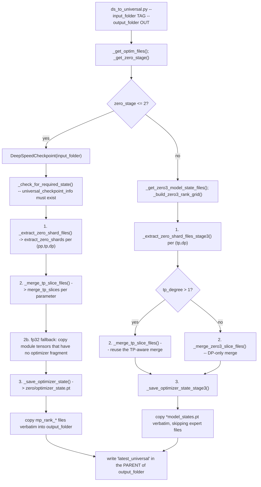
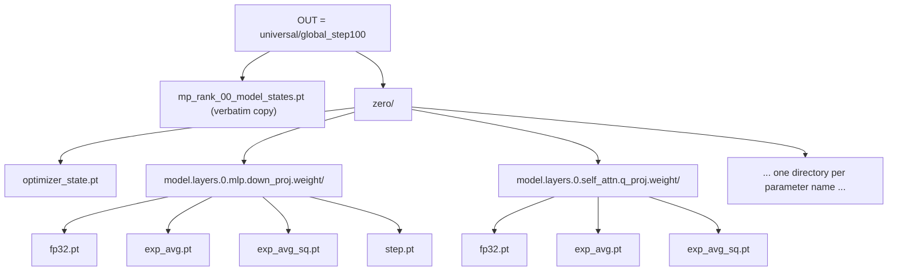
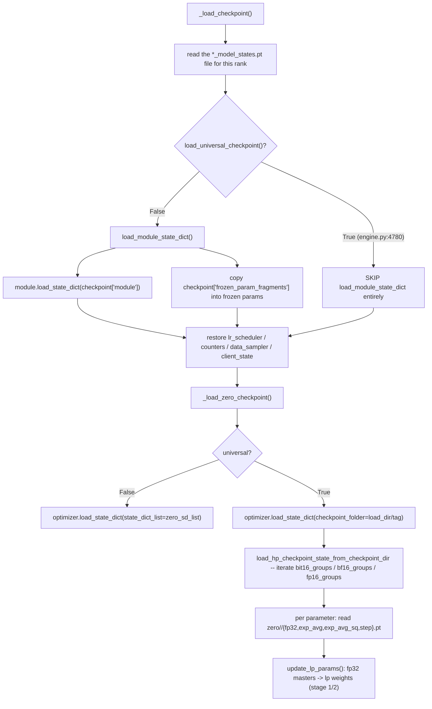
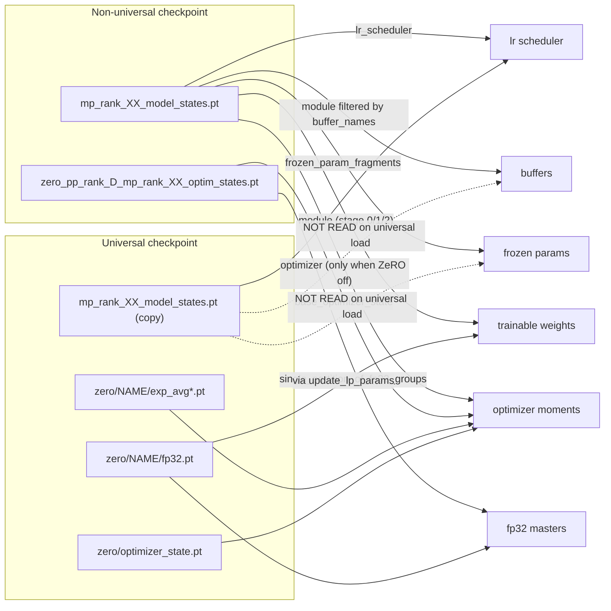
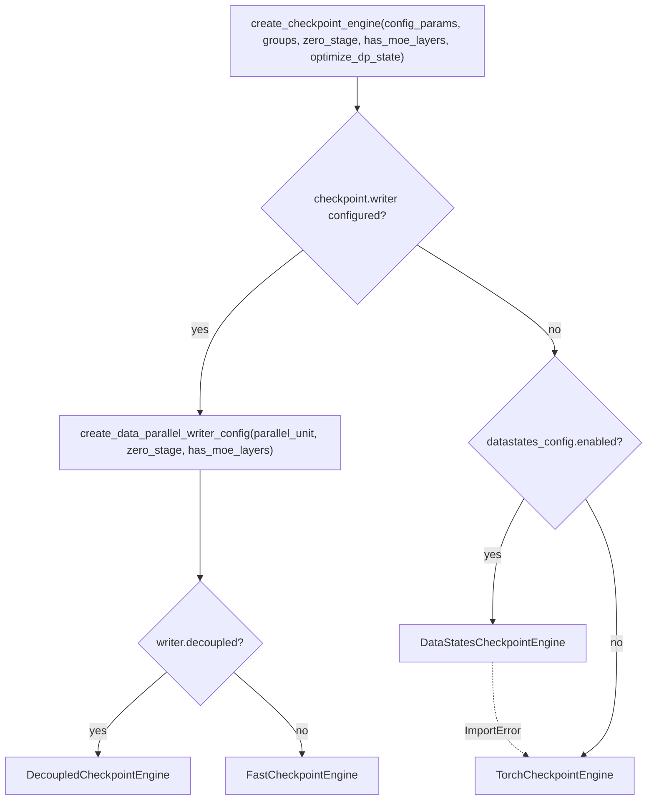

# Checkpointing

What this covers: the on-disk format of a DeepSpeed checkpoint, the save and load
code paths in `DeepSpeedEngine`, Universal Checkpointing (UCP) and the
`ds_to_universal.py` converter, the offline `zero_to_fp32` recovery path, the
`DeepSpeedCheckpoint` reader and reshaping utilities, the checkpoint-engine
abstraction, and a per-tensor-category compatibility matrix. It is written for
someone who has to change one of these paths without breaking the others.

Source of truth: upstream commit d70adc32.

Citations are `path:line` against this tree. Where this tree adds code that is
not in stock DeepSpeed 0.20.1 (AutoEP, affine maps, decoupled writers), that is
called out explicitly.

---

## 1. Vocabulary

A DeepSpeed checkpoint is a *directory of tag directories*, not a file.

| Term | Meaning |
| --- | --- |
| `save_dir` | Root directory passed to `save_checkpoint`. Holds tag directories plus the `latest` pointer and the recovery scripts. |
| `tag` | Name of one checkpoint, default `global_step{N}` (`deepspeed/runtime/engine.py:5044-5048`). All ranks must agree; enforced by `_checkpoint_tag_validation` (`deepspeed/runtime/engine.py:4994`). |
| model-states file | `*_model_states.pt`. Holds `module` (the `nn.Module` state dict), metadata, and -- when ZeRO is off -- the optimizer state. |
| optim-states file | `*_optim_states.pt`. Holds one ZeRO data-parallel rank's optimizer partition. |
| `mp_rank` | Tensor/model-parallel rank, from `mpu.get_model_parallel_rank()` (`deepspeed/runtime/engine.py:2264-2266`). Always `00` without an mpu. |
| `pp_rank` in ZeRO file names | Despite the name, this is the ZeRO **data-parallel** partition rank, `dist.get_rank(group=self.optimizer.dp_process_group)` (`deepspeed/runtime/engine.py:4450`). See `deepspeed/checkpoint/ds_to_universal.py:624-632` for the same observation in-tree. |
| `lp` / `hp` | Low-precision (fp16/bf16) model weights vs. high-precision (fp32) master weights. |
| UCP | Universal Checkpointing: a topology-independent rewrite of a ZeRO checkpoint under a `zero/` tree, loaded with `checkpoint: {load_universal: true}`. |

### 1.1 File-name builders

Every path in a checkpoint comes from one of these. Change a name here and you
must change the matching reader.

| Builder | Produces | Line |
| --- | --- | --- |
| `_get_ckpt_name` | `mp_rank_{mp:02d}_model_states.pt` (ZeRO 0/1/2) or `zero_pp_rank_{dp}_mp_rank_{mp:02d}_model_states.pt` (ZeRO-3) | `deepspeed/runtime/engine.py:4454-4478` |
| `_get_zero_ckpt_prefix` | `zero_pp_rank_{dp}` or `bf16_zero_pp_rank_{dp}` | `deepspeed/runtime/engine.py:4437-4438` |
| `_get_rank_zero_ckpt_name` | `{prefix}_mp_rank_{mp:02d}_optim_states.pt` | `deepspeed/runtime/engine.py:4440-4447` |
| `_get_optimizer_ckpt_name` | `expp_rank_{expp}_mp_rank_{mp:02d}_optim_states.pt` (MoE) | `deepspeed/runtime/engine.py:4480-4483` |
| `_get_expert_ckpt_name` | `layer_{lid}_expert_{eid}_mp_rank_{mp:02d}_model_states.pt`, or the legacy `expert_{eid}_...` when `layer_id <= -1` | `deepspeed/runtime/engine.py:4485-4499` |
| `PipelineModule.ckpt_layer_path` | `layer_{idx:02d}-{rank_repr}-model_states.pt` | `deepspeed/runtime/pipe/module.py:583-590` |
| `PipelineModule.ckpt_prefix` | `module-{dim}_{rank:02d}...` (data dim omitted) | `deepspeed/runtime/pipe/module.py:566-580` |

The literal prefixes/suffixes are also declared symbolically in
`deepspeed/checkpoint/constants.py:40-49` (`MODEL_FILE_PREFIX = 'mp_rank_'`,
`ZERO_FILE_PREFIX = 'zero_pp_rank_'`, `OPTIM_FILE_SUFFIX = '_optim_states.pt'`,
`MODEL_FILE_SUFFIX = '_model_states.pt'`, `LAYER_FILE_PREFIX = 'layer_'`,
`BF16_ZERO_FILE_PREFIX`, `FP16_ZERO_FILE_PREFIX`). The engine does **not** import
those constants -- it builds names with f-strings -- so the two lists must be
kept in sync by hand.

Note the `bf16_` prefix applies **only** to optim-states files
(`_get_zero_ckpt_prefix`), never to the ZeRO-3 model-states file, which always
uses a bare `zero_pp_rank_` prefix (`deepspeed/runtime/engine.py:4466`).

---

## 2. On-disk layout

### 2.1 ZeRO-2, DP=2, no model parallelism, fp16

`engine.save_checkpoint("ckpt", tag="global_step100")`:

```
ckpt/
|-- latest                                        # text: "global_step100"
|-- zero_to_fp32.py                               # copied by rank 0
|-- zero_to_torch.py                              # copied by rank 0
`-- global_step100/
    |-- mp_rank_00_model_states.pt                # written by DP rank 0 only
    |-- zero_pp_rank_0_mp_rank_00_optim_states.pt # written by DP rank 0
    `-- zero_pp_rank_1_mp_rank_00_optim_states.pt # written by DP rank 1
```

With `bf16` enabled the two optim files become
`bf16_zero_pp_rank_0_mp_rank_00_optim_states.pt` and
`bf16_zero_pp_rank_1_...` (`deepspeed/runtime/engine.py:4437-4438`,
`4451`).

The recovery scripts land in `save_dir`, not in the tag directory:
`_save_zero_checkpoint` is called as `_save_zero_checkpoint(save_dir, tag)` and
passes its first argument straight to `_copy_recovery_script`
(`deepspeed/runtime/engine.py:5077`, `5699-5700`, `5664-5670`).

### 2.2 ZeRO-3, DP=2, no model parallelism, fp16

```
ckpt/
|-- latest
|-- zero_to_fp32.py
|-- zero_to_torch.py
`-- global_step100/
    |-- zero_pp_rank_0_mp_rank_00_model_states.pt   # every rank writes its own
    |-- zero_pp_rank_1_mp_rank_00_model_states.pt
    |-- zero_pp_rank_0_mp_rank_00_optim_states.pt
    `-- zero_pp_rank_1_mp_rank_00_optim_states.pt
```

Two differences from ZeRO-2 matter:

1. The model-states file is **per data-parallel rank**, because
   `save_non_zero_checkpoint` is forced true for every rank under ZeRO-3 via
   `is_first_weights_partition_group()` (`deepspeed/runtime/engine.py:2008-2010`,
   `1679-1680`).
2. Its `module` entry contains **buffers plus zero-element parameter
   placeholders**, not weights -- ZeRO-3 has already partitioned the parameters
   away. This is stated in-tree twice: the `_get_buffer_names` comment
   ("the buffers are already there but they are intermixed with param
   placeholders", `deepspeed/runtime/engine.py:5548-5550`) and the
   `load_checkpoint` docstring ("ZeRO stage 3 restores fp32 weights because its
   model checkpoint does not contain the partitioned model weights",
   `deepspeed/runtime/engine.py:4533-4534`).

### 2.3 Pipeline parallelism

`PipelineEngine.module_state_dict` returns `None` and writes per-layer files
itself (`deepspeed/runtime/pipe/engine.py:1299-1316`,
`deepspeed/runtime/pipe/module.py:600-639`):

```
ckpt/global_step100/
|-- mp_rank_00_model_states.pt          # metadata only, module=None
|-- layer_00-model_00-model_states.pt
|-- layer_01-model_00-model_states.pt
|-- ...
`-- zero_pp_rank_*_mp_rank_00_optim_states.pt
```

Layer files are matched by `LAYER_FILE_PREFIX_PATTERN = r'layer_(\d+)-model_.*'`
(`deepspeed/checkpoint/deepspeed_checkpoint.py:26`).

### 2.4 MoE

When `has_moe_layers`, `save_checkpoint` takes the `_save_moe_checkpoint` branch
and sets `save_non_zero_checkpoint = False`
(`deepspeed/runtime/engine.py:5056-5062`). Expert weights go to
`layer_{lid}_expert_{eid}_mp_rank_{mp:02d}_model_states.pt` and the non-ZeRO
optimizer state to `expp_rank_{expp}_mp_rank_{mp:02d}_optim_states.pt`.

### 2.5 The two tag files

| File | Written by | Read by |
| --- | --- | --- |
| `latest` | `save_checkpoint`, global rank 0 only, after `checkpoint_engine.commit` (`deepspeed/runtime/engine.py:5099-5104`); also by `_commit_decoupled_checkpoint` for decoupled engines (`5120-5122`) | `load_checkpoint` when `tag is None` and `load_universal` is false (`deepspeed/runtime/engine.py:4549-4554`); `get_fp32_state_dict_from_zero_checkpoint` (`deepspeed/utils/zero_to_fp32.py:659-665`) |
| `latest_universal` | `ds_to_universal.main`, written into the **parent** of `--output_folder` (`deepspeed/checkpoint/ds_to_universal.py:1371-1375`) | `load_checkpoint` when `tag is None` and `load_universal` is true |

Both files contain only the tag string. `load_checkpoint` picks between them with

```python
latest_tag = "latest_universal" if self.load_universal_checkpoint() else "latest"
```

(`deepspeed/runtime/engine.py:4550`). A missing `latest` logs a warning and
returns `(None, None)`; a missing `latest_universal` raises `ValueError`
(`deepspeed/runtime/engine.py:4556-4563`).

### 2.6 NVMe optimizer offload

With `zero_nvme_offload_optimizer()`, the swap folder is copied into the tag
directory under `offloaded_tensors/rank{NN}/`, excluding any `gradient*`
subdirectories (`deepspeed/runtime/engine.py:5079-5093`), and copied back on
load (`deepspeed/runtime/engine.py:5587-5604`).

---

## 3. Save path

### 3.1 Rank responsibilities

Two booleans decide who writes what. Both are set once, in
`_configure_checkpointing` (`deepspeed/runtime/engine.py:1995-2017`):

```python
dp_rank = groups._get_sequence_data_parallel_rank()
rank = self.local_rank if self.use_node_local_storage() else dp_rank

if self.checkpoint_engine.is_data_parallel_writer(rank) \
    or (self.zero_optimization_partition_weights() and self.is_first_weights_partition_group()):
    self.save_non_zero_checkpoint = True

if hasattr(self.optimizer, 'dp_process_group'):
    param_rank = dist.get_rank(group=self.optimizer.dp_process_group)
    self.save_zero_checkpoint = param_rank == dp_rank
```

| Flag | True for | Controls |
| --- | --- | --- |
| `save_non_zero_checkpoint` | DP rank 0 under the default `CheckpointEngine.is_data_parallel_writer` (`deepspeed/runtime/checkpoint_engine/checkpoint_engine.py:47-48`); **all** ranks under ZeRO-3; a writer subset chosen by `DataParallelWriterFactory` for fast/decoupled engines | the `*_model_states.pt` write in `_save_checkpoint` (`deepspeed/runtime/engine.py:5542-5543`) |
| `save_zero_checkpoint` | ranks whose rank in `optimizer.dp_process_group` equals their sequence-DP rank; false when the optimizer has no `dp_process_group` (plain fp16/fp32 optimizers) | the `*_optim_states.pt` write in `_save_zero_checkpoint` (`deepspeed/runtime/engine.py:5075-5077`) |

`save_zero_checkpoint` can be true with `zero_optimization()` false: the
`BF16_Optimizer` used for bf16 at stage 0 has a `dp_process_group`
(`deepspeed/runtime/bf16_optimizer.py:89`,
`deepspeed/runtime/engine.py:2716-2725`). Such a run writes
`bf16_zero_pp_rank_*` optim files that `load_checkpoint` will not read back,
because `zero_checkpoint_requested` gates on `self.zero_optimization()`
(`deepspeed/runtime/engine.py:4579`). It also writes `param_shapes=None`
(`5163`), which is why UCP conversion of a stage-0 bf16 checkpoint has no shape
metadata to work from.

### 3.2 `save_checkpoint` sequence



Code: `deepspeed/runtime/engine.py:5011-5108`.

Two ordering facts to preserve when editing:

- `latest` is written **after** `checkpoint_engine.commit` and only by global
  rank 0 (`deepspeed/runtime/engine.py:5099-5104`). A reader that sees `latest`
  is therefore guaranteed the commit has returned on rank 0, but *not* that
  other ranks have finished -- the trailing `dist.barrier()` at `5106` is what
  provides that, and it happens after `latest` exists. Treat `latest` as
  "a writer started committing this tag", not "this tag is complete", unless
  every rank has returned from `save_checkpoint`.
- Decoupled engines skip the whole commit block and defer it to
  `_commit_decoupled_checkpoint` (`deepspeed/runtime/engine.py:5110-5124`),
  which writes `latest` from the deferred `CheckpointCommitInfo`.

### 3.3 What goes into the model-states file

`_save_checkpoint` (`deepspeed/runtime/engine.py:5516-5543`):

```python
save_path = self._get_ckpt_name(save_dir, tag)
zero_optimizer_state = self.zero_optimization()
save_frozen_param = self.zero_optimization_partition_gradients() and not exclude_frozen_parameters

self._curr_ckpt_path = os.path.join(save_dir, tag)
module = self.module_state_dict(exclude_frozen_parameters=exclude_frozen_parameters)
self._curr_ckpt_path = None

state = self._common_checkpoint_state(module, zero_optimizer_state, save_frozen_param)
```

`self._curr_ckpt_path` is set only around the `module_state_dict()` call because
`PipelineEngine.module_state_dict` reads it to decide where to write its layer
files and then returns `None` (`deepspeed/runtime/pipe/engine.py:1299-1316`).

`_common_checkpoint_state` (`deepspeed/runtime/engine.py:5159-5180`) is the
single definition of the model-states dictionary:

| Key | Value | Condition |
| --- | --- | --- |
| `module` | `self.module_state_dict(...)`, or `None` under pipeline parallelism | always |
| `buffer_names` | `self._get_buffer_names()` | always |
| `optimizer` | `self.optimizer.state_dict()` | only when `self.optimizer` and **not** `zero_optimizer_state`; else `None` |
| `param_shapes` | `self._get_zero_param_shapes()` | only when `self.optimizer` and `zero_optimizer_state`; else `None` |
| `frozen_param_shapes` | `_get_zero_frozen_param_attributes(_get_param_shape_func)` | only when `save_frozen_param` |
| `frozen_param_fragments` | `_get_zero_frozen_param_attributes(_get_param_fragment_func)` | only when `save_frozen_param` |
| `shared_params` | `self._get_shared_params()` | only when `self.optimizer` and `zero_optimizer_state` |
| `lr_scheduler` | `self.lr_scheduler.state_dict()` | when an lr scheduler exists |
| `data_sampler` | `training_dataloader.data_sampler.state_dict()` | when curriculum learning is enabled |
| `random_ltd` | `random_ltd_scheduler.state_dict()` | when random-LTD is enabled |
| `skipped_steps`, `global_steps`, `global_samples` | engine counters | always |
| `dp_world_size` | `self.seq_dp_world_size` | always |
| `mp_world_size` | `self.mp_world_size` | always |
| `checkpoint_parallel_dimensions` | `{pp_degree, tp_degree}` from the mpu (`deepspeed/runtime/engine.py:426-434`) | always |
| `ds_config`, `ds_version` | config dict and package version | always |

On top of that, `_save_checkpoint` adds `universal_checkpoint_info` when the
module carries it as an attribute (`deepspeed/runtime/engine.py:5533-5535`),
rejects a `client_state` that collides with `CHECKPOINT_PARALLEL_DIMS`
(`5536-5538`), and finally merges `client_state` over the whole dict
(`state.update(client_state)`, `5539`). Client keys therefore *shadow*
DeepSpeed keys; only `checkpoint_parallel_dimensions` is protected.

### 3.4 `module_state_dict`

```python
def module_state_dict(self, destination=None, prefix="", keep_vars=False, exclude_frozen_parameters=False):
    sd = self.module.state_dict(destination=destination, prefix=prefix, keep_vars=keep_vars)
    if exclude_frozen_parameters:
        for n, p in self.module.named_parameters():
            if not p.requires_grad and n in sd:
                del sd[n]
    if self.random_ltd_enabled():
        sd = remove_random_ltd_state_dict(sd)
    return sd
```

(`deepspeed/runtime/engine.py:4127-4138`.) This is a plain
`nn.Module.state_dict()`, so it contains parameters *and* persistent buffers.
Under ZeRO-3 the parameter entries are the post-partition placeholders described
in section 2.2.

`_get_buffer_names` (`deepspeed/runtime/engine.py:5545-5564`) walks the module
tree with `recurse=False` at each level so it can skip
`module._non_persistent_buffers_set`, and returns dotted names. Its only
consumer is `zero_to_fp32.parse_model_states`, which uses it to pull buffers back
out of `state_dict["module"]` (`deepspeed/utils/zero_to_fp32.py:156-166`).

### 3.5 Frozen parameters

"Frozen" in this code means *not owned by the optimizer*, which is broader than
`requires_grad == False`. The predicate is `is_optimized_parameter`
(`deepspeed/runtime/utils.py:890-895`), whose docstring records that
zero-element parameters are excluded for the same reason as frozen ones.

```python
def _get_param_shape_func(self, param):
    return param.ds_shape if hasattr(param, 'ds_id') else param.shape

def _get_param_fragment_func(self, param):
    return param.ds_tensor.detach().cpu() if hasattr(param, 'ds_id') else param.detach().cpu()

def _get_zero_frozen_param_attributes(self, attr_func):
    frozen_param_fragments = OrderedDict()
    for param in self.module.parameters():
        if is_optimized_parameter(param):
            continue
        if param not in self.param_names:
            raise ValueError(f"failed to find frozen {param} in named params")
        name = self.param_names[param]
        frozen_param_fragments[name] = attr_func(param)
    return frozen_param_fragments
```

(`deepspeed/runtime/engine.py:5566-5585`.)

The `ds_id` test is the ZeRO-3 discriminator: under ZeRO-3 a frozen parameter's
*local shard* (`param.ds_tensor`) is saved and its logical shape
(`param.ds_shape`) is recorded separately, so reassembly needs every rank's file.
Under ZeRO-2 there is no `ds_id`, so `frozen_param_fragments` holds the **whole**
tensor on every writing rank -- duplicating what is already in `module`.

`frozen_param_shapes` / `frozen_param_fragments` exist only when
`zero_optimization_partition_gradients()` is true, i.e. stage >= 2
(`deepspeed/runtime/engine.py:5522`, `1673-1674`). At stage 0/1 frozen
parameters are preserved solely because `module` holds full tensors.

### 3.6 `param_shapes` and `shared_params`

`_get_zero_param_shapes` (`deepspeed/runtime/engine.py:5587-5623`) returns a
list (one entry per parameter group) of `OrderedDict[name -> shape]`, taken from
the optimizer's flat group lists in this precedence order:

1. `optimizer.round_robin_bit16_groups` if present (ZeRO-2's shuffled view),
2. else `optimizer.bf16_groups` when bf16 is enabled,
3. else `optimizer.bit16_groups` at stage 2, or `optimizer.fp16_groups` otherwise.

The docstring is explicit that order is load-bearing: the saved optimizer data is
flat with no identifiers, so it can only be interpreted by replaying the same
order. Any change to group construction invalidates old checkpoints.

`_get_shared_params` (`deepspeed/runtime/engine.py:5625-5662`) records
`{alias_name -> canonical_name}` for tied weights, keyed on `param.ds_id` under
ZeRO-3 and `param.data_ptr()` otherwise. It is computed only on
`dist.get_rank() == 0`; every other rank writes `{}`.

### 3.7 `_save_zero_checkpoint`

```python
zero_checkpoint_name = self._get_zero_ckpt_name(save_path, tag)
zero_sd = dict(optimizer_state_dict=self.optimizer.state_dict(), ds_config=self.config, ds_version=version)
...
self.checkpoint_engine.save(zero_sd, zero_checkpoint_name)
if self.global_rank == 0:
    self._copy_recovery_script(save_path)
```

(`deepspeed/runtime/engine.py:5682-5701`.) The `ds_config` and `ds_version`
duplication is deliberate: `zero_to_fp32` and `ds_to_universal` read the optim
files without the model-states file in some paths.

Contents of `optimizer_state_dict` by optimizer:

| Optimizer | Keys | Line |
| --- | --- | --- |
| `DeepSpeedZeroOptimizer` (stage 1/2) | `loss_scaler`, `dynamic_loss_scale`, `overflow`, `clip_grad`, `base_optimizer_state`, optional `base_optimizer_state_step`, `single_partition_of_fp32_groups` (padding stripped), `zero_stage`, `group_paddings`, `param_alignment_paddings`, `partition_count`, `ds_version`, `param_slice_mappings`, optional `universal_checkpoint_info` | `deepspeed/runtime/zero/stage_1_and_2.py:3479-3524` |
| `DeepSpeedZeroOptimizer_Stage3` | `zero_stage`, `loss_scaler`, `dynamic_loss_scale`, `overflow`, `partition_count`, optional `ds_zero_partition_groups`, `optimizer_state_dict`, `fp32_flat_groups` | `deepspeed/runtime/zero/stage3.py:3756-3772` |
| `BF16_Optimizer` | `clip_grad`, `base_optimizer_state`, `single_partition_of_fp32_groups`, `group_paddings`, `partition_count`, `ds_version`, `param_slice_mappings`, optional `universal_checkpoint_info` | `deepspeed/runtime/bf16_optimizer.py:634-648` |

`param_slice_mappings` is what makes UCP possible: it maps each parameter name to
the `(start, numel)` fragment it occupies in this rank's flat fp32 partition.
ZeRO-3 has no equivalent and reconstructs offsets arithmetically instead
(`deepspeed/checkpoint/ds_to_universal.py:189-208`).

`ZeRO-3 elastic checkpointing` raises `NotImplementedError` at `state_dict()`
time (`deepspeed/runtime/zero/stage3.py:3785-3787`).

### 3.8 `save_16bit_model`

`save_16bit_model(save_dir, save_filename="pytorch_model.bin", exclude_frozen_parameters=False)`
(`deepspeed/runtime/engine.py:5834-5883`) writes a single consolidated
HuggingFace-style weight file, not a DeepSpeed checkpoint. It:

- under ZeRO-3, refuses AutoEP (`_raise_if_autoep_zero3_consolidated_export`,
  `deepspeed/runtime/engine.py:5755-5760`), and requires
  `stage3_gather_16bit_weights_on_model_save`; otherwise it logs and returns
  `False` without writing (`5859-5867`);
- under ZeRO-3 calls `_zero3_consolidated_16bit_state_dict`
  (`5762-5827`), which gathers one module's parameters at a time with
  `GatheredParameters(modifier_rank=0)`, additionally gathers AutoTP shards via
  `GatherReplacedLayerParams` when `autotp_size() > 1`, keeps tied weights tied
  by `ds_id`, and -- unlike the ZeRO checkpoint -- **does** copy persistent
  buffers (`5807-5810`);
- otherwise just calls `module_state_dict()` (`5869`);
- writes only on `dist.get_rank() == 0` but **must be called on every rank**,
  because the gather is collective (docstring at `5849-5851`).

`save_fp16_model` is a deprecated alias (`5829-5832`).

There is also `_replace_module_consolidated_state_dict`
(`deepspeed/runtime/engine.py:5703-5734`) for AutoTP-without-ZeRO-3, reached
through `_consolidated_16bit_state_dict` (`5736-5746`).

---

## 4. Load path

### 4.1 Top level



Code: `deepspeed/runtime/engine.py:4513-4614`. The gating expressions verbatim
(`4577-4582`):

```python
zero3 = self.zero_optimization_partition_weights()
universal = self.load_universal_checkpoint()
zero_checkpoint_requested = load_path is not None and self.zero_optimization()
# Universal checkpoints keep the model weights only under zero/, so module-only loads still need it.
load_zero_checkpoint = zero_checkpoint_requested and (not load_module_only or zero3 or universal)
load_zero_optimizer_states = load_optimizer_states and not load_module_only
```

`update_lp_params()` at `4610` is required on the universal stage-1/2 path
because UCP writes the fp32 masters and the low-precision weights are only
derived from them by that call
(`deepspeed/runtime/zero/stage_1_and_2.py:3292-3301`).

Under ZeRO-3 you cannot `load_checkpoint()` immediately after
`save_checkpoint()` on a live engine: the module is partitioned and the loader
expects a pristine model (docstring, `deepspeed/runtime/engine.py:4542-4545`).

### 4.2 `_load_checkpoint`

`deepspeed/runtime/engine.py:4692-4851`. Branch by branch:

| Step | Lines | What it restores |
| --- | --- | --- |
| Build file list | `4703-4511` | `_get_all_ckpt_names` globs `_get_ckpt_name(..., mp_placeholder="*")`; on the universal path `pp_placeholder="0"` so only DP rank 0's ZeRO-3 model-states file is considered (`4501-4511`). |
| Pick the rank's file | `4704-4717` | `SDLoaderFactory.get_sd_loader(...).load(mp_world_size, mp_rank, is_pipe_parallel)`. On the universal path `mp_rank`/`mp_world_size` are rescaled to the *file count* so no Megatron-specific weight merger runs (`4710-4714`). Returns `(None, None)` if nothing loaded (`4719-4720`). |
| Pipeline path marker | `4738-4740` | sets `self._curr_ckpt_path` so `PipelineEngine.load_module_state_dict` can find the layer files. |
| MoE experts | `4744-4779` | `load_moe_state_dict` merges `layer_*_expert_*` files into `checkpoint['module']`. Skipped entirely when `load_universal_checkpoint()` (`4744`), because UCP restores experts from `zero/`. |
| **Module weights** | `4780-4786` | `self.load_module_state_dict(...)` -- **skipped when `load_universal_checkpoint()`** (`4780`). This single `if` is the source of the UCP gaps in section 5.6. |
| DP world size | `4788` | `self.loaded_checkpoint_dp_world_size = checkpoint['dp_world_size']`, consumed by `_load_zero_checkpoint` and `_get_all_zero_checkpoint_names`. |
| `load_module_only` branch | `4791-4794` | `deepspeed_states = ['module']`; calls `optimizer.refresh_fp32_params()` when available, so the masters follow the freshly loaded lp weights. |
| Non-ZeRO optimizer | `4796-4819` | Only when `load_optimizer_states and self.optimizer is not None and not self.zero_optimization()`. For MoE it reads `expp_rank_*_optim_states.pt`; otherwise it uses the `optimizer` key of the model-states file. fp16/bf16 engines pass `load_optimizer_states=` through, fp32 engines do not (`4815-4819`). |
| lr scheduler | `4821-4822` | `self.lr_scheduler.load_state_dict(checkpoint['lr_scheduler'])` when `load_lr_scheduler_states`. |
| random-LTD | `4824-4825` | `random_ltd_scheduler.load_state_dict(checkpoint['random_ltd'])`. |
| data sampler | `4827-4829` | `training_dataloader.data_sampler.load_state_dict(checkpoint['data_sampler'])` under curriculum learning. |
| counters | `4831-4834` | `global_steps`, `global_samples` (defaulted to `global_steps * train_batch_size()`), `skipped_steps`, `loaded_checkpoint_mp_world_size`. |
| client state | `4839-4849` | everything in the checkpoint dict that is not in `deepspeed_states`; `optimizer` is re-added from `optim_checkpoint` when the MoE branch read a separate file. |

Everything from the "lr scheduler" row down runs **regardless of
`load_universal`**, because those values live in the verbatim-copied
`*_model_states.pt` file. Only `load_module_state_dict` is bypassed.

### 4.3 `load_module_state_dict`

`deepspeed/runtime/engine.py:4386-4435`. Two distinct restores:

1. **Trainable and frozen weights present in `module`.** Wrapped in
   `deepspeed.zero.GatheredParameters(params_to_fetch, modifier_rank=0)`; the
   fetch list is either an explicit `z3_params_to_fetch`, or every
   `NOT_AVAILABLE` ZeRO-3 parameter when `fetch_z3_params`, or empty
   (`4393-4405`). Then either `custom_load_fn(src, dst)` or
   `self.module.load_state_dict(module_state_dict, strict=...)`. `strict` is
   downgraded to `False` when `allowed_missing_keys` is supplied, and the
   missing/unexpected sets are then re-checked by hand so that only the allowed
   keys may be missing (`4410-4422`) -- this exists for AutoEP ZeRO-3 expert
   parameters that are restored from ZeRO shards instead.
2. **Frozen fragments.** If `checkpoint['frozen_param_fragments']` is not
   `None`, every non-optimized parameter is located by name through
   `self.param_names` and copied: into `param.ds_tensor.data` when it has a
   `ds_id`, otherwise into `param.data` (`4424-4435`). A frozen parameter that
   is missing from `self.param_names` raises `ValueError`.

### 4.4 `_load_zero_checkpoint`

`deepspeed/runtime/engine.py:4853-4909`.

```python
dp_size_changed = (not self.load_universal_checkpoint()
                   and self.seq_dp_world_size != self.loaded_checkpoint_dp_world_size)
if dp_size_changed and (load_optimizer_states or not isinstance(self.optimizer, DeepSpeedZeroOptimizer)):
    raise ZeRORuntimeException(...)
```

The only non-universal DP-resize that is allowed is "elastic ZeRO stage 1/2
fp32 weights loaded without optimizer states"; everything else is told to use
`ds_to_universal.py` (`4859-4866`).

Then:

| Mode | `zero_sd_list` | `checkpoint_folder` |
| --- | --- | --- |
| universal | `None` | `os.path.join(load_dir, tag)` |
| non-universal | `self._get_all_zero_checkpoints(load_dir, tag)` -- raises `ZeRORuntimeException` if the files are absent | `None` |

Both are handed to the same optimizer entry point
(`deepspeed/runtime/engine.py:4898-4903`):

```python
self.optimizer.load_state_dict(state_dict_list=zero_sd_list,
                               load_optimizer_states=load_optimizer_states,
                               load_from_fp32_weights=True,
                               checkpoint_folder=checkpoint_folder,
                               load_serial=load_serial,
                               param_shapes=param_shapes)
```

and every ZeRO optimizer dispatches on `checkpoint_folder` being truthy:
`stage_1_and_2.py:3779-3783`, `stage3.py:3954-3959`,
`bf16_optimizer.py:667-670`.

`_get_all_zero_checkpoints` (`4981-4992`) tries both bf16 modes and warns when
the checkpoint's bit16 type differs from the engine's.
`_get_all_zero_checkpoint_names` (`4923-4939`) also silently accepts the legacy
`...optim_states.pt` spelling (no underscore).
`_get_all_zero_checkpoint_state_dicts` (`4941-4979`) decides per rank whether to
actually read a file: every rank reads every partition when
`zero_elastic_checkpoint()` or when the file count differs from the current DP
world size; otherwise each rank reads only its own and substitutes
`{OPTIMIZER_STATE_DICT: None}` for the rest.

`zero_config.pipeline_loading_checkpoint` serializes the load across local
ranks with point-to-point `dist.send`/`recv` and is asserted to be ZeRO-3 only
(`4869-4885`, `deepspeed/runtime/zero/stage3.py:3961-3971`).

---

## 5. Universal Checkpointing

UCP decouples the checkpoint from the training topology by rewriting every ZeRO
shard into one directory per parameter holding full, unsharded, padding-free
fp32 tensors. Restoring then re-slices those tensors for whatever
(DP, TP, EP) topology the new job has.

### 5.1 Conversion pipeline



Code: `deepspeed/checkpoint/ds_to_universal.py:1158-1377`.

CLI flags (`deepspeed/checkpoint/ds_to_universal.py:70-97`):
`--input_folder`, `--output_folder`, `--num_extract_workers` (default 4),
`--num_merge_workers` (default 2, "more memory intensive"),
`--keep_temp_folder`, `--no_strict`, `--inject_missing_state`.

Work is distributed with a `ProcessPoolExecutor`, falling back to a serial loop
when `num_workers <= 1` so that unit tests can run it
(`deepspeed/checkpoint/ds_to_universal.py:538-550`).

### 5.2 `extract_zero_shards`

`deepspeed/checkpoint/ds_to_universal.py:132-166`. For one `(pp, tp, dp)` triple
it reads that ZeRO rank's optim file and builds, per parameter group:

```python
flat_state = dict(
    exp_avg=state_groups[param_group_id]["exp_avg"],
    exp_avg_sq=state_groups[param_group_id]["exp_avg_sq"],
    fp32=fp32_groups[param_group_id],
)
if "step" in state_groups[param_group_id]:
    flat_state["step"] = state_groups[param_group_id]["step"]
```

It then walks `param_slice_mappings[param_group_id]` and calls
`dump_param_fragment` with the recorded `(start, numel)`. Parameters matching
`pipeline_replicated_parameter_patterns` are skipped for `pp_index > 0` so a
tied embedding is not written twice (`158-161`).

`dump_param_fragment` (`218-232`) writes
`{temp}/{param_name}/{tp_index}/{state_name}.{dp_index:02d}`, narrowing the flat
tensor to the fragment and `clone()`-ing it (a narrowed view would serialize the
entire backing tensor).

The ZeRO-3 variant `extract_zero_shards_stage3` (`168-208`) has no
`param_slice_mappings`; it walks `param_shapes` in order and recomputes offsets
with `_zero_partitioned_param_info` (`604-608`), dropping the per-rank alignment
padding via

```python
padding_free_numel = max(0, min(partitioned_numel, unpartitioned_numel - partition_rank * partitioned_numel))
```

It dumps under the real `tp_index` (not 0) so that a later TP-aware merge can
reassemble AutoTP shards.

### 5.3 `merge_tp_slices`

`deepspeed/checkpoint/ds_to_universal.py:291-505`. For one parameter, for each
of `fp32`, `exp_avg`, `exp_avg_sq` (and `step` separately at `365-367`), it
concatenates that parameter's DP fragments per TP rank via `_merge_zero_shards`
(`235-288`) and then merges across TP ranks. The merge rule is chosen by the
first match in this order:

| Branch | Rule | Extra keys written | Lines |
| --- | --- | --- | --- |
| affine map (`affine_map.params`, fork addition) | `ParamAffineMap.rebuild(slices, SCALE_POWER_BY_STATE[state])` -- geometric, category-free | none | `379-385` |
| `tp_replicated_parameter_patterns` | assert all slices equal, take slice 0 | none | `386-389` |
| `parameter_to_average_patterns` | `sum(slices) / len(slices)` | none | `390-391` |
| `parameter_with_2_sub_params_cat_dim_0` | chunk each slice in 2, cat each half across ranks, cat the halves | `cat_dim`, `param_n_sub_params=2` | `392-399` |
| `parameter_with_sub_params` | per-sub-parameter narrow using `sub_param_shard_widths` (UCP >= 0.4) or an even split | `sub_param_shape` | `400-485` |
| default | `torch.cat(slices, dim=1 if row-parallel else 0)`; `continue` (write nothing) if there are no slices at all | `cat_dim` | `486-494` |
| post-pass: `vocabulary_parameter_patterns` | truncate to `original_vocab_size` | `vocab_tensor=True` | `496-500` |

The result is saved as `{PARAM: tensor, **extra}` to
`zero/{param}/{state}.pt` (`502-503`).

The `SCALE_POWER_BY_STATE` indirection exists because scaling a parameter by `s`
scales its gradient by `1/s`: Adam's first moment carries the inverse and the
second moment the inverse square (comment at `369-372`).

Pattern bookkeeping: every pattern list is tracked in `unmatched_patterns`, each
worker returns its leftovers, and `_merge_tp_slice_files` intersects them across
workers and asserts the intersection is empty unless `--no_strict`
(`579-595`). When an affine map matches, `consume_superseded_patterns` marks the
category patterns used so the strict check still passes (`347-362`).

### 5.4 Output layout



As a tree, for ZeRO-2 DP=2 converted from the section 2.1 checkpoint:

```
universal/
|-- latest_universal                               # "global_step100"
`-- global_step100/
    |-- mp_rank_00_model_states.pt                 # byte-for-byte copy
    `-- zero/
        |-- optimizer_state.pt                     # param_groups + global state
        |-- model.embed_tokens.weight/
        |   |-- fp32.pt
        |   |-- exp_avg.pt
        |   |-- exp_avg_sq.pt
        |   `-- step.pt
        |-- model.layers.0.input_layernorm.weight/
        |   |-- fp32.pt
        |   |-- exp_avg.pt
        |   `-- exp_avg_sq.pt
        `-- ...
```

Parameter names become **directory paths**, so a name containing `/` creates
nested directories. The code is aware of this and always `makedirs` the
parameter directory before writing (`deepspeed/checkpoint/ds_to_universal.py:222-223`,
and the comment at `902-904`).

`optimizer_state.pt` is the optim file of rank `(0,0,0)` with the three sharded
keys removed and `param_groups` hoisted
(`deepspeed/checkpoint/ds_to_universal.py:1006-1015`):

```python
sharded_states = [BASE_OPTIMIZER_STATE, PARAM_SLICE_MAPPINGS, SINGLE_PARTITION_OF_FP32_GROUPS]
output_sd = {k: v for k, v in optim_sd.items() if k not in sharded_states}
output_sd[PARAM_GROUPS] = optim_sd[BASE_OPTIMIZER_STATE][PARAM_GROUPS]
```

### 5.5 What is copied verbatim, and the fp32 fallback

Copied verbatim: every `mp_rank_*` file for stage <= 2
(`shutil.copy2`, `deepspeed/checkpoint/ds_to_universal.py:1264-1275`), and every
`*model_states.pt` except expert files for stage 3 (`1356-1369`). When AutoEP
metadata is present the file is loaded, has `universal_checkpoint_info` keys
injected, and is re-saved instead of copied.

This verbatim copy is why the universal load still gets `lr_scheduler`,
`global_steps`, `data_sampler`, `random_ltd`, `buffer_names`,
`frozen_param_shapes`, `frozen_param_fragments`, `ds_config` and the whole
`client_state` -- they are all read from the copied model-states file by
`_load_checkpoint` (section 4.2).

The **fp32 fallback** (stage <= 2 only,
`deepspeed/checkpoint/ds_to_universal.py:1212-1227`):

```python
for model_file in ds_checkpoint.mp_rank_files:
    model_state = torch.load(model_file, map_location="cpu", weights_only=False)
    module_state = model_state.get("module")
    if module_state is None:
        continue
    for name, tensor in module_state.items():
        param_dir = os.path.join(zero_output_folder, name)
        fp32_path = os.path.join(param_dir, "fp32.pt")
        if os.path.isfile(fp32_path):
            continue
        os.makedirs(param_dir, exist_ok=True)
        torch.save({PARAM: tensor.float()}, fp32_path)
```

Three consequences worth knowing before you touch this:

1. It exists because ZeRO does not materialize optimizer state for parameters
   that have never received a gradient, so `merge_tp_slices` `continue`s for
   them (`487-491`) and no `fp32.pt` is written.
2. `module_state` is a full `nn.Module` state dict, so this loop also writes
   `zero/<buffer_name>/fp32.pt` for every **persistent buffer**. Nothing ever
   reads those files: the universal load iterates the optimizer's parameter
   groups, not the `zero/` directory (section 5.6). They are inert bytes.
3. The first `mp_rank_*` file to supply a name wins, and the tensor is written
   unmerged with no `cat_dim`. For a genuinely TP-sharded parameter that would
   store only one rank's shard. In practice the fallback only triggers for
   parameters with no optimizer state at all, but the asymmetry is real.

The stage-3 path has **no** such fallback loop, so a ZeRO-3 universal checkpoint
contains no buffer `fp32.pt` files and no fp32 for gradient-less parameters.

### 5.6 The load side, and exactly what it restores

Enabling it: `{"checkpoint": {"load_universal": true}}`, parsed at
`deepspeed/runtime/config.py:552-553` from
`LOAD_UNIVERSAL_CHECKPOINT = "load_universal"`
(`deepspeed/runtime/constants.py:356-357`), exposed as
`engine.load_universal_checkpoint()` (`deepspeed/runtime/engine.py:1770-1771`).



The per-parameter reader is
`load_hp_checkpoint_state(self, folder, tp_rank, tp_world_size, ep_rank=0, ep_size=1, load_optimizer_states=True)`
(`deepspeed/checkpoint/universal_checkpoint.py:236-391`), monkey-patched onto
each low-precision parameter by `enable_universal_checkpoint`
(`394-397`), which stage 1/2 and bf16 call during init
(`deepspeed/runtime/zero/stage_1_and_2.py:755`, `806-815`;
`deepspeed/runtime/bf16_optimizer.py:240`, `314-323`). It:

1. lists `{stem}.pt` files in the parameter directory and rejects duplicates;
   **requires `fp32.pt`** and raises `ZeRORuntimeException` without it
   (`243-255`);
2. drops everything but `fp32` when `load_optimizer_states=False` (`256-257`);
3. for each state: slices by EP rank for expert parameters (`273-289`), applies
   vocab re-padding (`317-326`), then resolves this rank's TP slice -- preferring
   the recorded AutoTP/affine metadata via `_resolve_autotp_partition`
   (`148-233`) and otherwise falling back to `chunk(tp_world_size, cat_dim)[tp_rank]`
   and the `sub_param_shape` / `param_n_sub_params` reversals (`342-375`);
4. narrows to `hp_mapping.lp_fragment_address` and copies: `fp32` into
   `hp_mapping.get_hp_fragment()`, anything else into
   `hp_mapping.optim_fragment[key]` (`377-389`);
5. returns the `step` value, which the caller asserts is identical across the
   group (`deepspeed/runtime/base_optimizer.py:399-401`).

The driver is `load_hp_checkpoint_state_from_checkpoint_dir`
(`deepspeed/runtime/base_optimizer.py:346-408`). Its loop is the crux:

```python
lp_groups = getattr(self, lp_groups_name)      # "bit16_groups" / "bf16_groups"
...
for lp in lp_groups[i]:
    if lp._hp_mapping is not None:
        step = lp.load_hp_checkpoint_state(os.path.join(checkpoint_dir, self.param_names[lp]), ...)
```

It also reads `zero/optimizer_state.pt`, calls `self._load_global_state(optim_sd)`,
rebuilds flat optimizer states with `map_to_flat_opt_states`, and copies every
non-`params` key of each saved `param_group` over the live one (`376-408`).

ZeRO-3 has its own pair:
`load_hp_checkpoint_state_from_checkpoint_dir_stage3`
(`deepspeed/runtime/zero/stage3.py:3985-4055`) for the full load and
`load_module_checkpoint_state_from_checkpoint_dir_stage3` (`4057-4095`) for the
module-only load. Both iterate `self.fp16_groups` -- again, optimizer-owned
parameters only -- and both go through `stage3.load_hp_checkpoint_state`
(`4102`+), which raises `ZeRORuntimeException` on a missing `fp32.pt`.

**Therefore, on the universal load path:**

| Restored by UCP | From | Mechanism |
| --- | --- | --- |
| fp32 master weights of optimizer-owned parameters | `zero/<name>/fp32.pt` | `load_hp_checkpoint_state` -> `hp_mapping.get_hp_fragment()` |
| fp16/bf16 model weights of those parameters | derived | `update_lp_params()` (stage 1/2, `engine.py:4610`); direct `copy_` into `fp16_partitioned_groups_flat` (stage 3, `stage3.py:4044-4055`) |
| Adam `exp_avg`, `exp_avg_sq` | `zero/<name>/exp_avg*.pt` | `hp_mapping.optim_fragment` -> `map_to_flat_opt_states` |
| `step` | `zero/<name>/step.pt` | `optimizer.state[hp_param]['step']` |
| optimizer `param_groups` hyperparameters, loss scaler, overflow | `zero/optimizer_state.pt` | `_load_global_state` + the param-group copy loop |
| lr scheduler, `global_steps`, `global_samples`, `skipped_steps`, `data_sampler`, `random_ltd`, `client_state` | the verbatim-copied `*_model_states.pt` | `_load_checkpoint` (these run on both paths) |

| **Not restored by UCP** | Why |
| --- | --- |
| **Frozen parameters** | They are not in `bit16_groups`/`bf16_groups`/`fp16_groups`, so the UCP loop never visits them; and the `frozen_param_fragments` copy lives inside `load_module_state_dict`, which `engine.py:4780` skips. They keep whatever values model construction gave them. |
| **Zero-element parameters** | Excluded from the optimizer groups by `is_optimized_parameter` (`deepspeed/runtime/utils.py:890-895`); same two reasons as frozen parameters. |
| **Registered persistent buffers** -- BatchNorm `running_mean` / `running_var` / `num_batches_tracked`, cached attention masks, non-parameter rotary tables | Buffers are not parameters, are not in any optimizer group, and `module.load_state_dict` is never called. For stage <= 2 the converter does write `zero/<buffer>/fp32.pt` (section 5.5), but no reader ever opens it. |
| Expert files under native MoE | `load_moe_state_dict` is skipped on the universal path (`engine.py:4744`). |
| RNG state | Never saved by DeepSpeed at all (section 7). |

If your model has BatchNorm, or frozen layers you actually need preserved,
a universal resume is not value-preserving for them. Practical options: keep
them out of the universal path (resume same-topology), re-call
`module.load_state_dict` yourself against the copied `*_model_states.pt` after
`load_checkpoint` returns, or stash the tensors in `client_state`.

### 5.7 Tensor provenance



Dotted edges are the gap created by `deepspeed/runtime/engine.py:4780`.

---

## 6. Offline recovery: `zero_to_fp32`

`deepspeed/utils/zero_to_fp32.py` (862 lines) reconstructs a single
consolidated fp32 `state_dict` from a ZeRO checkpoint **without** a distributed
runtime. `_copy_recovery_script` drops a copy of it (and `zero_to_torch.py`)
into `save_dir` on every save (`deepspeed/runtime/engine.py:5664-5670`), marked
executable where possible (`5672-5680`).

Public API:

| Function | Purpose | Line |
| --- | --- | --- |
| `get_fp32_state_dict_from_zero_checkpoint(checkpoint_dir, tag=None, exclude_frozen_parameters=False, lazy_mode=False)` | returns an in-memory fp32 state dict; reads `latest` when `tag is None` and raises `ValueError` if absent | `614-676` |
| `convert_zero_checkpoint_to_state_dict(...)` | shards and writes the result to `output_dir` | `679` |
| `convert_zero_checkpoint_to_fp32_state_dict(...)` | thin wrapper, also the CLI entry point | `769` |
| `load_state_dict_from_zero_checkpoint(model, checkpoint_dir, tag=None)` | moves the model to CPU and `load_state_dict(..., strict=False)` | `785-821` |

Internals:

1. `parse_model_states` (`150-197`) reads every `*_model_states.pt`. It requires
   `buffer_names` (`156-157`), then recovers buffers as
   `{k: v.float() if v.is_floating_point() else v for k, v in state_dict["module"].items() if k in buffer_names}`
   (`163-166`), and collects `param_shapes`, `frozen_param_shapes`,
   `frozen_param_fragments`, `shared_params`, `ds_version` into a
   `zero_model_state` namedtuple-like dataclass (`42`).
2. `parse_optim_states` (`200-238`) loads the optim files with `mmap=True`,
   immediately discards the nested base-optimizer state (only masters are
   needed), reads `zero_stage` and `partition_count`, and **requires the file
   count to equal the saved world size** -- otherwise `ValueError` warning you
   about an overwritten or partially written checkpoint (`222-226`). It selects
   `single_partition_of_fp32_groups` for stage <= 2 and `fp32_flat_groups` for
   stage 3 (`229-234`).
3. Stage dispatch (`241-267`) to `_get_fp32_state_dict_from_zero2_checkpoint`
   (`394-418`) or `_get_fp32_state_dict_from_zero3_checkpoint` (`563-583`).
   Both do the same three things in the same order: insert buffers, merge frozen
   params unless excluded, merge trainable params, then re-tie shared params.
4. `GatheredTensor` (`464-508`) is a lazy pseudo-tensor so that `lazy_mode=True`
   can materialize one parameter at a time; `to_torch_tensor` (`586-611`)
   realizes them while preserving tensor identity for tied weights and leaving
   non-floating-point buffers at their original dtype (`602-604`).

`get_model_state_file(checkpoint_dir, zero_stage)` (`90-103`) hardcodes
`mp_rank_00_model_states.pt` for stage <= 2 and
`zero_pp_rank_0_mp_rank_00_model_states.pt` for stage 3 -- a second place that
must change if the naming scheme changes.

Unlike the universal load path, `zero_to_fp32` **does** restore buffers and
frozen parameters, because it reads them straight out of the model-states file.

---

## 7. What is never checkpointed

- **RNG state.** `DeepSpeedEngine` never calls `get_rng_state` for
  checkpointing. The only RNG handling in `deepspeed/runtime` is broadcast for
  consistency at init (`deepspeed/runtime/hybrid_engine.py:36-38`,
  `deepspeed/runtime/tensor_parallel/tp_manager.py:30-32`) and the
  forward/backward save-restore inside activation checkpointing
  (`deepspeed/runtime/activation_checkpointing/checkpointing.py:620-622`,
  `725-732`). The only RNG-ish thing persisted is the curriculum-learning data
  sampler's `np_rng_state`
  (`deepspeed/runtime/data_pipeline/constants.py:65`), carried inside
  `data_sampler`. If you need torch/numpy/python RNG across a resume, put it in
  `client_state`.
- **Gradients.** Explicitly excluded from the NVMe offload copy
  (`deepspeed/runtime/engine.py:5090`).
- **Dataloader position**, except through the curriculum data sampler.

---

## 8. The `DeepSpeedCheckpoint` reader and reshaping utilities

`deepspeed/checkpoint/` is the offline toolkit: it reads a checkpoint directory
with no live engine and can re-map it onto a different 3-D (pp, tp, dp)
topology. Exports are listed in `deepspeed/checkpoint/__init__.py`.

### 8.1 `DeepSpeedCheckpoint`

`deepspeed/checkpoint/deepspeed_checkpoint.py:43-365`. Constructor
`DeepSpeedCheckpoint(dir, tp_degree=None, pp_degree=None, dp_degree=None, final_layer_norm_idx=-1)`:

| Step | Line | Detail |
| --- | --- | --- |
| enumerate files | `54-58` | `get_files(dir)`; `_get_pipeline_layer_files` keeps anything fully matching `LAYER_FILE_PREFIX_PATTERN = r'layer_(\d+)-model_.*'` (`26`, `38-40`); a non-empty result means the checkpoint is pipeline-parallel |
| validate | `58`, `354-365` | asserts `mp_rank_*` exists, plus `layer_*` and `layer_01*` for pipeline checkpoints |
| scan metadata | `61`, `130-148` | `_discover_model_state_metadata` loads each `mp_rank_*` file **once**, keeps only `checkpoint_parallel_dimensions`, a flattened `param_shapes`, trimmed AutoEP metadata, and a one-key `ds_config`; `global_state` takes `iteration`, `args`, `checkpoint_info`, `universal_checkpoint_info` from file 0 and then `del`s the state dict |
| derive the source topology | `62-75` | `get_model_3d_descriptor_from_metadata`, then `ZeROCheckpoint(dir, source_3d=...)` |
| parse layer keys | `66-67`, `333-341` | regex-extract the layer index from each layer file, sort numerically, rebuild as `layer_{id}` |
| build 2-D maps | `77-83` | `meg_2d_parallel_map(src_pp, src_tp).simple_init()` for the old map, `reshape_meg_2d_parallel(...)` for the new one |
| reshape ZeRO files | `85-86` | only when any degree changed |
| build per-role maps | `89-92` | `pp_to_transformer_map`, `transformer_file_map`, `tp_to_embedding_map`, `tp_to_final_norm_map` |

Layer-key semantics are Megatron-specific: index `0` is the embedding
(`EMBEDDING_LAYER_INDEX`), index `-1` the final layer norm
(`FINAL_LAYER_NORM_INDEX`), and `layer_keys[1:final_layer_norm_idx]` are the
transformer layers (`21-22`, `287`, `302`).

Merging across TP ranks uses two module-level tables: `SEQUENTIAL_LAYERS`
(`30-33`), whose keys are replicated so slice 0 is taken verbatim, and
`LAYER_CONCAT_DIM = {'self_attention.dense.weight': 1, 'mlp.dense_4h_to_h.weight': 1}`
(`35`), the row-parallel exceptions. Everything else is concatenated on dim 0
(`_merge_state_dicts`, `343-352`). These names are Megatron-LM's, so this reader
is not generic across model code.

`get_zero_checkpoint_state(pp_index, tp_index, dp_index, strip_tensor_paddings=True)`
(`181-186`) delegates to `ZeROCheckpoint`, ignoring `param_shapes`.

### 8.2 `ZeROCheckpoint`

`deepspeed/checkpoint/zero_checkpoint.py:17-145`. Indexes the `*_optim_states.pt`
files on a 3-D grid, and on read optionally strips padding:
`_strip_tensor_paddings` (`95-112`) narrows each per-group optimizer state by
`group_paddings[key]`, `_clear_group_paddings` (`114-118`) zeroes the recorded
paddings afterwards, and `_update_partition_count` (`138-145`) rewrites
`partition_count` to the new DP degree. `reshape(target_3d_desc)` (`91-93`)
re-maps the file grid.

### 8.3 The reshape modules

| Module | Contents |
| --- | --- |
| `deepspeed/checkpoint/reshape_utils.py` | `basic_folder_validation`, `get_files`, `get_files_with_prefix`, `sort_zero_files`, `get_zero_files`, `partition_data`, and the recursive `merge_state` / `merge_state_dict` / `merge_state_list` used to combine TP shards |
| `deepspeed/checkpoint/reshape_meg_2d.py` | `meg_2d_parallel_map` (a `(pp, tp)` -> file-index map; `simple_init` assigns index `i` to `pp = i // tp_degree, tp = i % tp_degree`), `_reshape_tp_dimension`, `_reshape_pp_dimension`, `reshape_meg_2d_parallel`, `get_mpu_ranks` |
| `deepspeed/checkpoint/reshape_3d_utils.py` | `model_3d_desc` with `reshape`, `world_size`, `is_valid`, `can_reshape`; `get_model_3d_descriptor` / `get_model_3d_descriptor_from_metadata`; `flatten_dp_dimension` / `unflatten_dp_dimension` |
| `deepspeed/checkpoint/utils.py` | `get_model_ckpt_name_for_rank`, `get_zero_ckpt_name_for_rank`, `get_layer_ckpt_name_for_rank`, `clone_tensors_for_torch_save` |

The `simple_init` ordering (pp-major) is relied on by
`_group_per_tp_shapes` in the converter, which documents it at
`deepspeed/checkpoint/ds_to_universal.py:980-999`.

Fork-only modules in the same package: `affine.py`, `affine_geometry.py`,
`affine_replica_policy.py`, `affine_transfer*.py` (the affine parameter-layout
IR, specified in `deepspeed/checkpoint/affine_ir_spec.md`), `autoep_affine.py`,
`autoep_universal.py`, `autoep_zero3_metadata.py`, `zero_affine.py`.

---

## 9. The checkpoint-engine abstraction

All reads and writes of checkpoint bytes go through
`self.checkpoint_engine`, built once in `_configure_checkpointing`
(`deepspeed/runtime/engine.py:1998-2002`).



Code: `deepspeed/runtime/checkpoint_engine/utils.py:15-39`.

The interface (`deepspeed/runtime/checkpoint_engine/checkpoint_engine.py`):

| Member | Abstract? | Default | Line |
| --- | --- | --- | --- |
| `CheckpointCommitInfo(tag, save_dir, save_latest)` | dataclass | -- | `14-18` |
| `create(info)` | yes | -- | `26-29` |
| `save(state_dict, path)` | yes | -- | `31-33` |
| `load(path, map_location=None)` | yes | -- | `38-40` |
| `commit(info)` | yes | -- | `42-45` |
| `makedirs(path, exist_ok=False)` | no | `os.makedirs` | `35-36` |
| `is_data_parallel_writer(dp_rank)` | no | `dp_rank == 0` | `47-48` |
| `is_decoupled()` | no | `False` | `50-51` |
| `set_commit_info` / `get_commit_info` | no | no-op / `None` | `53-57` |
| `cleanup()` | no | no-op | `59-60` |
| `preserves_storage_sharing()` | no | `True` | `62-63` |

Implementations:

| Class | File | Notes |
| --- | --- | --- |
| `TorchCheckpointEngine` | `torch_checkpoint_engine.py` | plain `torch.save` / `torch.load`; the default, and the one hardcoded as a fallback in `load_moe_state_dict`'s signature (`deepspeed/runtime/engine.py:4259`) |
| `FastCheckpointEngine` | `fast_checkpoint_engine.py` | uses `CheckpointWriterFactory` (aio/GDS-backed writers) and a `DataParallelWriterConfig` to spread writes across DP ranks |
| `DecoupledCheckpointEngine` | `decoupled_checkpoint_engine.py` | forks a writer process (`init_decoupled_checkpoint`), queues saves, and returns before bytes land; `is_decoupled()` is `True`, so `save_checkpoint` defers both `commit` and the `latest` write to `_commit_decoupled_checkpoint` |
| `DataStatesCheckpointEngine` | `datastates_checkpoint_engine.py` | optional third-party backend; also decoupled, and `preserves_storage_sharing()` is overridden |

`preserves_storage_sharing()` matters for pipeline saves: when it is `False`,
`PipelineModule.save_state_dict` skips `clone_tensors_for_torch_save`
(`deepspeed/runtime/pipe/module.py:627-637`).

### 9.1 `deepspeed/runtime/model_checkpointing/`

This package holds the configuration and writer-placement logic the fast and
decoupled engines consume.

| File | Contents |
| --- | --- |
| `constants.py` | the `"checkpoint"` config schema (`CHECKPOINT_FORMAT` docstring), `ValidationMode` (`WARN`/`IGNORE`/`FAIL`, default `WARN`), `CheckpointWriterType` (`MOCK`/`PYTHON`/`FAST`, default `FAST`), `CheckpointDataParallel` (`REPLICA`/`SOCKET`/`MACHINE`), and defaults for `io_buffer_size` (64 MiB), `io_buffer_double` (`True`), `io_multiplier` (1), `show_statistics` (`False`), `decoupled` (`False`) |
| `config.py` | `get_checkpoint_config` / `get_checkpoint_writer_config` plus `_validate_config_values` and `_make_upper_case` |
| `writer_factory.py` | `CheckpointWriterFactory.create_writer(file_path, optimize_dp_state)` / `release_writer()`, with `_setup_for_aio` and `_setup_for_gds` |
| `data_parallel_writer_factory.py` | `DataParallelWriterConfig` and `DataParallelWriterFactory.create_config(zero_stage, has_moe_layers)`, which decides which ranks write, with separate paths for DDP, 2-D expert parallelism, and 3-D parallelism |
| `utils.py` | `MPUInfo`, `ExpertParallelInfo`, `UniversalParallelInfo`, `create_universal_parallel_info`, `create_data_parallel_writer_config` |

`tag_validation` from this schema is what `_checkpoint_tag_validation` enforces:
`IGNORE` disables the check, `WARN` logs, `FAIL` asserts
(`deepspeed/runtime/engine.py:4994-5009`, `deepspeed/runtime/config.py:549-551`).

---

## 10. Compatibility matrix

Rows are tensor categories, columns are ZeRO stages. "Where restored from" names
the file and key.

### 10.1 Save

| Category | Stage 0 | Stage 1 | Stage 2 | Stage 3 |
| --- | --- | --- | --- | --- |
| Trainable fp16/bf16 weights | `module` (full) | `module` (full) | `module` (full) | `module` holds placeholders only; real values live in `fp32_flat_groups` |
| fp32 master weights | `optimizer` key in model-states (if an fp16/bf16 optimizer wraps them) | `single_partition_of_fp32_groups` | `single_partition_of_fp32_groups` | `fp32_flat_groups` |
| Frozen parameters | `module` only | `module` only | `module` + `frozen_param_fragments` (full copy) | `frozen_param_fragments` only (per-rank `ds_tensor` shard) |
| Zero-element parameters | `module` | `module` | `frozen_param_shapes`/`fragments` | `frozen_param_shapes`/`fragments` |
| Persistent buffers | `module`, names in `buffer_names` | same | same | same |
| Optimizer moments | `optimizer` in model-states | `base_optimizer_state` in optim-states | `base_optimizer_state` | `optimizer_state_dict` in optim-states |
| `param_slice_mappings` | n/a | yes | yes | no (offsets recomputed) |
| lr scheduler | `lr_scheduler` in model-states | same | same | same |
| RNG | not saved | not saved | not saved | not saved |

### 10.2 Load, same topology (`load_universal: false`)

| Category | Restored? | Where from |
| --- | --- | --- |
| Trainable weights | yes | `module` via `load_module_state_dict`; stage 3 instead rebuilds them from `fp32_flat_groups` in `_rigid_load_state_dict` |
| fp32 masters | yes when `load_optimizer_states` or `load_from_fp32_weights` | optim-states; `refresh_fp32_params()` re-derives them from lp weights when `load_module_only` |
| Frozen parameters | yes | `module` (stage 0/1) and/or `frozen_param_fragments` (stage >= 2) |
| Buffers | yes | `module` |
| Optimizer moments | yes when `load_optimizer_states` | optim-states |
| lr scheduler | yes when `load_lr_scheduler_states` | `lr_scheduler` |
| RNG | no | not in the checkpoint |
| DP resize | only elastic stage 1/2, fp32-weights-only | otherwise `ZeRORuntimeException` (`engine.py:4859-4866`) |

### 10.3 Load, universal (`load_universal: true`)

| Category | Restored? | Where from |
| --- | --- | --- |
| Trainable weights (optimizer-owned, non-empty) | yes | `zero/<name>/fp32.pt`, then `update_lp_params()` / direct copy |
| fp32 masters | yes | `zero/<name>/fp32.pt` |
| Optimizer moments | yes when `load_optimizer_states` | `zero/<name>/exp_avg.pt`, `exp_avg_sq.pt` |
| `step` | yes | `zero/<name>/step.pt` |
| Optimizer `param_groups`, loss scaler | yes | `zero/optimizer_state.pt` |
| **Frozen parameters** | **no** | `frozen_param_fragments` exists in the copied model-states file but `load_module_state_dict` is skipped (`engine.py:4780`) |
| **Zero-element parameters** | **no** | same |
| **Persistent buffers (BatchNorm running stats, cached masks)** | **no** | `module` is never applied; stage<=2 writes `zero/<buffer>/fp32.pt` but nothing reads it |
| lr scheduler, counters, `data_sampler`, `random_ltd`, `client_state` | yes | the verbatim-copied `*_model_states.pt` |
| RNG | no | not in the checkpoint |
| Topology change (DP, TP, EP) | yes, within the recorded metadata | per-rank re-slicing in `load_hp_checkpoint_state` |

### 10.4 `zero_to_fp32` / `save_16bit_model`

| Category | `get_fp32_state_dict_from_zero_checkpoint` | `save_16bit_model` |
| --- | --- | --- |
| Trainable weights | yes, merged fp32 from all optim shards | yes (gathered 16-bit) |
| Frozen parameters | yes unless `exclude_frozen_parameters` | yes unless `exclude_frozen_parameters` |
| Buffers | yes, via `buffer_names` | yes under ZeRO-3 (`engine.py:5807-5810`); yes via `module_state_dict` otherwise |
| Optimizer state | no, discarded on purpose (`zero_to_fp32.py:205-207`) | no |
| Shared/tied weights | yes, re-tied from `shared_params` | yes, re-tied by `ds_id` |

---

## 11. Notes for anyone modifying these paths

1. **Parameter ordering is part of the format.** `_get_zero_param_shapes`
   reproduces the optimizer's flat-group order, and the saved optimizer tensors
   carry no names. Reordering group construction silently breaks every existing
   checkpoint (`deepspeed/runtime/engine.py:5588-5596`).
2. **File names are built twice.** Once with f-strings in the engine, once as
   constants in `deepspeed/checkpoint/constants.py`, plus hardcoded literals in
   `zero_to_fp32.get_model_state_file` and regexes in
   `ds_to_universal._zero3_tp_dp_ranks_from_file`. Grep all four.
3. **`client_state` overwrites engine keys.** `state.update(client_state)` runs
   last (`deepspeed/runtime/engine.py:5539`); only
   `checkpoint_parallel_dimensions` is guarded.
4. **Adding a tensor category requires touching three readers**, not one:
   `load_module_state_dict`, the UCP loop in
   `base_optimizer.load_hp_checkpoint_state_from_checkpoint_dir`, and
   `zero_to_fp32`. The buffer/frozen-parameter gap in section 5.6 is exactly
   what happens when only the first is updated.
5. **UCP's strict pattern check is intentional.** `_merge_tp_slice_files`
   asserts the intersection of unmatched patterns across workers is empty
   (`deepspeed/checkpoint/ds_to_universal.py:588-595`). A new merge category
   must either consume its patterns or be registered in
   `consume_superseded_patterns`.
6. **`save_checkpoint` is collective.** Every rank must call it; several ranks
   write nothing but all of them participate in two barriers and the tag-hash
   all-reduce. The same is true of `save_16bit_model` because of the gather.
7. **Decoupled engines move the commit.** Anything that assumes bytes are on
   disk when `save_checkpoint` returns is wrong under
   `DecoupledCheckpointEngine` / `DataStatesCheckpointEngine`; check
   `is_decoupled()`.
