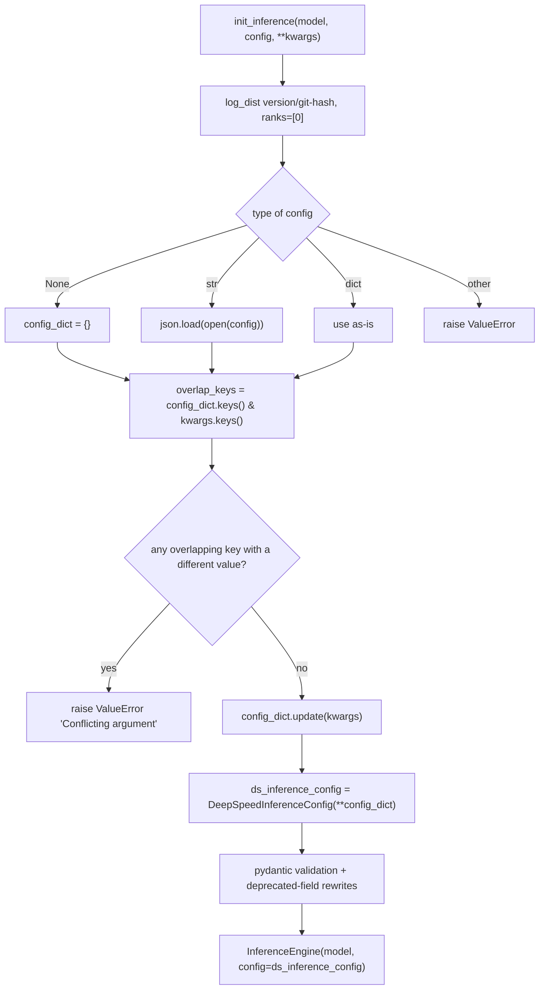
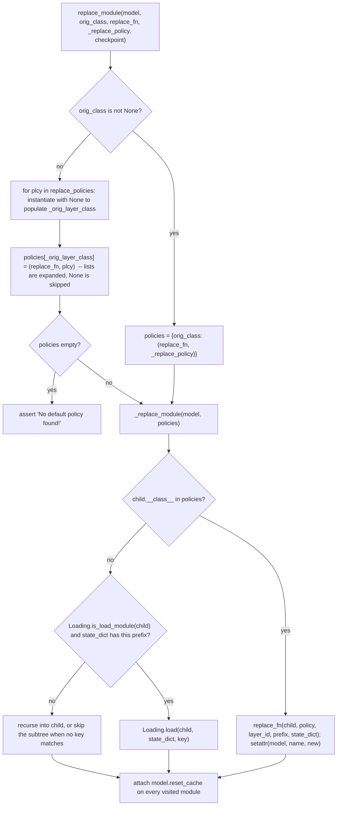
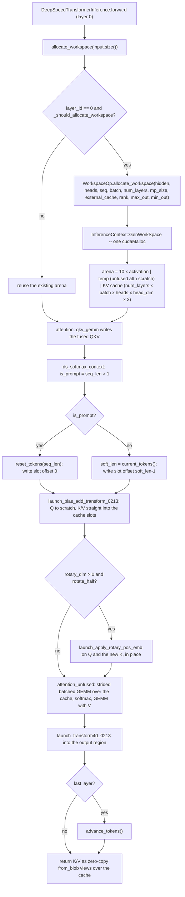
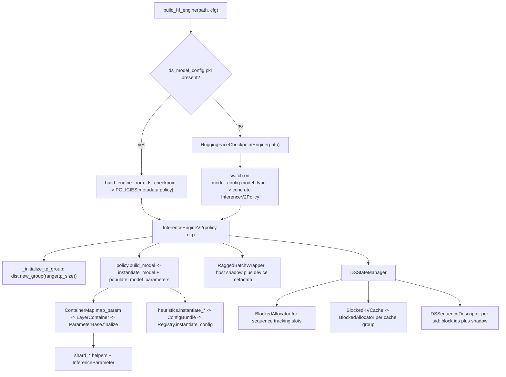
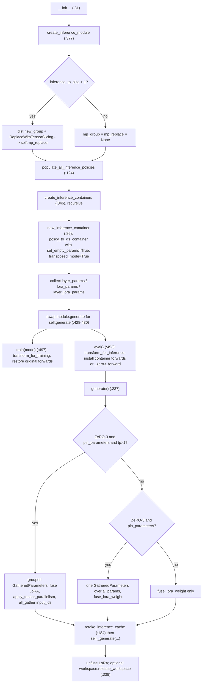

# Inference

What this covers: the two inference stacks in this tree -- the original
`deepspeed.init_inference` / `InferenceEngine` path with its module-injection
and fused-kernel layers, and the newer `deepspeed/inference/v2/` ragged-batching
engine -- plus quantized inference, the hybrid training/inference engine, and
the rollout subsystem. It is written for someone who has to change one of these
paths.

Source of truth: upstream commit d70adc32.

Citations are `path:line` against this tree. This tree carries inference code
that is not in stock DeepSpeed 0.20.1 (AutoEP, segment-KI, shared prefill,
`deepspeed/runtime/rollout/`, graph capture in the hybrid engine); those are
flagged where they appear.

---

## 1. The two stacks

| | v1 ("kernel inject" / AutoTP) | v2 (ragged) |
| --- | --- | --- |
| Entry point | `deepspeed.init_inference(model, config, **kwargs)` (`deepspeed/__init__.py:701`) | `build_hf_engine(path, engine_config)` (`deepspeed/inference/v2/engine_factory.py:71`) |
| Engine class | `InferenceEngine(Module)` (`deepspeed/inference/engine.py:44`) | `InferenceEngineV2` (`deepspeed/inference/v2/engine_v2.py:30`) |
| Input | a live `nn.Module` (usually a HF model) | a checkpoint path |
| Strategy | mutate the existing module tree in place | build a DeepSpeed-native model from scratch |
| Batching | whatever the caller's `generate()` does | ragged batch + blocked KV cache |
| Config | `DeepSpeedInferenceConfig` (`deepspeed/inference/config.py:118`) | `RaggedInferenceEngineConfig` (`deepspeed/inference/v2/config_v2.py:29`) |
| Generation loop | HF `generate()`, patched onto the engine | external (DeepSpeed-MII); the engine exposes only `put()` |

They share almost nothing. `deepspeed/inference/__init__.py` lazily re-exports
only the **v2** names (`RaggedInferenceEngineConfig`, `DeepSpeedTPConfig`,
`InferenceEngineV2`, `build_hf_engine`, `build_engine_from_ds_checkpoint`); the
v1 `InferenceEngine` and `DeepSpeedInferenceConfig` are exported from
`deepspeed/__init__.py:56-57`.

---

## 2. `init_inference` and `InferenceEngine`

### 2.1 `init_inference`

```python
def init_inference(model: torch.nn.Module,
                   config: Optional[Union[str, Dict[str, Any]]] = None,
                   **kwargs: Any) -> InferenceEngine:
```

(`deepspeed/__init__.py:701-703`.)



Code: `deepspeed/__init__.py:751-778`.

Note the gap between docstring and code: the docstring says config and kwargs
are merged with "kwargs take precedence" (`deepspeed/__init__.py:735`), but
`deepspeed/__init__.py:766-772` **raises** on any overlapping key whose values
differ. Precedence therefore only applies to identical values; non-overlapping
kwargs are merged.

`default_inference_config()` (`deepspeed/__init__.py:694-698`) returns
`DeepSpeedInferenceConfig().dict()`.

There is no per-kwarg deprecation shim in `init_inference`. Deprecated keys are
handled entirely by `DeepSpeedConfigModel._deprecated_fields_check`
(`deepspeed/runtime/config_utils.py:60-103`), which warns only if the field was
explicitly set, then rewrites it into the new dotted location and asserts that
both spellings were not supplied together.

### 2.2 `DeepSpeedInferenceConfig`

`deepspeed/inference/config.py:118-323`. All inference configs derive from
`DeepSpeedConfigModel` (`deepspeed/runtime/config_utils.py:17`), whose
`model_config` sets `extra="forbid"` (unknown keys are rejected),
`populate_by_name=True` (aliases *and* field names both work),
`validate_default=True` (so a `{}` default is validated into the real
sub-model) and `validate_assignment=True`
(`deepspeed/runtime/config_utils.py:105-113`). `__init__` also strips any value
literally equal to `"auto"` except for `replace_method`
(`deepspeed/runtime/config_utils.py:54-58`).

Active fields:

| Field (alias) | Type | Default | Lines |
| --- | --- | --- | --- |
| `replace_with_kernel_inject` (`kernel_inject`) | `bool` | `False` | `121-127` |
| `dtype` | `torch.dtype` | `torch.float16` | `129-133` |
| `tensor_parallel` (`tp`) | `DeepSpeedTPConfig` | `{}` | `135-139` |
| `enable_cuda_graph` | `bool` | `False` | `141-145` |
| `use_triton` | `bool` | `False` | `147-150` |
| `triton_autotune` | `bool` | `False` | `152-157` |
| `zero` | `DeepSpeedZeroConfig` | `{}` | `159-163` |
| `triangular_masking` (`tm`) | `bool` | `True` | `165-169` |
| `moe` | `Union[bool, DeepSpeedMoEConfig]` | `{}` | `171-175` |
| `keep_module_on_host` | `bool` | `False` | `177-184` |
| `quant` | `QuantizationConfig` | `{}` | `186-197` |
| `checkpoint` | `Optional[Union[str, Dict]]` | `None` | `200-203` |
| `base_dir` | `str` | `""` | `205-209` |
| `set_empty_params` | `bool` | `False` | `211-214` |
| `save_mp_checkpoint_path` | `Optional[str]` | `None` | `216-222` |
| `checkpoint_config` (`ckpt_config`) | `InferenceCheckpointConfig` | `{}` | `224-228` |
| `return_tuple` | `bool` | `True` | `230-234` |
| `training_mp_size` | `int` | `1` | `236-241` |
| `injection_policy` (`injection_dict`) | `Optional[Dict]` | `None` | `250-254` |
| `injection_policy_tuple` | `Optional[tuple]` | `None` | `256-257` |
| `config` (`args`) | `Optional[Dict]` | `None` | `259` |
| `max_out_tokens` (`max_tokens`) | `int`, `gt=0` | `1024` | `261-266` |
| `min_out_tokens` (`min_tokens`) | `int` | `1` | `268-274` |
| `transposed_mode` | `bool` | `False` | `276` |

Deprecated fields, all rewritten into the nested configs: `replace_method`
(`243-248`, warn only, no replacement), `mp_size` -> `tensor_parallel.tp_size`
(`278-283`), `mpu` -> `tensor_parallel.mpu` (`284`), `ep_size` -> `moe.ep_size`
(`285`), `ep_group` -> `moe.ep_group` (`286-291`), `ep_mp_group` (`292-297`),
`moe_experts` -> `moe.moe_experts` (`298`), `moe_type` -> `moe.type`
(`299-303`).

Nested configs:

| Class | Fields | Lines |
| --- | --- | --- |
| `DeepSpeedTPConfig` | `enabled=True`, `tp_size=1`, `tp_grain_size=64`, `mpu=None`, `tp_group=None` | `34-52` |
| `DeepSpeedMoEConfig` | `enabled=True`, `ep_size=1`, `moe_experts=[1]` (alias `num_experts`), `type=MoETypeEnum.standard`, `ep_mp_group=None`, `ep_group=None` (alias `expert_group`) | `55-75` |
| `BaseQuantConfig` | `enabled=True`, `num_bits=8`, `q_type=QuantTypeEnum.sym`, `q_groups=1` | `83-87` |
| `WeightQuantConfig` | adds `quantized_initialization={}`, `post_init_quant={}` | `90-93` |
| `ActivationQuantConfig`, `QKVQuantConfig` | `enabled=True` | `96-101` |
| `QuantizationConfig` | `enabled`, `activation`, `weight`, `qkv` | `104-108` |
| `InferenceCheckpointConfig` | `checkpoint_dir`, `save_mp_checkpoint_path`, `base_dir` (all `None`) | `112-115` |

`tp_grain_size` reaches `AutoTP` through
`deepspeed/module_inject/replace_module.py:303`.

Validators (`deepspeed/inference/config.py:305-323`): `validate_dtype`
(mode `"before"`, converts strings via `DtypeEnum`, raises `TypeError` for
anything that is not a `str` or `torch.dtype`), `moe_backward_compat` (a bare
`bool` becomes `DeepSpeedMoEConfig(enabled=...)`), and `has_triton` (raises
when `use_triton` is set and `deepspeed.HAS_TRITON` is false).

### 2.3 The dtype gate

The only dtype admissibility check in the engine is
`deepspeed/inference/engine.py:74-76`:

```python
if config.dtype not in get_accelerator().supported_dtypes():
    raise ValueError(
        f"Data type {config.dtype} is not supported by {get_accelerator().device_name()} accelerator")
```

It is accelerator-delegated, not a hardcoded list. There is **no
`_validate_args` method** in `deepspeed/inference/engine.py`; validation is
split between pydantic (section 2.2) and inline asserts in `__init__`.

`DtypeEnum` (`deepspeed/inference/config.py:15-26`) accepts fp16, fp32, bf16
and **int8**, but no accelerator lists `torch.int8` in `supported_dtypes()`
(`deepspeed/accelerator/cuda_accelerator.py:226-232` returns `[torch.float]`
plus half/bfloat16 when supported;
`deepspeed/accelerator/cpu_accelerator.py:382-386`;
`deepspeed/accelerator/xpu_accelerator.py:370-371`;
`deepspeed/accelerator/abstract_accelerator.py:182-183` declares the contract).
Consequence: `dtype=torch.int8` is accepted by the config and then rejected at
engine construction on every accelerator in this tree. The config docstring at
`deepspeed/inference/config.py:130-133` ("Supported target types: `torch.half`,
`torch.int8`, `torch.float`") is stale with respect to int8.

dtype then drives model conversion in `_convert_to_dtype`
(`deepspeed/inference/engine.py:513-526`), whose int8 branch is dead code:

```python
if False:  #config.dtype is torch.int8 and self.quantization_scales is None:
```

(`deepspeed/inference/engine.py:517`). The live branches are `half()`,
`bfloat16()`, `float()` (`521-526`). dtype is also forwarded into
`generic_injection(..., dtype=config.dtype, ...)`
(`deepspeed/inference/engine.py:417`) and into `replace_transformer_layer` via
`config`, and selects checkpoint quantization at
`deepspeed/inference/engine.py:480`.

dtype does **not** select the injection mode; that is decided purely by
`injection_dict` / `replace_with_kernel_inject` / `tp_size` (section 2.5).

### 2.4 `InferenceEngine.__init__`

`deepspeed/inference/engine.py:49-189`, in order:

| # | Lines | Step |
| --- | --- | --- |
| 1 | `55-56` | set module global `DS_INFERENCE_ENABLED = True` (declared at `38`) |
| 2 | `58-60` | `super().__init__()`; if a previous engine's workspace exists, `self.destroy()` (`191-196`, which resets `DeepSpeedTransformerInference.layer_id = 0` and `DeepSpeedSelfAttention.num_layers = 0` and releases the workspace) |
| 3 | `62-65` | store `self.module`, `self._config`; `_get_model_config_generate(config)` sets `self.config` to the **HF** model config (`207-210`) |
| 4 | `67-69` | if the module has `generate`, patch `self.generate = self._generate` |
| 5 | `71-72` | `TransformerPolicy.hf_model_config = self.module.config` |
| 6 | `74-76` | the dtype gate (section 2.3) |
| 7 | `80-99` | copy `injection_policy`, tp group/mpu, quantization placeholders, `cuda_graph_created=False`, `TorchCheckpointEngine()`, `_init_quantization_setting(None)` |
| 8 | `101-103` | BLOOM mask-prepare removal hack when kernel-injecting without a user dict |
| 9 | `105-107` | assert torch >= 1.10 when `enable_cuda_graph` on CUDA |
| 10 | `109-111` | `_convert_to_dtype(config)` |
| 11 | `113-118` | resolve the TP group: from `self.mpu`, else `_create_model_parallel_group(config)` when `tp_size > 1` |
| 12 | `120-125` | `build_alibi_tensor()` / `build_attn_bias()` for the non-kernel paths, after the TP group exists (fork addition; `217-259`) |
| 13 | `127-133` | `has_moe_layers(self.module)`; `_create_ep_parallel_group(config.moe.ep_size)` when MoE and world size > 1 |
| 14 | `135-169` | the three-mode injection dispatch (section 2.5) |
| 15 | `171-177` | device placement: `to_empty(device)` for a meta module, else `.to(device)` unless `keep_module_on_host` |
| 16 | `179-182` | broadcast RNG state from rank 0 when `tp_size > 1` |
| 17 | `184-185` | assert `not enable_cuda_graph` when `tp_size > 1` |
| 18 | `187-189` | `self.local_cuda_graph = self._local_cuda_graph_used(self.module)`; `self._is_compiled = False` |

Note the two different `config`s on the engine: `self._config` is the
`DeepSpeedInferenceConfig`, `self.config` is the HuggingFace model config (or
the user-supplied `config.config` dict). The comment at
`deepspeed/inference/engine.py:420` restates this at the injection call site.

Process-group helpers:

- `_create_model_parallel_group(config)` (`278-289`) builds
  `dist.new_group(range(tp_size))` **once per process** and caches it on the
  class attribute `InferenceEngine.inference_mp_group` (`46`).
- `_create_ep_parallel_group(moe_experts)` (`291-318`) builds dicts of EP groups
  keyed by ep size, raising `ValueError` when `world_size // ep_size == 0`, and
  strided expert-MP groups when `world_size > ep_size`.

### 2.5 The three injection modes

`deepspeed/inference/engine.py:135-169`, with the mode numbering taken from the
source comment at `136`:

| Mode | Condition | Action |
| --- | --- | --- |
| 1. user-specified TP | `self.injection_dict` is truthy (`137`) | asserts `not replace_with_kernel_inject` (`138`); per entry, asserts the key is an `nn.Module` subclass, normalizes a `str` policy into `config.injection_policy_tuple`, validates every name against `self.module.named_modules()` suffixes (raising `ValueError(f"Injection policy layer'{policy}' not valid.")`), then `_apply_injection_policy(config, client_module)` |
| 2. kernel injection | `config.replace_with_kernel_inject` (`158`) | `_apply_injection_policy(config)` with no `client_module` |
| 3. automatic TP | `config.tensor_parallel.tp_size > 1` (`160`) | `parser_dict = AutoTP.tp_parser(model)` (`162`), then one `_apply_injection_policy(config, client_module)` per pair |

If none apply (no dict, no kernel inject, `tp_size == 1`), **no injection
happens at all** and the engine is a thin wrapper.

`_apply_injection_policy(config, client_module=None)`
(`deepspeed/inference/engine.py:411-421`):

```python
checkpoint = SDLoaderFactory.get_sd_loader_json(config.checkpoint, self.checkpoint_engine) \
    if checkpoint_dir is not None else None
generic_injection(self.module, dtype=config.dtype, enable_cuda_graph=config.enable_cuda_graph)
if isinstance(self.module, torch.nn.Module):
    replace_transformer_layer(client_module, self.module, checkpoint, config, self.config, training_mode=False)
```

### 2.6 forward, generation, CUDA graphs, profiling

`forward(*inputs, **kwargs)` (`deepspeed/inference/engine.py:588-615`):

- the CUDA-graph fast path is gated on
  `get_accelerator().device_name() == 'cuda' and self._config.enable_cuda_graph and not self.local_cuda_graph`
  (`600-605`). On the first call it captures, then always replays. So
  `enable_cuda_graph` is a no-op on non-CUDA accelerators, and
  `local_cuda_graph=True` (graphs captured inside replaced submodules) disables
  the engine-level graph.
- otherwise plain `self.module(*inputs, **kwargs)` (`607-608`).
- `_create_cuda_graph` (`528-545`) runs **3 warmup iterations** on a side
  stream "to create the workspace and cublas handle", then captures with
  `self.static_inputs`/`self.static_kwargs` pinned.
- `_graph_replay` (`547-555`) `copy_()`s tensor inputs into the static buffers
  and replays. Non-tensor inputs are silently ignored, which is the usual
  static-shape caveat.
- `_local_cuda_graph_used` (`575-586`) returns `False` for a plain
  `nn.Module`; it only matters for pipeline-like wrapper objects (diffusers
  pipelines), where it scans `module.__dict__` for attributes that both match a
  generic policy and expose `enable_cuda_graph`.

`_generate(*inputs, **kwargs)` (`617-640`) resets the KV cache when the module
exposes `reset_cache`, raises `NotImplementedError` for `num_beams > 1`, and
raises `RuntimeError` when a 2-D `input_ids` exceeds `max_out_tokens`, before
delegating to `self.module.generate`.

Profiling: `profile_model_time(use_cuda_events=True)` (`198-205`) registers
forward pre/post hooks (`261-276`) -- but only when `enable_cuda_graph` is
false; with graphs on, timing comes from the inline block in `forward`
(`595-598`, `610-613`). `model_times()` (`557-566`) drains `_model_times` and
raises a specific `ValueError` when graphs are on but no times were recorded.

`compile(backend, compile_kwargs)` (`642-655`) disables NVTX ("Avoid graph
breaks") and calls `self.module.compile(...)`.

Dead or unreachable in this tree, worth knowing before you read it as live
behaviour:

- `InferenceEngine._load_checkpoint` (`444-502`) has **no callers**. The real
  checkpoint path runs inside `replace_transformer_layer`
  (`deepspeed/module_inject/replace_module.py:409-478`).
- `config.quant` (`QuantizationConfig`) is never read: `__init__` passes `None`
  to `_init_quantization_setting` (`95-97`), which hardcodes 8 bits / 1 group
  (`320-332`).
- the int8 branch of `_convert_to_dtype` (`517-520`).

---

## 3. Module injection

### 3.1 `replace_transformer_layer`

```python
replace_transformer_layer(orig_layer_impl, model, checkpoint_dict, config, model_config,
                          training_mode=False, replacement_sources=None)
```

(`deepspeed/module_inject/replace_module.py:181-187`.) Ordered behaviour:

| # | Lines | Step |
| --- | --- | --- |
| 1 | `202` | `quantize = (config.dtype == torch.int8)` |
| 2 | `213-214` | `mp_replace = ReplaceWithTensorSlicing(mp_group=config.tensor_parallel.tp_group, mp_size=config.tensor_parallel.tp_size)` |
| 3 | `216-378` | define the closures `replace_with_policy`, `replace_wo_policy`, `replace_fn`, `set_lm_head`, `conv2d_parallel_shard_weights` |
| 4 | `380-401` | traversal. With a `checkpoint_dict` and **no** kernel inject, call `replace_module(...)` once per shard file with a tqdm bar and a `gc.collect()` between shards; Yuan models additionally get `conv2d_parallel_shard_weights`. Otherwise one `replace_module(...)` with no checkpoint |
| 5 | `403-404` | AutoTP only: `set_lm_head(replaced_module)` |
| 6 | `406-408` | build the `GroupQuantizer` and read world size / rank |
| 7 | `409-478` | kernel-inject meta-tensor checkpoint load: asserts `container_g.ckpt_load_enabled`, then `load_model_with_checkpoint(...)` per shard for `parallelization == 'pp'` or the tp-split layout, then the `"non_tp"` shards |
| 8 | `480-543` | optional `save_mp_checkpoint_path` export: `non-tp.pt` from rank 0, `ds_inference_config.json`, and `tp_{rank:02d}_{m:02d}.pt` partitions carrying `p.scale` when present |
| 9 | `545` | `return replaced_module` |

### 3.2 How HF modules are matched



Code: `deepspeed/module_inject/replace_module.py:616-651` and `676-720`.

The match is **exact class-object identity** in a dict:
`if child.__class__ in policies` (`deepspeed/module_inject/replace_module.py:685`).
Keys come either from the caller's `orig_class` (`636`) or from each policy's
`_orig_layer_class` (`641-645`). `_orig_layer_class` is declared `None` on the
base `DSPolicy` (`deepspeed/module_inject/policy.py:28`) and set by each policy
in `__init__` from a real `transformers` import, for example
`HFOPTLayerPolicy._orig_layer_class = transformers.models.opt.modeling_opt.OPTDecoderLayer`
(`deepspeed/module_inject/containers/opt.py:111`),
`LLAMALayerPolicy` -> `LlamaDecoderLayer`
(`deepspeed/module_inject/containers/llama.py:176`), `BLOOMLayerPolicy` ->
`BloomBlock` (`deepspeed/module_inject/containers/bloom.py:113`). It may be a
**list** (`HFBertLayerPolicy`,
`deepspeed/module_inject/containers/bert.py:40`;
`HFDistilBertLayerPolicy`, `.../distil_bert.py:41`; `InternLMLayerPolicy`
builds one by dynamic import, `.../internlm.py:130-144`) and is set to `None`
on `ImportError`/`AttributeError` (`.../llama2.py:122-125`). That is why
`replace_module` instantiates a throw-away policy with `None` first
(`replace_module.py:639-640`) -- purely to populate the class attribute.

There is no `policy.name` attribute anywhere in `deepspeed/module_inject/`; the
only `.name` is `TensorParallel_Layer.name`
(`deepspeed/module_inject/layers.py:422-424`).

Two secondary mechanisms exist but do not pick the policy:

- diffusers generic policies match by `isinstance`: `_module_match`
  (`replace_module.py:78-83`) calls `policy.match(module)`, and
  `UNetPolicy.match` is `isinstance(module, self._orig_layer_class)`
  (`deepspeed/module_inject/containers/unet.py:27-28`).
- name/string heuristics drive auxiliary decisions:
  `Loading.is_load_module` matches a hardcoded `_get_name()` list
  (`deepspeed/module_inject/auto_tp.py:141-151`),
  `AutoTP.in_module_list` compares `type(...).__name__`
  (`auto_tp.py:274-278`), `AutoTP.supported` / `tp_parser` match substrings of
  `str(model)` (`auto_tp.py:293-304`, `366-385`), and `get_fused_qkv_type`
  matches `FUSED_QKV_TYPE_DICT` keys as substrings, longest first
  (`deepspeed/module_inject/fusedqkv_utils.py:30-52`).

### 3.3 The branch: kernel inject vs auto-TP

`deepspeed/module_inject/replace_module.py:322-333`:

```python
def replace_fn(child, _policy, layer_id=0, prefix="", state_dict=None):
    # copy relevant state from child -> new module
    if not training_mode and config.replace_with_kernel_inject:
        new_module = replace_with_policy(child, _policy, config.triangular_masking,
                                         inference=True, layer_id=layer_id)
    else:
        new_module = replace_wo_policy(child, _policy, prefix=prefix, state_dict=state_dict)
    return new_module
```

The second positional argument is **overloaded**: on the kernel path it is a
`TransformerPolicy` *class*; on the auto-TP path it is
`config.injection_policy_tuple` -- a tuple of layer-name suffixes -- landing in
`replace_wo_policy`'s `all_reduce_linears` parameter
(`replace_module.py:274`).

**Kernel-inject path**, `replace_with_policy` (`replace_module.py:216-272`),
with the step numbering from the source comments:

| Step | Line | Call |
| --- | --- | --- |
| -- | `217-221` | `policy = policy_cls(child, inference=inference)`; raise if `not policy.cuda_graph_supported and config.enable_cuda_graph` |
| -- | `223-227` | MoE detection on `child.mlp` |
| 1 | `230-235` | `policy_to_ds_container(policy, config, model_config, layer_id, child)`; `set_moe(moe)` |
| 2 | `238` | `set_tensor_parallel_config(tp_size, tp_group)` |
| 3 | `241` | `initialize_tensors()` |
| 4 | `244-245` | `convert_to_required_dtype()` |
| 5 | `248-249` | `set_quantization_config(GroupQuantizer(q_int8=quantize))` |
| 6 | `252` | `create_ds_model_config()` |
| 7 | `255` | `create_module()` |
| 8 | `258` | `transpose()` |
| 9 | `261` | `apply_tensor_parallelism(mp_replace)` |
| 10 | `264` | `copy_data_to_new_module()` |
| 11 | `267-272` | stash the first container in the module global `container_g` (`178`) and return `_container.module` |

The whole HF layer object is replaced by a fused module
(`DeepSpeedTransformerInference` / `DeepSpeedGPTInference` /
`DeepSpeedBloomInference` / ...). `container_g` is what makes the later
meta-tensor checkpoint load possible.

**Auto-TP path**, `replace_wo_policy` (`replace_module.py:274-320`): the HF
layer is kept; only its `nn.Linear` / `nn.Embedding` children are swapped for
TP layers. It picks the right sub-config (`vision_config` for
`MllamaVisionEncoderLayer`, else `text_config`, else `model_config`;
`280-290`), builds `AutoTP(...)` (`293-304`),
`set_tensor_parallel_config` (`307`), `update_linear_policies` (`310`), and
then either `_replace_last_linear_module(module)` when the target names include
`lm_head`/`embed_out` or `_replace_module(module)` (`313-316`).

`set_lm_head` (`replace_module.py:335-356`) returns immediately in
`training_mode`, finds the embedding weight by scanning for
`"word_embeddings."` / `"embed_tokens."` / `"wte."`, ties a meta `lm_head` to
it, and TP-replaces `module.lm_head`, else `module.embed_out`, else
`module.language_model.lm_head`. A real quirk: those three calls are positional
-- `replace_wo_policy(module, ("lm_head", ), 0, "lm_head")` -- so `prefix=0`
and `state_dict="lm_head"` (`350`, `353`, `355`).

### 3.4 Policies and containers

`deepspeed/module_inject/replace_policy.py:23-27` lists `replace_policies`
verbatim: `HFBertLayerPolicy`, `HFGPTNEOLayerPolicy`, `GPTNEOXLayerPolicy`,
`HFGPTJLayerPolicy`, `MegatronLayerPolicy`, `HFGPT2LayerPolicy`,
`BLOOMLayerPolicy`, `HFOPTLayerPolicy`, `HFCLIPLayerPolicy`,
`HFDistilBertLayerPolicy`, `LLAMALayerPolicy`, `LLAMA2LayerPolicy`,
`InternLMLayerPolicy`. `generic_policies` (`replace_policy.py:30`) is
`[UNetPolicy, VAEPolicy]`. `MegatronMoELayerPolicy` exists
(`deepspeed/module_inject/containers/megatron_gpt_moe.py:36`) but is not in
`replace_policies`.

Policy -> container dispatch is a dict keyed on **exact type** in
`policy_to_ds_container` (`deepspeed/module_inject/utils.py:14-53`): unknown
types log `f"Policy type {policy_type} not supported"` and return `None`
(`48-49`). The dict (`28-41`) has no entry for `HFCLIPLayerPolicy` or
`MegatronMoELayerPolicy`, so a CLIP encoder layer matched through
`replace_policies` would fall into that `None` return.

Container classes, with the feature mixins that matter:

| Container | Bases | Policy |
| --- | --- | --- |
| `BaseTransformerContainer` (`containers/base.py:26`) | `ABC` | -- |
| `BaseTransformerMoEContainer` (`containers/base_moe.py:13`) | `BaseTransformerContainer` | -- |
| `DS_BERTContainer` (`containers/bert.py:13`) | `BaseTransformerContainer` | `HFBertLayerPolicy` |
| `DS_DistilBERTContainer` (`containers/distil_bert.py:13`) | `BaseTransformerContainer` | `HFDistilBertLayerPolicy` |
| `DS_GPT2Container` (`containers/gpt2.py:11`) | `BaseTransformerContainer` | `HFGPT2LayerPolicy` |
| `DS_BloomContainer` (`containers/bloom.py:19`) | `MetaTensorContainer`, `HybridEngineContainer`, `BaseTransformerContainer` | `BLOOMLayerPolicy` |
| `DS_GPTJContainer` (`containers/gptj.py:20`) | `MetaTensorContainer`, `HybridSplitQKVContainer`, `BaseTransformerContainer` | `HFGPTJLayerPolicy` |
| `DS_GPTNEOContainer` (`containers/gptneo.py:20`) | same mixins | `HFGPTNEOLayerPolicy` |
| `DS_GPTNEOXContainer` (`containers/gptneox.py:19`) | `MetaTensorContainer`, `HybridMegatronContainer`, `BaseTransformerContainer` | `GPTNEOXLayerPolicy` |
| `DS_OPTContainer` (`containers/opt.py:19`) | `MetaTensorContainer`, `HybridSplitQKVContainer`, `BaseTransformerContainer` | `HFOPTLayerPolicy` |
| `DS_LLAMAContainer` (`containers/llama.py:73`) | `MetaTensorContainer`, `HybridGatedMLPContainer`, `HybridSplitQKVContainer`, `BaseTransformerContainer` | `LLAMALayerPolicy` |
| `DS_LLAMA2Container` (`containers/llama2.py:23`) | same mixins | `LLAMA2LayerPolicy` |
| `DS_InternLMContainer` (`containers/internlm.py:20`) | `HybridGatedMLPContainer`, `HybridSplitQKVContainer`, `BaseTransformerContainer` | `InternLMLayerPolicy` |
| `DS_MegatronGPTContainer` (`containers/megatron_gpt.py:14`) | `MegatronContainer`, `BaseTransformerContainer` | `MegatronLayerPolicy` |
| `DS_MegatronGPTMoEContainer` (`containers/megatron_gpt_moe.py:15`) | `MegatronContainer`, `BaseTransformerMoEContainer` | `MegatronMoELayerPolicy` |

A **container** owns the tensor plumbing between an HF layer and a fused
module. `BaseTransformerContainer.__init__`
(`deepspeed/module_inject/containers/base.py:28-86`) derives everything the
fused kernel config needs from the policy and the HF model config, and nulls
twelve tensor slots (`qkvw/qkvb/dense_w/dense_b`, `_h4h_w/_h4h_b/_4hh_w/_4hh_b`,
`attn_nw/attn_nb/input_nw/input_nb`, `66-80`). Its methods map one-to-one onto
the numbered steps in section 3.3: `initialize_tensors` (`140-144`) calls
`policy.attention()`, `policy.mlp()`, `policy.layernorm()`;
`create_ds_model_config` (`88-131`) asserts `num_attention_heads % mp_size == 0`
and builds the fused `DeepSpeedInferenceConfig`; `apply_tensor_parallelism`
(`225-236`) fans out to `attention_qkv_mp` (a
`mp_replace.strided_copy(..., num_splits=3)`), `attention_o_mp`,
`mlp_inter_mp`, `mlp_output_mp`; `copy_data_to_new_module` (`266-281`) moves the
norms onto the fused module. `create_module` is **not** on the base -- each
container defines it (for example
`deepspeed/module_inject/containers/llama.py:81-90`, which sets
`rotate_half=True`, `rotary_dim`, `rope_theta` and builds
`DeepSpeedGPTInference`).

Feature mixins (`deepspeed/module_inject/containers/features/`):

| Mixin | File | Purpose |
| --- | --- | --- |
| `MetaTensorContainer` | `features/meta_tensor.py:11` | sets `ckpt_load_enabled` and declares `load_params`, enabling the meta-tensor checkpoint path asserted at `replace_module.py:410-411` |
| `HybridEngineContainer` | `features/hybrid_engine.py:12` | `transform_for_training` / `transform_for_inference`, LoRA fuse/unfuse, `release_memory`, `reset_params`, `set_params_wo_copy` -- the hybrid engine's entire contract |
| `HybridSplitQKVContainer` | `features/split_qkv.py:12` | separate q/k/v tensors instead of a fused QKV |
| `HybridGatedMLPContainer` | `features/gated_mlp.py:11` | gate/up split for SwiGLU-style MLPs |
| `MegatronContainer`, `HybridMegatronContainer` | `features/megatron.py:10`, `features/hybrid_megatron.py:12` | Megatron QKV interleaving |

Policy base classes (`deepspeed/module_inject/policy.py`): `DSPolicy(ABC)`
(`27-40`) has `_orig_layer_class = None` and one abstract `attention()`;
`TransformerPolicy(DSPolicy)` (`43-110`) adds the static
`hf_model_config` (`46`), the constructor flags `inference`, `linear_layer`,
`scale_attention`, `megatron_v2`, `use_mup`, `mlp_act_func_type`,
`pre_attn_norm`, `use_load_prefix`, `split_qkv`, `norm_type` (`48-76`), and the
abstract `attention()`, `get_hidden_heads()`, `mlp()`, `layernorm()`
(`78-110`). `attn_linear_layer` / `mlp_linear_layer` are *not* policy
attributes -- the container derives both from `policy.linear_layer`
(`containers/base.py:47-48`). The twelve canonical tensor names are the
`transformer_param_names` tuple (`policy.py:12-24`).

### 3.5 AutoTP

`AutoTP.tp_parser(model)` (`deepspeed/module_inject/auto_tp.py:343-394`) derives
the `(layer_class, all_reduce_names)` pairs that mode 3 consumes:

1. `get_module_list(model)` (`280-291`) walks children, collecting one
   representative module per distinct `ModuleList` child *type name* (dedup via
   `in_module_list`, `274-278`).
2. `assert AutoTP.supported(model)` (`350-351`). `supported` (`293-304`)
   extracts the model name with `": (.*?)Model"` / `": (.*?)Stack"` /
   `"(.*?)Model"` regexes and rejects
   `['deberta','flaubert','fsmt','gpt2','led','longformer','xlm','xlnet']`.
   The assertion message is chosen by `kernel_supported(module_list)`
   (`328-341`), which reports whether a kernel-inject container exists.
3. For each representative, build a flat list of its `nn.Linear` names and
   `"ln"` markers (`352-361`, helper `get_layers` at `306-315`).
4. Decide the row-parallel (all-reduce) set `gem_list` (`362-385`): the linear
   immediately before an `"ln"`, plus names containing `out_proj`, `o_proj`,
   `down_proj`, and model-specific cases for GPTNeoX, Falcon ("this is a hack"),
   Mixtral `w2`, Phi, ChatGLM.
5. `update_policy_list` (`317-326`) merges per type and returns the list
   (`394`).

`_replace(child, name, conv_linear_layer)` (`auto_tp.py:414-481`) is where a
`Linear` becomes a TP layer. The decisive test is at `460-461`:

```python
if (name in self.all_reduce_linears or arctic_w2_all_reduce_linear or down_proj) \
        and not training_column_lm_head:
```

| Condition | Result | Line |
| --- | --- | --- |
| already `child.replaced`, or AutoEP-managed | returned unchanged | `417-422` |
| name in the skip list (`mlp.gate`, `q_a_proj`, `kv_a_proj_with_mqa`, `block_sparse_moe.gate`, qwen2-moe gates) | unchanged | `435-437` |
| Yuan `v_proj` / `o_proj` | `Yuan_LinearLayer` / `Yuan_LinearAllreduce` | `440-445` |
| `gate_up_proj`, or GLM `dense_h_to_4h` | `GateUpPack_LinearLayer` | `448-449` |
| row-parallel + `conv_linear_layer` | `Conv_LinearALlreduce` | `464-465` |
| row-parallel + legacy lm_head | `LmHeadLinearAllreduce` | `466-467` |
| row-parallel otherwise | **`LinearAllreduce`** | `469` |
| column + fused QKV (`require_tp_fused_qkvw`) | `fused_LinearLayer` | `477-479` |
| column otherwise | **`LinearLayer`** | `481` |

The two base TP layers are in `deepspeed/module_inject/layers.py`:
`LinearAllreduce` (`888-968`) shards weight **dim 1** (the input dim) and
leaves the bias replicated, and its forward is
`matmul(input, weight.T)` -> `RowParallel.apply(...)` -> bias (`909-915`);
`LinearLayer` (`983-1091`) shards **dim 0** (the output dim) for both weight
and bias and applies `ColumnParallel` (or `AsyncColumnParallel` when
`tp_overlap_comm`), optionally followed by a gather when `gather_output`
(`1003-1023`). Both derive from `TensorParallel_Layer(nn.Module, ABC)` (`372`),
whose `_freeze_partition_sizes(total_size)` (`584-592`) caches the per-rank
shard widths from `get_shard_size_list`.

Shard sizing lives in `deepspeed/module_inject/tp_shard.py`, which in this tree
is metadata-driven rather than global-state driven: `AutoTPMeta`
(a frozen dataclass, `49-92`) carries `num_kv_heads`, `num_attention_heads`,
`n_embd`, `tp_grain_size`, `training`, built by `from_model_config` (`65-92`,
descending into `text_config` for multimodal configs);
`get_shard_size(total_size, mp_size, meta, name=None, rank=None, mp_group=None)`
(`95-139`) does a **kv-head-aware uneven split** when `num_kv_heads` is known
and the name is neither an MLP, a last linear (`lm_head`/`embed_out`) nor a MoE
MLP layer, otherwise a grain-quantized split giving the remainder to the last
rank; `get_shard_size_list` (`142-152`) asserts the shards tile the dimension
exactly. Note it raises `ValueError` when `mp_size != dist.get_world_size()`
and no `mp_group` was supplied (`114-122`) -- a behavioural difference from
upstream's global-state version.

`deepspeed/module_inject/fusedqkv_utils.py` handles pre-fused QKV weights,
which cannot be split naively because TP must keep head groups aligned:
`require_tp_fused_qkvw(name, mp_size)` (`18-32`) is the gate used at
`auto_tp.py:477` and matches `qkv_proj`, `query_key_value`, `attn.Wqkv`,
`self_attn.W_pack`, `c_attn`; `FUSED_QKV_TYPE_DICT` (`30-42`) maps layer-class
substrings to layout ids (`codegentype`, `bloomtype`, `glmtype`, `qwentype`,
`bigcodetype`, `phi3type`), and `prepare_tp_fused_qkvw` dispatches to the
matching per-layout transposer.

Finally, `update_mp_params(child, name)` (`auto_tp.py:989-1018`) divides the
head/width attributes listed in `param_list` (`1005-1009`) by `get_shard_size`,
skipping subtrees where nothing was actually sharded.

### 3.6 `generic_injection` (diffusers)

`deepspeed/module_inject/replace_module.py:86-175`. Its `isinstance` test is
inverted on purpose -- `if isinstance(module, torch.nn.Module): pass` / `else:
<all the work>` (`136-138`) -- so for a plain `nn.Module` the function is a
no-op and the body runs only for a non-`nn.Module` object, i.e. a diffusers
*pipeline*. That is why the engine calls it unconditionally before the
`isinstance`-guarded `replace_transformer_layer`
(`deepspeed/inference/engine.py:417-421`).

It is **fp16 only** (`raise ValueError("Generic injection only supported with
FP16")`, `139-140`); resolves `CrossAttention` or `attention_processor.Attention`
plus `BasicTransformerBlock` from diffusers inside a `try/except ImportError`
(`142-154`); always wraps the text encoder in `DSClipEncoder` (`156-158`);
scans `module.__dict__` with `_module_match` (`159-161`); and for each matched
sub-module swaps the inner attention classes before wrapping the whole thing
with `policy.apply(...)` -> `DSUNet` / `DSVAE` (`165-175`). `replace_attn`
(`88-130`) builds a `DeepSpeedDiffusersAttention` with
`triangular_masking=False, max_out_tokens=4096`; `replace_attn_block`
(`132-134`) wraps the block in `DeepSpeedDiffusersTransformerBlock`.

### 3.7 `load_checkpoint.py`

`deepspeed/module_inject/load_checkpoint.py` exposes one function,
`load_model_with_checkpoint(r_module, sd, mp_replace, ckpt_type, ckpt_mp_size, weight_quantizer=None, rank=0, container=None)`
(`23-30`), used only by the kernel-inject meta-tensor path. `prefix_check()`
(`33-42`) detects the OPT/BLOOM `^model[.]` / `^transformer[.]` prefixes, and
`skip_level_0_prefix = prefix_check() and container.policy.use_load_prefix`
(`44`) is the only consumer of `TransformerPolicy.use_load_prefix`.
`load_module_recursive` (`222-271`) dispatches on `child.__class__ in
layer_policies` (`196-218`) and **materializes meta modules into DeepSpeed
equivalents before loading**: `nn.LayerNorm` -> `Normalize`, `nn.Linear` /
`ColumnParallelLinear` / `RowParallelLinear` -> `LinearLayer.from_weights`,
`OPTLearnedPositionalEmbedding` -> `OPTEmbedding`, `LlamaRMSNorm` / `RMSNorm`
-> `RMSNormalize`, anything else -> `EmbeddingLayer` (`241-264`).

---

## 4. The fused kernel layer

### 4.1 Inventory

Python wrappers, `deepspeed/ops/transformer/inference/`:

| File | Purpose |
| --- | --- |
| `config.py` | `TransformerConfig` (`11`) and the per-layer `DeepSpeedInferenceConfig` (`21`) -- distinct from the engine-level config of the same name |
| `ds_attention.py` | `DeepSpeedSelfAttention` (`17`), `BloomSelfAttention` (`185`) |
| `ds_mlp.py` | `DeepSpeedMLP` (`16`) |
| `moe_inference.py` | `DeepSpeedMoEInferenceConfig` (`23`), `DeepSpeedMoEMLP` (`132`), `DeepSpeedMoEInference` (`160`) |
| `diffusers_attention.py` | `DeepSpeedDiffusersAttentionFunction` (`35`), `DeepSpeedDiffusersAttention` (`99`) |
| `diffusers_transformer_block.py`, `diffusers_2d_transformer.py`, `bias_add.py` | diffusers support |
| `triton_ops.py`, `triton/` | Triton kernel variants |
| `op_binding/` | one wrapper class per fused op (section 4.4) |

The fused layer module itself is
`deepspeed/model_implementations/transformers/ds_transformer.py`
(`DeepSpeedTransformerInference`).

CUDA sources, `csrc/transformer/inference/`:

| Path | Contents |
| --- | --- |
| `csrc/pt_binding.cpp` | all pybind11 entry points and host-side glue (~2105 lines) |
| `csrc/apply_rotary_pos_emb.cu` | RoPE |
| `csrc/dequantize.cu` | int8 -> fp16/bf16/fp32 group dequantize |
| `csrc/gelu.cu`, `csrc/relu.cu` | bias + activation, gated activation |
| `csrc/layer_norm.cu`, `csrc/rms_norm.cu` | norms, including residual variants |
| `csrc/softmax.cu` | attention softmax with mask / alibi / triangular / local variants |
| `csrc/transform.cu` | `bias_add_transform_0213` / `transform4d_0213`, the QKV <-> cache layout shuffles |
| `csrc/pointwise_ops.cu` | vector add, MoE residual matmul |
| `includes/inference_context.h` | the `InferenceContext` singleton: workspace, KV cache, cuBLAS handle, streams |
| `includes/inference_cublas_wrappers.h` | `cublas_gemm_ex` / `cublas_strided_batched_gemm` |
| `includes/inference_cuda_layers.h` | `launch_*` declarations |

Build definition: `op_builder/transformer_inference.py:19-42` (`InferenceBuilder`,
extension `transformer_inference`, absolute name
`deepspeed.ops.transformer.inference.transformer_inference_op`). `BaseOp` loads
it once, lazily, into the class attribute `BaseOp.inference_module`
(`deepspeed/ops/transformer/inference/op_binding/base.py:13-20`).

### 4.2 `DeepSpeedSelfAttention`

`__init__` (`deepspeed/ops/transformer/inference/ds_attention.py:21-91`) notes
worth knowing:

- `num_layers = 0` is a **class** counter (`18`); each instance takes
  `config.layer_id = DeepSpeedSelfAttention.num_layers` then increments it
  (`26-27`). The final value is the layer count and is passed to the kernels as
  `num_layers`.
- `data_type = config.dtype` but `data_type_fp = torch.half if config.dtype ==
  torch.int8 else config.dtype` (`24-25`) -- weights may be int8 while biases
  and norms stay fp16.
- `set_empty_params` leaves every weight `None` (`29-39`), which is the
  meta-tensor / container-filled path the hybrid engine uses.
- QKV width accounts for GQA/MQA: `(hidden_size // mp_size) * 3` when
  `config.num_kv < 0`, else `((heads + num_kv * 2) // mp_size) * (hidden_size //
  heads)` (`41-42`).
- `norm_factor = sqrt(hidden_size // heads)` and then square-rooted **again**
  unless `use_mup` (`72-74`), because the C++ side multiplies by
  `norm_factor * norm_factor` (`csrc/transformer/inference/csrc/pt_binding.cpp:374`).
- `_qkv_buffers` is a class-level scratch pair allocated once by the first
  instance (`19`, `84-91`) and reused by `_merge_qkv()` (`120-130`) to stack
  separate q/k/v weights. Being shared across layers, it is only valid during
  the current layer's forward.

`forward` (`132-182`):

| Step | Lines | Call |
| --- | --- | --- |
| 1 | `145-149` | choose the QKV weight: `_merge_qkv()` when `attn_qkvw is None`, else the stored fused weight |
| 2 | `150-157` | post-LN models: `self.linear_func(...)` -> `LinearOp` -> `linear_layer_{fp16,bf16,fp32}` |
| 3 | `158-163` | pre-LN models: `self.qkv_func(input, weight, bias, gamma=norm_w, beta=norm_b)` -> `QKVGemmOp` -> `qkv_gemm_*` (LayerNorm) or `rms_qkv_gemm_*` (RMSNorm); returns `(qkv_out, inp_norm)` |
| 4 | `165-167` | `is_prompt = kwargs.get("first_token", qkv_out[0].shape[1] > 1)`, plus `token_idx` / `position_ids` for static-shape accelerators |
| 5 | `169-175` | `compute_attention(...)` |
| 6 | `177` | `self.vector_matmul_func(input=context_layer, weight=self.attn_ow)` -- output projection |
| 7 | `178-181` | `inp_norm = qkv_out[-1]`; `dist.all_reduce(output, group=self.mp_group)` when `mlp_after_attn` and the group is parallel |
| 8 | `182` | return `(output, key_layer, value_layer, context_layer, inp_norm)` |

`compute_attention` (`93-118`) calls `SoftmaxContextOp` with the mask converted
from int64 to `(1 - mask) * -10000.0` (`104-105`, `minus_inf` at `14`),
`norm_factor = 1/self.norm_factor if scale_attention else 1.0`, and the layer
id / layer count. `key_layer` and `value_layer` come back as **views into the
workspace KV cache**, not fresh tensors.

`BloomSelfAttention` (`185-300`) overrides `compute_attention` with an eager
implementation that concatenates `layer_past` itself -- so BLOOM uses an
*external*, Python-side KV cache. That is why injection passes
`external_cache = config.bigscience_bloom` into `allocate_workspace`.

### 4.3 Workspace and KV cache



Who allocates, and when:

- `DeepSpeedTransformerInference` holds one class-level
  `workspace = WorkspaceOp(config)`
  (`deepspeed/model_implementations/transformers/ds_transformer.py:86-87`) and
  `self._should_allocate_workspace = True` (`88`). `allocate_workspace(size)`
  (`90-98`) fires **only for `config.layer_id == 0` and only once**, passing
  `(hidden_size, heads, size[1], size[0], DeepSpeedTransformerInference.layer_id,
  mp_size, config.bigscience_bloom, rank, max_out_tokens, min_out_tokens)`. It
  is called at the top of every layer-0 forward (`139`).
- `reset_cache()` is a classmethod (`100-103`) that
  `deepspeed/module_inject/replace_module.py:718-719` attaches to every visited
  module, so `InferenceEngine._generate` can call it between prompts
  (`deepspeed/inference/engine.py:618-620`).
- `WorkspaceOp` (`deepspeed/ops/transformer/inference/op_binding/workspace.py:150-255`)
  resolves `allocate_workspace_{fp32,bf16,fp16}`, `release_workspace`,
  `retake_workspace`, `reset_cache` and the fork-only
  `repeat_kv_cache_{fp32,bf16,fp16}` (`159-171`), falling back to a pure-Python
  `InferenceContext` (`16-147`) when the extension is unavailable.

The CUDA-side arena is one `cudaMalloc` sized by
`InferenceContext::GenWorkSpace`
(`csrc/transformer/inference/includes/inference_context.h:102-190`):

| Region | Formula | Line |
| --- | --- | --- |
| activation | `10 * (num_heads * effective_head_size) * batch_size` | `127` |
| temp (unfused attention scratch) | `batch_size * (num_heads/mp_size) * max_out_tokens` | `129` |
| KV cache | `num_layers * batch_size * ((num_heads*effective_head_size)/mp_size) * 2` | `130-131` |

`head_size` is padded up to 32/64/128 for flash attention (`123-125`);
`_max_seq_len` is clamped by the free-memory budget and throws below
`min_out_tokens` (`142-157`); and **the KV region is omitted entirely when
`external_cache` is set** (`145-147`), which is the BLOOM case.

Inside `ds_softmax_context`
(`csrc/transformer/inference/csrc/pt_binding.cpp:440-568`), the cache address
is computed as

```
offset       = 10*(hidden_dim * cache_bsz * GetMaxTokenLength())
             + layer_id * 2 * cache_bsz * GetMaxTokenLength() * hidden_dim
value_offset = cache_bsz * GetMaxTokenLength() * hidden_dim
```

(`482-487`), i.e. the cache starts after the activation region, is strided per
layer, and keys and values are separated by `value_offset`. Note that
`is_prompt` is **recomputed from the sequence length**, overriding the Python
argument: `is_prompt = (seq_len > 1)` (`465`). `max_out_tokens` caps the cache's
sequence dimension via `GetMaxTokenLength()`, and K/V are returned as
`from_blob` views with explicit strides (`550-568`) -- which is why HF-style
`past_key_value` plumbing is effectively a no-op on the fused path.

### 4.4 `DeepSpeedMLP`

`forward` (`deepspeed/ops/transformer/inference/ds_mlp.py:92-125`):

| Step | Lines | Call |
| --- | --- | --- |
| 1 | `93-97` | `_merge_inter_w()` into the class-level `_inter_w_buffers` when `inter_w is None` |
| 2 | `100-104` | no-LayerNorm path: `self.fused_gemm_gelu(...)` -> `GELUGemmOp` -> `fused_gemm_gelu_*` (two GEMMs plus activation fused) |
| 3 | `105-113` | normal path: `self.mlp_gemm_func(...)` -> `MLPGemmOp` -> `mlp_gemm_*` / `rms_mlp_gemm_*`; returns `(output, residual_add)` where `residual_add` is the kernel's `input + residual + input_bias` |
| 4 | `115-121` | `self.residual_add_func(...)` -> `ResidualAddOp` -> `residual_add_bias_*`, which mutates `residual` in place and returns it |
| 5 | `122-125` | `dist.all_reduce(residual, group=self.mp_group)` when parallel; return `residual` |

`ResidualAddOp.forward`
(`deepspeed/ops/transformer/inference/op_binding/residual_add.py:53-73`) falls
back to `VectorAddOp(residual + attention_output, hidden_state, 1/mp_size)` when
both biases are `None`, and substitutes the kernel's `residual_add` tensor for
`residual` on post-LN models (`65-67`).

`DeepSpeedMLP` never touches `inference_module` directly; every kernel call goes
through an op-binding object. The call site is
`deepspeed/model_implementations/transformers/ds_transformer.py:178`.

### 4.5 `op_binding` -> C++ symbols

Every binding follows the same shape: pick
`self.inference_module.<name>_<dtype-suffix>` inside a `try`, fall back to a
pure-torch `*_fallback` on `AttributeError`. The suffixes `_fp32` / `_fp16` /
`_bf16` come from the `DEF_OPS(_name, _dtype)` macro instantiated at
`csrc/transformer/inference/csrc/pt_binding.cpp:2050-2104`.

| Class | Bound symbol(s) | C++ function |
| --- | --- | --- |
| `LinearOp` (`op_binding/linear.py:12`) | `linear_layer_{fp16,bf16,fp32}` | `ds_linear_layer<T>` (`pt_binding.cpp:1106`) |
| `VectorMatMulOp` (`vector_matmul.py:12`) | `vector_matmul_{fp16,int8,bf16,fp32}` | `ds_vector_matmul<T>` (`1318`) |
| `QKVGemmOp` (`qkv_gemm.py:15`) | `qkv_gemm_*` / `rms_qkv_gemm_*` | `ds_qkv_gemm<T>` (`1022`), `ds_rms_qkv<T>` (`954`) |
| `MLPGemmOp` (`mlp_gemm.py:16`) | `mlp_gemm_*` / `rms_mlp_gemm_*` | `ds_mlp_gemm<T>` (`1503`), `ds_rms_mlp_gemm<T>` (`1556`) |
| `GELUGemmOp` (`gelu_gemm.py:13`) | `fused_gemm_gelu_{int8,fp16,bf16,fp32}` | `fused_gemm_gelu<T>` (`1705`) |
| `SoftmaxContextOp` (`softmax_context.py:14`) | `softmax_context_{fp16,bf16,fp32}` | `ds_softmax_context<T>` (`440`) -- the fused attention + KV-cache kernel |
| `SoftmaxOp` (`softmax.py:13`) | `softmax_{fp16,bf16,fp32}` | `ds_softmax<T>` (`59`) |
| `ResidualAddOp` (`residual_add.py:14`) | `residual_add_bias_{fp16,bf16,fp32}` | `residual_add_bias<T>` (`1796`) |
| `VectorAddOp` (`vector_add.py:10`) | `_vector_add` | `_vector_add` (`1843`) |
| `BiasAddOp` / `BiasGeluOp` / `BiasReluOp` / `BiasResidualOp` | `bias_add_*`, `bias_gelu_*`, `bias_relu_*`, `bias_residual_*` | `ds_bias_add<T>` (`645`), `ds_bias_gelu<T>` (`571`), `ds_bias_relu<T>` (`629`), `ds_bias_residual<T>` (`661`) |
| `GatedActivationOp` (`gated_activation.py:13`) | `gated_activation` | `ds_gated_activation` (`598`) |
| `LayerNormOp` (`layer_norm.py:12`) | `layer_norm` | `ds_layer_norm` (`682`) |
| `RMSNormOp` / `PreRMSNormOp` | `rms_norm`, `pre_rms_norm` | `ds_rms_norm` (`710`), `ds_pre_rms_norm` (`741`) |
| `EinsumSecSmEcmOp` / `MoEResMatmulOp` | `einsum_sec_sm_ecm_*`, `moe_res_matmul` | `einsum_sec_sm_ecm<T>` (`132`), `moe_res_matmul` (`1908`) |
| `PadTransformOp` (`pad_transform.py:10`) | `pad_transform_fp16` (fp16 only) | `padd_add_transform<T>` (`1266`) |
| `WorkspaceOp` (`workspace.py:150`) | `allocate_workspace_*`, `release_workspace`, `retake_workspace`, `reset_cache`, `repeat_kv_cache_*` | `allocate_workspace<T>` (`107`), `ds_release_workspace` (`1923`), `ds_retake_workspace` (`1925`), `reset_cache` (`437`), `repeat_kv_cache<T>` (`1951`, fork-only) |

`int8` is generally **not** a separate kernel: `dtype == torch.int8` selects the
fp16 kernel and int8-ness is passed as a `q_int8` flag plus a `weight.scale`
tensor (section 5.2).

---

## 5. Quantized inference

Two independent mechanisms share the word "quantization".

### 5.1 Post-training weight-only quantization

`deepspeed/inference/quantization/` (`quantization.py`, `layers.py`, `utils.py`,
`quantization_context.py`). Entry point
`_init_group_wise_weight_quantization(model, ds_config)`
(`deepspeed/inference/quantization/quantization.py:20-109`), marked
`[Experimental]`. It reads
`ds_config['weight_quantization']['post_init_quant']` (`34-35`) and is **not
wired into `init_inference` or the engine** -- the only callers in this tree are
in `tests/unit/inference/quantization/test_intX_quantization.py`.

What it does (`39-97`): detects ZeRO-3 / parameter offload, collects every
module whose type is in
`QUANTIZATION_LAYER_MAPPINGS = {nn.Linear: QuantizedLinear, nn.Embedding: QuantizedEmbedding}`
(`deepspeed/inference/quantization/layers.py:111-114`), sorts smallest-first to
limit peak memory, all-gathers the ZeRO-3 shard, asserts the weight is fp16,
and then **constructs the quantized replacement module -- which is where
quantization happens** (`81`). `QuantizedLinear.__init__` (`layers.py:47-62`)
wraps the weight through `get_quantized_weight_wrapper` (`20-31`, deduping tied
weights by `id`) and `get_quantize_weight_fn` (`34-44`). Weight, scale and min
are packed into a single flat `nn.Parameter` by `concat_to_compat_param`
(`utils.py:190-220`) so ZeRO-3's "all parameters share a dtype" assumption
still holds; `forward` deconcats, dequantizes into a temporary, and calls
`torch._C._nn.linear` (`layers.py:64-72`).

The math is in `deepspeed/inference/quantization/utils.py`: `Quantizer` (`48`)
accepts only 4 or 8 bits and only asymmetric mode (`52-54`); `_quantize_int8`
(`78-87`) computes a per-group min/max scale and rounds into `uint8`; 4-bit
packs two values per byte via `_compress_uint8_to_uint4` (`89-98`).
`DeQuantizer` (`101`) prefers the CUDA kernels
`dequantize_int4_to_half_experimental` /
`dequantize_int8_to_half_experimental` when the group size is a multiple of 8
and the group dim is last (`120-128`), else falls back to pure torch. Kernels
come from `QuantizerBuilder` (`op_builder/quantizer.py:9-31`, sources under
`csrc/quantization/`). A parallel ZeRO-3-init path exists via `_quantize_param`
(`utils.py:223-240`) and the wrappers at `243-286`, driven from `zero.Init`
(`deepspeed/runtime/zero/partition_parameters.py:349-351`, `1239-1240`).

### 5.2 The int8 kernel-inject path

Triggered by `quantize = (config.dtype == torch.int8)` at
`deepspeed/module_inject/replace_module.py:202` -- which, per section 2.3, is
currently unreachable through `init_inference` because no accelerator admits
`torch.int8`.

The quantizer is `GroupQuantizer`
(`deepspeed/module_inject/replace_module.py:42-75`). `quantize(inputs, qkv=True,
count=1, parallel_dim=0)` (`51-75`) computes a symmetric per-group
`scale = max(|min|, |max|) * 2 / 2**num_bits`, rounds and clamps into
`torch.int8`, and attaches `out.scale` as the concatenation of the whole-tensor
scale with the two half-split scales (`66-74`). That `.scale` attribute is
exactly what the op bindings read via `weight.scale if hasattr(weight,
'scale')` (`op_binding/qkv_gemm.py:82`, `op_binding/vector_matmul.py:39`,
`op_binding/mlp_gemm.py:104-105`, `op_binding/gelu_gemm.py:45-48`).

Where quantization is actually applied: **at parameter-copy / checkpoint-load
time**, not in a separate pass.

| Site | Lines |
| --- | --- |
| meta-tensor checkpoint load | `deepspeed/module_inject/load_checkpoint.py:81-86` and `130-138` (already-int8 checkpoints bypass quantization and carry their stored scale, with asserts that int8 shards cannot be merged across ranks, `94-102`) |
| policy copy helpers | `deepspeed/module_inject/policy.py:153-161` (`maybe_copy`), `180-184` (`maybe_copy_qkv`), `197-198` (`maybe_copy_geglu`) |
| the container's own pass | `BaseTransformerContainer.apply_weight_quantization` exists (`containers/base.py:210-223`) but its **call site is commented out** with `# TODO(cmikeh2): Re-enable this once verified` (`235-236`; same in `containers/features/hybrid_engine.py:98`) |

On the C++ side, `quantized_gemm` **dequantizes the int8 weight into a
temporary fp16 buffer with `launch_dequantize` and then runs a normal cuBLAS
GEMM** (`csrc/transformer/inference/csrc/pt_binding.cpp:855-898`). This is
weight-only int8 *storage*, not int8 arithmetic.

An unrelated quantized linear lives in `deepspeed/linear/quantization.py`
(`QuantizedParameter` at `18`, `QuantizedLinear` at `132`), used by
`deepspeed/linear/optimized_linear.py` for LoRA-optimized training. It is not
part of either inference path above.

---

## 6. Inference V2

### 6.1 Component map



### 6.2 Engine construction

`build_hf_engine(path, engine_config, debug_level=logging.INFO)`
(`deepspeed/inference/v2/engine_factory.py:71`) delegates to
`build_engine_from_ds_checkpoint` (`34`) when `ds_model_config.pkl` exists
(`89-90`), otherwise constructs a `HuggingFaceCheckpointEngine` and dispatches
on `model_config.model_type`. The dispatch table (the source comment above it
reads `# TODO: generalize this to other models`, `101`):

| `model_type` | Policy | Gate | Line |
| --- | --- | --- | --- |
| `"opt"` | `OPTPolicy` | raises unless `do_layer_norm_before` | `102-106` |
| `"llama"` | `Llama2Policy` | -- | `108` |
| `"mistral"` | `MistralPolicy` | transformers >= 4.34.0 | `110-113` |
| `"mixtral"` | `MixtralPolicy` | transformers >= 4.36.1 | `116-119` |
| `"falcon"` | `FalconPolicy` | -- | `122` |
| `"phi"` / `"phi3"` | `PhiPolicy` / `Phi3Policy` | -- | `124-126` |
| `"qwen"` / `"qwen2"` / `"qwen2_moe"` | `QwenPolicy` / `Qwen2Policy` / `Qwen2MoePolicy` | -- | `128-132` |
| `"exaone4"` / `"exaone4_5"` | `Exaone4Policy` / `Exaone4_5Policy` | transformers >= 4.54.0 / >= 5.3.0 | `134-141` |
| anything else | `raise ValueError(f"Unsupported model type {model_config.model_type}")` | | `145` |

`build_engine_from_ds_checkpoint` instead reads the metadata file named by
`make_metadata_filename(path, 0, tp_size)`, parses it into `ModelMetadata`, and
looks the policy up in the global `POLICIES` dict by `metadata.policy`
(`54-68`).

`RaggedInferenceEngineConfig` (`deepspeed/inference/v2/config_v2.py:29`) has
exactly three fields: `tensor_parallel` (alias `tp`, a `DeepSpeedTPConfig` whose
only field is `tp_size`), `state_manager` (alias `manager`, a
`DSStateManagerConfig`), and `quantization` (a `QuantizationConfig` whose only
field is `quantization_mode`, documented for `'wf6af16'`).

### 6.3 `InferenceEngineV2`

`deepspeed/inference/v2/engine_v2.py:30`. The public surface is small and does
**not** include a `generate()` or `get()`: token-level loops live outside
(DeepSpeed-MII).

| Member | Line | Purpose |
| --- | --- | --- |
| `free_blocks` (property) | `48` | free KV blocks per cache group |
| `n_kv_cache_groups` (property) | `56` | cache group count |
| `model()` | `62` | the underlying `DSInferenceModelBase` |
| `__init__(policy, engine_config)` | `68` | see below |
| `_initialize_tp_group()` | `93` | `init_distributed()`, set device from `LOCAL_RANK`, `dist.new_group(range(tp_size))` |
| `put(batch_uids, batch_tokens, do_checks=True)` | `107` | **one forward pass**; returns logits for the final token of each sequence only |
| `query(uid, max_request_tokens, max_request_blocks)` | `158` | KV requirements, using `PlaceholderSequenceDescriptor` for unknown uids |
| `can_schedule(uids, lengths)` | `184` | returns a `SchedulingResult` |
| `get_remaining_block_capacity(uid)` | `233` | |
| `flush(uid)` | `242` | `self._state_manager.flush_sequence(uid)` |
| `serialize(save_path)` | `251` | saves `flattened_params`, the metadata JSON, and (rank 0) pickles the model config |

`__init__` order (`77-91`): store config and policy, `_initialize_tp_group()`,
`policy.build_model(config, base_mp_group)`,
`RaggedBatchWrapper(config.state_manager)`,
`DSStateManager(config.state_manager, model.kv_cache_config(), base_mp_group)`,
`model.set_state_manager(...)`.

`put` (`107-156`): optional `can_schedule` dry run raising `SchedulingError`
(`122-126`); `batch.clear()`; per sequence
`get_or_create_sequence(uid)` -> `model.maybe_allocate_kv(desc, n_tokens)` ->
`desc.pre_forward(n_tokens)` -> `batch.insert_sequence(...)` (`131-136`);
`batch.finalize()` (one H2D of all metadata, `139`);
`model.prepare_batch(batch)` (`143`, "in anticipation of CG in the future");
`logits = model.forward(batch)` (`146`); then `desc.post_forward()` and
`model.maybe_free_kv(desc)` per uid (`153-154`).

The forward pass itself belongs to the model, not the engine. The contract is in
`deepspeed/inference/v2/model_implementations/inference_model_base.py`
(`prepare_batch` abstract at `256-257`, `forward` at `267`), and a concrete
example is
`deepspeed/inference/v2/model_implementations/llama_v2/model.py`:
`forward` (`199`) -> `_forward_embed` (`116`) -> norm -> per-layer
`_forward_transformer_layer` (`133`) -> `_forward_unembed` (`177`). A layer body
(`148-175`) is `state_manager.get_cache(layer_idx)` -> `qkv` ->
`attn(hidden, kv_cache, ragged_batch_info)` -> `attn_out` -> optional
`all_reduce` -> `norm` -> `mlp_1` -> `mlp_2` -> optional `all_reduce` -> a fused
peek-ahead norm of the *next* layer (`166-168`).

### 6.4 Ragged batching and the blocked KV cache

Three layers, all in `deepspeed/inference/v2/ragged/`:

1. **`BlockedAllocator`** (`blocked_allocator.py:11`) -- a free list over block
   ids in a pinned CPU int32 tensor (`46-48`). `allocate(n)` (`50`) pops ids and
   writes `-1` as the used marker, raising `ValueError` when short (`63`);
   `free(blocks)` (`74`) validates range and double-free before pushing back
   (`89-93`). Cost is documented as O(blocks) with a TODO to move it to C++.
2. **`BlockedKVCache`** (`kv_cache.py:40`) -- the cache tensors, documented as
   6-D `(num_caches, num_blocks, block_size, 2, num_heads, head_size)`
   (`42-45`), with one `BlockedAllocator` per cache group (`47`). Under
   `AllocationMode.RESERVE` it derives
   `num_blocks = available_kv_memory // total_per_block_footprint` and then
   `all_reduce(..., ReduceOp.MIN, group=mp_group)` so every TP rank gets
   identical capacity; under `ALLOCATE` the block count comes from
   `memory_config.size`. Offloading raises `NotImplementedError`.
3. **`DSStateManager`** (`ragged_manager.py:19`) -- owns the cache plus sequence
   tracking. `__init__` (`55`) allocates a
   `BlockedAllocator(config.max_tracked_sequences)` for tracking slots and, per
   cache config, device block-id storage of shape `(max_tracked_sequences,
   num_allocation_groups, max_blocks_per_allocation_group)` plus a pinned host
   shadow (`77-87`). Methods: `flush_sequence` (`108`),
   `get_or_create_sequence` (`130`), `allocate_blocks` (`203`).

Per-sequence growth happens in the model:
`model_implementations/inference_transformer_base.py:436` `maybe_allocate_kv`
-> `get_kv_requirements` (`413`,
`req_blocks = ceil_div(seen_tokens + max_new_tokens, attn.kv_block_size)`) ->
`state_manager.allocate_blocks` -> `sequence.extend_kv_cache(new_blocks)`.
`kv_cache_config` (`450`) builds the `KVCacheConfig` with
`cache_shape=(num_layers, n_heads_kv_local, head_size)`.

Defaults in `ragged/manager_configs.py`: `KVCacheConfig.block_size = 128`
(`36`), `num_allocation_groups = 1` (`41`), `cache_dtype = fp16` (`67`),
`max_blocks_per_allocation_group = 64` (`72`);
`DSStateManagerConfig.max_tracked_sequences = 2048` (`139`),
`max_ragged_batch_size = 768` (`145`), `max_ragged_sequence_count = 512`
(`151`), `max_context = 8192` (`159`), `offload = False` (`171`); a model
validator asserts `max_ragged_sequence_count <= min(max_tracked_sequences,
max_ragged_batch_size)` (`176-181`). `MemoryConfig.size` defaults to 1e9 bytes.

`RaggedBatchWrapper` (`ragged/ragged_wrapper.py:31`) keeps a host shadow for
every device metadata tensor -- `_input_ids`, `_batch_metadata_storage`
(tokens, sequences), `_token_to_seq_storage` (per-token sequence index),
`_inflight_seq_descriptors` (`[max_ragged_sequence_count, 4]` = start token,
n tokens, history tokens, alignment slot) and `_kv_ptrs` (device pointers to
each sequence's block-id buffer), all with worked examples at `41-77`.
`insert_sequence` (`134`) accumulates into Python lists for speed and
`finalize` (`184`) does five non-blocking H2D copies. `masks` (`270`) always
returns `None`.

`DSSequenceDescriptor` (`ragged/sequence_descriptor.py:59`) tracks
`_seen_tokens` / `_in_flight_tokens` plus the block-id tensors and shadows;
`pre_forward` / `post_forward` (`216`, `226`) advance the counters,
`extend_kv_cache` (`235`) async-copies new ids, and `free_kv_cache` (`270`)
raises `NotImplementedError("Partial KV-cache freeing is not yet supported.")`.

### 6.5 Model implementations and the registries

Two separate, import-time registration mechanisms.

**Policy registry.** `POLICIES = {}` is a module global
(`model_implementations/inference_policy_base.py:25`) and
`PolicyMeta(ABCMeta).__new__` (`95-100`) registers every subclass by class name
(`if name != "InferenceV2Policy": POLICIES[name] = new_obj`).
`InferenceV2Policy` (`104`) requires exactly one of `checkpoint_engine` /
`inf_checkpoint_path` (`111-134`); `build_model` (`140-158`) calls the abstract
`instantiate_model`, then `populate_model_parameters` (`189-220`) builds a
`ContainerMap`, feeds it either `checkpoint_engine.parameters()` (followed by
`flatten_inference_model`) or a flat buffer plus `ModelMetadata` (followed by
`restore_inference_model`), validates every container, and calls
`model.set_parameters(...)`. `ContainerMap.map_param` (`58-83`) matches
transformer prefixes, parses the layer index out of the parameter name, and
routes to the right `LayerContainer.set_dependency`.

Parameter plumbing is metaclass-driven: a `LayerContainer`
(`layer_container_base.py:165`) is annotated with `ParameterBase` subclasses
plus a static `PARAM_MAPPING` dict (supporting `*` wildcards),
`LayerMetaclass.__new__` (`51`) turns the annotations into parameter slots, and
`ParameterBase.complete_component` (`parameter_base.py:152`) calls `finalize()`
once a parameter's dependencies have all arrived, replacing the placeholder
with a realized tensor. Sharding is done by the pure functions in
`model_implementations/sharding/` (`shard_qkv_param`, `shard_attn_out_param`,
`shard_mlp_1_param`, `shard_mlp_2_param`, `shard_embedding_param`,
`shard_unembed_param`, `get_shard_endpoints`). `flat_model_helpers.py`
serializes the model into one aligned buffer plus a `ModelMetadata` carrying
the policy name (`flatten_inference_model` `100`, `restore_inference_model`
`225`). Twelve model families are present, each with `policy.py`, `model.py`
and a container module: `exaone4`, `exaone4_5`, `falcon`, `llama_v2`,
`mistral`, `mixtral`, `opt`, `phi`, `phi3`, `qwen`, `qwen_v2`, `qwen_v2_moe`;
the author guide is `model_implementations/AddingAModel.md`.

**Module registry.** `modules/module_registry.py`: `ConfigBundle` (`13`) holds
`name`, `config`, `implementation_config`; the base is
`DSModuleRegistryBase(ABC)` (`22`) with `instantiate_config` (`28`, raising
`KeyError` for an unknown name and `ValueError` when `supports_config` is
false) and `register_module` (`49`, type-checked against
`associated_class()` and returning the class so it works as a decorator).
Seven interface/registry pairs live in `modules/interfaces/`:

| Interface | Registry | Implementation(s) |
| --- | --- | --- |
| `DSSelfAttentionBase` (`attention_base.py:17`) | `DSSelfAttentionRegistry` (`:92`) | `DSDenseBlockedAttention` (`'dense_blocked_attention'`) |
| `DSLinearBase` (`linear_base.py:18`) | `DSLinearRegistry` (`:67`) | `BlasFPLinear` (`'blas_fp_linear'`), `QuantizedWf6Af16Linear` (`'quantized_wf6af16_linear'`) |
| `DSEmbeddingBase` (`embedding_base.py:19`) | `DSEmbeddingRegistry` (`:80`) | `DSRaggedEmbedding` (`'ragged_embedding'`) |
| `DSUnembedBase` (`unembed_base.py:17`) | `DSUnembedRegistry` (`:56`) | `DSRaggedUnembed` (`'ragged_unembed'`) |
| `DSMoEBase` (`moe_base.py:18`) | `DSMoERegistry` (`:86`) | `DSMultiGemmMoE` (`'cutlass_multi_gemm_moe'`) |
| `DSPreNormBase` (`pre_norm_base.py:18`) | `DSPreNormRegistry` (`:68`) | `DSPreLNCUDAModule` (`'cuda_pre_ln'`), `DSPreRMSCUDAModule` (`'cuda_pre_rms'`) |
| `DSPostNormBase` (`post_norm_base.py:18`) | `DSPostNormRegistry` (`:64`) | `DSPostLNCUDAModule` (`'cuda_post_ln'`) |

Selection is centralized in `modules/heuristics.py` (`instantiate_attention`
`36`, `instantiate_embed` `56`, `instantiate_linear` `75`, `instantiate_moe`
`110`, `instantiate_post_norm` `139`, `instantiate_pre_norm` `158`,
`instantiate_unembed` `179`). Only `instantiate_linear` branches: it picks
`"blas_fp_linear"` when `quantization.quantization_mode is None`, else
`"quantized_wf6af16_linear"` for `"wf6af16"` behind CUDA / non-ROCm /
Ampere (`device_properties.major == 8`) checks, else raises
(`heuristics.py:89-107`).

Kernels (`deepspeed/inference/v2/kernels/`) all derive from `DSKernelBase(ABC)`
(`ds_kernel.py:9`), whose docstring requires that `__init__` do all compilation
and warmup and that `__call__` perform **no allocations**. Three groups:
`core_ops/` (`CUDABiasActivation`, `BlasLibLinear`, the CUDA LayerNorm/RMSNorm
families, `CUDAGatedActivation`, `CUDAWf6Af16Linear`), `cutlass_ops/`
(`MixedGEMM`, `MoEGEMM`, `MixedMoEGEMM`) and `ragged_ops/` (`AtomBuilder`,
`BlockedFlashAttn`, `RaggedEmbeddingKernel`, `BlockedRotaryEmbeddings`,
`BlockedTrainedRotaryEmbeddings`, `LinearBlockedKVCopy`, `RaggedLogitsGather`,
`MoEGather`, `MoEScatter`, `RaggedTopKGating`).

Checkpoint ingestion (`deepspeed/inference/v2/checkpoint/`) is a single
abstraction: `CheckpointEngineBase(ABC)` (`base_engine.py:15`) with one abstract
`parameters() -> Iterable[Tuple[str, torch.Tensor]]` (`26`). Implementations:
`HuggingFaceCheckpointEngine` (`huggingface_engine.py:16`), which resolves
sharded weight maps through `huggingface_hub` and applies a tied-embedding
fixup for qwen2 (`116-119`); and `InMemoryModelEngine`
(`in_memory_engine.py:12`), which yields `model.named_parameters()` and then
deletes the model -- so it is not safe to call twice (`22-23`).

Supporting modules: `allocator.py` (`Allocator.empty_from(tensor, shape)`, a
cached flatten-and-view, plus the `on_device` decorator),
`inference_parameter.py` (`InferenceParameter(torch.Tensor)`, a tensor subclass
carrying auxiliary tensors in `_aux_attrs`; note the docstring caveat that
"outputs of torch.Tensor operations will not be InferenceParams"), and
`scheduling_utils.py` (`SchedulingResult` enum and `SchedulingError`).

One latent bug to be aware of: `DSStateManager.kv_block_size`
(`deepspeed/inference/v2/ragged/ragged_manager.py:183-187`) reads
`self._kv_config`, but the attribute is `self._kv_configs` -- the property would
raise `AttributeError` if called.

---

## 7. Hybrid engine

`DeepSpeedHybridEngine(DeepSpeedEngine)`
(`deepspeed/runtime/hybrid_engine.py:27`) is a training engine that can swap its
transformer layers for v1 fused inference modules and back, so an RLHF-style
loop can generate without a second copy of the model.



Key members (names verified against the file; several plausible-sounding
alternatives do **not** exist):

| Member | Line | Note |
| --- | --- | --- |
| `create_inference_module` | `377` | the entry point. Builds the TP group, calls `populate_all_inference_policies`, walks the module, and swaps `module.generate` for `self.generate` (`428-430`) |
| `create_inference_containers(module, layer_id=0)` | `346` | recursive walker; also collects `layer_params`, `lora_params`, `layer_lora_params`, `all_lora_params` and builds `_other_layers` for the auxiliary types |
| `populate_all_inference_policies` | `124` | builds `{orig_layer_class: (new_inference_container, policy_cls)}` from `replace_policies`, plus auxiliary `{nn.Linear: LinearLayer, nn.Embedding: EmbeddingLayer, nn.LayerNorm: Normalize}` and `OPTLearnedPositionalEmbedding -> OPTEmbedding`. Fork-specific: skips `HFOPTLayerPolicy` when the HF OPT `forward` signature has `cache_position`/`past_key_values` (`128-133`), and degrades to `{}` with an explicit warning when nothing matches (`140-149`) |
| `new_inference_container(orig_layer, policy_cls, layer_id)` | `86` | builds the container with `DeepSpeedInferenceConfig(set_empty_params=True, transposed_mode=True, ...)`, then `initialize_tensors(enable_training=True)`, `create_ds_model_config()`, `create_module()`, `set_params_wo_copy(Z3_enabled=...)` |
| `generate(*inputs, **kwargs)` | `237` | three branches, see the diagram; tail releases the workspace when `release_inference_cache` and records `_generate_latency` (`337-342`) |
| `_zero3_forward(layer_id)` | `434` | returns a closure that gathers that layer's inactive params (and LoRA params) before calling the container's forward. Installed by `eval()` when `Z3_enabled and not gather_all_layers` |
| `retake_inference_cache` | `184` | `workspace.retake_workspace()` with one retry after `gc.collect()`, then `RuntimeError("Unable to retake inference workspace.")` |
| `fuse_lora_weight` / `unfuse_lora_weight` / `unfuse_lora_weight_non_pinned` | `164` / `171` / `175` | singular "weight"; the per-layer helpers are `_fuse_lora_layer` (`161`) and `_unfuse_lora_layer` (`168`) |
| `eval()` / `train(mode=True)` / `step()` | `453` / `497` / `511` | `eval` prints the E2E latency breakdown on rank 0 and installs inference forwards; `train` restores the original forwards; `step` calls `reset_params()` on every container for non-ZeRO-3 |

There is no `_init_inference_containers`, no `fuse_lora_weights` (plural), and
no `release_workspace` method -- the release is
`self.workspace.release_workspace()` at `338`, on the `WorkspaceOp` created at
`60`. `_gather_latency` is an attribute (`57`, set at `280` and `313`, consumed
at `342` and printed at `467`), not a method.

Fork additions: graph capture (`DecodeGraphCache`,
`decode_steps_from_generate_kwargs`, `validate_graph_capture_support` from
`deepspeed/runtime/hybrid_engine_graph.py`, wired at `64-71` and installed as
`self.module.forward` by `eval()` at `489-490`), and shared prefill --
`prepare_shared_prefill(source_batch_size, repeats, prompt_length)` (`197`),
which allocates a target-batch workspace up front and sets
`container.module._should_allocate_workspace = False` on every container after
rejecting ZeRO-3, `inference_tp_size != 1`, `release_inference_cache`,
`enable_graph_capture`, empty containers, and BLOOM external caches
(`200-229`); and `repeat_shared_prefill_cache(source_batch_size, repeats)`
(`232`), which calls `repeat_kv_cache` and re-pairs the flat tensors into
`(key, value)` per layer.

---

## 8. Rollout

`deepspeed/runtime/rollout/` is a fork-local subsystem: a trainer-facing
abstraction for generating sequences with a training engine. **Nothing inside
`deepspeed/` constructs one** -- the only factory is `build_rollout` and the
caller owns construction.

| File | Contents |
| --- | --- |
| `base.py` | the contract: `RolloutConfig` (`19`), `SamplingConfig` (`28`), `RolloutRequest` (`43`), `RolloutBatch` (`62`), and `RolloutEngine(ABC)` (`93`) with abstract `generate(request, sampling) -> RolloutBatch` (`99`) and `sync_weights(step)` (`103`), plus a default no-op `shutdown()` (`110`) |
| `continuous_batching.py` | scheduler primitives only: `ContinuousBatchRequest` (`18`), `ContinuousBatchUpdate` (`25`, carrying `active`, `keep_slots`, `retired`, `admitted`), `ContinuousBatchScheduler` (`49`, FIFO over bounded slots, with `submit`/`schedule`/`advance`), and `plan_prefill_buckets` (`136`, an O(n^2) DP over length-sorted buckets) |
| `opsd.py` | `ResponseTokenBatch` (`16`, with `from_rollout` at `29` and `select_causal_logits` at `53`), `JSDLossOutput` (`63`), and `generalized_jsd_loss` (`71`) |
| `hybrid_engine_rollout.py` | the concrete engine, `HybridEngineRollout(RolloutEngine)` (`167`), plus `HybridEngineRolloutConfig` (`119`), `_ForwardProfiler` (`37`), `GlobalWorkRemaining` (`85`), `_GlobalEosStoppingCriteria` (`98`), `_ContinuousGraphState` (`154`) |
| `__init__.py` | `build_rollout(rollout_cfg, student_engine=None, tokenizer=None, **kwargs)` (`38`), which returns `HybridEngineRollout` for `engine == "hybrid_engine"` and raises otherwise (`48-53`) |

Contracts worth respecting when modifying this: prompts in a `RolloutRequest`
are **left-padded** (`base.py:46-51`); a `RolloutBatch` carries
`input_ids [B', T_p + T_r]` where `B' = B * n_samples_per_prompt`, plus
`response_start_idx [B']` (`69-71`); and `ResponseTokenBatch` shifts
`target_ids` / `response_mask` by one so that logits at position `i` predict
`target_ids[:, i]` (`opsd.py:20-21`).

`HybridEngineRollout.generate` (`hybrid_engine_rollout.py:251`, under
`@torch.no_grad()`) dispatches on `sampling.continuous_batch_size`: set means
`_generate_continuous` (`441`) or `_generate_continuous_graph` (`827`),
unset means `_generate_batched` (`279`), which may use `_generate_graph`
(`1790`) when graph capture is usable. The three paths are named in the module
docstring (`4-16`).

Coupling to the engine is deliberately thin -- seven call sites in total.
`self.engine.module` is used at `243`, `292`, `460`, `836`, `1194`; the only
hybrid-engine-specific calls are
`self.engine.prepare_shared_prefill(...)` (`343`) and
`self.engine.repeat_shared_prefill_cache(...)` (`1709`), which are exactly
`deepspeed/runtime/hybrid_engine.py:197` and `232`. Everything else needs only
`engine.module`, which is why the unit tests can pass a
`SimpleNamespace(module=...)` (comment at `218-219`).

`sync_weights(step)` (`2108`) delegates to `refresh_weights` (`208`), which
drops derived-weight caches through
`deepspeed.module_inject.segment_ki.segki_refresh` and releases any retained
CUDA graph, because the graph captured now-freed tensor addresses. That
contract is marked "PROVISIONAL" in the source.

---

## 9. Notes for anyone modifying these paths

1. **Matching is by exact class object.** `child.__class__ in policies`
   (`deepspeed/module_inject/replace_module.py:685`) and
   `policy_to_ds_container`'s `type(policy)` lookup
   (`deepspeed/module_inject/utils.py:46`) are both identity-based, so a
   subclass of a supported HF layer or of a supported policy will silently not
   match.
2. **`replace_fn`'s second argument is overloaded** -- a policy class on the
   kernel path, a tuple of layer-name suffixes on the AutoTP path
   (`replace_module.py:322-331` vs `274`).
3. **The fused kernel layer keeps global state.** `DeepSpeedSelfAttention.num_layers`,
   `DeepSpeedTransformerInference.layer_id`, `_qkv_buffers`, `_inter_w_buffers`
   and the `InferenceContext` singleton are all class- or process-level. Two
   engines in one process require `destroy()`
   (`deepspeed/inference/engine.py:191-196`).
4. **`is_prompt` is decided in C++, not Python.**
   `csrc/transformer/inference/csrc/pt_binding.cpp:465` recomputes it from the
   sequence length, overriding whatever `forward` passed.
5. **Several v1 paths are dead** in this tree: `InferenceEngine._load_checkpoint`
   (no callers), the int8 branch of `_convert_to_dtype` (`if False:`),
   `config.quant` (never read), and
   `BaseTransformerContainer.apply_weight_quantization` (call site commented
   out). Do not reason about them as live behaviour.
6. **`torch.int8` is unreachable through `init_inference`** because no
   accelerator lists it in `supported_dtypes()`. The int8 kernel-inject
   machinery is still present and still exercised by loading pre-quantized
   checkpoints.
7. **v2 registration happens at import time.** `PolicyMeta` registers every
   `InferenceV2Policy` subclass by class name
   (`inference_policy_base.py:95-100`), and module implementations register via
   `@DS<X>Registry.register_module` executed from
   `modules/implementations/__init__.py`. A new policy or module that is never
   imported is invisible, and a renamed policy class breaks every existing
   `ds_model_config.pkl` checkpoint, because `ModelMetadata.policy` stores the
   class name.
8. **v2 kernels must not allocate in `__call__`** (`kernels/ds_kernel.py:24`);
   buffers come from `Allocator.empty_from` or from the state manager.
