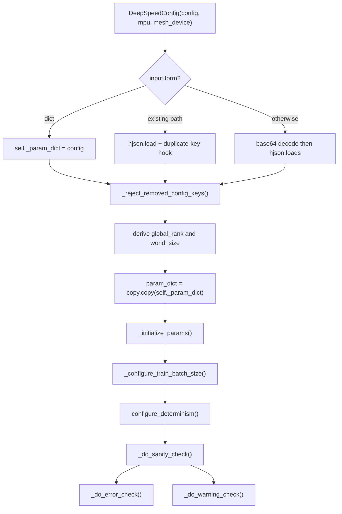
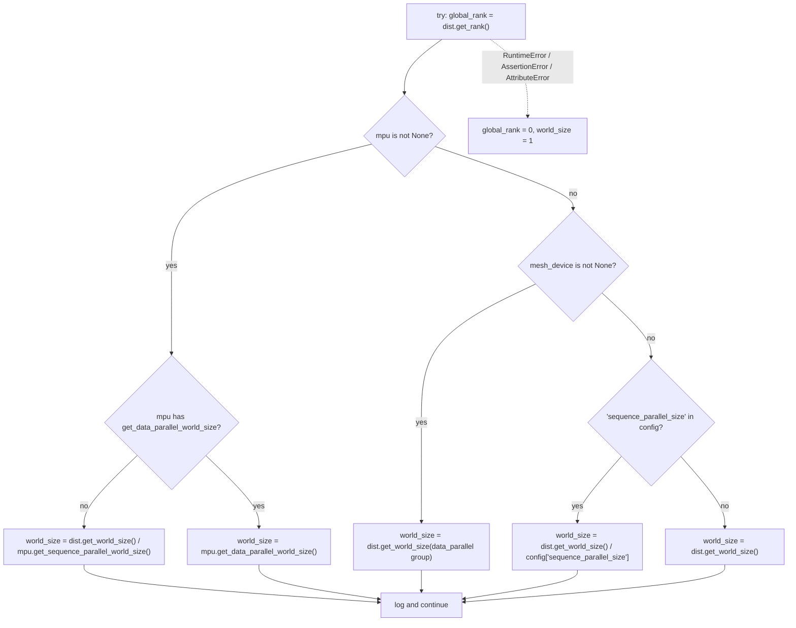
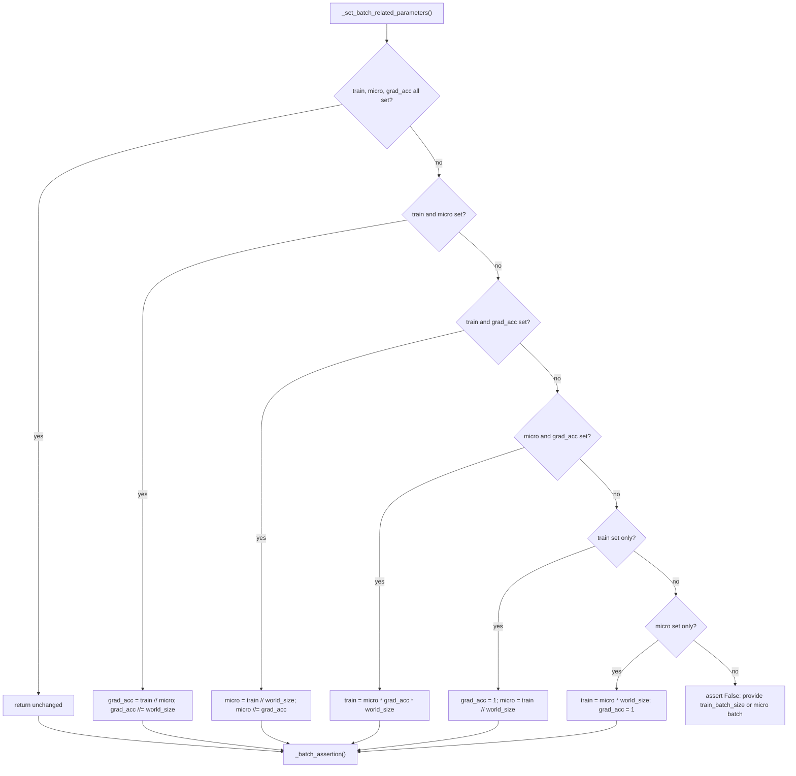
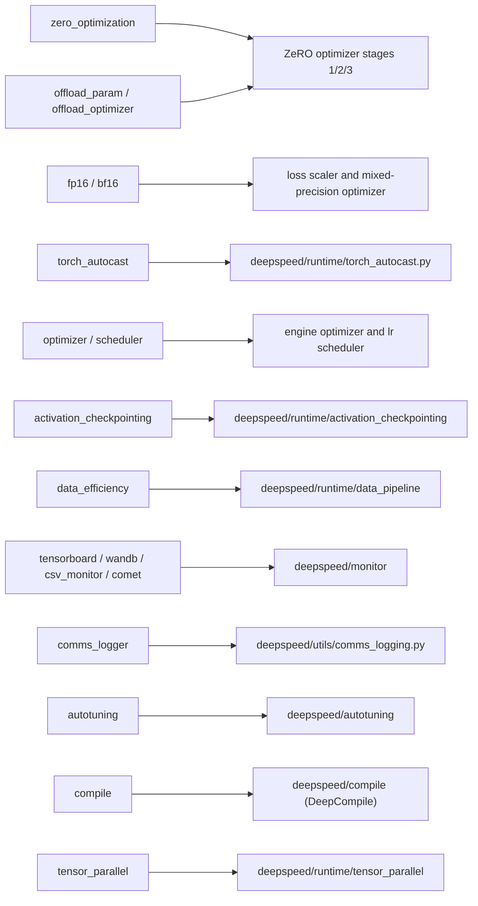

# Configuration

**What this covers.** How a DeepSpeed JSON/dict config becomes the
`DeepSpeedConfig` object the engine reads; the pydantic base class that backs the
sub-configs and its deprecated-field machinery; the batch-size derivation
arithmetic in exact detail; the map from config block to owning module and class;
where validation raises versus asserts, including the removed-feature rejection
lists; and a worked example annotated key by key.

**Source of truth: upstream commit d70adc32** (DeepSpeed 0.20.1), as checked out
on this fork's `intro` branch. Line numbers drift; names are the durable part of
a citation.

---

## 1. Entry points and accepted input forms

`DeepSpeedConfig.__init__` accepts `config: Union[str, dict]`
(`deepspeed/runtime/config.py:441`) and resolves it in three steps
(`deepspeed/runtime/config.py:443-454`):

| Input form | Detection | Loader |
| --- | --- | --- |
| `dict` | `isinstance(config, dict)` | used as-is, stored on `self._param_dict` (`deepspeed/runtime/config.py:443`) |
| filesystem path | `os.path.exists(config)` | `hjson.load(...)` with `object_pairs_hook=dict_raise_error_on_duplicate_keys` (`deepspeed/runtime/config.py:446`) |
| base64 string | fallback | `base64.urlsafe_b64decode(...).decode('utf-8')` then `hjson.loads` (`deepspeed/runtime/config.py:449-450`) |

Notes that matter when editing this path:

* The loader is **hjson**, not `json`, so comments and unquoted keys are accepted
  for both the file and the base64 forms.
* Duplicate keys are rejected by `dict_raise_error_on_duplicate_keys`
  (`deepspeed/runtime/config_utils.py:205`), which raises
  `ValueError("Duplicate keys in DeepSpeed config: ...")`. This hook is only
  installed on the *file* path; the base64 path calls `hjson.loads` without it
  (`deepspeed/runtime/config.py:450`).
* If base64 decoding fails with `UnicodeDecodeError` or `AttributeError`, a
  `ValueError` is raised naming all three accepted forms
  (`deepspeed/runtime/config.py:451-454`).

`deepspeed.initialize()` normalises the same three forms earlier, via
`load_ds_config` (`deepspeed/runtime/tensor_parallel/init_utils.py:19`), so that
it can inspect the dict (e.g. `sequence_parallel_size`, `compile.deepcompile`)
before building the engine; it then passes the already-decoded dict to
`DeepSpeedConfig` (`deepspeed/__init__.py:540-541`, `deepspeed/__init__.py:584`).
`load_ds_config` additionally catches `ValueError` from the decode attempt and
re-raises with the same message
(`deepspeed/runtime/tensor_parallel/init_utils.py:28-32`).

A third construction site is `zero.Init`, which builds its own `DeepSpeedConfig`
when handed a config (`deepspeed/runtime/zero/partition_parameters.py:1072`);
that is the "HF `zero.Init` case where there is no mpu" referenced in the
world-size code (`deepspeed/runtime/config.py:469`).

### Parse / validate pipeline



The ordering is fixed in `deepspeed/runtime/config.py:456-484`. Two consequences:

* Removed-feature rejection happens **before** anything else is parsed, so a
  stale `nebula` block fails fast rather than being silently ignored.
* `_initialize_params` runs before the batch math, so `self.world_size` is
  already set but `train_batch_size` may still be `None` at that point.
* `copy.copy(self._param_dict)` is a *shallow* copy
  (`deepspeed/runtime/config.py:479`); the comment says it is so the user JSON
  stays unmodified for logging, but nested dicts are shared. Do not mutate
  nested blocks in `_initialize_params`.

---

## 2. `config_utils.py`: the pydantic base

`DeepSpeedConfigModel` (`deepspeed/runtime/config_utils.py:17`) extends
`pydantic.BaseModel` and is the base of every pydantic-style DeepSpeed config.

Its `model_config` (`deepspeed/runtime/config_utils.py:105-113`):

| Setting | Value | Effect |
| --- | --- | --- |
| `validate_default` | `True` | defaults are validated too, so a bad default is a bug caught at construction |
| `validate_assignment` | `True` | later `setattr` on a config field re-validates |
| `use_enum_values` | `True` | enum fields store the value, not the member |
| `populate_by_name` | `True` | aliases and field names both accepted |
| `extra` | `"forbid"` | an unknown key *inside a pydantic sub-config* raises `ValidationError` |
| `arbitrary_types_allowed` | `True` | permits `torch.dtype` and friends |
| `protected_namespaces` | `()` | allows fields starting with `model_` |

Because `extra="forbid"` applies only to pydantic sub-configs, unknown
**top-level** keys are silently ignored: the top level is parsed by hand with
`param_dict.get(...)` through `get_scalar_param`
(`deepspeed/runtime/config_utils.py:193`), never by a pydantic model.

### The `"auto"` filter

`DeepSpeedConfigModel.__init__(self, strict=False, **data)` drops any value equal
to the string `"auto"` unless the key is `replace_method`
(`deepspeed/runtime/config_utils.py:54-57`). This exists so Hugging Face configs
containing `"auto"` placeholders can still be loaded; the comment marks it as
temporary. Passing `strict=True` disables the filter.

### Deprecated-field handling

Deprecation metadata lives in `pydantic.Field(json_schema_extra={...})` and is
processed by `_deprecated_fields_check` / `_process_deprecated_field`
(`deepspeed/runtime/config_utils.py:60-103`), called at the end of `__init__`.

| kwarg | Default | Behaviour |
| --- | --- | --- |
| `deprecated` | `False` | gate; `True` enables the rest (`deepspeed/runtime/config_utils.py:102`) |
| `deprecated_msg` | `""` | appended to the warning (`deepspeed/runtime/config_utils.py:71`) |
| `new_param` | `""` | name of the replacement field, dotted names allowed (`deepspeed/runtime/config_utils.py:82-88`) |
| `set_new_param` | `True` | copy the deprecated value into `new_param` (`deepspeed/runtime/config_utils.py:73`) |
| `new_param_fn` | `lambda x: x` | converts old value to new field's type (`deepspeed/runtime/config_utils.py:65-66`) |

Mechanics worth knowing before you add a deprecation:

* The warning is emitted only when the user actually set the field, i.e. when
  `dep_field in self.model_fields_set` (`deepspeed/runtime/config_utils.py:69`).
* When a `new_param` exists and `set_new_param` holds, the deprecated attribute
  is `delattr`-ed first (`deepspeed/runtime/config_utils.py:76`), then the new
  one is set. Supplying both old and new keys is an `AssertionError`:
  "Cannot provide deprecated parameter ... and replacing parameter ... together"
  (`deepspeed/runtime/config_utils.py:89-91`).
* A dotted `new_param` walks into sub-configs with
  `reduce(getattr, new_param_nested[:-1], pydantic_config)`
  (`deepspeed/runtime/config_utils.py:86`).

A live example is `HybridEngineConfig.enable_cuda_graph`, deprecated in favour of
`enable_graph_capture` (`deepspeed/runtime/config.py:368`).

### Other helpers in `config_utils.py`

| Symbol | Purpose |
| --- | --- |
| `get_config_default(config, field_name)` | default of a non-required pydantic field (`deepspeed/runtime/config_utils.py:120`) |
| `pp_int` | `int` subclass with comma-formatted `repr`, used for doc-friendly large defaults (`deepspeed/runtime/config_utils.py:127`) |
| `ScientificNotationEncoder` | `json.JSONEncoder` that renders numbers `> 1e3` in scientific notation (`deepspeed/runtime/config_utils.py:146`) |
| `DeepSpeedConfigObject` | plain non-pydantic base, `__repr__` via `json.dumps` (`deepspeed/runtime/config_utils.py:176`) |
| `get_scalar_param` / `get_list_param` / `get_dict_param` | thin `dict.get` wrappers (`deepspeed/runtime/config_utils.py:193-202`) |
| `dict_raise_error_on_duplicate_keys` | duplicate-key rejection hook (`deepspeed/runtime/config_utils.py:205`) |

---

## 3. `constants.py`: key names and defaults

`deepspeed/runtime/constants.py` holds the top-level key-name/default pairs, in
`NAME` + `NAME_DEFAULT` pairs, plus `*_FORMAT` docstrings that are only used in
error and warning text. `config.py` does `from .constants import *`
(`deepspeed/runtime/config.py:17`), so every one of those names is in scope
unqualified.

A representative slice:

| Key | Constant | Default |
| --- | --- | --- |
| `train_batch_size` | `TRAIN_BATCH_SIZE` | `None` (`deepspeed/runtime/constants.py:19-20`) |
| `train_micro_batch_size_per_gpu` | `TRAIN_MICRO_BATCH_SIZE_PER_GPU` | `None` (`deepspeed/runtime/constants.py:59-60`) |
| `gradient_accumulation_steps` | `GRADIENT_ACCUMULATION_STEPS` | `None` (`deepspeed/runtime/constants.py:71-72`) |
| `managed_gradient_accumulation` | `MANAGED_GRADIENT_ACCUMULATION` | `True` (`deepspeed/runtime/constants.py:78-79`) |
| `gradient_clipping` | `GRADIENT_CLIPPING` | `1.0` (`deepspeed/runtime/constants.py:202-203`) |
| `communication_data_type` | `COMMUNICATION_DATA_TYPE` | `None` (`deepspeed/runtime/constants.py:215-216`) |
| `gradient_allreduce_op` | `GRADIENT_ALLREDUCE_OP` | `"mean"` (`deepspeed/runtime/constants.py:261-265`) |
| `steps_per_print` | `STEPS_PER_PRINT` | `None` (`deepspeed/runtime/constants.py:45-46`) |
| `dataloader_drop_last` | `DATALOADER_DROP_LAST` | `False` (`deepspeed/runtime/constants.py:402-403`) |
| `data_types.keep_in_fp32_modules` | `KEEP_IN_FP32_MODULES` | `"auto"` (`deepspeed/runtime/constants.py:390-391`) |

One quirk to be aware of: `constants.py` computes
`SEQ_PARALLEL_COMMUNICATION_DATA_TYPE_DEFAULT` conditionally on the NCCL version
(`deepspeed/runtime/constants.py:230-234`) and then immediately overwrites it
with `"fp32"` unconditionally (`deepspeed/runtime/constants.py:236`). The
conditional branch is therefore dead; the effective default is always `"fp32"`.

`constants.py` also imports `get_accelerator` at module scope
(`deepspeed/runtime/constants.py:6`) and calls `device_name` /
`communication_backend_version` during import
(`deepspeed/runtime/constants.py:230`), so importing it resolves the accelerator.

---

## 4. `world_size` derivation

`self.world_size` is set in a single `try` block
(`deepspeed/runtime/config.py:458-476`):



Types produced by each branch -- this is load-bearing for the batch math below:

| Branch | Expression | Result type |
| --- | --- | --- |
| `mpu` without `get_data_parallel_world_size` | `dist.get_world_size() / mpu.get_sequence_parallel_world_size()` (`deepspeed/runtime/config.py:463`) | **`float`** (true division) |
| `mpu` with `get_data_parallel_world_size` | `mpu.get_data_parallel_world_size()` (`deepspeed/runtime/config.py:465`) | `int` |
| `mesh_device` | `dist.get_world_size(mesh_device.get_group(mesh_dim="data_parallel"))` (`deepspeed/runtime/config.py:467`) | `int` |
| no mpu, `sequence_parallel_size` present | `dist.get_world_size() / config["sequence_parallel_size"]` (`deepspeed/runtime/config.py:471`) | **`float`** |
| no mpu, no `sequence_parallel_size` | `dist.get_world_size()` (`deepspeed/runtime/config.py:473`) | `int` |
| exception path | literal `1` (`deepspeed/runtime/config.py:476`) | `int` |

Important details:

* The `sequence_parallel_size` lookup on line 471 is against the **original
  `config` argument**, not `self._param_dict`. If `config` was a path or base64
  string, `"sequence_parallel_size" in config` is a substring test on the string,
  not a key test. Keep that in mind if you touch this branch.
* The exception list is `(RuntimeError, AssertionError, AttributeError)`
  (`deepspeed/runtime/config.py:474`). `dist.get_rank()` asserts when the backend
  is not initialised (`deepspeed/comm/comm.py:763-764`), which is how the
  single-process `world_size = 1` default is reached.
* `deepspeed.initialize()` creates the `mesh_device` for the
  `sequence_parallel_size` + `data_parallel_size` and AutoSP cases
  (`deepspeed/__init__.py:557-575`), so in the normal engine path the
  `mesh_device` branch is taken rather than the float-producing one.

---

## 5. Batch-size math

Driven by `_configure_train_batch_size`, which calls
`_set_batch_related_parameters` then `_batch_assertion`
(`deepspeed/runtime/config.py:654-656`).

### 5.1 `_set_batch_related_parameters`

Reads the three current values (`deepspeed/runtime/config.py:613-615`) -- all
default to `None` -- and takes exactly one branch:

| # | Condition | Action | Source |
| --- | --- | --- | --- |
| 1 | all three set | return, nothing derived | `deepspeed/runtime/config.py:618-619` |
| 2 | `train_batch` and `micro_batch` set | `grad_acc = train_batch // micro_batch`; then `grad_acc //= world_size`; assign to `gradient_accumulation_steps` | `deepspeed/runtime/config.py:622-625` |
| 3 | `train_batch` and `grad_acc` set | `micro_batch = train_batch // world_size`; then `micro_batch //= grad_acc`; assign to `train_micro_batch_size_per_gpu` | `deepspeed/runtime/config.py:628-631` |
| 4 | `micro_batch` and `grad_acc` set | `train_batch_size = micro_batch * grad_acc`; then `*= world_size`; assign to `train_batch_size` | `deepspeed/runtime/config.py:634-637` |
| 5 | only `train_batch` set | `gradient_accumulation_steps = 1`; `train_micro_batch_size_per_gpu = train_batch // world_size` | `deepspeed/runtime/config.py:640-642` |
| 6 | only `micro_batch` set | `train_batch_size = micro_batch * world_size`; `gradient_accumulation_steps = 1` | `deepspeed/runtime/config.py:645-647` |
| 7 | neither `train_batch` nor `micro_batch` (incl. only `grad_acc`) | `assert False, 'Either train_batch_size or train_micro_batch_size_per_gpu needs to be provided'` | `deepspeed/runtime/config.py:650-652` |



Operator and type notes:

* Every derivation uses **floor division `//`**, never `/`. The only true
  divisions in this file are in the world-size block
  (`deepspeed/runtime/config.py:463`, `deepspeed/runtime/config.py:471`).
* Division is applied in **two separate statements**, not as one
  `a // (b * c)`. Branch 2 is `(train // micro) // world_size` and branch 3 is
  `(train // world_size) // grad_acc`. With non-divisible inputs these two
  orderings are not interchangeable, and both truncate twice.
* `//` on a `float` operand yields a `float`: if `world_size` came from one of
  the two true-division branches above, `gradient_accumulation_steps` or
  `train_micro_batch_size_per_gpu` can end up as a float (e.g. `4.0`). Code
  downstream that indexes or ranges over these values should not assume `int`.
* Branches 4 and 6 only multiply, so they preserve whatever type `world_size`
  has.

### 5.2 `_batch_assertion`

Four plain `assert` statements (`deepspeed/runtime/config.py:594-609`):

| Assertion | Message |
| --- | --- |
| `train_batch > 0` | "Train batch size: {} has to be greater than 0" (`deepspeed/runtime/config.py:600`) |
| `micro_batch > 0` | "Micro batch size per gpu: {} has to be greater than 0" (`deepspeed/runtime/config.py:602`) |
| `grad_acc > 0` | "Gradient accumulation steps: {} has to be greater than 0" (`deepspeed/runtime/config.py:604`) |
| `train_batch == micro_batch * grad_acc * world_size` | "Check batch related parameters. train_batch_size is not equal to micro_batch_per_gpu * gradient_acc_step * world_size ..." (`deepspeed/runtime/config.py:606-609`) |

The identity check is exact equality, so a user-supplied triple that does not
multiply out exactly is rejected rather than rounded. Conversely, the truncating
`//` in the derivation branches means a *derived* triple can fail this assertion:
e.g. `train_batch_size=10`, `train_micro_batch_size_per_gpu=4`, world size 1
derives `grad_acc = 2` and then fails `10 == 4 * 2 * 1`.

Because these are `assert`s, running Python with `-O` removes them entirely.

---

## 6. Sub-config objects

All of these are built in `_initialize_params`
(`deepspeed/runtime/config.py:486-592`).

| Config block | Owning module | Key class / factory | Attribute on `DeepSpeedConfig` |
| --- | --- | --- | --- |
| `zero_optimization` | `deepspeed/runtime/zero/config.py` | `DeepSpeedZeroConfig` via `get_zero_config` (`:71`, `:90`) | `zero_config`, `zero_optimization_stage`, `zero_enabled` (`deepspeed/runtime/config.py:503-505`) |
| `zero_optimization.offload_param` | `deepspeed/runtime/zero/offload_config.py` | `DeepSpeedZeroOffloadParamConfig` (`:21`) | nested in `zero_config` |
| `zero_optimization.offload_optimizer` | `deepspeed/runtime/zero/offload_config.py` | `DeepSpeedZeroOffloadOptimizerConfig` (`:55`) | nested in `zero_config` |
| `bf16` (alias `bfloat16`) | `deepspeed/runtime/precision_config.py` | `DeepSpeedBF16Config` via `get_bfloat16_config` (`:34`, `:41`) | `bfloat16_config` (`deepspeed/runtime/config.py:514`) |
| `fp16` | `deepspeed/runtime/precision_config.py` | `DeepSpeedFP16Config` via `get_float16_config` (`:95`, `:100`) | `float16_config` (`deepspeed/runtime/config.py:513`) |
| `torch_autocast` | `deepspeed/runtime/config.py` | plain getters `get_torch_autocast_enabled` / `_dtype` / `get_lower_precision_safe_modules` (`:179`, `:186`, `:197`) | `torch_autocast_enabled`, `torch_autocast_dtype`, `torch_autocast_lower_precision_safe_modules` |
| `data_types` | `deepspeed/runtime/constants.py` keys | plain `dict.get` (`deepspeed/runtime/config.py:559-571`) | `grad_accum_dtype`, `param_dtype`, `buffer_dtype`, `keep_in_fp32_modules` |
| `optimizer` | `deepspeed/runtime/config.py` | `get_optimizer_name` / `get_optimizer_params` / `get_optimizer_legacy_fusion` (`:288`, `:295`, `:310`) | `optimizer_name`, `optimizer_params`, `optimizer_legacy_fusion` |
| `scheduler` | `deepspeed/runtime/config.py` | `get_scheduler_name` / `get_scheduler_params` (`:325`, `:332`) | `scheduler_name`, `scheduler_params` |
| `activation_checkpointing` | `deepspeed/runtime/activation_checkpointing/config.py` | `DeepSpeedActivationCheckpointingConfig` (`:57`), a `DeepSpeedConfigObject` | `activation_checkpointing_config` (`deepspeed/runtime/config.py:507`) |
| `data_efficiency` | `deepspeed/runtime/data_pipeline/config.py` | `get_data_efficiency_enabled` / `get_data_efficiency_config` (`:26`, `:14`) | `data_efficiency_enabled`, `data_efficiency_config` (`deepspeed/runtime/config.py:546-547`) |
| `tensorboard`, `wandb`, `csv_monitor`, `comet` | `deepspeed/monitor/config.py` | `DeepSpeedMonitorConfig` via `get_monitor_config` (`:12`, `:125`) | `monitor_config` (`deepspeed/runtime/config.py:510`) |
| `comms_logger` | `deepspeed/comm/config.py` | `DeepSpeedCommsConfig` wrapping `CommsLoggerConfig` (`:19`, `:11`) | `comms_config` (`deepspeed/runtime/config.py:509`) |
| `autotuning` | `deepspeed/autotuning/config.py` | `DeepSpeedAutotuningConfig` (`:10`), a `DeepSpeedConfigObject` | `autotuning_config` (`deepspeed/runtime/config.py:539`) |
| `compile` | `deepspeed/compile/config.py` | `CompileConfig` (`:12`) | `compile_config` (`deepspeed/runtime/config.py:588`) |
| `flops_profiler` | `deepspeed/profiling/config.py` | `DeepSpeedFlopsProfilerConfig` (`:10`) | `flops_profiler_config` (`deepspeed/runtime/config.py:536`) |
| `aio` | `deepspeed/runtime/swap_tensor/aio_config.py` | `get_aio_config` -> plain dict (`:20`) | `aio_config` (`deepspeed/runtime/config.py:576`) |
| `checkpoint` | `deepspeed/runtime/config.py` + `deepspeed/runtime/model_checkpointing/config.py` | `get_checkpoint_params` (`:381`), `get_checkpoint_config` (`:61`) | `checkpoint_tag_validation_*`, `load_universal_checkpoint`, `checkpoint_config` |
| `datastates_ckpt` | `deepspeed/datastates/config.py` | `DeepSpeedDataStatesConfig` (`:15`) | `datastates_config` (`deepspeed/runtime/config.py:582`) |
| `tensor_parallel` | `deepspeed/runtime/tensor_parallel/config.py` | `TPTrainingConfig` via `get_tensor_parallel_config` (`:149`) | `tensor_parallel_config` (`deepspeed/runtime/config.py:591`) |
| `expert_parallel` | `deepspeed/module_inject/auto_ep_config.py` | `AutoEPConfig` via `get_expert_parallel_config` (`deepspeed/runtime/config.py:171`) | `expert_parallel_config` (`deepspeed/runtime/config.py:592`) |
| `timers.throughput` | `deepspeed/utils/config.py` | `DeepSpeedThroughputTimerConfig` via `get_timers_config` (`:27`, `:35`) | `timers_config` (`deepspeed/runtime/config.py:590`) |
| `hybrid_engine` | `deepspeed/runtime/config.py` | `HybridEngineConfig` (`:359`) | `hybrid_engine` (`deepspeed/runtime/config.py:542`) |
| `weight_quantization` | `deepspeed/inference/config.py` | `WeightQuantConfig` (constructed only if the key exists) | `weight_quantization_config` (`deepspeed/runtime/config.py:585-586`) |
| `pipeline` | `deepspeed/runtime/config.py` | `get_pipeline_config` -> plain dict with its own defaults (`:272`) | `pipeline` (`deepspeed/runtime/config.py:544`) |
| `deterministic_mode` | `deepspeed/runtime/determinism.py` | `configure_determinism` (`:10`) | `deterministic_mode` (`deepspeed/runtime/config.py:483`) |

Two construction styles coexist. Pydantic (`DeepSpeedConfigModel`) subclasses get
type coercion, field validators, and `extra="forbid"`. `DeepSpeedConfigObject`
subclasses (activation checkpointing, autotuning, flops profiler, datastates) do
manual `get_scalar_param` reads and accept unknown keys silently.

### Config block to runtime component



Two more blocks are omitted from the diagram only to keep it readable: `aio` ->
`deepspeed/runtime/swap_tensor` and `checkpoint` ->
`deepspeed/runtime/model_checkpointing`. Both appear in the table above.

---

## 7. Validation behaviour

DeepSpeed mixes three failure mechanisms in this file; which one you get depends
on where the check lives.

### 7.1 `DeepSpeedConfigError`

Defined at `deepspeed/runtime/config.py:76`. Raised for:

| Check | Site |
| --- | --- |
| removed top-level or ZeRO config key present | `_reject_removed_config_keys` (`deepspeed/runtime/config.py:133-141`) |
| invalid `checkpoint.tag_validation` value | `get_checkpoint_tag_validation_mode` (`deepspeed/runtime/config.py:395-397`) |
| invalid `checkpoint.parallel_write.pipeline_stage` | `get_checkpoint_parallel_write_pipeline` (`deepspeed/runtime/config.py:407-408`) |
| `data_types.keep_in_fp32_modules` not `"auto"` or a list of str | `deepspeed/runtime/config.py:568-571` |

### 7.2 `ValueError`

| Check | Site |
| --- | --- |
| unparseable config input | `deepspeed/runtime/config.py:452-454` |
| invalid `communication_data_type` | `deepspeed/runtime/config.py:230` |
| invalid `torch_autocast.dtype` | `deepspeed/runtime/config.py:192-193` |
| non-string entries in `torch_autocast.lower_precision_safe_modules` | `deepspeed/runtime/config.py:202-203` |
| unsupported `gradient_allreduce_op` | `deepspeed/runtime/config.py:246-248` |
| `gradient_allreduce_op="sum"` with ZeRO-3 | `deepspeed/runtime/config.py:694-696` |
| `gradient_allreduce_op="sum"` with ZenFlow | `deepspeed/runtime/config.py:697-698` |
| `gradient_allreduce_op="sum"` with DeepCompile | `deepspeed/runtime/config.py:699-700` |
| `deterministic_mode` not a JSON boolean | `deepspeed/runtime/determinism.py:13-14` |

### 7.3 `assert`

Asserts are used for the batch identities and for the compatibility matrix:

| Check | Site |
| --- | --- |
| the four batch assertions | `deepspeed/runtime/config.py:600-609` |
| "Either train_batch_size or train_micro_batch_size_per_gpu needs to be provided" | `deepspeed/runtime/config.py:651-652` |
| fp16 and bf16 not simultaneously enabled | `deepspeed/runtime/config.py:515-516` |
| `train_micro_batch_size_per_gpu` / `gradient_accumulation_steps` defined | `deepspeed/runtime/config.py:683-687` |
| ZeRO stage `<= ZeroStageEnum.max_stage` | `deepspeed/runtime/config.py:689-692` |
| `fp16_master_weights_and_grads` requires ZeRO 1/2/3 | `deepspeed/runtime/config.py:702-705` |
| `bf16_master_weights_and_grads` requires ZeRO 1/2/3 | `deepspeed/runtime/config.py:706-709` |
| `bf16_optimizer_states` requires ZeRO 1/2/3 and `bf16_master_weights_and_grads` | `deepspeed/runtime/config.py:710-714` |

`_do_warning_check` only logs: a `vocabulary_size` not aligned to
`TENSOR_CORE_ALIGN_SIZE = 8` (`deepspeed/runtime/config.py:49`,
`deepspeed/runtime/config.py:717-721`), and the use of `max_grad_norm` inside
`optimizer.params` instead of the top-level `gradient_clipping`
(`deepspeed/runtime/config.py:723-730`).

### 7.4 Removed-feature rejection lists

`_REMOVED_TOP_LEVEL_CONFIG_KEYS` (`deepspeed/runtime/config.py:81-118`) maps a
removed top-level key to the message raised. The keys, in file order:

| Key | Removed feature |
| --- | --- |
| `nebula` | Nebula checkpointing |
| `compression_training` | DeepSpeed compression library |
| `amp` | NVIDIA Apex AMP integration (use `fp16`, `bf16`, or `torch_autocast`) |
| `quantize_training` | Mixture-of-Quantization (MoQ) |
| `sparse_gradients` | sparse compression of dense `torch.nn.Embedding` gradients |
| `eigenvalue` | eigenvalue-based MoQ |
| `sparse_attention` | DeepSpeed Sparse Attention |
| `elasticity` | elastic training |
| `graph_harvesting` | graph harvesting |
| `curriculum_learning` | legacy top-level form; use `data_efficiency.data_sampling.curriculum_learning` |
| `progressive_layer_drop` | Progressive Layer Dropping |

`_REMOVED_ZERO_CONFIG_KEYS` (`deepspeed/runtime/config.py:119-130`) is checked
only when `param_dict["zero_optimization"]` is a dict
(`deepspeed/runtime/config.py:137-141`):

| Key | Removed feature |
| --- | --- |
| `mics_shard_size` | MiCS ZeRO-3 sharding |
| `mics_hierarchical_params_gather` | MiCS ZeRO-3 sharding |
| `zeropp_loco_param` | LoCo-Zero++ error feedback |

All messages point at
`https://github.com/deepspeedai/DeepSpeed/issues/8489`
(`_REMOVED_FEATURES_ISSUE`, `deepspeed/runtime/config.py:80`) except the
`elasticity` one. The policy here is deliberate: these blocks are rejected
rather than ignored because silently dropping them would change numerics or
checkpoint behaviour without telling the user.

A separate legacy path still *warns* rather than rejecting: a boolean
`zero_optimization` value is translated by `read_zero_config_deprecated`
(`deepspeed/runtime/zero/config.py:60-68`), which maps `True` to stage 1 and
reads the old `allgather_size` key.

---

## 8. Worked example

```json
{
  "train_micro_batch_size_per_gpu": 4,
  "gradient_accumulation_steps": 2,
  "gradient_clipping": 1.0,
  "steps_per_print": 10,
  "communication_data_type": "fp32",
  "gradient_allreduce_op": "mean",
  "bf16": { "enabled": true },
  "zero_optimization": {
    "stage": 2,
    "reduce_bucket_size": 500000000,
    "offload_optimizer": { "device": "cpu", "pin_memory": true }
  },
  "optimizer": { "type": "AdamW", "params": { "lr": 1e-4 } },
  "scheduler": { "type": "WarmupLR", "params": { "warmup_num_steps": 100 } },
  "activation_checkpointing": { "partition_activations": true },
  "comms_logger": { "enabled": true, "prof_all": true, "verbose": false },
  "compile": { "deepcompile": false },
  "timers": { "throughput": { "enabled": true } }
}
```

Key by key:

| Key | Parsed at | Runtime effect |
| --- | --- | --- |
| `train_micro_batch_size_per_gpu: 4` | `get_train_micro_batch_size_per_gpu` (`deepspeed/runtime/config.py:343`) | with `gradient_accumulation_steps` also set and `train_batch_size` absent, branch 4 fires: `train_batch_size = 4 * 2 * world_size` (`deepspeed/runtime/config.py:634-637`). Read back through `engine.train_micro_batch_size_per_gpu()` (`deepspeed/runtime/engine.py:1578`) |
| `gradient_accumulation_steps: 2` | `get_gradient_accumulation_steps` (`deepspeed/runtime/config.py:208`) | number of micro-steps per optimizer step; exposed as `engine.gradient_accumulation_steps()` (`deepspeed/runtime/engine.py:1761`) |
| `gradient_clipping: 1.0` | `get_gradient_clipping` (`deepspeed/runtime/config.py:268`) | clip norm used by the optimizer path; `engine.gradient_clipping()` (`deepspeed/runtime/engine.py:1836`). This is also the default (`deepspeed/runtime/constants.py:203`); set `0.0` to disable |
| `steps_per_print: 10` | `get_steps_per_print` (`deepspeed/runtime/config.py:252`) | print interval; `engine.steps_per_print()` (`deepspeed/runtime/engine.py:1800`). Default `None` (`deepspeed/runtime/constants.py:46`) |
| `communication_data_type: "fp32"` | `get_communication_data_type` (`deepspeed/runtime/config.py:216`) | string mapped to `torch.float32` at parse time (`deepspeed/runtime/config.py:223-228`). When absent (`None`), `engine.communication_data_type` falls back to fp16/bf16/fp32 based on the precision flags (`deepspeed/runtime/engine.py:1777-1789`) |
| `gradient_allreduce_op: "mean"` | `get_gradient_allreduce_op` (`deepspeed/runtime/config.py:241`) | lower-cased and checked against `GRADIENT_ALLREDUCE_OP_SUPPORTED` (`deepspeed/runtime/constants.py:265`); the engine sets `self.gradient_average = (op == mean)` (`deepspeed/runtime/engine.py:548`). `"sum"` is rejected with ZeRO-3, ZenFlow, or DeepCompile (`deepspeed/runtime/config.py:694-700`) |
| `bf16.enabled: true` | `get_bfloat16_config` -> `DeepSpeedBF16Config` (`deepspeed/runtime/precision_config.py:34`, `:41`) | selects the bf16 optimizer path; asserted mutually exclusive with `fp16.enabled` (`deepspeed/runtime/config.py:515-516`) |
| `zero_optimization.stage: 2` | `get_zero_config` (`deepspeed/runtime/zero/config.py:71`) | sets `zero_optimization_stage` and `zero_enabled = stage > 0` (`deepspeed/runtime/config.py:504-505`); `ZeroStageEnum.gradients == 2` (`deepspeed/runtime/zero/config.py:85`) |
| `zero_optimization.reduce_bucket_size` | `DeepSpeedZeroConfig.reduce_bucket_size` (`deepspeed/runtime/zero/config.py:112`) | gradient reduce bucket size; read by `engine.zero_reduce_bucket_size()` (`deepspeed/runtime/engine.py:1658`) and passed to DeepCompile's native init (`deepspeed/runtime/engine.py:6087`) |
| `zero_optimization.offload_optimizer` | `DeepSpeedZeroOffloadOptimizerConfig` (`deepspeed/runtime/zero/offload_config.py:55`) | `device: cpu` moves optimizer state to host memory; `pin_memory: true` is the default and page-locks it (`deepspeed/runtime/zero/offload_config.py:75`) |
| `optimizer.type` / `.params` | `get_optimizer_name` / `get_optimizer_params` (`deepspeed/runtime/config.py:288`, `:295`) | a name in `DEEPSPEED_OPTIMIZERS` (`deepspeed/runtime/config.py:63-66`) is lower-cased (`deepspeed/runtime/config.py:523-524`) and built by the engine; `max_grad_norm` inside `params` triggers a rank-0 warning (`deepspeed/runtime/config.py:723-730`) |
| `scheduler.type` / `.params` | `get_scheduler_name` / `get_scheduler_params` (`deepspeed/runtime/config.py:325`, `:332`) | names resolved against `deepspeed/runtime/lr_schedules.py` by the engine |
| `activation_checkpointing.partition_activations` | `DeepSpeedActivationCheckpointingConfig` (`deepspeed/runtime/activation_checkpointing/config.py:57`); key constant at `:27` | partitions saved activations across the model-parallel group in `deepspeed/runtime/activation_checkpointing` |
| `comms_logger.*` | `CommsLoggerConfig` (`deepspeed/comm/config.py:11`) | consumed by `CommsLogger.configure` (`deepspeed/utils/comms_logging.py:78`) when `deepspeed.comm.configure` is called with the config (`deepspeed/comm/comm.py:77-80`). See `10-comm-and-accelerators.md` |
| `compile.deepcompile: false` | `CompileConfig.deepcompile` (`deepspeed/compile/config.py:15`) | `engine.is_deepcompile_enabled()` (`deepspeed/runtime/engine.py:6147`); `false` makes `engine.compile()` use plain `torch.compile`. See `11-deepcompile.md` |
| `timers.throughput.enabled` | `get_timers_config` (`deepspeed/utils/config.py:27`) | enables the throughput timers; default is already `True` (`deepspeed/utils/config.py:38`) |

Note what is *not* in this example and is still set: `gradient_clipping` would
default to `1.0` anyway, `managed_gradient_accumulation` defaults to `True`
(`deepspeed/runtime/constants.py:79`), and `data_types.keep_in_fp32_modules`
defaults to `"auto"` (`deepspeed/runtime/constants.py:391`).

---

## 9. Practical notes for modifying this path

* Adding a top-level key means: a `NAME`/`NAME_DEFAULT` pair in
  `deepspeed/runtime/constants.py`, a `get_*` helper in
  `deepspeed/runtime/config.py`, a line in `_initialize_params`, and an engine
  accessor near `deepspeed/runtime/engine.py:1575-1840`.
* Adding a block is better done as a `DeepSpeedConfigModel` subclass: you get
  type validation and `extra="forbid"` for free, which the
  `DeepSpeedConfigObject` style does not provide.
* `deepspeed/runtime/config.py` and `deepspeed/runtime/config_utils.py` are both
  in the CI run-all glob list (`ci/tests_fetcher.py:171-172`), so any change here
  runs the full selected suite. See `12-testing-and-ci.md`.
* `DeepSpeedConfig.print(name)` dumps every attribute except `_param_dict`
  (`deepspeed/runtime/config.py:673-680`) and then the user JSON via
  `print_user_config` (`deepspeed/runtime/config.py:663`) -- the fastest way to
  see what a config actually resolved to.
