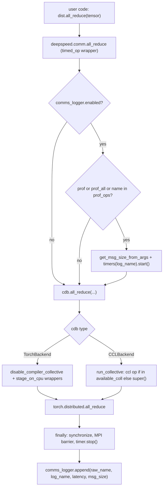
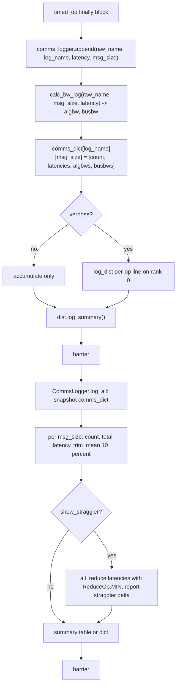
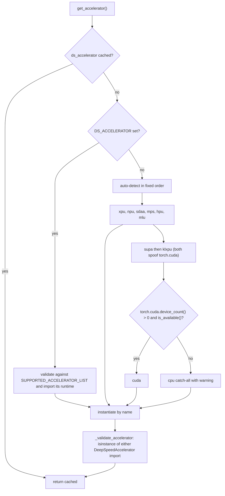
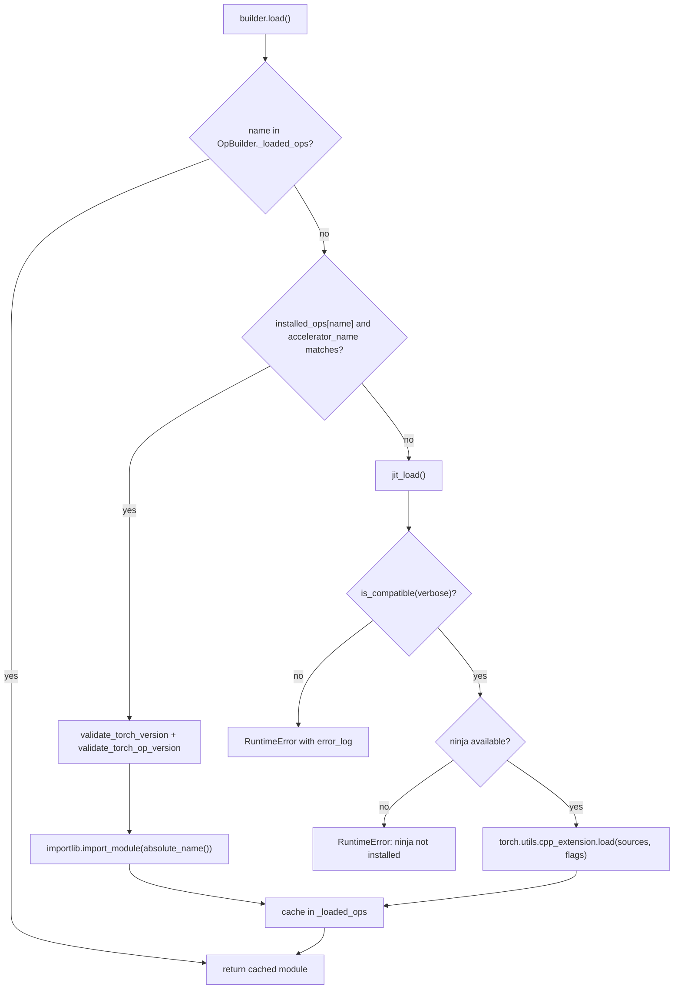

# Communication and accelerators

**What this covers.** The `deepspeed.comm` wrapper over `torch.distributed` and
why it exists; the backend classes and the comms logger (including how bandwidth
is computed); the `check-torchdist` rule; the accelerator abstraction, its
resolution order, and the concrete backends that exist; the op-builder / JIT
machinery and the `DS_BUILD_*` environment variables; and how to read
`ds_report`.

**Source of truth: upstream commit d70adc32** (DeepSpeed 0.20.1), as checked out
on this fork's `intro` branch. Line numbers drift; names are the durable part of
a citation.

---

## 1. Why `deepspeed.comm` exists

The module docstring states the contract (`deepspeed/comm/comm.py:5-21`): the
`deepspeed.comm` API "must be kept fully compatible (same signatures) as
torch.dist API", so that replacing `import torch.distributed as dist` with
`from deepspeed import comm as dist` breaks no public `torch.distributed`
functionality. What the wrapper buys on top of that:

| Capability | Where |
| --- | --- |
| per-collective timing and bandwidth logging | `timed_op` (`deepspeed/comm/comm.py:99`) + `CommsLogger` (`deepspeed/utils/comms_logging.py:67`) |
| one pluggable backend object (`cdb`) chosen from the accelerator | `set_backend` (`deepspeed/comm/comm.py:209`) |
| launcher / MPI / AzureML / SageMaker rank discovery | `init_distributed` (`deepspeed/comm/comm.py:839`) |
| capability shims for older torch | `reduce_scatter_fn` (`:275`), `allgather_fn` (`:344`), `has_coalescing_manager` (`deepspeed/comm/torch.py:83`) |
| CPU staging so gloo can carry MPS/CUDA tensors | `stage_on_cpu` (`deepspeed/comm/torch.py:178`) |
| accelerator fast paths (CCL, shm, mori SDMA, one-shot P2P) | `deepspeed/comm/ccl.py`, `mori.py`, `custom_collective.py` |

`deepspeed/comm/backend.py:20-22` is explicit that `TorchBackend` is the only
officially supported backend for now; direct NCCL/MPI/Gloo backends are marked
experimental/future work.

| File | Lines | Role |
| --- | --- | --- |
| `deepspeed/comm/__init__.py` | 7 | re-exports `from .utils import *` and `from .comm import *` |
| `deepspeed/comm/comm.py` | 1007 | public API: collective wrappers, `init_distributed`, logger glue |
| `deepspeed/comm/backend.py` | 47 | abstract `Backend` base (`name`, `world_size`, `world_rank`, `process_groups`) |
| `deepspeed/comm/torch.py` | 678 | `TorchBackend`, the default implementation |
| `deepspeed/comm/ccl.py` | 179 | `CCLBackend`, a `TorchBackend` subclass using the oneCCL op |
| `deepspeed/comm/reduce_op.py` | 18 | backend-independent `ReduceOp` enum |
| `deepspeed/comm/constants.py` | 51 | backend-name constants and comms-logger key names |
| `deepspeed/comm/config.py` | 23 | `CommsLoggerConfig`, `DeepSpeedCommsConfig` |
| `deepspeed/comm/utils.py` | 140 | launcher env readers and message-size introspection |
| `deepspeed/comm/custom_collective.py` | 104 | one-shot P2P inference all-reduce fast path |
| `deepspeed/comm/mori.py` | 228 | AMD/ROCm SDMA all-gather fast path (opt-in) |
| `deepspeed/comm/pg_utils.py` | 29 | optional-process-group helpers, deliberately **not** re-exported |

`pg_utils` is worth calling out: in `deepspeed.comm` collectives `group=None`
means the world group, but for an *optional* parallel dimension `None` means "no
parallelism". `pg_utils.is_parallel(group)` encodes the second meaning and must
be imported as `from deepspeed.comm import pg_utils`
(`deepspeed/comm/pg_utils.py:5-11`, `:16-29`).

---

## 2. `comm.py`

### 2.1 Module state

Four module globals matter: `cdb = None` ("current deepspeed backend",
`deepspeed/comm/comm.py:43`), `timers = timer.SynchronizedWallClockTimer()`
(`:46`), `comms_logger = CommsLogger()` (`:48`), and the per-backend handles
`nccl_backend` / `mpi_backend` / `ccl_backend` / `hccl_backend` (`:51-54`).
Every collective wrapper forwards to `cdb`; most non-collective helpers assert on
it with the same message,
`'DeepSpeed backend not set, please initialize it using init_process_group()'`
(e.g. `:194-195`, `:270-271`, `:743-744`).

### 2.2 `init_distributed`

`init_distributed` (`deepspeed/comm/comm.py:839-901`) is the public entry point.
Order of operations:

1. `dist_init_required` defaults to `cdb is None or not cdb.is_initialized()`
   (`:862-863`).
2. If `cdb is None`, try
   `init_deepspeed_backend(get_accelerator().communication_backend_name(), ...)`
   then `set_backend()` (`:865-868`). `init_deepspeed_backend` (`:147`) only
   actually constructs a backend for `CCL_BACKEND`; every other name logs "not
   yet implemented" (`:157-169`).
3. If `cdb` is still `None` but `torch.distributed.is_initialized()`, wrap the
   user's existing process group in a `TorchBackend` and return (`:869-872`).
4. If `dist_init_required is False`, assert the backend is initialised (`:874-877`).
5. Otherwise, when `auto_mpi_discovery` is on and any of
   `RANK, WORLD_SIZE, MASTER_ADDR, MASTER_PORT, LOCAL_RANK` is missing, run
   AzureML (`:964`), AWS SageMaker (`:996`), or MPI (`mpi_discovery`, `:904`)
   discovery (`:880-889`). Detection uses `in_aml()` / `in_aws_sm()` /
   `in_dlts()`, which check `AZUREML_EXPERIMENT_ID`, `SM_TRAINING_ENV`, and
   `DLTS_JOB_ID` respectively (`:949`, `:954`, `:959`).
6. Finally construct `TorchBackend(dist_backend, timeout, init_method, rank, world_size)`,
   with `dist_backend` defaulting to the accelerator's backend name (`:896-901`).

`destroy_process_group` also releases DeepSpeed's own group references through
`deepspeed.utils.groups._release_process_group_references` (`:179-189`).

### 2.3 `timed_op`

`timed_op` (`deepspeed/comm/comm.py:99-138`) is the decorator on every logged
collective, written so a disabled logger costs at most two `if` checks per call
(`:106`). The log name and signature are resolved once at decoration time
(`:100-102`).

Per call, when `comms_logger.enabled`: bind args with
`bind_partial(...) + apply_defaults()` (`:108-110`), then
`should_profile = func_args.get('prof', False) or comms_logger.prof_all or selected_log_name in comms_logger.prof_ops`
(`:112-113`). When profiling, compute `msg_size` via `get_msg_size_from_args`
(`:117`), resolve the record name with `get_debug_log_name` (`:118`), and start
the timer (`:119`).

The op runs in `try: return func(...)` with a `finally` block (`:121-136`) that,
when the logger is enabled:

* calls `get_accelerator().synchronize()` when profiling, since accurate timing
  needs the op to be blocking (`:126-127`);
* calls `cdb.barrier()` when `cdb.using_mpi`, because an MPI stream cannot simply
  be synchronised (`:128-130`);
* stops the timer and calls
  `comms_logger.append(raw_name, log_name, time_elapsed, msg_size)` (`:132-136`).
  `raw_name` is `func.__name__` (it picks the bandwidth formula); `log_name` is
  the user-visible record key.

### 2.4 Collective wrappers

Every `@timed_op` wrapper has the shape
`(..., prof=False, log_name='<name>', debug=get_caller_func())` and immediately
delegates to the matching `cdb` method:

| Wrappers (all in `deepspeed/comm/comm.py`) | Lines |
| --- | --- |
| `broadcast`, `broadcast_object_list`, `all_gather`, `all_gather_object` | `:232`, `:238`, `:250`, `:262` |
| `reduce_scatter_tensor`, `all_gather_into_tensor` | `:308`, `:325` |
| `all_to_all_single`, `all_to_all` | `:359`, `:378` |
| `send`, `recv`, `isend`, `irecv`, `batch_isend_irecv` | `:390`, `:396`, `:402`, `:408`, `:432` |
| `gather`, `scatter`, `barrier`, `monitored_barrier` | `:440`, `:453`, `:466`, `:472` |
| `reduce`, `reduce_scatter`, `all_reduce` | `:638`, `:651`, `:688` |
| `inference_all_reduce`, `all_reduce_coalesced` -- both logged under `log_name='all_reduce'` | `:700`, `:712` |

Non-decorated helpers that pick an implementation and then call a decorated one:
`reduce_scatter_fn` (`:275`) uses `reduce_scatter_tensor` when
`cdb.has_reduce_scatter_tensor()`, else chunks with `torch.chunk` and falls back
to `reduce_scatter`, warning once on rank 0 (`:285-305`); `allgather_fn` (`:344`)
mirrors that for `all_gather_into_tensor` vs `all_gather` (`:348-356`);
`all_gather_coalesced` (`:681`) forwards without timing. `P2POp` (`:414`) asserts
its `op` is `deepspeed.comm.isend` or `irecv` (`:424`) and stores it as the
string `'isend'`/`'irecv'` (`:425`), which `TorchBackend.batch_isend_irecv` maps
back with `getattr(torch.distributed, op.op)` (`deepspeed/comm/torch.py:566-570`).

Also exported: `log_summary` (`:483`), `reset_log` (`:560`), `has_comm_data`
(`:591`), `get_comm_operation_count` (`:608`), `get_logged_comm_ops` (`:623`),
`initialize_mesh_device` (`:812`), `enable_symm_mem_for_group` (`:827`),
`get_all_ranks_from_group` (`:797`).

### 2.5 Collective call path



### 2.6 Message-size introspection

`get_msg_size_from_args` (`deepspeed/comm/utils.py:107-134`) finds the tensor
argument positionally or by keyword and returns `element_size() * nelement()`.
Discovery order (`deepspeed/comm/utils.py:65-87` positional, `:89-105` keyword):
`tensor`, `tensors`, `input_list`, `input_tensor_list`, `p2p_op_list`.
Collectives with no tensor (e.g. `barrier`) return `0` (`:130-131`). For list
collectives it sums the list and unwraps `P2POp.tensor` with
`getattr(x, 'tensor', x)` (`:128-134`); the comment there notes this is the
*total* data moved, not the size of a single NCCL/MPI call.
`get_debug_log_name` appends `| [Caller Func: <name>]` when `debug` is on
(`:136-140`), using `get_caller_func` (`deepspeed/utils/comms_logging.py:10`,
which walks three frames up).

---

## 3. `torch.py`: `TorchBackend`

`TorchBackend` (`deepspeed/comm/torch.py:238`) is "a light-weight wrapper class
for torch.distributed API. Only a subset of functions are wrapped" (`:239-245`).

### 3.1 Construction

`__init__` (`:247-270`) builds the shm op (`build_shm_op`, `:74`), probes
`has_all_reduce_coalesced` / `has_coalescing_manager` (`:250-251`), resolves
`all_gather_function` and `reduce_scatter_function` (`:252-253`), calls
`init_process_group` (`:260`), initialises the shm op and records
`shm_vector_kernel_level` (`:261-265`), and makes a best-effort mori attempt
(`_init_sdma_backend`, `:270-282`).

`get_all_gather_function` prefers `torch.distributed.all_gather_into_tensor` and
falls back to `_all_gather_base`, else `None` (`:284-291`);
`get_reduce_scatter_function` mirrors it (`:293-300`).

`init_process_group` (`:308-326`) passes `device_id` to
`torch.distributed.init_process_group` only when all of these hold (`:318-321`):
the known world size is not 1, the torch signature accepts `device_id`, torch is
not in the exclusive `(2.6.0, 2.7.1)` range, and the accelerator is `cuda`. The
reasons are documented inline (`:312-320`), including that binding a device makes
later `new_group()` calls use `ncclCommSplit`, which a single-rank job cannot
satisfy. `known_world_size` (`:58-71`) returns `None` rather than guessing when
the size is neither an explicit argument nor in `WORLD_SIZE`.

### 3.2 Decorator stack

Most methods carry two decorators, outermost first -- e.g. `all_reduce`
(`:328-332`):

* `disable_compiler_collective` (`:52-55`) is a no-op on torch >= 2.3 and
  otherwise wraps the function in `compiler.disable`
  (`deepspeed/runtime/compiler.py:44`).
* `stage_on_cpu` (`:178-235`) copies device tensors gloo cannot accept to CPU,
  runs the collective, and copies back. `_needs_cpu_staging` (`:159-175`) is
  `True` for MPS tensors always, and for CUDA tensors when
  `torch.distributed.get_backend(group) == 'gloo'`. Async ops get a `StagedWork`
  (`:141-156`) whose `wait()` copies back after the underlying work completes.
  `isend` uses `@stage_on_cpu(always_async=True, copy_from_cpu=False)` (`:555`);
  `irecv` uses `always_async=True, copy_to_cpu=False` (`:560`).

`_ensure_gloo_subgroup_split` (`:25-49`) monkey-patches
`torch.distributed.distributed_c10d._new_process_group_helper` so a gloo world
can create a subgroup excluding some ranks on torch 2.7-2.10; it is installed
lazily from `new_group` (`:614-616`).

### 3.3 Comm-off debug switches

Five module globals plus setters disable collectives for debugging (`:18-22`,
`:103-132`): `all_gather_comm_off`, `reduce_scatter_comm_off`,
`broadcast_comm_off`, `all_reduce_comm_off`, `reduce_comm_off`, and
`backward_comm_off(flag)` which flips all-gather and reduce-scatter together
(`:130-132`). A disabled method logs "... is OFF" on rank 0 and returns a `Noop`
whose `wait()` returns `None` (`:135-138`).

### 3.4 `inference_all_reduce` fast paths

`inference_all_reduce` (`:334-381`) is the only collective with a layered fast
path, and is *not* wrapped in `stage_on_cpu`:

1. **One-shot P2P kernel** for non-CPU accelerators (`:347-360`): requires sum
   reduction, dtype in `(fp16, bf16, fp32)`,
   `custom_collective_ready(world_sz, group)`, a contiguous tensor, and size
   `<= custom_collective_max_bytes()`.
2. **CPU shm kernel** via `torch.ops.deepspeed.inference_all_reduce_` (`:361`,
   `:367-381`): needs `shm_vector_kernel_level >= 2` for bf16/fp16 and `>= 1` for
   fp32 (`:368-369`), and the group must be the whole world because the kernel
   takes no group argument (`:370-376`).
3. Otherwise plain `torch.distributed.all_reduce` (`:377-379`).

`all_gather_into_tensor` (`:444-458`) similarly tries
`mori.allgather_into_tensor` and falls through when it returns `None`. The mori
path is opt-in via `DS_SDMA_ALLGATHER=1`, with `DS_SDMA_ALLGATHER_MAX_NUMEL` to
size the transit buffer (`deepspeed/comm/mori.py:16-27`) -- environment variables,
not `ds_config` fields.

### 3.5 Version gates and `_reduce_op`

| Method | Gate |
| --- | --- |
| `all_reduce_coalesced` | raises `RuntimeError` when `has_all_reduce_coalesced` is false; needs torch >= 1.13 (`:385-393`, `:88-89`) |
| `all_gather_coalesced` | `_all_gather_base_coalesced` if present, else the coalescing manager (`:481-502`) |
| `init_device_mesh` | torch >= 2.2; `device_name()` below torch 2.4, `current_device_name()` at/above (`:654-665`) |
| `enable_symm_mem_for_group` | torch >= 2.5 (`:667-672`) |

`_reduce_op` (`:631-652`) maps the DeepSpeed `ReduceOp` enum onto
`torch.distributed.ReduceOp`. `deepspeed/comm/reduce_op.py:9-18` defines
`SUM, PRODUCT, MIN, MAX, BAND, BOR, BXOR, AVG, UNUSED`; `UNUSED` has no mapping
and passes through unchanged.

---

## 4. `ccl.py`: `CCLBackend`

`CCLBackend` (`deepspeed/comm/ccl.py:35`) subclasses `TorchBackend`.
`build_ccl_op()` (`:16-23`) asks the accelerator for `"CCLCommBuilder"` and
`load()`s it, returning `None` when the builder is missing or is a
`NotImplementedBuilder`. If the op cannot be built, `__init__` sets
`self.initialized = False` and returns early (`:38-41`), so `set_backend` never
assigns it to `cdb` (`deepspeed/comm/comm.py:224-226`). Otherwise it initialises
the torch backend with `backend='ccl'`, broadcasts the oneCCL KVS address from
rank 0 (`:50-54`), and records `available_coll` from
`self.ccl_comm_op.get_available_coll()` (`:57`).

`run_collective(name, **kwargs)` (`:62-77`) dispatches to
`self.ccl_comm_op.<name>` when the name is in `available_coll`, otherwise to
`super().<name>`. It builds the call with `eval("self.ccl_comm_op." + name)` and
passes `*kwargs.values()`, so **argument order in each call site's kwargs dict is
positionally significant**. Sub-group support is lazy:
`get_all_ranks_from_group` (`:166-178`) enumerates global ranks and calls
`_new_group` (`:156-164`) the first time it sees an unregistered group.

Backend name constants live in `deepspeed/comm/constants.py:6-11`: `nccl`, `ccl`,
`mpi`, `gloo`, `sccl`, `hccl`. `set_backend` (`deepspeed/comm/comm.py:209-229`)
only has branches for `nccl`, `mpi`, `ccl`, and `hccl`, and each requires the
corresponding module global to be a non-`None` initialised backend.

---

## 5. The comms logger

### 5.1 Configuration

`CommsLoggerConfig` (`deepspeed/comm/config.py:11`) is the pydantic model and
`DeepSpeedCommsConfig` (`:19`) wraps it, exposing `comms_logger_enabled`. Keys
and defaults, from `deepspeed/comm/constants.py`: `enabled=False` (`:33-34`),
`verbose=False` (`:37-38`), `prof_all=True` (`:41-42`), `debug=False` (`:45-46`),
`prof_ops=[]` (`:49-50`).

`deepspeed.comm.configure(deepspeed_config=...)` copies the block into the global
logger (`deepspeed/comm/comm.py:68-95`) and can override each field
individually. Programmatic control also exists:
`start_profiling_comms` / `stop_profiling_comms` flip `prof_all`
(`deepspeed/utils/comms_logging.py:90-94`), and `start_profiling_op(op_name_list)`
/ `stop_profiling_op` edit `prof_ops` (`:97-101`).

### 5.2 How bandwidth is computed

`calc_bw_log(comm_op, size, duration)` (`deepspeed/utils/comms_logging.py:34-64`)
returns `(tput, busbw)` -- algorithmic and bus bandwidth -- following the
nccl-tests conventions it cites (`:32-33`). With `n = dist.get_world_size()`:

| `comm_op` (the raw function name) | `tput` | `busbw` | Line |
| --- | --- | --- | --- |
| `all_to_all_single`, `all_to_all` | `size / duration` | `(size / duration) * ((n - 1) / n)` | `:40-42` |
| `all_gather`, `all_gather_into_tensor`, `reduce_scatter`, `reduce_scatter_tensor` | `size` first multiplied by `n`, then `size / duration` | `(size / duration) * ((n - 1) / n)` | `:43-46` |
| `all_reduce`, `all_reduce_coalesced`, `inference_all_reduce` | `size * 2 / duration` | `(size / duration) * (2 * (n - 1) / n)` | `:47-49` |
| `send`, `recv`, `isend`, `irecv`, `batch_isend_irecv`, `broadcast`, `broadcast_object_list`, `reduce`, `gather`, `scatter`, `barrier` | `size / duration` | `= tput` | `:50-52` |
| anything else | prints "wrong comm_op specified" and calls `exit(0)` | -- | `:53-55` |

Both values are then `*= 8` (bytes to bits) and `/= 1e6` (`:57-62`). Because
`duration` arrives in **milliseconds** from the timer's `elapsed()`,
`bytes/ms * 8 / 1e6` yields Gbit/s. The all-gather/reduce-scatter row scales
`size` by `n` first because the logged message size is one rank's shard, not the
full buffer. Note the unknown-op branch terminates the process with `exit(0)`.

### 5.3 Record and aggregate

`append(raw_name, record_name, latency, msg_size)`
(`deepspeed/utils/comms_logging.py:104-123`) stores into a two-level dict,
`comms_dict[record_name][msg_size] = [count, [latencies], [algbws], [busbws]]`.
A new message size creates a new inner entry (`:115`); a new op creates the outer
entry (`:118`). With `verbose`, every op is logged through `log_dist(..., [0])`
(`:121-123`).

`log_all(print_log=True, show_straggler=False, return_dict=False)` (`:210-378`)
snapshots `comms_dict` to avoid concurrent-modification errors (`:273`), then per
`(record_name, msg_size)` computes `count = vals[0]`,
`total_latency_ms = sum(vals[1])`, and trimmed means of latency/algbw/busbw via
`trim_mean(..., 0.1)` -- a 10% trim from both ends (`:301-308`, documented at
`:258`). `get_operation_summary(operation_name)` (`:171-207`) returns the same
per-size summary for one op. Straggler analysis (`:327-375`) all-reduces the
latency vector with `ReduceOp.MIN` to get the per-op minimum across ranks,
reports that as the communication latency, and reports `lats - min_lats` as the
straggler component (`:352-358`).

`deepspeed.comm.log_summary` (`deepspeed/comm/comm.py:483-557`) brackets
`log_all` with two barriers and lets only rank 0 print, while all ranks can
return the dict.



---

## 6. The `check-torchdist` rule

`.pre-commit-config.yaml` registers a local hook with
`entry: ./scripts/check-torchdist.py`. That script runs
`git grep -Hn --no-index -P "torch\.distributed |torch\.distributed(?!\.nn)"`
over the files passed to it and exits 1 with "Please replace all calls to
torch.distributed with deepspeed.comm" on any hit. `torch.distributed.nn` is
allowed by the negative lookahead.

**What to use instead:** `import deepspeed.comm as dist` (`AGENTS.md:56`). The
names match `torch.distributed`, so call sites are otherwise unchanged.

Paths excluded by the hook's `exclude:` regex: `deepspeed/comm/` (the wrapper
itself), `scripts/check-torchdist.py`, `docs/`, `benchmarks/`,
`.agents/skills/pr-checklist/SKILL.md`, `deepspeed/moe/sharded_moe.py`,
`deepspeed/runtime/comm/coalesced_collectives.py`,
`deepspeed/launcher/launch.py`, `tests/unit/comm/test_dist.py`, and
`tests/unit/checkpoint/test_affine_transfer_executor_external_group.py`. The
config comment states the grandfathered `deepspeed/` files stay excluded "until
we wrap ProcessGroup in deepspeed.comm", so new code must not extend the list.

A sibling hook, `check-torchcuda`, enforces the same discipline for direct CUDA
API use, with `#ignore-cuda` comments marking deliberate exceptions (see
`accelerator/real_accelerator.py:205`). Check your changes with
`pre-commit run --files <changed files>`.

---

## 7. The accelerator abstraction

`accelerator/` is the top-level package; `deepspeed/accelerator` is a **symlink**
to it. This is why `real_accelerator.py` imports `DeepSpeedAccelerator` from both
`accelerator.abstract_accelerator` and
`deepspeed.accelerator.abstract_accelerator` and validates against either class
(`accelerator/real_accelerator.py:14-21`, `:28-44`): the module has two import
identities, build-time and runtime. `accelerator/__init__.py` exports
`DeepSpeedAccelerator`, `get_accelerator`, `set_accelerator`,
`is_current_accelerator_supported`.

### 7.1 The method contract

`DeepSpeedAccelerator` (`accelerator/abstract_accelerator.py:10`) sets
`supports_nvtx_domain = False` (`:11`) and initialises `_name`,
`_communication_backend_name`, `_compile_backend` (`:13-16`). The full method
surface, grouped as the file groups it:

| Group | Methods (line of each group's first member) |
| --- | --- |
| device semantics | `is_synchronized_device` (`:19`), `use_host_timers` (`:23`), `resolves_data_dependency` (`:27`), `handles_memory_backpressure` (`:31`) |
| device APIs | `device_name` (`:36`), `device` (`:40`), `set_device` (`:44`), `current_device` (`:48`), `current_device_name` (`:52`), `device_count` (`:56`), `synchronize` (`:60`) |
| RNG | `random` (`:65`), `set_rng_state` (`:69`), `get_rng_state` (`:73`), `manual_seed` (`:77`), `manual_seed_all` (`:81`), `initial_seed` (`:85`), `default_generator` (`:89`) |
| streams and events | `Stream` (`:95`), `stream` (`:99`), `current_stream` (`:103`), `default_stream` (`:107`), `Event` (`:112`) |
| memory | `empty_cache` (`:117`), `memory_allocated` (`:121`), `max_memory_allocated` (`:125`), `reset_max_memory_allocated` (`:129`), `memory_cached` (`:133`), `max_memory_cached` (`:137`), `reset_max_memory_cached` (`:141`), `memory_stats` (`:145`), `reset_peak_memory_stats` (`:149`), `memory_reserved` (`:153`), `max_memory_reserved` (`:157`), `total_memory` (`:161`), `available_memory` (`:165`) |
| dtypes | `is_bf16_supported` (`:170`), `is_fp16_supported` (`:174`), `is_fp64_supported` (`:178`), `supported_dtypes` (`:182`) |
| misc | `is_available` (`:187`), `range_push` (`:191`), `range_pop` (`:195`), `lazy_call` (`:199`), `communication_backend_name` (`:203`), `is_triton_supported` (`:207`) |
| graphs | `prefer_triton_grouped_mm` (`:215`), `is_graph_capture_supported` (`:225`), `is_current_stream_capturing` (`:228`), `create_graph` (`:232`), `capture_to_graph` (`:236`), `replay_graph` (`:240`) |
| tensor constructors | `BFloat16Tensor` (`:246`), `ByteTensor` (`:251`), `DoubleTensor` (`:256`), `FloatTensor` (`:261`), `HalfTensor` (`:266`), `IntTensor` (`:271`), `LongTensor` (`:276`) |
| pinned host memory | `_torch_pin_memory` (`:284`), `_torch_empty_pinned` (`:287`), `_torch_is_pinned` (`:290`), `register_host_memory` (`:293`), `unregister_host_memory` (`:297`), `pin_memory_alignment` (`:301`), `pin_memory` (`:337`), `pin_empty` (`:354`), `pin_empty_like` (`:365`), `is_pinned` (`:371`), `unpin_memory` (`:378`), `on_accelerator` (`:386`) |
| op builder plumbing | `op_builder_dir` (`:390`), `create_op_builder` (`:395`), `get_op_builder` (`:400`), `build_extension` (`:404`) |
| launcher plumbing | `export_envs` (`:408`), `visible_devices_envs` (`:412`), `set_visible_devices_envs` (`:416`) |
| compiler | `get_compile_backend` (`:420`), `set_compile_backend` (`:424`) |

Not all are `@abc.abstractmethod`: the pinned-memory block supplies working
defaults (`:284-301`, `:310-384`) so a backend overrides only what differs.
`_torch_pins_host_memory = True` (`:303`) lets a backend declare that its
`_torch_pin_memory` really page-locks; the CPU accelerator instead overrides the
primitives to be no-ops (`accelerator/cpu_accelerator.py:441-447`).

### 7.2 Resolution order

`get_accelerator()` (`accelerator/real_accelerator.py:51`) memoises
`ds_accelerator` (`:52-54`) and otherwise runs three phases.

**Phase 1 -- `DS_ACCELERATOR` override** (`:59-114`). The value must be in
`SUPPORTED_ACCELERATOR_LIST = ['cuda', 'cpu', 'xpu', 'npu', 'mps', 'hpu', 'mlu', 'sdaa', 'supa', 'klxpu']`
(`:23`, enforced at `:111-113`). Each name also verifies its runtime dependency
and raises `ValueError` if missing: `xpu` needs `torch.xpu` (`:61-67`), `npu`
needs `torch_npu` (`:70-74`), `sdaa` needs `torch_sdaa` (`:76-81`), `mps` needs
`torch.mps` (`:82-89`), `hpu` needs `habana_frameworks.torch.hpu` (`:90-95`),
`mlu` needs `torch_mlu` (`:96-100`), `supa` needs `torch_supa` (`:101-105`),
`klxpu` needs `torch_xmlir` (`:106-110`). `cpu` needs nothing (`:68-69`).
`ds_set_method = "override"`.

**Phase 2 -- auto-detection** (`:117-218`), in exactly this order: `xpu` via
`hasattr(torch, 'xpu') and torch.xpu.is_available()` (`:133-135`), `npu` via
`import torch_npu` (`:139-144`), `sdaa` (`:146-151`), `mps` via
`torch.mps.current_allocated_memory()` (`:152-160`), `hpu` (`:161-167`), `mlu`
(`:168-174`), `supa` (`:175-185`), `klxpu` (`:186-194`), `cuda` via
`torch.cuda.device_count() > 0 and torch.cuda.is_available()` (`:195-209`), and
finally `cpu` as the catch-all with a warning (`:210-216`). `supa` and `klxpu`
deliberately precede the CUDA probe because both spoof `torch.cuda` (`:177`,
`:188`); the CUDA probe uses both predicates so a device-less machine never makes
a CUDA call (`:199-205`). `ds_set_method = "auto detect"`.

**Phase 3 -- instantiation** (`:221-264`): a name-to-class dispatch, then
`_validate_accelerator(ds_accelerator)` (`:261`) and an info log naming the
method (`:262-263`). `set_accelerator(accel_obj)` (`:267-272`) lets a caller
install an instance directly, with the same validation.



### 7.3 Concrete backends

Every file in `accelerator/` at this commit:

| File | Class | `_name` | Comm backend | `op_builder_dir()` |
| --- | --- | --- | --- | --- |
| `abstract_accelerator.py` | `DeepSpeedAccelerator` | -- | -- | abstract (`:390`) |
| `real_accelerator.py` | -- (resolver) | -- | -- | -- |
| `cuda_accelerator.py` | `CUDA_Accelerator` | `cuda` | `nccl`, `gloo` on win32 (`:34`) | `op_builder` (`:358`) |
| `cpu_accelerator.py` | `CPU_Accelerator` | `cpu` | `ccl` if oneCCL present else `gloo` (`:171-174`) | `op_builder.cpu` (`:454`) |
| `xpu_accelerator.py` | `XPU_Accelerator` | `xpu` | `ccl` if oneCCL present else `xccl` (`:182-185`) | `op_builder.xpu` (`:468`) |
| `npu_accelerator.py` | `NPU_Accelerator` | `npu` | `hccl` (`:50`) | `op_builder.npu` (`:307`) |
| `hpu_accelerator.py` | `HPU_Accelerator` | `hpu` | `hccl` (`:19`) | `op_builder.hpu` (`:254`) |
| `mlu_accelerator.py` | `MLU_Accelerator` | `mlu` | `cncl` (`:19`) | `op_builder.mlu` (`:238`) |
| `sdaa_accelerator.py` | `SDAA_Accelerator` | `sdaa` | `tccl` (`:49`) | `op_builder.sdaa` (`:266`) |
| `supa_accelerator.py` | `SUPA_Accelerator` | `supa` | `bccl`, `gloo` on win32 (`:18`) | `op_builder.supa` (`:234`) |
| `klxpu_accelerator.py` | `KLXPU_Accelerator` | `klxpu` (`:19`) | inherited from CUDA (`nccl`) | `op_builder.klxpu` (`:43`) |
| `mps_accelerator.py` | `MPS_Accelerator` | `mps` | `gloo` (`:29`) | `op_builder.mps` (`:260`) |

Each `op_builder_dir()` first tries `from op_builder import __deepspeed__` and
returns the top-level name on success (a local/editable install), falling back to
the `deepspeed.ops.op_builder.*` form otherwise -- e.g.
`accelerator/cuda_accelerator.py:353-359`. `__deepspeed__ = True` is set in
`op_builder/__init__.py` exactly so the abstract accelerator can tell a DeepSpeed
`op_builder` from a third-party one.

`KLXPU_Accelerator` is the one backend that subclasses another concrete one:
it extends `CUDA_Accelerator` because "KUNLUNXIN XPU (torch_xmlir) presents
itself through torch.cuda, so device strings, streams, RNG, and memory
management are inherited from CUDA"
(`accelerator/klxpu_accelerator.py:9-15`), overriding only `_name`,
`use_host_timers`, the NVTX domain, and `op_builder_dir`.

The CUDA accelerator builds its `class_dict` by reflection over the op_builder
package, skipping `all_ops`, `builder`, and subdirectories
(`accelerator/cuda_accelerator.py:365-384`), then explicitly pulls
`CPUAdamBuilder`, `CPUAdagradBuilder`, `CPULionBuilder`, `AsyncIOBuilder` from
`op_builder.cpu` because those host-side ops need no CUDA to build (`:389-393`).
The CPU accelerator instead hard-codes its builder list in `get_op_builder` and
returns `NotImplementedBuilder` for anything else
(`accelerator/cpu_accelerator.py:473-500`).

---

## 8. Op builders and JIT compilation

### 8.1 `OpBuilder`

`OpBuilder` (`op_builder/builder.py:212`) is an ABC with class state
`_is_rocm_pytorch` and `_loaded_ops` (`:213-214`). Abstract: `absolute_name()`
(`:221`), the import path of the pre-installed `.so`, and `sources()` (`:229`),
source paths relative to the DeepSpeed root.

Overridable hooks and their base behaviour: `include_paths` -> `[]` (`:274`),
`cxx_args` -> `[]` (`:280`), `is_compatible(verbose=False)` -> `True` (`:286`),
`extra_ldflags` -> `[]` (`:292`), `libraries_args` -> `[]` (`:295`),
`extra_compile_args` -> `{'cxx': cxx_args()}` (`:301`), `jit_load_kwargs` ->
`{'extra_cflags': extra_compile_args()['cxx']}` (`:507`), `hipify_extension`
no-op (`:235`), `validate_torch_op_version` no-op (`:249`).

Support utilities: `has_function` compiles a tiny C program to smoke-test a
library (`:308-316`); `cpu_arch` (`:396`) and `simd_width` (`:447`) probe the
host CPU; `_riscv_hwcap` (`:406`) / `_riscv_has_vector` (`:423`) handle RISC-V
vectors; `deepspeed_src_path` resolves relative sources against the repo root
(`:468`); `is_rocm_pytorch` caches the ROCm verdict (`:256-272`).

### 8.2 `load()` -- prebuilt vs JIT

`load(verbose=False)` (`op_builder/builder.py:489-505`): return the cached module
if `self.name in OpBuilder._loaded_ops` (`:490-491`); read `installed_ops`,
`torch_info`, `accelerator_name` from `deepspeed.git_version_info` (`:493`); if
`installed_ops.get(self.name)` **and** `accelerator_name == get_accelerator()._name`
(`:495`), validate the pre-compiled op against the runtime torch
(`validate_torch_version`, `:498`) and device toolkit
(`validate_torch_op_version`, `:499`), then
`importlib.import_module(self.absolute_name())` and cache (`:501-503`);
otherwise `jit_load(verbose)` (`:505`). `validate_torch_version` raises
`RuntimeError("PyTorch version mismatch! ...")` when the major.minor of installed
and runtime torch differ (`:238-247`).

`jit_load(verbose=True)` (`:513-548`):

1. **Gate:** `if not self.is_compatible(verbose): raise RuntimeError(f"Unable to JIT load the {self.name} op due to it not being compatible due to hardware/software issue. {self.error_log}")`
   (`:514-517`). `error_log` is set by `warning()` (`:464-466`) or directly by
   `is_compatible`.
2. `verify_ninja_availability()`; a failure becomes "Unable to JIT load the ...
   op due to ninja not being installed" (`:518-522`).
3. Absolutise sources and include paths (`:527-528`), merge `jit_load_kwargs()`
   and `extra_ldflags()`, and append `-l<lib>` (or `<lib>.lib` on win32) per entry
   of `libraries_args()` because `torch.utils.cpp_extension.load()` has no
   `libraries` argument (`:530-534`).
4. Call `load(...)`, record the build duration, cache into `_loaded_ops`, return
   (`:535-548`).



### 8.3 `CUDAOpBuilder`

`CUDAOpBuilder` (`op_builder/builder.py:551`) adds:

* `MIN_COMPUTE_CAPABILITY = None` (`:556`) -- "oldest compute capability major the
  op supports, or None to skip these checks" (`:553-555`).
* `self.jit_mode = True` in `__init__`, flipped to `False` by `builder()` because
  a pre-built op must target the requested arch list, not this machine's GPUs
  (`:558-562`, `:808-811`).
* `is_compatible` (`:782-806`): the base verdict when `MIN_COMPUTE_CAPABILITY is
  None`; otherwise requires torch (`:786-792`), and when a GPU is visible and
  ROCm is not in use calls `installed_cuda_version()` -- which raises
  `MissingCUDAException` with no toolkit -- and rejects a GPU whose major
  capability is below the minimum (`:793-805`). `DS_IGNORE_CUDA_DETECTION` skips
  the GPU half (`:793`).
* `filter_ccs(ccs)` (`:769-780`) prunes build targets below
  `MIN_COMPUTE_CAPABILITY` and warns which were dropped.
* `extra_compile_args` (`:860-882`) asserts no CUDA/torch mismatch on non-ROCm
  (`assert_no_cuda_mismatch`, `:185`), calls `nvcc_args()` first because it
  decides `enable_bf16` and the arch list, and appends `-DBF16_AVAILABLE` plus
  the `-U__CUDA_NO_BFLOAT16*` undefines for bf16.
* `jit_load` (`:841-858`) saves and restores `TORCH_CUDA_ARCH_LIST`, since
  `compute_capability_args()` publishes the JIT arch list through it.
* `builder()` (`:808-839`) returns a `CUDAExtension`, where
  `OpBuilder.builder()` (`:479-487`) returns a `CppExtension`.

`assert_no_cuda_mismatch` raises `CUDAMismatchException` (`:39`) when the system
CUDA and torch's CUDA differ, unless `DS_SKIP_CUDA_CHECK=1` is set, in which case
it warns and proceeds (`:196-208`). `probe_is_compatible(builder, verbose)`
(`:117-129`) wraps `is_compatible` in a try/except so a builder whose *probe
itself* raises (a CUDA builder on a GPU host with no toolkit) is reported as not
compatible instead of breaking `import deepspeed` -- see the inline reference to
issue #7452.

### 8.4 Builder directories

| Directory | Builders present |
| --- | --- |
| `op_builder/` (CUDA/default) | `custom_collective`, `dc`, `evoformer_attn`, `fp_quantizer`, `fused_adam`, `fused_glu`, `fused_lamb`, `fused_lion`, `gds`, `inference_core_ops`, `inference_cutlass_builder`, `pin_memory`, `pin_memory_load`, `quantizer`, `ragged_ops`, `ragged_utils`, `random_ltd`, `spatial_inference`, `stochastic_transformer`, `transformer`, `transformer_inference`, `utils` (plus `builder.py` and `all_ops.py`) |
| `op_builder/cpu/` | `async_io`, `comm` (CCL + shm), `cpu_adagrad`, `cpu_adam`, `cpu_lion`, `fused_adam`, `no_impl`, `pin_memory` |
| `op_builder/xpu/` | as cpu minus `comm` and `cpu_lion`, plus `flash_attn` |
| `op_builder/npu/`, `op_builder/supa/` | `async_io`, `cpu_adagrad`, `cpu_adam`, `cpu_lion`, `fused_adam`, `fused_lamb`, `fused_lion`, `inference`, `no_impl`, `pin_memory`, `quantizer` |
| `op_builder/klxpu/` | `async_io`, `cpu_adagrad`, `cpu_adam`, `cpu_lion`, `fused_adam`, `no_impl`, `pin_memory`, `utils` |
| `op_builder/hpu/` | `cpu_adam`, `fp_quantizer`, `fused_adam`, `no_impl`, `transformer_inference` |
| `op_builder/mlu/` | `cpu_adagrad`, `cpu_adam`, `fused_adam`, `no_impl` |
| `op_builder/sdaa/`, `op_builder/mps/` | `cpu_adam`, `fused_adam`, `no_impl` |

Each subdirectory has its own `builder.py` base and a `no_impl.py` providing
`NotImplementedBuilder`, which the CPU accelerator returns for unknown builder
names so unit tests get an object rather than `None`
(`accelerator/cpu_accelerator.py:497-500`).

### 8.5 Re-export and reflection

`deepspeed/ops/op_builder` is a **symlink** to the top-level `op_builder`, so the
two import paths reach the same files on Linux; `setup.py` copies the tree
instead on Windows (`setup.py:220-222`).

`op_builder/__init__.py` reflects over the package and, for each class whose name
ends in `Builder` (excluding `OpBuilder` and `CUDAOpBuilder`), binds a module
attribute of the same name. At install time (when the package resolves as
`op_builder`) it binds a closure deferring to
`get_accelerator().create_op_builder(member_name)`, because torch may not be
importable yet; at runtime it binds the class from
`get_accelerator().get_op_builder(member_name)`. So
`from deepspeed.ops.op_builder import FusedAdamBuilder` always yields the builder
for the *current* accelerator.

`op_builder/all_ops.py` performs the same reflection to build `__op_builders__`
and `ALL_OPS = {op.name: op for op in __op_builders__ if op is not None}`, plus
`accelerator_name`. `deepspeed/ops/__init__.py` exposes `__compatible_ops__`
lazily through a module `__getattr__`, because probing runs compiler subprocesses
and queries GPUs that `import deepspeed` does not need.

### 8.6 `DS_BUILD_*` and friends

`setup.py` decides, per op, between pre-compiling and leaving it to JIT:

```python
BUILD_OP_PLATFORM = 1 if sys.platform == "win32" else 0   # setup.py:128
BUILD_OP_DEFAULT = int(get_env_if_set('DS_BUILD_OPS', BUILD_OP_PLATFORM))  # :129
```

So on Linux the default is JIT and on Windows pre-compile. `op_envvar(op_name)`
reads `ALL_OPS[op_name].BUILD_VAR` and asserts the builder declares one
(`:147-150`); `op_enabled(op_name)` resolves that variable against
`BUILD_OP_DEFAULT` (`:153-155`). The loop at `:159-177` then, per op: computes
`builder.is_compatible()`; warns and skips when requested but incompatible
(`:163-167`); calls `hipify_extension()` for a compatible-but-JIT op under ROCm
(`:170-171`); and appends `builder.builder()` to `ext_modules` when both enabled
and compatible (`:174-177`).

Per-op variables as declared by `BUILD_VAR`:

| Variable | Builder file declaring it |
| --- | --- |
| `DS_BUILD_AIO`, `DS_BUILD_GDS`, `DS_BUILD_PIN_MEMORY` | `op_builder/cpu/async_io.py:13`, `op_builder/gds.py:12`, `op_builder/pin_memory.py:12` |
| `DS_BUILD_CCL_COMM`, `DS_BUILD_SHM_COMM` | `op_builder/cpu/comm.py:12`, `op_builder/cpu/comm.py:48` |
| `DS_BUILD_CPU_ADAM`, `DS_BUILD_CPU_ADAGRAD`, `DS_BUILD_CPU_LION` | `op_builder/cpu/cpu_adam.py:10`, `op_builder/cpu/cpu_adagrad.py:8`, `op_builder/cpu/cpu_lion.py:10` |
| `DS_BUILD_FUSED_ADAM`, `DS_BUILD_FUSED_LAMB`, `DS_BUILD_FUSED_LION`, `DS_BUILD_FUSED_GLU` | `op_builder/fused_adam.py:12` (also `op_builder/cpu/fused_adam.py:10`), `op_builder/fused_lamb.py:12`, `op_builder/fused_lion.py:12`, `op_builder/fused_glu.py:8` |
| `DS_BUILD_DEEP_COMPILE`, `DS_BUILD_CUSTOM_COLLECTIVE` | `op_builder/dc.py:10`, `op_builder/custom_collective.py:14` |
| `DS_BUILD_FP_QUANTIZER`, `DS_BUILD_QUANTIZER`, `DS_BUILD_EVOFORMER_ATTN` | `op_builder/fp_quantizer.py:10`, `op_builder/quantizer.py:10`, `op_builder/evoformer_attn.py:14` |
| `DS_BUILD_INFERENCE_CORE_OPS`, `DS_BUILD_CUTLASS_OPS` | `op_builder/inference_core_ops.py:12`, `op_builder/inference_cutlass_builder.py:11` |
| `DS_BUILD_RAGGED_OPS`, `DS_BUILD_RAGGED_DEVICE_OPS` | `op_builder/ragged_utils.py:12`, `op_builder/ragged_ops.py:12` |
| `DS_BUILD_TRANSFORMER`, `DS_BUILD_TRANSFORMER_INFERENCE`, `DS_BUILD_STOCHASTIC_TRANSFORMER` | `op_builder/transformer.py:10`, `op_builder/transformer_inference.py:10`, `op_builder/stochastic_transformer.py:10` |
| `DS_BUILD_SPATIAL_INFERENCE`, `DS_BUILD_RANDOM_LTD`, `DS_BUILD_UTILS` | `op_builder/spatial_inference.py:10`, `op_builder/random_ltd.py:10`, `op_builder/utils.py:10` |
| `DS_BUILD_NOT_IMPLEMENTED` | `op_builder/cpu/no_impl.py:10` |

Non-per-op build variables:

| Variable | Effect |
| --- | --- |
| `DS_BUILD_OPS` | global default for every `DS_BUILD_*` (`setup.py:129`) |
| `DS_BUILD_STRING` | appended to the version, and suppresses git hash lookup (`setup.py:203`, `:235-239`) |
| `DS_ENABLE_NINJA` | passes `use_ninja` to the accelerator's `BuildExtension` (`setup.py:107-108`) |
| `TORCH_CUDA_ARCH_LIST` | arch list; defaulted from `get_default_compute_capabilities()` when torch reports no CUDA (`setup.py:117-123`); `DEFAULT_COMPUTE_CAPABILITIES = "6.0;6.1;7.0"` (`op_builder/builder.py:24`) |
| `DS_SKIP_CUDA_CHECK` | downgrade a CUDA/torch version mismatch to a warning (`op_builder/builder.py:196-204`) |
| `DS_IGNORE_CUDA_DETECTION` | skip the GPU half of `CUDAOpBuilder.is_compatible` (`op_builder/builder.py:793`) |

A dependency fixup follows the main loop: if `async_io` or `gds` are pre-compiled
but `pin_memory` is not, `setup.py` pre-compiles `pin_memory` too, or raises when
it is incompatible (`setup.py:179-192`). `.github/workflows/nv-pre-compile-ops.yml:57`
shows the pattern in practice: `DS_BUILD_OPS=1` with specific ops turned off by
`DS_BUILD_<OP>=0`.

---

## 9. `ds_report`

`bin/ds_report` is a two-line script calling `deepspeed.env_report.cli_main`
(`deepspeed/env_report.py:183`), installed as a console script on Linux and
Windows (`setup.py:293-296`). Flags (`:167-174`): `--hide_operator_status` skips
the op table (`:178-179`), `--hide_errors_and_warnings` passes `verbose=False`
into the compatibility probes (`:179`).

`op_report` (`:31-60`) prints the semantics up front -- "Ops not installed will be
just-in-time (JIT) compiled at runtime if needed. Op compatibility means that
your system meet the required dependencies to JIT install the op." (`:40-42`) --
then a ninja line, then one row per op in `ALL_OPS`.

| Column | Meaning | Source |
| --- | --- | --- |
| `ninja` | `[OKAY]` / `[FAIL]` from `is_ninja_available()`; `[FAIL]` means no op can be JIT-built | `:46-47` |
| `installed` | `[YES]` only when `installed_ops.get(op_name)` **and** `accelerator_name == get_accelerator()._name` | `:56-57` |
| `compatible` | `[OKAY]` / `[NO]` from `probe_is_compatible(builder, verbose)` | `:55` |

| installed | compatible | Interpretation |
| --- | --- | --- |
| `[YES]` | `[OKAY]` | pre-compiled in this wheel and usable |
| `[NO]` | `[OKAY]` | will JIT-build on first use (needs ninja and a compiler) |
| `[NO]` | `[NO]` | unusable here; `load()` would raise from the `is_compatible` gate |
| `[YES]` | `[NO]` | the wheel shipped it but this host no longer satisfies the deps; `load()` still imports the pre-built module, so trust the `installed` column for behaviour |

The `installed` column also reads `[NO]` when the wheel was built for a different
accelerator, because of the `accelerator_name` comparison (`:56-57`).

`debug_report` (`:133-164`) always prints torch install path and version,
DeepSpeed install path, `deepspeed info` (version, git hash, git branch), the
wheel's compiled-against torch, and `/dev/shm` size. On CUDA it adds
`torch cuda version`, `torch hip version`, `nvcc version`, and the wheel's
cuda/hip (`:139-145`); on NPU it adds `torch_npu` path/version and the CANN
version (`:146-150`).

Two lines to watch: `nvcc version` reporting
`[FAIL] cannot find CUDA_HOME ...` or `[FAIL] nvcc missing` (`:63-75`) means no
toolkit, so no CUDA op can JIT-build; and `/dev/shm` below 512 MiB prints a
warning suggesting `--shm-size='1gb'`, plus an NCCL-specific pointer when the
comm backend is nccl (`:113-120`).
