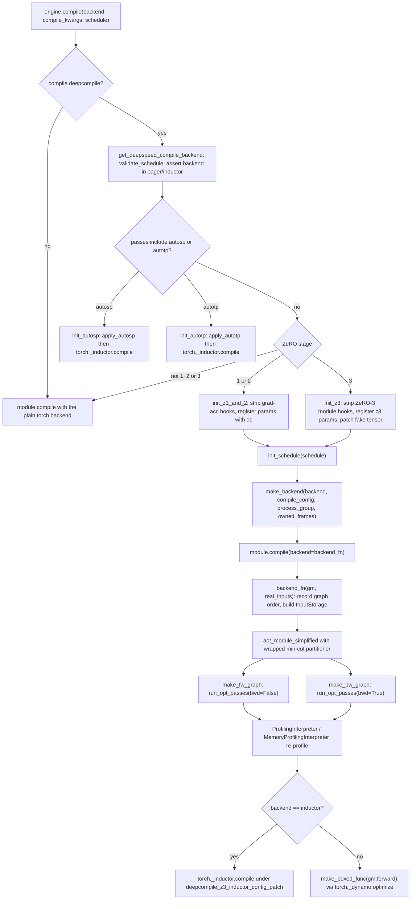

# DeepCompile

**What this covers.** The `deepspeed/compile/` subsystem: what it compiles, the
backend it hands to `torch.compile`, every module in the package and what it
does, the graph passes and their contracts, the `compile` config block, how the
passes replace the eager ZeRO hooks per stage, and the supporting helpers in
`deepspeed/runtime/compiler.py` and `deepspeed/runtime/torch_autocast.py`.

**Source of truth: upstream commit d70adc32** (DeepSpeed 0.20.1), as checked out
on this fork's `intro` branch. Line numbers drift; names are the durable part of
a citation.

Where a module's purpose could not be established from the code alone, this
document says so instead of guessing.

---

## 1. What DeepCompile is

DeepCompile is a `torch.compile` **backend factory**. Instead of letting Dynamo
hand the captured graph straight to Inductor, `deepspeed/compile/backend.py`
builds a `backend_fn` that:

1. receives the Dynamo `GraphModule` and the real inputs;
2. drives AOTAutograd so DeepSpeed sees the partitioned forward and backward
   graphs;
3. runs a *scheduled list of graph passes* that insert DeepSpeed's own
   communication and memory ops as graph nodes (all-gather, release, reduce,
   offload, reload);
4. profiles the rewritten graph for time and memory;
5. returns the graph for eager execution or Inductor compilation.

The ops it inserts are real custom ops under the `dc` namespace --
`torch.ops.dc.allgather_param`, `wait_allgather`, `release_param`,
`reduce_grad`, `free_tensors`, `offload_tensor`, `wait_offload`,
`reload_tensor`, `wait_reload`, `end_backward`
(`deepspeed/compile/inductor.py:315-330`) -- implemented by the `dc` native
extension built from `csrc/compile/*` by `DeepCompileBuilder`
(`op_builder/dc.py:9-23`).

Availability gate: `is_deepcompile_supported()` requires torch >= 2.6 **and**
`get_accelerator().device_name() == "cuda"` (`deepspeed/compile/util.py:29-30`).
The native handle is loaded lazily and cached by `get_deepcompile_handle()`
(`deepspeed/compile/util.py:48-52`), which calls `DeepCompileBuilder().load()`.

### Entry path from `engine.compile()`

`DeepSpeedEngine.compile` (`deepspeed/runtime/engine.py:5993`) is the single
entry point. Relevant steps:

| Step | Line |
| --- | --- |
| require `is_compile_supported()` (torch >= 2.1) | `deepspeed/runtime/engine.py:6007-6008`, `deepspeed/runtime/compiler.py:40-41` |
| pick `compile_mode`: `"autoep_non_moe"` or `"model"` | `:6010` |
| reject a second `compile()` with a different mode | `:6012-6016` |
| if `is_deepcompile_enabled()`, resolve the DeepCompile backend | `:6055-6056` |
| fall back to the plain torch backend when resolution returns `None` | `:6058-6061` |
| align hook state with `_set_deepcompile_active(...)` | `:6064` |
| `self.module.compile(**{**compile_kwargs, 'backend': backend})` | `:6068` |
| on any exception, `_deactivate_deepcompile()` and re-raise | `:6069-6073` |

`get_deepspeed_compile_backend` (`:5959-5991`) validates the user schedule
against the pass registry with `validate_schedule(schedule, opt_passes)`
(`:5971`), converts pass names to callables (`:5966-5972`), asserts
`backend in ['inductor', 'eager']` (`:5974`), rejects combining `autotp` with
`autosp` or the ZeRO passes (`:5976-5978`), and then dispatches to the AutoSP
backend, the AutoTP backend, or `get_deepcompile_backend` (`:5980-5989`).

`get_deepcompile_backend` (`:5933-5957`) is where the ZeRO coupling lives: if the
ZeRO stage is not 1, 2, or 3 it logs "Currently DeepCompile supports ZeRO stage
1, 2, or 3 only ... Falling back to the torch compiler" and returns `None`
(`:5937-5943`). It also implicitly enables `compile_config.offload_parameters`
when the ZeRO config offloads *both* optimizer and parameters to CPU
(`:5946-5950`). Then: stage 1 -> `init_z1_and_2(...)`, stage 2 ->
`init_z1_and_2(..., use_z2=True)`, stage 3 -> `init_z3(...)`
(`:5951-5956`).

If `compile.deepcompile` is true but `compile()` was never called, the forward
logs once: "DeepCompile is enabled but engine.compile() has not been called;
executing without DeepCompile until compile() runs."
(`deepspeed/runtime/engine.py:3098-3101`).

### Compile pipeline

---

## 2. Module map

### Core

| Module | Lines | What it does |
| --- | --- | --- |
| `__init__.py` | 6 | re-exports only `pad_tensors` from `util` |
| `backend.py` | 492 | `make_backend`, the pass schedule state machine, AOTAutograd wiring, `register_compile_pass` |
| `config.py` | 77 | `CompileConfig` pydantic model and the `PassName` literal |
| `constants.py` | 11 | AutoSP input/label/position key names (`AUTOSP_INPUT_ID_KEY`, `AUTOSP_LABEL_ID_KEY`, `AUTOSP_POSITION_ID_KEY`) |
| `util.py` | 631 | `is_deepcompile_supported`, `get_deepcompile_handle`, backward prologue/epilogue, node classification helpers (`is_comm_op`, `is_cast_op`, `get_no_copy_ops`, `get_last_uses`) |
| `fx.py` | 213 | FX graph surgery: `add_postprocess`, `add_args_process`, `move_primals_to_head`, `add_end_backward`, `add_free_activations`, `replace_reduce_outputs_with_none`, `is_impure_for_dce` |
| `graph_param.py` | 103 | `DSGraphParam` dataclass and `DSGraphParamManager`, which maps graph nodes to ZeRO parameters and builds the backward param/grad mapping (`:61`, `:86`) |
| `partitioner.py` | 109 | `get_wrapped_partitioner` wraps AOTAutograd's partitioner to record `num_fwd_outputs` per frame and, for ZeRO-3, force recomputation of parameter aliases (`:20`, `:89-109`) |
| `input_storage.py` | 192 | `InputStorage` + `TensorMetadata`: keeps the real forward inputs (or just their metadata) so `make_fw_graph` can re-run when it is called more than once per `backend_fn` call (`:26-33`) |
| `list_schedule.py` | 816 | node-list scheduling under a memory budget: `fast_free_schedule` (`:578`), `simple_prefetch` (`:170`), `list_schedule` (`:106`), `SchedulerMemoryBudget`, `allgather_allocation_bytes` (`:400`), `max_possible_gathered_bytes` (`:422`) |
| `inductor.py` | 335 | Inductor integration: `register_custom_ops` (`:228`) registers the `dc` ops as non-reusing fallbacks, `patch_create_aot_dispatcher_function` (`:185`) injects the fw/bw compilers, `deepcompile_z3_inductor_config_patch` (`:37`) |
| `patch_compiled_func.py` | 144 | patches the compiled autograd function so the backward's real inputs can be captured per frame (`:81`, `:96`, `:119`) |
| `patch_fake_tensor.py` | 135 | wraps `wrap_to_fake_tensor_and_record` so a *released* ZeRO-3 parameter traces with its full `ds_shape` while Dynamo's tensor-match guards see the stable released representation (`:23-36`, `:78-100`) |
| `z3_eager_fallback.py` | 279 | `DeepCompileZ3EagerFallback` -- "Track eager-only ZeRO-3 gathers and restore partitioned state around compiled forwards" (`:56-57`); `deepcompile_z3_forward_context` (`:46`) |
| `init_z1_and_2.py` | 209 | stage 1/2 setup + default schedule |
| `init_z3.py` | 224 | stage 3 setup + default schedule |
| `init_tp.py` | 62 | AutoTP backend (`init_autotp`, `:47`) |
| `init_sp.py` | 23 | AutoSP backend (`init_autosp`, `:10`) |

### Passes (`deepspeed/compile/passes/`)

| Module | Lines | Registered name(s) | What the pass does |
| --- | --- | --- | --- |
| `contract.py` | 121 | -- | `PassContract` (`:18`) with `provides` / `requires` / `conflicts_with` / `phase`, the `_pass_contracts` registry (`:41`), and `validate_schedule` (`:77`) |
| `zero3_compile.py` | 542 | `zero3_compile` (`:27`) | inserts `allgather_param` + `wait_allgather` before each parameter use and `release_param` after its last use, `reduce_grad` in the backward, then profiles and schedules the result (`:280-333`, `:335`, `:415`, `:475`) |
| `zero_1_and_2_compile.py` | 77 | `zero1_compile`, `zero2_compile` (`:16-17`) | forward only registers the graph with the native handle (`register_graph_z1` / `register_graph_z2`, `:30-33`); backward appends a `reduce_grad` node per parameter gradient and an `end_backward` (`:36-63`) |
| `prefetch.py` | 163 | `prefetch` (`:19`) | reorders the all-gathers `zero3_compile` emitted, using a bandwidth predictor from `profilers/comm_profile.py`; tunables `FUSE_FACTOR=0.8`, `MARGIN=0.1`, `MAX_FUSE_SIZE=1e9`, `MAX_BUFFERED_SIZE=4e9` (`:23-26`) |
| `selective_gather.py` | 226 | `selective_gather` (`:21`) | chooses which gathered parameters to keep resident rather than re-gathering, within `MEM_MARGIN=0.1` (`:27`) of the observed peak; entry point at `:78` |
| `offload_parameters.py` | 60 | `offload_parameters` (`:14`) | rewrites `zero3_compile`'s all-gather nodes into `offload_parameter` / `reload_parameter` pairs (`:19`, `:33`, `:51`) |
| `offload_adam_states.py` | 617 | `offload_adam_states`, `offload_adam_states_sync`, `offload_adam_states_for_init` (`:35-37`) | moves fp32 master params and Adam moments between device and pinned host memory around the compiled graph (`:584`, `:591`, `:599`) |
| `offload_activation.py` | 842 | `offload_activation`, `offload_activation_floor` (`:30-31`) | the floor pass offloads saved activations in the forward and reloads them in the backward; the planner pass then gives memory back against a measured floor (`:811`, `:828`) |
| `sp_compile.py` | 680 | -- (driven by `init_sp`) | AutoSP: shards the sequence dimension inside the graph, inserting `all_to_all` and sequence-shard nodes (`apply_autosp`, `:635`) |
| `tp_compile.py` | 267 | -- (driven by `init_tp`) | AutoTP: emits the tensor-parallel collectives as graph nodes using `torch.ops.autotp.copy_to_tp_region` / `reduce_from_tp_region` / `gather_from_tp_region` (`:13-15`, `apply_autotp`, `:263`) |
| `long_context_checkpointing.py` | 103 | -- | splices a sequence-aware `should_ban_recomputation` into `torch._functorch.partitioners.solve_min_cut`; registered by `register_long_context_checkpointing` (`:74`) and used by AutoSP (`deepspeed/compile/init_sp.py:12`) |

`passes/__init__.py` also defines a `run_opt_passes` function (`:11-48`) with a
different signature from `backend.run_opt_passes`. The one the backend actually
calls is `deepspeed/compile/backend.py:257`; the `passes/__init__.py` copy takes
`(nz3, graph_index, graph_id, gm, ...)` and `(opt_pass_fn, mem_budget)` tuples,
which is not the shape `make_backend` produces. **Its current call site could not
be established from the code in this package**; treat it as legacy until proven
otherwise.

### Profilers and custom ops

| Module | Lines | What it does |
| --- | --- | --- |
| `profilers/__init__.py` | 31 | the `ProfilingResult` dataclass: fwd/bwd graph, `needs_backward`, `num_fwd_outputs`, per-node memory and time records, `param_indices`, `process_group` |
| `profilers/graph_profile.py` | 515 | `ProfilingInterpreter` (`:204`) times each node; `MemoryProfilingInterpreter` (`:421`) records allocation/delta/peak per node; `is_profile_incomplete` (`:81`) and the backfill/abort helpers keep partial profiles from being treated as valid |
| `profilers/comm_profile.py` | 170 | measures all-gather bandwidth (`run_all_gather`, `:79`) and returns an interpolating `create_predictor()` (`:125`) used by the prefetch pass |
| `custom_ops/all_to_all.py` | -- | the `all_to_all` custom op used by AutoSP |
| `custom_ops/tp_collectives.py` | -- | `copy_to_tp_region`, `gather_from_tp_region`, `reduce_from_tp_region` |
| `custom_ops/sp_dp_registry.py` | -- | SP/DP mesh bookkeeping, incl. `extract_mesh_size` |
| `custom_ops/sp_compat.py` | -- | `_check_autosp_compatibility` preflight |

---

## 3. `backend.py`: the pass state machine

### Module-global state

`backend.py` keeps the schedule and per-graph results in module globals
(`deepspeed/compile/backend.py:38-79`): `remaining_schedule`, `next_passes`,
`param_manager`, `graph_order_with_frame_id` (a `GraphOrder`, `:46`),
`frames_needing_bwd`, `frames_partitioned`, `profiling_results`,
`opt_pass_times`, and the pass registry `opt_passes`.

`register_compile_pass(name, opt_pass_fn, contract=None)` (`:101-106`) puts the
callable in `opt_passes` and registers the contract under the same name;
`contract=None` *clears* any contract previously registered for that name. The
engine registers the built-in passes at construction time, guarded by
`is_deepcompile_supported()` (`deepspeed/runtime/engine.py:734-756`), and
`DeepSpeedEngine.register_compile_pass` (`:6143-6145`) forwards to it so users
can add their own.

### Schedule advance

`init_schedule(schedule)` (`:109-118`) validates the `[(step, [passes]), ...]`
shape and stores it as a `deque`. `launch_compile_passes(global_steps, owned_frames=None)`
(`:121-135`) fires when `global_steps == remaining_schedule[0][0]`, pops that
entry into `next_passes`, and then **resets everything**:
`torch._dynamo.reset()`, `get_deepcompile_handle().reset()`, clears the graph
order, profiling results, and param managers, calls
`cleanup_compiled_backward_state(owned_frames=...)`, and clears
`frames_partitioned`.

This reset is why `validate_schedule` checks each step independently: "DeepCompile
resets Dynamo and recompiles from the original graph at every launched step ...
so capabilities a pass provides in one step do not carry over to later steps"
(`deepspeed/compile/passes/contract.py:90-93`). It is also why the default
schedules repeat `add_z3_gather_release` in the later step rather than relying on
the earlier one (`deepspeed/compile/init_z3.py:171-174`).

`launch_compile_passes` is bound onto the engine as a partial carrying the
engine's own `owned_frames` set (`deepspeed/compile/init_z3.py:206-207`,
`init_z1_and_2.py:204-205`), and the engine calls it at the top of `forward`,
outside the forward prologue, because "the compiler compiles hooks including the
forward prologue" (`deepspeed/runtime/engine.py:3103-3105`).

### `make_backend` and `backend_fn`

`make_backend(backend, compile_config, compile_kwargs, process_group, owned_frames)`
(`:311`) first calls `register_custom_ops()` (`:313`) and resolves
`free_activation = compile_config.free_activation and not is_backend_inductor(backend)`
(`:317`) -- free-activation is eager-only.

Inside `backend_fn(gm, real_inputs)` (`:323`):

* `graph_id = id(gm.graph)` and `frame_id = gm.meta["dynamo_compile_id"].frame_id`
  (`:324`, `:334`); `frame_key = (owner_token, frame_id)` keys per-engine state.
* `z3_partition = any(hasattr(v, "ds_id") for v in real_inputs)` (`:338`) -- this
  is how the backend detects ZeRO-3 parameters. For ZeRO-3, `param_indices` are
  `(index, ds_id, ds_shape)`; otherwise they are `(index, param_id, shape)` and
  every `nn.Parameter` input must carry `param_id` (`:339-352`).
* An `InputStorage` is created per graph and the real inputs are stored, because
  `backend_fn` is called once while `make_fw_graph` may be called many times
  (`:354-363`).
* `make_fw_graph` (`:370-410`) determines `needs_backward` from
  `frame_id in frames_partitioned` (`:374`) -- the comment at `:326-333` explains
  that replicating AOTAutograd's own backward determination is too costly, so the
  partitioner's behaviour is used as the signal. It then patches the compiled
  autograd function on the first frame that needs a backward (`:379-384`),
  materialises symbolic inputs (`set_example_values_to_symints`, `:181`), builds
  the `DSGraphParamManager` (`:389`), and calls `run_opt_passes(..., bwd=False)`.
* `make_bw_graph` (`:412-459`) pops the recorded backward inputs for the frame
  (`pop_backward_input`, `:421`); when Dynamo called the backward compiler ahead
  of time (symints saved for backward), it fabricates dummy inputs for profiling
  (`:424-431`). After the passes it optionally adds `free_activations` nodes
  (`:445-449`) and releases the frame's compiled-backward state (`:451`).
* Backend selection (`:461-490`): for `"eager"` it calls `aot_module_simplified`
  with the wrapped partitioner and `make_boxed_func(gm.forward)` compilers, then
  `torch._dynamo.optimize(**compile_kwargs)`; for `"inductor"` it installs the
  compilers through `patch_create_aot_dispatcher_function`, calls
  `torch._inductor.compile` under `deepcompile_z3_inductor_config_patch`, and
  always restores the patch in a `finally` because `AotAutograd.__init__` is
  process-global (`:485-488`). Any other backend raises
  `ValueError(f"Unsupported backend {backend}")` (`:490`).

`run_opt_passes` (`:257-308`) synchronises, GCs, and empties the cache around
each pass, then per pass: calls `opt_pass_fn(gm, graph_id, graph_order, profiling_results, create_inputs_fn, mem_budget, param_manager, bwd)`;
if it returned a new module, lints and recompiles the graph, and re-profiles
memory -- but only when the operator profile is complete, since "Re-profiling an
already incomplete graph would turn synthetic backfilled metadata into a
seemingly valid memory profile" (`:285-291`). Completeness is agreed across ranks
with a `ReduceOp.MIN` all-reduce (`_sync_memory_profile_complete`, `:161-170`).

Note `mem_budget=.0` is passed and marked `# unused` at both call sites
(`:399`, `:439`); the memory budget actually used by the ZeRO-3 scheduling lives
in `list_schedule.SchedulerMemoryBudget`, built inside `zero3_compile`.

---

## 4. The `compile` config block

`CompileConfig` (`deepspeed/compile/config.py:12`) is a `DeepSpeedConfigModel`,
parsed as `self.compile_config = CompileConfig(**param_dict.get('compile', {}))`
(`deepspeed/runtime/config.py:588`).

| Key | Type / default | Meaning (from the field docstring) |
| --- | --- | --- |
| `deepcompile` | `bool = False` | turn DeepCompile on/off (`:15`) |
| `autoep_non_moe` | `bool = False` | compile the callable parents of AutoEP layers while keeping AutoEP eager (`:18`) |
| `free_activation` | `bool = False` | eagerly free activations (`:21`) |
| `free_activation_threshold` | `int = 10 * 1024 * 1024` | byte threshold above which activations are eagerly freed (`:24`) |
| `offload_activation` | `bool = False` | move saved activations to pinned host memory and bring each back just before the backward reads it; only tensors >= 5MB with a fixed shape, and only as many as the budget requires; mutually exclusive with `offload_parameters` and `offload_opt_states` (`:27-32`) |
| `offload_activation_pin_memory` | `bool = True` | pin the host buffers used for activation offload (`:34-37`) |
| `offload_opt_states` | `bool = False` | offload fp32 master params and Adam moments during fwd/bwd and reload for the step; designed for `gradient_accumulation_steps=1` (`:39-44`) |
| `double_buffer` | `bool = True` | double buffering (`:46`) |
| `symmetric_memory` | `bool = False` | enable symmetric memory for the DP group (`:49`) |
| `debug_log` | `bool = False` | graph dumping and verbose pass logging (`:52`) |
| `offload_parameters` | `bool = False` | parameter offloading (`:55`) |
| `sync_before_reduce` | `bool = False` | sync before reduce (`:58`) |
| `sync_after_reduce` | `bool = False` | sync after reduce (`:61`) |
| `sync_before_allgather` | `bool = False` | sync before allgather (`:64`) |
| `sync_after_allgather` | `bool = False` | sync after allgather (`:67`) |
| `keep_int_input_tensors` | `bool = True` | keep real values for int tensors in `InputStorage` (`:70`) |
| `keep_all_input_tensors` | `bool = False` | keep real values for all input tensors in `InputStorage` (`:73`) |
| `passes` | `Optional[List[PassName]] = None` | compose optimizations; `PassName = Literal["z1", "z3", "autosp", "autotp"]` (`:9`, `:76`) |

`passes` is read by the engine predicates
`compile_zero_optimization_stage()` (`"z1"` or `"z3"` present,
`deepspeed/runtime/engine.py:1642-1644`), `compile_autosp()` (`:1646-1648`),
`compile_autotp()` (`:1650-1652`), and `uses_parallelization_pass_only()`
(`:1654-1656`), which is what gates whether DeepCompile takes over gradient
reduction at all.

Config-level rejections involving this block:

| Rule | Site |
| --- | --- |
| `gradient_allreduce_op="sum"` with `compile.deepcompile` | `deepspeed/runtime/config.py:699-700` |
| `autoep_non_moe=True` combined with DeepCompile | `deepspeed/runtime/engine.py:6024-6026` |
| `autotp` combined with `autosp` or the ZeRO passes | `deepspeed/runtime/engine.py:5976-5978` |
| `offload_opt_states` with ZeRO `offload_optimizer` on cpu/nvme | `deepspeed/compile/init_z3.py:93-98` |
| `offload_activation` with `offload_parameters` or `offload_opt_states` | `deepspeed/compile/init_z3.py:100-104` |
| `offload_parameters` and `offload_opt_states` together | `deepspeed/compile/init_z3.py:147-151` |
| a user schedule containing `add_z3_gather_release` under ZeRO 1/2 | `deepspeed/compile/init_z1_and_2.py:196-200` |
| compiled autograd with DeepCompile -- warned and disabled, not an error | `deepspeed/runtime/engine.py:6078-6083` |

---

## 5. Interaction with ZeRO

DeepCompile replaces the eager ZeRO hooks with graph nodes. The handover is done
in the `init_*` functions before `make_backend` is called.

### ZeRO stage 1 and 2 -- `init_z1_and_2`

`init_z1_and_2(engine, backend, compile_config, compile_kwargs, schedule=None, use_z2=False)`
(`deepspeed/compile/init_z1_and_2.py:100`):

1. `optimizer.contiguous_gradients = False` to avoid an unnecessary buffer
   (`:103`).
2. Remove and clear every `optimizer._grad_acc_hooks` (`:104-106`) -- the eager
   per-parameter gradient-accumulation hooks that normally drive reduction.
3. `dc = engine._initialize_deepcompile_native(compile_config)` (`:108`), which
   calls `dc.init(self.data_parallel_group, compile_config, self.zero_reduce_bucket_size())`
   (`deepspeed/runtime/engine.py:6085-6089`).
4. Register every parameter with the native handle via `dc.register_param(param_id, shape, p, grad_buffer, offset)`.
   For stage 2 the grad buffers are built from the optimizer's flat partition
   views up front (`:110-134`); for stage 1 they start empty and are filled per
   accumulation boundary (`:141-187`).
5. Install a pre-backward hook that publishes the grad buffers as
   `optimizer.averaged_gradients`: `set_z2_grad_buffer` (`:136-139`) or
   `set_z1_grad_buffer` (`:161-187`). The stage-1 variant releases the buffers on
   a non-boundary micro-step and rebuilds them on the boundary.
6. Default schedule: a single step 0 entry with `add_z2_reduce` or
   `add_z1_reduce` (`:189-194`).

### ZeRO stage 3 -- `init_z3`

`init_z3(engine, backend, compile_config, compile_kwargs, schedule=None)`
(`deepspeed/compile/init_z3.py:87`), in order:

1. Validate the offload combinations *before* touching the engine, because
   everything below removes hooks and unpatches modules (`:89-104`).
2. Clear `optimizer.ipg_buckets` and empty the cache (`:109-111`).
3. `engine._initialize_deepcompile_native(compile_config)` (`:113`).
4. Install `DeepCompileZ3EagerFallback` and register its `complete_backward` as
   a post-backward hook (`:115-116`).
5. **Remove the ZeRO-3 hooks:** `optimizer.parameter_offload._remove_module_hooks()`
   plus every `optimizer._grad_acc_hooks` (`:118-123`).
6. **Unpatch `torch.nn.functional.linear`**, restoring
   `InsertPostInitMethodToModuleSubClasses.linear_bk` if it was patched
   (`:126-127`).
7. Optionally `dist.enable_symm_mem_for_group(engine.data_parallel_group.group_name)`
   (`:129-131`).
8. For every parameter: set `p.ds_persist = False` (persistent params are
   disabled under DeepCompile) and
   `dc.register_z3_param(p.ds_id, p.ds_shape, p.ds_tensor, grad_buffer, p.ds_persist, expected_grad_dtype)`
   (`:133-144`). Frozen params keep an empty buffer because no reduce op is
   scheduled for a param without a grad node (`:135-137`).
9. Choose the default schedule (`:146-184`) -- see the table below.
10. Add a pre-backward hook refilling `optimizer.averaged_gradients` from the
    stage-3 grad partition map (`:190-197`).
11. `patch_fake_tensor()` and `torch._inductor.config.size_asserts = False`
    (`:209-210`), then acquire process-wide ownership of the Dynamo flags
    `force_parameter_static_shapes` and `force_nn_module_property_static_shapes`,
    setting both to `False` (`:25-26`, `:30-72`, `:216-218`).

Default ZeRO-3 schedules, with `WARMUP = 5` (`deepspeed/compile/init_z3.py:22`):

| Condition | Step 0 | Step `WARMUP` |
| --- | --- | --- |
| `offload_parameters` | `add_z3_gather_release`, `offload_parameter_fwd` | -- |
| `offload_opt_states` | `add_z3_gather_release` | step 1: `offload_adam_states_for_init`, `add_z3_gather_release`, `move_opt_states` |
| `offload_activation` | `add_z3_gather_release`, `offload_activation_floor` | `add_z3_gather_release`, `offload_activation_floor`, `offload_activation` |
| default | `add_z3_gather_release` | `add_z3_gather_release`, `schedule_prefetch`, `selective_gather` |

The comments explain the staging: the activation-offload *floor* pass must run at
step 0 because "a job that only fits with its activations moved out never reaches
WARMUP otherwise", while the planner runs at `WARMUP` because it only gives
memory back and the floor it needs cannot be measured at step 0
(`:164-174`). The opt-state offload engages at step 1 because states only exist
after step 0's optimizer step (`:158-160`).

### Where the hooks sit

```mermaid
flowchart TD
    subgraph EAGER["Eager ZeRO (DeepCompile inactive)"]
        E1["engine module_forward_pre_hook / post_hook"] --> E2["ZeRO-3 parameter_offload module hooks: pre-fetch, gather, release"]
        E2 --> E3["per-parameter _grad_acc_hooks drive reduce_scatter"]
        E3 --> E4["engine.allreduce_gradients()"]
    end
    subgraph DC["DeepCompile active"]
        D1["_set_deepcompile_active(True) removes both engine forward hooks"] --> D2["init_z3 removes parameter_offload module hooks and _grad_acc_hooks"]
        D2 --> D3["zero3_compile inserts dc.allgather_param / wait_allgather / release_param / reduce_grad as graph nodes"]
        D3 --> D4["engine.allreduce_gradients() returns immediately"]
        D4 --> D5["backward_prologue calls deepcompile_backward_prologue; epilogue calls deepcompile_backward_epilogue"]
        D5 --> D6["DeepCompileZ3EagerFallback restores partitioned state around any eager-only gather"]
    end
```

Citations for the DeepCompile column: engine forward hooks removed in
`_set_deepcompile_active` (`deepspeed/runtime/engine.py:6112-6118`) and
reinstalled when deactivating (`:6119-6123`); ZeRO-3 hooks removed in
`deepspeed/compile/init_z3.py:118-123`; node insertion in
`deepspeed/compile/passes/zero3_compile.py:280-333`;
`allreduce_gradients` early-returns under
`is_deepcompile_active() and not uses_parallelization_pass_only()`
(`deepspeed/runtime/engine.py:3171-3175`); prologue/epilogue calls at `:3251-3252`
and `:3286-3287`, implemented in `deepspeed/compile/util.py:72-83` where
`deepcompile_backward_prologue` runs the registered pre-backward hooks and then
`dc.start_backward(is_gradient_accumulation_boundary)`; the forward runs inside
`deepcompile_z3_forward_context(self)` (`:3107`).

Teardown mirrors setup: `_deactivate_deepcompile` (`:6097-6101`) calls
`_cleanup_deepcompile_native` (`dc.cleanup()`, `:6091-6095`) and then
`_set_deepcompile_active(False)`, which also releases the compiled-backward state
(`:6127-6131`) and restores the borrowed Dynamo config (`:6133-6137`).

### AutoSP and AutoTP

These two are parallelization passes rather than ZeRO passes, and they return
their own backend functions:

* `init_autosp(config)` (`deepspeed/compile/init_sp.py:10-23`) runs
  `_check_autosp_compatibility()`, reads the SP/DP mesh sizes from the config
  dict with `extract_mesh_size`, registers long-context checkpointing, and
  returns a backend that calls `apply_autosp(gm, real_inputs, debug=False, sp_size=..., dp_size=...)`
  then `torch._inductor.compile`. `deepspeed.initialize` separately requires
  `compile.deepcompile` for AutoSP and rejects ZeRO stage >= 2
  (`deepspeed/__init__.py:543-555`).
* `init_autotp(model)` (`deepspeed/compile/init_tp.py:47-62`) requires torch >=
  2.6 (`AUTOTP_MIN_TORCH_VERSION`, `:14`), rejects the transformers versions in
  `BROKEN_TRANSFORMERS_MOE_VERSIONS = ("5.8.0", "5.10.1")` for models whose
  experts mutate the routing tensor in place (`:15`, `:25-45`), suppresses the
  module-level collectives with `defer_collectives_to_compiler(model)`, and
  returns a backend that calls `apply_autotp` then `torch._inductor.compile`. The
  AutoTP path also forces `compile_kwargs['fullgraph'] = True`
  (`deepspeed/runtime/engine.py:5928`) and drops the TP dataloader consistency
  check with a warning (`:5921-5926`).

---

## 6. `deepspeed/runtime/compiler.py`

This module is DeepSpeed's thin, import-cheap wrapper around the torch compiler;
it is **not** DeepCompile, and is used throughout the runtime independently.

| Symbol | Line | Purpose |
| --- | --- | --- |
| `is_compile_supported()` | `:40` | `required_torch_version(min_version=2.1)` |
| `disable(func)` | `:44` | `torch.compiler.disable` when supported, else identity |
| `lazy_disable(func)` | `:50` | `torch._disable_dynamo` from torch 2.4, which imports `torch._dynamo` on first call rather than at decoration, keeping `import deepspeed` fast |
| `enable(min_version=None)` | `:58` | decorator factory that keeps a function compiled only above a torch version |
| `is_compiling()` | `:100` | `torch.compiler.is_compiling` with two import fallbacks (`:18-25`) |
| `compiled_autograd(enabled, kwargs)` | `:104` | context manager installing `torch._dynamo.compiled_autograd` with a `torch.compile` compiler built on the accelerator's compile backend |
| `compile()` | `:125` | returns `torch.compile` or a no-op decorator |
| `compile_autoep_non_moe_regions(model, backend, compile_kwargs)` | `:132` | compiles the callable parents of `AutoEPMoELayer`s while wrapping each MoE layer's `forward` in `disable(...)`; requires `fullgraph=False` and `dynamic=False`, and rolls every change back on any exception (`:142-187`) |

`deepspeed/comm/torch.py:52-55` uses `compiler.disable` for its collectives on
torch < 2.3, which is why the comm layer imports this module.

## 7. `deepspeed/runtime/torch_autocast.py`

Relevant to DeepCompile only through the forward: the engine's forward wraps the
module call in `autocast_if_enabled(self)` (`deepspeed/runtime/engine.py:3107`,
helper at `deepspeed/runtime/torch_autocast.py:94`) in the same `with` statement
as `deepcompile_z3_forward_context`, so autocast and DeepCompile compose at the
forward boundary rather than inside the compiled graph.

The module's own surface: `init_autocast_params(engine, dtype, ...)` (`:35`)
annotates parameters with a `comm_dtype` attribute
(`PARAM_COMM_DTYPE_ATTR_NAME`, `:22`), and `has_comm_dtype` / `get_comm_dtype` /
`get_all_comm_dtypes` / `sort_dtypes` (`:77-92`) let the reduction paths group
parameters by communication dtype. `LOWER_PRECISION_SAFE_MODULES` (`:15`) is the
default module list, exposed through
`get_default_autocast_lower_precision_modules()` (`:69`). The config side is
`torch_autocast.enabled` / `dtype` / `lower_precision_safe_modules`
(`deepspeed/runtime/config.py:179-205`); note that
`_REMOVED_TOP_LEVEL_CONFIG_KEYS` points users of the removed `amp` block at
`torch_autocast` (`deepspeed/runtime/config.py:88-90`).

---

## 8. Pass contracts

`PassContract` (`deepspeed/compile/passes/contract.py:18`) has four fields:
`provides`, `requires`, `conflicts_with` (all `FrozenSet[str]`) and `phase`
(`"both"` by default, described as informational for now) at
`deepspeed/compile/passes/contract.py:31-34`. Two
capability tags exist:

| Tag | Meaning | Defined |
| --- | --- | --- |
| `CAP_Z3_GATHER_RELEASE` | the ZeRO-3 all-gather/release nodes are in the graph | `deepspeed/compile/passes/contract.py:11` |
| `CAP_OPT_STATES_EVICTED` | optimizer state is off the accelerator, so the following profile measures memory without it | `deepspeed/compile/passes/contract.py:14` |

Registered contracts:

| Pass | Contract |
| --- | --- |
| `zero3_compile` | `provides={CAP_Z3_GATHER_RELEASE}` (`passes/zero3_compile.py:29`) |
| `prefetch` | `requires={CAP_Z3_GATHER_RELEASE}` (`passes/prefetch.py:21`) |
| `selective_gather` | `requires={CAP_Z3_GATHER_RELEASE}` (`passes/selective_gather.py:23`) |
| `offload_parameters` | `requires={CAP_Z3_GATHER_RELEASE}` (`passes/offload_parameters.py:16`) |
| `zero1_compile` | `conflicts_with={"zero3_compile"}` (`passes/zero_1_and_2_compile.py:19`) |
| `zero2_compile` | `conflicts_with={"zero3_compile", "zero1_compile"}` (`passes/zero_1_and_2_compile.py:20`) |
| `offload_adam_states` | `requires={CAP_OPT_STATES_EVICTED}`, plus conflicts (`passes/offload_adam_states.py:44`) |
| `offload_adam_states_sync` | conflicts incl. `offload_adam_states` (`passes/offload_adam_states.py:48`) |
| `offload_adam_states_for_init` | `provides={CAP_OPT_STATES_EVICTED}` (`passes/offload_adam_states.py:49`) |
| `offload_activation`, `offload_activation_floor` | `PassContract()` -- unconstrained (`passes/offload_activation.py:34`) |

`validate_schedule(schedule, name_registry)`
(`deepspeed/compile/passes/contract.py:77-121`) walks each step independently,
resolving a raw callable back to its registered name by object identity and
raising `PassContractError` when a callable is registered under multiple names
(`:60-74`). A pass with no registered contract is unconstrained but still visible
to other passes' conflicts (`:85-87`). It raises on the first unmet requirement
(`:107-109`) or the first conflict, treated symmetrically so either pass may
declare the incompatibility (`:112-119`).

---

## 9. Practical notes

* **The gate is narrow.** `is_deepcompile_supported()` is torch >= 2.6 and CUDA
  only (`deepspeed/compile/util.py:29-30`). On any other accelerator the engine
  never registers the built-in passes
  (`deepspeed/runtime/engine.py:734`) and `compile()` silently takes the plain
  torch path.
* **A bad combination falls back rather than failing**, in exactly one case: a
  ZeRO stage outside 1/2/3 logs and returns `None`, after which `compile()` uses
  the user's original backend (`deepspeed/runtime/engine.py:5937-5943`,
  `:6058-6061`). Everything else raises.
* **Every init path mutates the optimizer and the module.** Validate before
  mutating, as `init_z3` does explicitly (`deepspeed/compile/init_z3.py:89-92`),
  or a failure leaves a half-converted engine.
* **The compiled backward state is process-global.** `frames_needing_bwd`,
  `backward_inputs`, and the patched autograd function live in module globals
  (`deepspeed/compile/backend.py:72`,
  `deepspeed/compile/patch_compiled_func.py:11-17`), which is why the engine
  tracks `_deepcompile_owned_frames` and releases exactly its own frames
  (`deepspeed/runtime/engine.py:6127-6131`).
* **Timing data is available** through `engine.get_compile_time()`, which returns
  `opt_pass_times` -- a list of `(phase, graph_index, graph_id, seconds)` tuples
  (`deepspeed/runtime/engine.py:6139-6141`, appended at
  `deepspeed/compile/backend.py:405`, `:457`).
* **Tests:** `tests/unit/compile/` holds the CPU-runnable contract tests
  (`test_pass_contract.py`, `test_backend.py`, `test_inductor_aot_kwargs.py`,
  `test_tp_compile.py`, `test_zero3_grad_dtype.py`); the GPU-dependent suites are
  in `tests/unit/v1/compile/` (`test_compile_zero.py`, `test_compile_autosp.py`,
  `test_offload_activation.py`, `test_offload_opt_states.py`,
  `test_selective_gather.py`, `test_graph_profile.py`, `test_list_schedule.py`,
  `test_partitioner.py`, `test_z3_eager_fallback.py`, `test_compile_fx.py`). See
  `12-testing-and-ci.md`.
