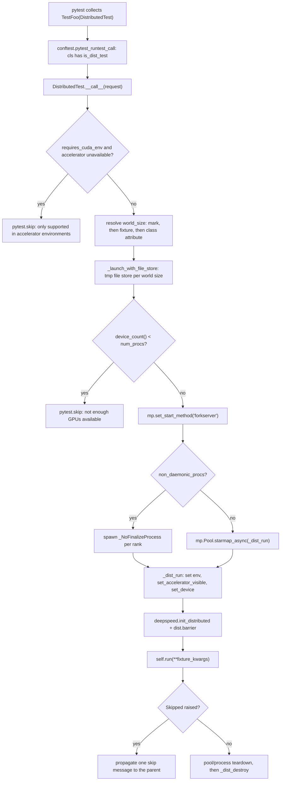
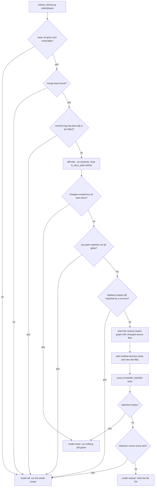
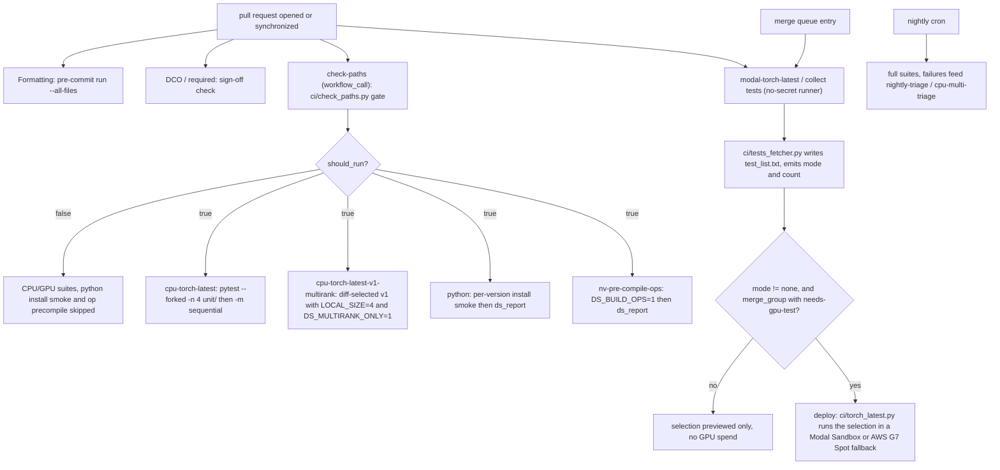

# Testing and CI

**What this covers.** How the test tree is laid out, including the
`tests/unit/v1/` split; the `DistributedTest` / `DistributedFixture` harness and
exactly how a distributed test is launched; the commands to run tests locally and
which suites run CPU-only; the diff-based CI test selector in
`ci/tests_fetcher.py`; the workflow set in `.github/workflows/` grouped by
purpose; and the pre-commit hook set with the exact command to check changed
files.

**Source of truth: upstream commit d70adc32** (DeepSpeed 0.20.1), as checked out
on this fork's `intro` branch. Line numbers drift; names are the durable part of
a citation.

---

## 1. Test layout

`CONTRIBUTING.md:30-34` states the split: "DeepSpeed tracks two types of tests:
unit tests and more costly model convergence tests. ... Unit tests are found in
`tests/unit/` and the model convergence tests are found in `tests/model/`."

| Path | Contents |
| --- | --- |
| `tests/conftest.py` | global pytest configuration, the `DistributedTest` runtest hook, the `DS_MULTIRANK_ONLY` collection gate |
| `tests/pytest.ini` | marker registry and the default `-m` deselection |
| `tests/unit/` | the unit suite, plus shared helpers `common.py`, `util.py`, `simple_model.py`, `alexnet_model.py`, `megatron_model.py`, `modeling.py`, `modelingpreln.py`, `multi_output_model.py` |
| `tests/unit/v1/` | the subset a GPU CI workflow runs; see below |
| `tests/model/` | model convergence drivers: `run_sanity_check.py`, `BingBertSquad/`, `Megatron_GPT2/` |
| `tests/accelerator/` | standalone `test_ds_init.py` with its own `ds_config.json` |
| `tests/benchmarks/`, `tests/perf/` | performance scripts, not part of the unit run |
| `tests/integration/`, `tests/lightning/`, `tests/hybrid_engine/`, `tests/torch_compile/`, `tests/small_model_debugging/` | out-of-suite drivers and debugging scripts |

Subdirectories of `tests/unit/`: `accelerator`, `autotuning`, `checkpoint`,
`comm`, `compile`, `hybrid_engine`, `inference`, `launcher`, `linear`,
`module_inject`, `monitor`, `ops`, `pipe`, `profiling`, `runtime`, `sequence`,
`ulysses_alst`, `utils`, and `v1`.

Subdirectories of `tests/unit/v1/`: `accelerator`, `autotp`, `compile`,
`half_precision`, `models`, `moe`, `multimodal`, `nvme`, `ops`, `pin_memory`,
`runtime`, `sequence_parallelism`, `zero`, plus the top-level
`test_engine_log_level.py` and `test_hybrid_engine_rollout_v1.py`.

### Why `v1` exists

`tests/unit/v1/` is a **scope**, not a different kind of test. It is the set the
diff-based GPU selector operates over: `WorkflowConfig(name="modal-torch-latest", test_scopes=("tests/unit/v1", ))`
(`ci/tests_fetcher.py:93-98`) and the same scope for
`cpu-torch-latest-v1-multirank` (`ci/tests_fetcher.py:101-106`). The remaining
`tests/unit/` subdirectories are covered by the CPU workflows, which run
`unit/` (`.github/workflows/cpu-torch-latest.yml:256`) or
`unit/ --ignore=unit/v1` (`.github/workflows/cpu-torch-multi-latest.yml:272`).

### `tests/pytest.ini`

`addopts` deselects a long list of markers by default:

```
-m "not sequential and not nightly and not inference and not seq_inference
    and not inference_ops and not inference_v2 and not inference_v2_ops
    and not stable_diffusion and not evaluation"
```

Registered markers (`tests/pytest.ini`): `sequential`, `inference`,
`inference_ops`, `inference_v2`, `inference_v2_ops`, `seq_inference`, `nightly`,
`world_size`, `stable_diffusion`, `evaluation`. So a plain
`pytest --forked tests/unit/` runs neither the inference suites nor the
`sequential` tests; CI runs the latter in a second invocation with
`-m 'sequential'` (`.github/workflows/cpu-torch-latest.yml:257`).

### `tests/conftest.py`

| Hook | What it does |
| --- | --- |
| module scope | pops `TORCH_ALLOW_TF32_CUBLAS_OVERRIDE` and disables TF32 on matmul and cuDNN, because correctness tests compare independent sharding/offload paths and need IEEE fp32 |
| module scope | sets `PROTOCOL_BUFFERS_PYTHON_IMPLEMENTATION=python` for T5 inference tests, and inserts the repo root on `sys.path` so multiple checkouts work without reinstalling |
| `pytest_configure` | forces `--color=yes` unless an explicit `--color` was given (the nightlies pass `--color=no`), and turns on `durations`, `durations_min=1`, `verbose` |
| `pytest_addoption` | adds `--torch_ver` and `--cuda_ver` |
| `check_environment` (session, autouse) | warns when `--torch_ver`/`--cuda_ver` are absent, and `pytest.exit(..., returncode=2)` on a mismatch |
| `pytest_collection_modifyitems` | the `DS_MULTIRANK_ONLY=1` gate: deselects every item that is not a `DistributedTest` with `world_size > 1`, honouring a `world_size` mark over the class attribute |
| `pytest_runtest_call` (tryfirst) | for a class with `is_dist_test`, instantiates it and calls it with the pytest request, then stubs `item.runtest` so the test does not run twice |
| `pytest_runtest_teardown` | closes the cached process pools after the last test of a `reuse_dist_env` class |
| `pytest_pycollect_makeitem` (tryfirst) | registers a `DistributedFixture` subclass as a real pytest fixture; pytest 8 ignores the `_pytestfixturefunction` marker on a class, which would otherwise fail with "fixture not found" before the launcher could skip |
| `pytest_fixture_setup` (tryfirst) | instantiates and calls a `DistributedFixture` when its fixture is set up |

---

## 2. The distributed test harness

`tests/unit/common.py` holds three classes.

### `DistributedExec` (`tests/unit/common.py:153`)

The abstract base, "Contains common methods needed for DistributedTest and
DistributedFixture" (`:154-157`). Class attributes and their defaults
(`:158-166`):

| Attribute | Default | Meaning |
| --- | --- | --- |
| `world_size` | `2` | process count; may be a list, which runs the body once per entry (`:361-367`) |
| `backend` | `get_accelerator().communication_backend_name()` | backend passed to `deepspeed.init_distributed` |
| `init_distributed` | `True` | whether the worker calls `deepspeed.init_distributed` |
| `set_dist_env` | `True` | whether the worker sets `MASTER_ADDR`/`MASTER_PORT`/`LOCAL_RANK`/`RANK`/`LOCAL_SIZE`/`WORLD_SIZE` |
| `requires_cuda_env` | `True` | skip with "only supported in accelerator environments." when the accelerator is unavailable (`:175-176`) |
| `reuse_dist_env` | `False` | keep the `mp.Pool` in `_pool_cache` across tests |
| `non_daemonic_procs` | `False` | use spawned `_NoFinalizeProcess` workers instead of a pool |
| `exec_timeout` | `DEEPSPEED_TEST_TIMEOUT` | from `DS_UNITTEST_TIMEOUT`, default `600` seconds (`:32`) |

### `DistributedTest` (`tests/unit/common.py:443`)

Sets `is_dist_test = True` (`:488`), which is the flag `conftest.py` looks for.
Per its docstring (`:444-487`): the class name must start with `Test`, it must
define one or more `test*` methods, it works with fixtures / `parametrize` /
marks, class methods can be fixtures, `world_size` can be overridden per test
with `@pytest.mark.world_size(n)`, and `class_tmpdir` is an autouse class-scoped
fixture shared across the class including any `DistributedFixture` (`:491-494`).

`__call__` (`:499-514`) resolves the current test function, collects its fixture
values, skips when `requires_cuda_env` is unmet, resolves the world size from the
`world_size` mark, then a `world_size` fixture, then the class attribute, and
calls `_launch_with_file_store`.

### `DistributedFixture` (`tests/unit/common.py:381`)

Sets `is_dist_fixture = True` (`:431`) and fakes the pytest fixture marker
(`:433-440`). Its purpose, per the docstring (`:382-430`): run a piece of code at
a *different* world size than the test that consumes it. Documented limitations:
no `@pytest.mark.parametrize`, exactly one integer `world_size` fixed at
definition, any fixture it uses must also be used by the consuming test, and it
cannot return values -- pass data through `class_tmpdir` files instead.

### Launch path

`_launch_with_file_store` (`:358-367`) takes the pytest `tmpdir`, creates a
`NamedTemporaryFile` with suffix `_filestore` per world size, and uses
`init_method = f"file://{fp.name}"`, sleeping 0.5s between sizes.

`_launch_procs(num_procs, init_method)` (`:285-309`):

1. Skip when `get_accelerator().is_available()` and
   `device_count() < num_procs`, with the message "Skipping test because not
   enough GPUs are available: N required, M available" (`:287-290`). For the CPU
   accelerator `device_count()` reads `LOCAL_SIZE` first
   (`accelerator/cpu_accelerator.py:210-214`), which is why the multi-rank CPU
   workflows export `LOCAL_SIZE=4`
   (`.github/workflows/cpu-torch-multi-latest.yml:70`).
2. Force `non_daemonic_procs = True` and `reuse_dist_env = False` on `xpu` and
   `mps`, because MPS cannot be used from a forked child (`:292-295`).
3. Honour `DS_DISABLE_REUSE_DIST_ENV=1` (`:297-301`).
4. `mp.set_start_method('forkserver', force=True)` (`:303-304`).
5. Dispatch to `_launch_non_daemonic_procs` or `_launch_daemonic_procs`.

`_launch_daemonic_procs` (`:194-231`) uses an `mp.Pool` (cached when
`reuse_dist_env`, and `reuse_dist_env` is forcibly disabled on `hpu`,
`:198-201`), `starmap_async`es `_dist_run` over the ranks, and on
`mp.TimeoutError` calls `pytest.exit("Test hanged, exiting", returncode=1)`
because a hang usually means the rest of the suite will hang too (`:216-222`).
Skips are propagated by asserting every rank reported the same message
(`:229-231`).

`_launch_non_daemonic_procs` (`:233-283`) spawns `_NoFinalizeProcess` workers --
a `mp.Process` subclass that ends with `os._exit` after `_bootstrap`, matching
fork/forkserver behaviour, because a process group kept alive past the test can
abort a gloo worker thread during interpreter finalization (`:141-150`). It
spin-waits for the first exit, terminates everything on timeout, then fails with
a distinct message per exit code: hung, "killed by signal", or "exited with code"
(`:269-278`).

`_dist_run(local_rank, num_procs, master_port, init_method, skip_msg="")`
(`:311-356`) is the worker body. When `dist` is already initialised it only
re-binds the device (`:312-315`); otherwise it sets the env block
(`:318-327`), pops `NCCL_DEBUG` (`:330`), calls `set_accelerator_visible()`
(`:333`) and `set_device(local_rank)` (`:336`), optionally
`deepspeed.init_distributed(...)` followed by `dist.barrier()` (`:338-343`), and
finally `self.run(**self._fixture_kwargs)` with `Skipped` captured rather than
raised (`:345-356`).

`set_accelerator_visible` (`:81-138`) discovers the device count per accelerator
when `CUDA_VISIBLE_DEVICES` is unset -- `rocm-smi --showid`, `nvidia-smi
--list-gpus`, `clinfo`, `hl-smi -L` (falling back to `ls /dev/accel`),
`npu-smi info -l`, `brsmi gpu list`, `device_count()` for mps, and the CPU socket
count otherwise -- then rotates the list by the xdist worker id so concurrent
workers use different devices (`:131-138`). `get_master_port` (`:47-64`) offsets
the base port by `1000 * xdist_worker_id` and scans for a free port.



### Other helpers in `common.py`

| Helper | Line | Purpose |
| --- | --- | --- |
| `preferred_dtype()` | `:528` | bf16 > fp16 > fp32 based on accelerator support |
| `EnableDeterminism` / `enable_determinism(seed)` | `:537`, `:575` | seeds python/numpy/accelerator, sets `CUDA_LAUNCH_BLOCKING=1` and `CUBLAS_WORKSPACE_CONFIG=:16:8`, enables deterministic algorithms, restores everything on exit |
| `reduce_boolean_flags(flag, op=all)` | `:588` | all-gathers a boolean so every rank agrees |
| `allclose_on_all_ranks(...)` | `:602` | compares tensors so all ranks succeed or fail together |
| `get_test_path(filename)` | `:522` | path relative to `tests/unit/` |
| `is_rocm_pytorch()` | `:35` | `torch.version.hip is not None` |

---

## 3. Running tests

### Locally

```bash
# the documented invocation (CONTRIBUTING.md:41)
pytest --forked tests/unit/

# the same thing through the Makefile (Makefile:10-11)
make test

# one directory or file
pytest --forked tests/unit/runtime/
pytest --forked tests/unit/compile/test_pass_contract.py -v

# the markers the default addopts deselect
pytest --forked -m 'sequential' tests/unit/
```

`--forked` is required: `CONTRIBUTING.md:44-47` says pytest-forked and the flag
"are required to test CUDA functionality in distributed tests. Using `--forked`
is safe because `import deepspeed` no longer initializes a CUDA context; earlier
versions probed CUDA at import time, which poisoned `fork()`." That property is
also an explicit project rule: "All changes must not cause `import deepspeed` to
initialize CUDA" (`AGENTS.md:72`).

CI adds `-n 4` for xdist parallelism and `--torch_ver` so `check_environment`
verifies the torch version (`.github/workflows/cpu-torch-latest.yml:256`). Note
CI runs pytest from inside `tests/` (`cd tests`) and passes paths like `unit/`,
because `tests/pytest.ini` and `tests/conftest.py` are picked up from there.

Useful environment knobs:

| Variable | Effect | Source |
| --- | --- | --- |
| `DS_ACCELERATOR` | force the accelerator; `cpu` is valid and needs no extra runtime | `accelerator/real_accelerator.py:23`, `:59-114` |
| `DS_UNITTEST_TIMEOUT` | per-test worker timeout in seconds, default 600 | `tests/unit/common.py:32` |
| `LOCAL_SIZE` | the CPU accelerator's device count, so it gates how large a `world_size` is admitted | `accelerator/cpu_accelerator.py:210-214` |
| `DS_MULTIRANK_ONLY=1` | deselect every single-rank test at collection | `tests/conftest.py` |
| `DS_DISABLE_REUSE_DIST_ENV=1` | force a fresh pool per test | `tests/unit/common.py:300-301` |
| `HF_HOME` | Hugging Face cache; CI pre-populates it to avoid xdist cache races | `.github/workflows/cpu-torch-latest.yml:256` |

### CPU-only runs

`DS_ACCELERATOR=cpu` is an accepted override that requires no extra package
(`accelerator/real_accelerator.py:68-69`); on a machine with no GPU the
auto-detect path reaches `cpu` as the catch-all anyway, with a warning
(`accelerator/real_accelerator.py:210-216`).

Evidence for which suites are CPU-viable comes from the workflows rather than
from a marker:

| Workflow | What it runs on CPU | Source |
| --- | --- | --- |
| `cpu-torch-latest` | the whole of `unit/`, then `-m 'sequential' unit/` | `.github/workflows/cpu-torch-latest.yml:256-257` |
| `cpu-torch-multi-latest` | `unit/ --ignore=unit/v1` plus `-m 'sequential' unit/`, with `LOCAL_SIZE=4` and `DS_MULTIRANK_ONLY=1` so only multi-rank tests run | `.github/workflows/cpu-torch-multi-latest.yml:70`, `:77`, `:272-273` |
| `cpu-torch-latest-v1-multirank` | the selected `tests/unit/v1` subset with `LOCAL_SIZE=4` and `DS_MULTIRANK_ONLY=1` | `.github/workflows/cpu-torch-latest-v1-multirank.yml:294-297` |

So the practical rule is: the whole unit suite is collectable on CPU, and
individual tests skip themselves when they need a device. Two mechanisms do that
skipping: `requires_cuda_env` plus the `device_count()` gate in
`DistributedExec`, and explicit per-test guards such as
`@pytest.mark.skipif(os.environ.get("DS_ACCELERATOR") == "cpu", ...)`
(`tests/unit/v1/ops/triton_ops/test_fused_rms_norm.py:756`,
`tests/unit/module_inject/test_auto_ep_comm.py:1590`). Note the second mechanism
only fires when `DS_ACCELERATOR` is *explicitly* set to `cpu`.

The plain `cpu-torch-latest` run advertises a single device, so its per-device
gate skips every `world_size > 1` test; that gap is exactly what the two
multi-rank CPU workflows exist to fill
(`.github/workflows/cpu-torch-latest-v1-multirank.yml:5-14`).

### Model tests

`CONTRIBUTING.md:105-113`:

```bash
cd tests/model/
pytest run_sanity_check.py
```

`--forked` is not needed for these.

---

## 4. Diff-based CI test selection

`ci/tests_fetcher.py` is "A small, self-contained take on HuggingFace
transformers' `utils/tests_fetcher.py`" (`ci/tests_fetcher.py:7`). Its four steps
(`:13-20`): collect changed Python files, build an import graph over `deepspeed`
and the `unit` test helpers, walk that graph *backwards* from the changed files to
the impacted tests, and write the impacted test paths one per line for the CI
runner (`ci/torch_latest.py`) to feed to pytest.

The design principle is stated as "Fail safe, never fail closed silently. ...
The one thing the selector will never do on error is select *fewer* tests than
reality" (`:24-28`).

### Configuration

`WorkflowConfig` (`ci/tests_fetcher.py:76-89`) has `name`, `test_scopes`, and
`extra_run_all_globs`. Two workflows are registered (`:92-107`):

| `--workflow` | `test_scopes` | `extra_run_all_globs` |
| --- | --- | --- |
| `modal-torch-latest` (default, `:109`) | `("tests/unit/v1",)` | `(".github/workflows/modal*.yml",)` |
| `cpu-torch-latest-v1-multirank` | `("tests/unit/v1",)` | `(".github/workflows/cpu-torch-latest-v1-multirank.yml",)` |

### The import graph

`PACKAGE_ROOTS = (("", "deepspeed"), ("tests", "unit"))` (`:134`) -- `deepspeed`
lives at the repo root, and tests import shared helpers as the `unit` package
rooted at `tests/` (`from unit.common import DistributedTest`).

`OPAQUE_MODULES = ("deepspeed", "deepspeed.comm", "deepspeed.accelerator")`
(`:145`). These `__init__.py` files are **not expanded** in the graph. The
comment explains why (`:136-144`): almost every test imports `unit.common`, which
imports `deepspeed`, `deepspeed.comm`, and `deepspeed.accelerator`; each of those
eagerly imports a large subtree, so treating them as normal nodes would make
nearly any `deepspeed/**` change fan out to the entire suite. Treating them as
opaque links a test only to the `__init__.py` itself; changes to the hubs
themselves are instead covered by the run-all globs.

Graph construction: `_all_source_files` (`:273`) walks both package roots,
skipping anything under `build/`; `_build_indexes` (`:321`) maps dotted module
names and per-directory siblings to paths; `_file_imports` (`:341`) parses each
file once with `ast` and returns both the resolved dependency paths and every raw
dotted name it referenced (the raw set powers dangling-delete detection);
`_reverse_graph` (`:428`) inverts it to "file -> files that import it"; and
`_impacted_files` (`:437`) does the backwards walk. A parse failure prints a
warning to stderr and contributes no edges (`:355-357`).

### `COMMON_RUN_ALL_GLOBS`

Changing any of these means "we can't safely narrow the suite" -> run everything
(`ci/tests_fetcher.py:152-175`):

| Glob | Reason given in the file |
| --- | --- |
| `ci/**` | the CI runner / this fetcher |
| `csrc/**` | C/CUDA kernel sources (compiled ops) |
| `op_builder/**` | op build system |
| `accelerator/**` | accelerator abstraction |
| `requirements/**` | dependency pins |
| `setup.py` | -- |
| `tests/conftest.py` | auto-loaded by every test |
| `tests/pytest.ini` | global pytest config (markers, addopts) |
| `tests/unit/common.py` | the distributed-test base used across the suite |
| `tests/unit/util.py` | -- |
| `deepspeed/__init__.py` | core orchestration, and now opaque in the graph |
| `deepspeed/runtime/engine.py` | ditto |
| `deepspeed/runtime/hybrid_engine.py` | ditto |
| `deepspeed/runtime/config.py` | ditto |
| `deepspeed/runtime/config_utils.py` | ditto |
| `deepspeed/comm/**` | collectives used by every distributed test |
| `deepspeed/accelerator/**` | accelerator abstraction used by every test |

The last six exist because tests exercise those modules *at runtime* through
`deepspeed.initialize()` without importing them directly, so the import graph
cannot see the dependency once `deepspeed/__init__` is opaque (`:163-167`).
`_matches_glob` (`:465-472`) supports `dir/**` matching arbitrary depth in
addition to plain `fnmatch`.

### `DYNAMIC_EDGES`

A curated map from a changed-file glob to extra test-path globs, for dependencies
the static graph cannot see -- "monkey-patching, registry/plugin lookup,
JIT-loaded ops, `replace_module()` injection at `deepspeed.initialize()` time"
(`:177-192`). It is additive on top of the static graph, and a file that is also
a run-all trigger short-circuits before the map is consulted (`:186-187`). The
single entry at this commit:

```python
DYNAMIC_EDGES = {
    "deepspeed/module_inject/**": ("tests/unit/v1/moe/**", ),
}
```

`CONTRIBUTING.md:82-85` tells contributors to add an entry here when they find a
gap.

### Fallback-to-full-suite rules

Every one of these returns `Selection("all", all_tests, reason)`:

| Condition | Line |
| --- | --- |
| no base ref (push / manual run) | `:495-496` |
| base ref not resolvable | `:498-499` |
| no merge-base (shallow clone or unrelated history) | `:501-505` |
| a commit message contains `[test all]` or `[no filter]` | `:507-510` (tags at `:148`) |
| a changed non-documentation file matches a run-all glob | `:521-524` |
| a deleted module is still imported by a surviving file | `:537-549` |
| the diff impacts every test in scope | `:573-574` |
| **any unexpected exception in the selector** | `:743-748` |

Two non-"all" outcomes exist: `Selection("none", [], ...)` when the diff is only
documentation (`:518-519`) or when no in-scope test is impacted (`:570-572`), and
`Selection("subset", ...)` otherwise (`:575`).

Documentation is defined in exactly one place: `is_docs_path` in
`ci/check_paths.py:29-31` -- anything under `docs/` or `blogs/`, plus `.md` files
at any depth. The selector imports it (`ci/tests_fetcher.py:68`) and the
`check-paths` workflow runs the same script as its gate
(`ci/check_paths.py:5-8`). Documentation "can neither force a full run nor seed
the graph" (`ci/tests_fetcher.py:514-516`).

Two further details in `select`:

* Renames are diffed with `--no-renames` so that moving code into a documentation
  path cannot hide the removed code; `-z` preserves unusual filenames
  (`:237-247`).
* A changed `conftest.py` selects every test under its directory (`:556-561`),
  and a brand-new test file is added explicitly because it has no importers yet
  (`:564-565`).
* A **clean** deletion no longer forces a full run: only a dangling import by a
  surviving file does (`:532-549`, `_dangling_importers` at `:578-586`).

### Output and local use

`main()` (`:693-769`) writes the targets to `--output-file`, default
`ci/.test_selection/test_list.txt`: the scope directories for `mode=all`,
individual files for `mode=subset`, nothing for `mode=none` (`:750-760`).
`_resolve_output_path` (`:649-657`) refuses an absolute path, a path escaping the
trusted checkout, or a symlink. It also emits `mode` and `count` to
`GITHUB_OUTPUT` (`_emit_github_output`, `:636-647`) and an HTML job summary
(`_write_step_summary`, `:660-691`, capped at 200 listed files). Untrusted
repository text is passed through `_single_line` (`:631-633`) before logging.

Local preview, pure stdlib and no DeepSpeed install needed
(`CONTRIBUTING.md:87-95`):

```bash
python ci/tests_fetcher.py --base origin/master
cat ci/.test_selection/test_list.txt

python ci/tests_fetcher.py --base origin/master --explain
```

`explain` (`:589-625`) prints, per changed source file, the shortest import chain
to each selected test, using a FIFO BFS so the chain is minimal
(`_reachable_with_parents`, `:449-463`). It never fails CI: `main` wraps it in a
bare `except Exception` that just prints the traceback (`:734-739`).

### `[test all]` and `needs-gpu-test`

These are two independent switches and `CONTRIBUTING.md:74-77` is explicit about
it: `[test all]` (or `[no filter]`) anywhere in a commit message on the branch
forces the full selection, but "Queue GPU execution still requires the exact
`needs-gpu-test` label."

The label is read only on merge-queue entries. The `collect-tests` job looks up
the entry's PR and sets `run_gpu` from
`any(.labels[]; .name == "needs-gpu-test")`
(`.github/workflows/modal-torch-latest.yml:234`, logged at `:246`). The `deploy`
job's `if` then requires, among other things, `needs.collect-tests.outputs.mode != 'none'`,
`github.event_name != 'pull_request_target'`, and -- for `merge_group` --
`needs.collect-tests.outputs.run_gpu == 'true'`
(`.github/workflows/modal-torch-latest.yml:316`). The workflow header states the
policy: "A GPU backend runs only for opted-in merge queue entries, the nightly
scheduled full run, and manual runs, so plain PR events never spend GPU quota"
(`:11-14`). `CONTRIBUTING.md:97-103` adds the trust model: under
`pull_request_target` and in the merge queue, GitHub runs the *base branch's* CI
scripts, so changes to `ci/*` only take effect once merged.



### Self-tests

`ci/test_tests_fetcher.py` is run by the trusted selector job
(`.github/workflows/modal-torch-latest.yml:265`) and by the formatting workflow
(`.github/workflows/formatting.yml:32`), where the comment notes "Modal runs these
from the base branch, so this is where a PR's own `ci/` changes get tested"
(`.github/workflows/formatting.yml:30-32`). Sibling self-tests in `ci/`:
`test_torch_latest.py`, `test_classify_multirank_exit.py`,
`test_install_accelerate.py`. The selector is written to be testable because "All
repo/config state lives on `TestSelector` (constructed with an arbitrary
`repo_root`)" (`ci/tests_fetcher.py:32-34`).

---

## 5. The workflow set

All filenames are under `.github/workflows/`.

### CPU

| File | Triggers |
| --- | --- |
| `cpu-torch-latest.yml` | `workflow_dispatch`, `pull_request`, `merge_group`, nightly cron `0 0 * * *` |
| `cpu-torch-multi-latest.yml` | `workflow_dispatch`, cron `0 4 * * *` -- multi-rank with `LOCAL_SIZE=4` |
| `cpu-torch-latest-v1-multirank.yml` | `workflow_dispatch`, plus pull requests and the merge queue; diff-selected `tests/unit/v1` with `DS_MULTIRANK_ONLY=1` |
| `python.yml` | `workflow_dispatch`, `pull_request`, `merge_group`, nightly cron -- per-Python-version install smoke ending in `ds_report` |
| `no-torch.yml` | `workflow_dispatch`, `pull_request`, nightly cron -- source-distribution build with no torch installed |

### GPU via Modal / AWS

| File | Triggers |
| --- | --- |
| `modal-torch-latest.yml` | `workflow_dispatch`, nightly cron `0 10 * * *`, `pull_request_target`, `merge_group`; the diff-selected GPU suite |
| `modal-accelerate.yml` | `workflow_dispatch`, `push`, `pull_request_target` |
| `aws-torch-latest.yml` | `workflow_dispatch`, `push`, `pull_request` |
| `aws-torch-latest-full.yml` | cron `0 8 * * *`, `workflow_dispatch` |
| `aws-accelerate.yml` | `workflow_dispatch`, `push`, `pull_request` |

### NVIDIA self-hosted

| File | Triggers |
| --- | --- |
| `nv-a6000.yml` | `pull_request`, `workflow_dispatch` |
| `nv-flash-attn.yml` | `workflow_dispatch`, `pull_request`, nightly cron |
| `nv-pre-compile-ops.yml` | `workflow_dispatch`, `pull_request`, `merge_group`, nightly cron -- `DS_BUILD_OPS=1` pre-compile then `ds_report` |
| `nv-sd.yml` | `workflow_dispatch`, `pull_request` -- Stable Diffusion |

### Accelerator vendors

| File | Accelerator | Triggers |
| --- | --- | --- |
| `amd-mi200.yml` | ROCm | `workflow_dispatch`, `pull_request`, nightly cron |
| `hpu-gaudi2.yml` | Intel Gaudi (hpu) | `workflow_dispatch`, nightly cron, `pull_request` |
| `hpu-gaudi2-nightly.yml` | Intel Gaudi | `workflow_dispatch`, nightly cron, `pull_request` |
| `xpu-max1100.yml` | Intel XPU | `workflow_dispatch`, nightly cron, `pull_request` |
| `xpu-compile.yml` | Intel XPU, compile path | `workflow_dispatch`, nightly cron, `pull_request` |
| `klxpu.yml` | KLXPU | `workflow_dispatch`, nightly cron; helper files in `klxpu/` (`deselect.txt`, `ignore.txt`, `run-tests.sh`) |
| `mps-torch-latest.yml` | Apple MPS | `workflow_dispatch`, `pull_request`, nightly cron; runs with `DS_ACCELERATOR=mps` |

### Formatting, gates, release

| File | Role |
| --- | --- |
| `formatting.yml` | `pre-commit run --all-files`, plus `scripts/check-readme.py` and `ci/test_tests_fetcher.py`; `workflow_dispatch`, `pull_request`, `merge_group`, nightly cron |
| `dco.yml` | the required DCO sign-off check; `pull_request`, `merge_group` |
| `check-paths.yml` | reusable `workflow_call` gate exposing `should_run`, backed by `ci/check_paths.py`; takes a `pr-ignore` input for workflow-specific exclusions |
| `release.yml` | build and publish on `push` |

### Nightly triage

| File | Role |
| --- | --- |
| `nightly-triage.yml` | triage for the nightly `modal-torch-latest` full run; driven by `ci/nightly_classify.sh` and `ci/nightly_report.sh` |
| `cpu-multi-triage.yml` | the same protocol for `cpu-torch-multi-latest`, with its own issue titles and its own `nightly-cpu-multi-last-green` tag; classes are green / infra / timeout / unknown / test |
| `klxpu-triage.yml` | triage for the KLXPU nightly |

Shared pieces: `setup-venv/action.yml` is a composite action used by the CPU
workflows; `ci/classify_multirank_exit.py` prints the `DS_CI_FAILURE_CLASS`
sentinel that `ci/nightly_classify.sh` greps from the job log;
`ci/install_accelerate.py` installs "Accelerate's test extras without replacing
the CI framework stack"; `ci/accelerate.py` and `ci/torch_latest.py` are the
trusted controllers for the accelerate and Modal runs respectively.

### PR CI pipeline stages



---

## 6. Pre-commit

`CONTRIBUTING.md:5-11` requires installing the hooks once:

```bash
pip install pre-commit   # or install DeepSpeed, which pulls it in
pre-commit install
```

### The exact command for changed files

`AGENTS.md:55` is the project rule: "Always verify changed files pass pre-commit
checks before committing: `pre-commit run --files <changed_files>`. Only check
modified files, not the entire codebase."

```bash
pre-commit run --files $(git diff --name-only master)
```

That is the form in `CONTRIBUTING.md:16` and in `make format`
(`Makefile:23`), which additionally bootstraps a `venv` with `pre-commit`
installed if one is not present (`Makefile:13-23`). Only
`.github/workflows/formatting.yml:48` runs `pre-commit run --all-files`.

### The hook set

From `.pre-commit-config.yaml`, in file order:

| Repo | Hooks |
| --- | --- |
| `meta` | `check-hooks-apply`, `check-useless-excludes` |
| `pre-commit/pre-commit-hooks` v5.0.0 | `check-case-conflict`, `check-json`, `check-symlinks`, `check-yaml`, `destroyed-symlinks`, `end-of-file-fixer` (excluding `docs/CNAME`), `fix-byte-order-marker`, `fix-encoding-pragma --remove`, `mixed-line-ending --fix=lf`, `requirements-txt-fixer`, `trailing-whitespace` |
| `google/yapf` v0.43.0 | `yapf` |
| `daverona/pre-commit/cpp` 0.8.0 | `clang-format` |
| local | `check-torchdist` -> `./scripts/check-torchdist.py` |
| local | `check-license` -> `./scripts/check-license.py`, on `\.(py|c|cpp|cu|cc|h|hpp|cuh|hip|tr)$` |
| `codespell-project/codespell` v2.1.0 | `codespell` with `--check-filenames --check-hidden`, skipping generated files and ignoring `youn,unsupport,noe,cann` |
| `pycqa/flake8` 5.0.4 | `flake8 --config=.flake8` |
| local | `check-torchcuda` -> `./scripts/check-torchcuda.py` |
| local | `check-extraindexurl` -> `./scripts/check-extraindexurl.py`, on `\.(yml|yaml|sh|py)$` |

Notable hooks for a contributor:

* **`check-torchdist`** -- never import torch's distributed module directly; use
  `import deepspeed.comm as dist` (`AGENTS.md:56`). Mechanism and exclusion list
  are documented in `10-comm-and-accelerators.md`.
* **`check-torchcuda`** -- the same discipline for direct CUDA API use; a
  deliberate exception is marked with a trailing `#ignore-cuda` comment (see
  `accelerator/real_accelerator.py:200-205`).
* **`check-license`** -- new source files need the two-line header
  (`AGENTS.md:57-61`):

  ```
  # SPDX-License-Identifier: Apache-2.0
  # DeepSpeed Team
  ```

  Excluded trees: `deepspeed/inference/v2/kernels/ragged_ops/blocked_flash` and
  `deepspeed/inference/v2/kernels/cutlass_ops/grouped_gemm`.
* **`check-extraindexurl`** -- blocks `--extra-index-url` in YAML, shell, and
  Python files.

### Formatter configuration

`.style.yapf`:

```ini
[style]
SPLIT_ALL_COMMA_SEPARATED_VALUES = false
COLUMN_LIMIT = 119
```

`.flake8`:

```ini
[flake8]
ignore = E,F403,F405,F541,F841,W
select = E9,F,W6
per-file-ignores =
    __init__.py:F401
```

So flake8 is deliberately narrow: `select = E9,F,W6` keeps syntax errors (`E9`),
pyflakes checks (`F`), and deprecation warnings (`W6`), while the broad `E` and
`W` style families are left to yapf. `F401` (unused import) is waived in
`__init__.py` because those files exist to re-export. The star-import codes
`F403`/`F405` are globally ignored, which is what lets
`from .constants import *` work in `deepspeed/runtime/config.py:17`.

`AGENTS.md:54` summarises the formatting contract: "yapf (column_limit=119,
`.style.yapf`) + flake8 (`.flake8`)". `AGENTS.md:86-88` also warns that the
agent-facing Edit tool has an auto-formatter that can silently change quotes and
whitespace, and recommends `bash` with `sed`/`python`/`cat` for
format-sensitive edits.

---

## 7. Test discipline rules

These are project rules, not conventions, and they are enforced in review
(`AGENTS.md:74-82`):

* A test is well-formed only if a different correct implementation of the same
  contract passes it.
* Before writing a test, name the concrete incorrect behavior it would catch; if
  you cannot, do not write it.
* Assert on observable outcomes through public/stable interfaces; do not assert
  private return values or exact internal strings unless pinning a fixed bug,
  with a justifying comment.
* Anchor to an external oracle or an independently derived reference instead of
  re-implementing the logic under test.
* Mocks stand in for a collaborator's documented contract, never for internals of
  the module under test.
* Changes to the training-loop or inference-level contract need integration
  tests, e.g. a minimal training loop with `SimpleModel`
  (`tests/unit/simple_model.py`).
* Integration tests must actually be *executed* on devices, with the hardware
  spec and results reported in the PR.
* `AGENTS.md:67` also asks you to consolidate tests rather than proliferate test
  files, and `AGENTS.md:66` to delete dead code together with its tests.
