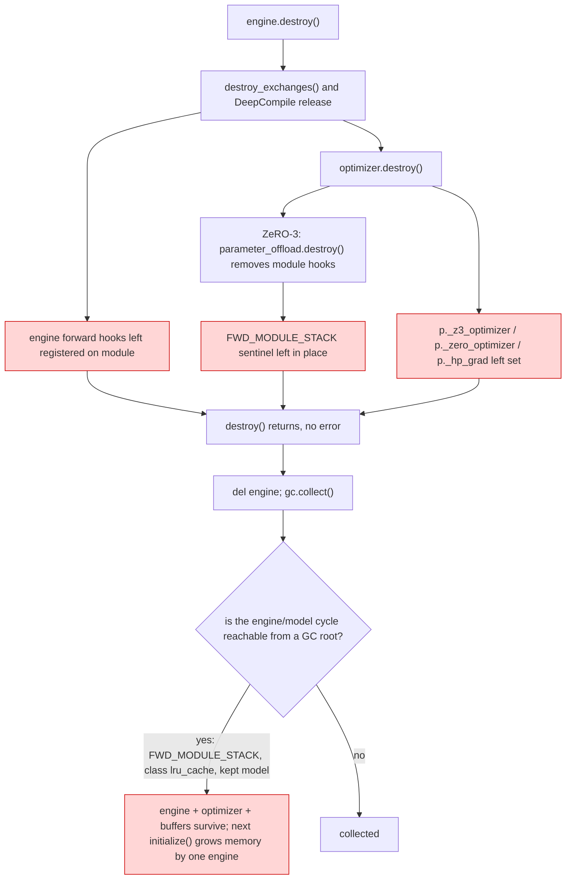
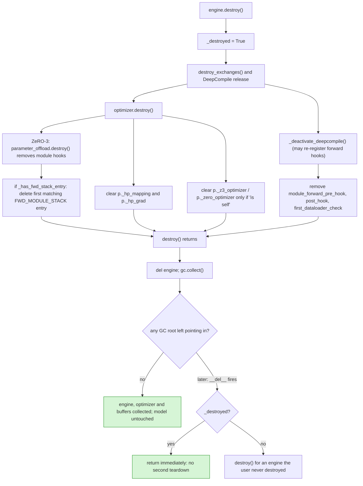
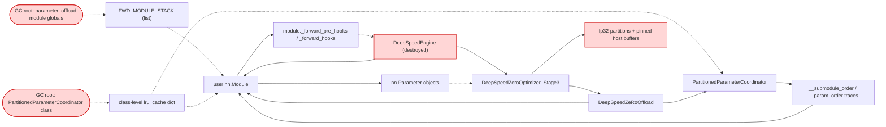
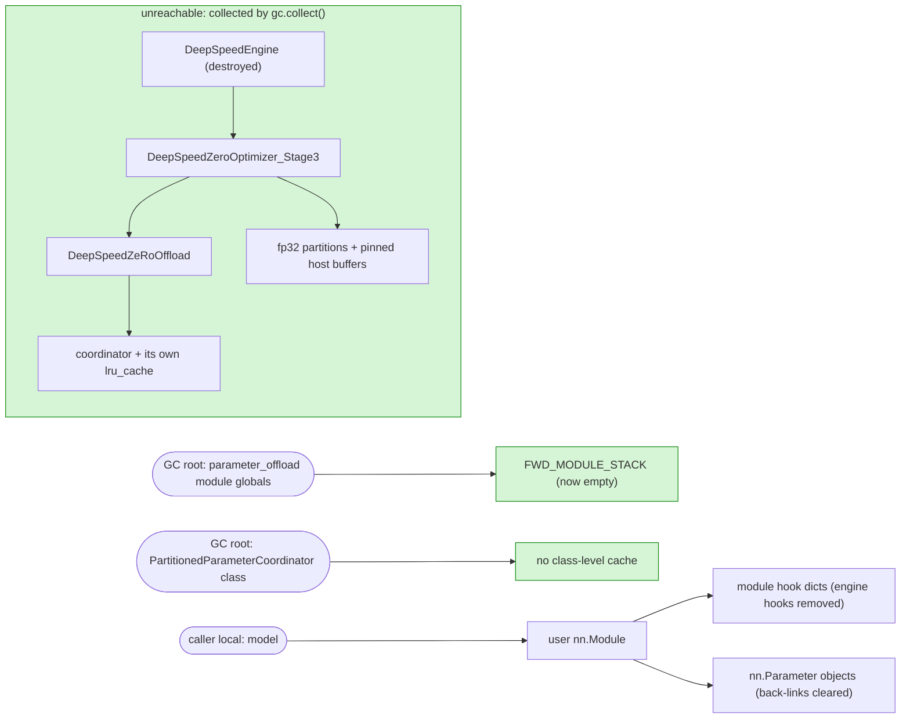

# Case study: a destroyed DeepSpeed engine that nothing could reclaim

| Field | Value |
|---|---|
| Issue | [#7204](https://github.com/deepspeedai/DeepSpeed/issues/7204) "[BUG] Re-initializing the Engine" (reported by `BiEchi`, 2025-04-05) |
| PR | [#9034](https://github.com/deepspeedai/DeepSpeed/pull/9034) "Fix memory leak in engine and zero optimizer" |
| Author | `hwchen2017` |
| Merged | 2026-11-09T14:28:22Z (merge commit `f32e164b947dcf681910e4c3d839870072f050ee`) |
| Files touched | `deepspeed/runtime/engine.py` (+13/-0), `deepspeed/runtime/zero/parameter_offload.py` (+11/-0), `deepspeed/runtime/zero/partitioned_param_coordinator.py` (+3/-1), `deepspeed/runtime/zero/stage3.py` (+3/-0), `deepspeed/runtime/zero/stage_1_and_2.py` (+2/-0), `deepspeed/runtime/bf16_optimizer.py` (+4/-0), `tests/unit/v1/zero/test_zero.py` (+107/-0) |
| Diff size | 7 files, +143 / -1 |
| Difficulty | Difficult |
| Why this was hard | Seven independent retaining references across five subsystems kept one object graph alive; `gc.collect()` already collected the engine/model cycle, so the failure was invisible to the obvious diagnostic, and the first five fixes exposed a sixth bug (a destructor-time second teardown) that silently corrupted a *different*, still-live engine. |

---

## 1. Symptom

The reporter destroyed and re-created the engine once per epoch because they
needed to run vLLM in between:

> "I want to launch an engine, then delete all the old engine and start a new
> engine, and the new model engine should start with exactly the same CPU/GPU
> memory (almost all 0) as launching the old model engine."

With ZeRO-3 plus CPU offload that did not happen:

> "It seems like the CPU memory was not freed after destroying the model engine
> under ZeRO-3 - the GPU memory is freed though."

The reporter's repro (comment on #7204) wrapped
`Gemma3ForConditionalGeneration` in a `stage: 3` config with
`offload_optimizer`/`offload_param` set to `cpu`, trained a few steps, then ran
`destroy()`, `del`, `gc.collect()` and `torch.cuda.empty_cache()`, printing
`psutil` RSS around each phase. Host RSS did not return to its
pre-initialization value. Eight months later the issue drew a second report:

> "Whenever the engine is destroyed and reinitialized, RAM seems to accumulate."

The PR quantified it on a `Sequential` of 16 `Linear(4096, 4096)` in bf16 over
four create/train/`destroy()`/`del`/`gc.collect()` cycles: **+4097.2 MiB host
RSS per cycle** for ZeRO-3 + CPU offload, **+2048.6 MiB of GPU memory per
cycle** for plain ZeRO-3, and **+2048.5 to +3584.9 MiB per cycle** for
ZeRO-0/1/2, `FP16_Optimizer`, `FP16_UnfusedOptimizer` and `BF16_Optimizer` when
the caller keeps the model (which is what HF `Trainer` does).

Two properties made this nasty to chase. `destroy()` returned without error and
*did* free some things (GPU memory in the reporter's ZeRO-3 run), so it looked
like a partial-cleanup problem rather than a reachability problem; and the leak
size equals the whole engine plus optimizer, so it reads as an allocator-caching
artefact until you measure across four cycles and see it is strictly linear.

---

## 2. Background

### 2.1 What `destroy()` is and is not

`DeepSpeedEngine.destroy()` (`deepspeed/runtime/engine.py:1291`) is a *release
resources* call, not a *drop references* call. It tears down DeepEP exchanges,
DeepCompile state, the optimizer, the decoupled checkpoint engine and the
Python-GC generation lease (`deepspeed/runtime/engine.py:1293-1327`), and
deliberately does not null out `self.module`, `self.optimizer` and friends,
because callers legitimately keep using the model afterwards. That is fine
*provided nothing outside the engine still points at the engine*: reclamation is
then Python's job. The bug here is that several things outside did still point
at it.

### 2.2 The engine/model reference cycle, and why it is normally fine

`deepspeed.initialize()` registers two forward hooks on the user's module
(`deepspeed/runtime/engine.py:633-635`), built by factories that close over
`self`:

```text
deepspeed/runtime/engine.py:3017-3022
    def _create_module_forward_pre_hook(self):

        def _module_forward_pre_hook(module, inputs, kwargs):
            return self._forward_prologue(inputs, kwargs)

        return self.module.register_forward_pre_hook(_module_forward_pre_hook, prepend=False, with_kwargs=True)
```

`register_forward_pre_hook` stores the closure in
`module._forward_pre_hooks`. So we have `engine.module -> module` and
`module._forward_pre_hooks[k].__closure__ -> engine`: a two-node cycle. Under a
tensor-parallel config a third hook is added, `first_dataloader_check`
(`deepspeed/runtime/engine.py:1038`, initialised to `None` at
`deepspeed/runtime/engine.py:993`), whose closure also captures `self`.

Reference cycles are not leaks in CPython. PEP 442 (Python 3.4+) made objects
with `__del__` collectable inside cycles too, so `DeepSpeedEngine.__del__`
(`deepspeed/runtime/engine.py:1280`) does not block collection either: a
`gc.collect()` reclaims `engine` + `module` together **as long as the cycle has
no external referrer**. That is the crux - the bug is not "a cycle Python cannot
break", it is "the cycle is anchored to GC roots". Two kinds of anchor existed.

### 2.3 Anchor kind 1: process-wide globals

`deepspeed/runtime/zero/parameter_offload.py:20` declares a module-level list,
`FWD_MODULE_STACK = list()`. ZeRO-3 uses it to find the innermost module
currently executing forward, so that a parameter which escapes its owning module
can be registered as an *external parameter* on the right ancestor
(`deepspeed/runtime/zero/parameter_offload.py:88` and `:393-396`). Submodule
hooks push and pop around each submodule's forward (`:533-534` pushes,
`:374-375` pops), which keeps the stack balanced *during* a forward. But
`setup_zero_stage3_hooks()` also pushes the top module once, at init, as a
permanent sentinel so `FWD_MODULE_STACK[-1]` is never an index error
(`deepspeed/runtime/zero/parameter_offload.py:323-326`). A module-level list is
a GC root for the life of the process.

### 2.4 Anchor kind 2: a class-level `functools.lru_cache` on a method

`PartitionedParameterCoordinator.__params_to_release(submodule, step_id)`
(`deepspeed/runtime/zero/partitioned_param_coordinator.py:633`) answers "which
parameter ids may be released after this submodule", consulted on every release
(`:495-498`). It used to be decorated:

```python
    @instrument_w_nvtx
    @functools.lru_cache(maxsize=None)
    def __params_to_release(self, submodule_to_release: Module, step_id: int) -> Set[int]:
```

A decorator runs at class-creation time, so there is exactly *one* cache for
the whole class, stored on the function object in the class `__dict__`. Because
the method is unbound at decoration time, `self` is part of the key tuple.
`maxsize=None` means nothing is ever evicted, and there is no invalidation call
anywhere.

### 2.5 Parameter-to-optimizer back-links

Several ZeRO features need to go from an `nn.Parameter` back to the optimizer
that owns its high-precision copy, so the public helpers in
`deepspeed/utils/tensor_fragment.py` can work on a bare parameter:

- ZeRO-3: `p._z3_optimizer = self` for every parameter
  (`deepspeed/runtime/zero/stage3.py:847-849`), used by
  `safe_get_full_fp32_param()` at `deepspeed/utils/tensor_fragment.py:146`.
- ZeRO-1/2: `lp._zero_optimizer = self` for parameters that own an
  `_hp_mapping` (`deepspeed/runtime/zero/stage_1_and_2.py:832-836`).
- `BF16_Optimizer`: `lp._hp_grad = hp_grad`
  (`deepspeed/runtime/bf16_optimizer.py:529`), where `hp_grad` is a *view* into
  the flat fp32 gradient buffer `self.fp32_groups_gradients_flat[i]`
  (allocated at `deepspeed/runtime/bf16_optimizer.py:196`, sliced at `:203-215`).

Attributes set on a parameter live in that parameter's `__dict__`: they are
owned by the *model*, not by the optimizer, so a caller who keeps the model
keeps them.

### 2.6 `safe_get_full_fp32_param` depends on `_hp_mapping` being intact

```text
deepspeed/utils/tensor_fragment.py:87-95
def get_full_hp_param(self, optim_state_key=None):
    reduce_buffer = torch.zeros_like(self, dtype=torch.float32).flatten()
    if self._hp_mapping is not None:
        ...
    dist.all_reduce(reduce_buffer, group=self._dp_group)
    return reduce_buffer.reshape_as(self)
```

`get_full_hp_param` copies this rank's fragment into a zero buffer **only if
`self._hp_mapping is not None`**, so with `_hp_mapping` cleared it silently
returns **zeros** rather than raising. Remember this for root cause 6.

---

## 3. Root cause

The engine/model cycle was reachable from GC roots through seven distinct edges.
The PR author found 1-5 with a transitive `gc.get_referrers` search from the
destroyed engine back to the roots; 6-7 fell out of validating the fix.

### Retainer 1 - engine forward hooks (`engine.py`)

`destroy()` never unregistered `module_forward_pre_hook`,
`module_forward_post_hook` or `first_dataloader_check`. Each entry in
`module._forward_pre_hooks` / `module._forward_hooks` holds a closure with a
cell referencing the engine. Consequence: **any caller that keeps the model
keeps the whole engine and optimizer**, for every ZeRO stage and the non-ZeRO
optimizers. This is the HF `Trainer` shape and explains the ZeRO-0/1/2,
`FP16_Optimizer` and `BF16_Optimizer` rows of the measurement table.

### Retainer 2 - `FWD_MODULE_STACK` (`parameter_offload.py`)

`DeepSpeedZeRoOffload.destroy()` removed the module hooks
(`_remove_module_hooks`, `deepspeed/runtime/zero/parameter_offload.py:294-307`)
but left the sentinel entry pushed by `setup_zero_stage3_hooks()`:

```text
FWD_MODULE_STACK (module global)  ->  user module
user module._forward_pre_hooks    ->  engine closure  ->  DeepSpeedEngine
DeepSpeedEngine.optimizer         ->  DeepSpeedZeroOptimizer_Stage3  ->  everything
```

This is the one that does not need a cooperating caller: **ZeRO-3 leaked even
when the user dropped the model**, which is exactly the #7204 report, and each
re-initialization appends one more module.

### Retainer 3 - class-level `lru_cache` (`partitioned_param_coordinator.py`)

Every call to `__params_to_release(self, submodule, step_id)` inserted a key
containing `self` into a never-cleared class attribute. So the class object - a
GC root for the life of the process - strongly referenced every
`PartitionedParameterCoordinator` ever constructed plus every submodule passed
as an argument, and from any coordinator the chain reaches the engine as in
retainer 2.

### Retainers 4 and 5 - `p._z3_optimizer`, `p._zero_optimizer`

`_link_all_hp_params` sets `p._z3_optimizer = self` on every ZeRO-3 parameter
and `_create_optimizer_mapping` sets `lp._zero_optimizer = self` under
ZeRO-1/2; nothing cleared either. A kept model therefore kept the optimizer,
and with it `parameter_offload`, the coordinator, the fp32 partitions and the
pinned host buffers when offloading.

### Retainer 6 - second teardown at collection time (`engine.py`)

This one is a *consequence* of fixing 1-5 and is the subtlest part of the PR.
Once a destroyed engine is actually collectable, `__del__` runs - and `__del__`
called `destroy()` again. The dangerous window: (1) `engine_a.destroy()`, caller
keeps `model`; (2) `engine_b = deepspeed.initialize(model=model, ...)` wraps the
same model and re-establishes `p._hp_mapping`, `p._zero_optimizer` /
`p._z3_optimizer`, and the `FWD_MODULE_STACK` entry; (3) the collector reclaims
`engine_a`, running `__del__ -> destroy() -> optimizer_a.destroy()`; (4)
`optimizer_a.destroy()` loops over `self.bit16_groups` / `self.bf16_groups`,
which contain *the same parameter objects* `engine_b` is now using, and sets
`p._hp_mapping = None` (`deepspeed/runtime/zero/stage_1_and_2.py:766-767`,
`deepspeed/runtime/bf16_optimizer.py:131-132`).

After that, `safe_get_full_fp32_param(p)` on the *live* `engine_b` returns zeros
(section 2.6), and `parameter_offload.destroy()` would delete `engine_b`'s
`FWD_MODULE_STACK` entry. The corruption is silent and non-deterministic in
timing. The `is self` guards added in the same PR make steps 3-4 only partially
destructive; `_hp_mapping` has no such "is mine" test available, hence the
`__del__` guard.

### Retainer 7 - `lp._hp_grad` (`bf16_optimizer.py`)

`_update_hp_grad` leaves `lp._hp_grad` pointing at a narrow view of
`fp32_groups_gradients_flat[i]`. A view keeps the whole underlying storage
alive, so a kept model pinned the entire flat fp32 gradient buffer - 2x the bf16
model size - even after every other reference to `BF16_Optimizer` was gone.

---

## 4. The fix

### 4.1 Unregister the engine's own hooks

`deepspeed/runtime/engine.py`

```diff
@@ def destroy(self):
             if self.is_deepcompile_active() or getattr(self, "_deepcompile_native_initialized", False):
                 self._deactivate_deepcompile()
+            # Callers often keep the model after destroy() (e.g. HF Trainer), and these hooks close
+            # over the engine, so leaving them registered would keep the engine and optimizer alive.
+            # This runs after _deactivate_deepcompile() because that re-registers the forward hooks.
+            for hook_attr in ("module_forward_pre_hook", "module_forward_post_hook", "first_dataloader_check"):
+                hook = getattr(self, hook_attr, None)
+                if hook is not None:
+                    hook.remove()
+                    setattr(self, hook_attr, None)
             debug_clear_module_and_param_names()
```

Two details carry the weight. *Ordering:* the loop must run **after**
`_deactivate_deepcompile()`, because that function removes the forward hooks,
runs native deactivation, and re-registers any that are `None`
(`deepspeed/runtime/engine.py:6113-6123`). Putting the removal loop earlier
would mean DeepCompile runs re-register fresh hooks on the way out of
`destroy()` - a textbook "fixed on my config" bug. *`getattr`/`setattr` with
`None`:* `destroy()` is reachable from `__del__` on a partially constructed
engine, where the attributes may not exist yet, and it is legal to call
`destroy()` twice (section 6), so the handles must be cleared idempotently.

### 4.2 Pop the `FWD_MODULE_STACK` sentinel - exactly once

`deepspeed/runtime/zero/parameter_offload.py`

```diff
     def destroy(self):
         self._remove_module_hooks()
+        # setup_zero_stage3_hooks() pushed the top module onto this process-wide stack; without
+        # popping it, every destroyed model (and the engine its hooks reference) stays alive.
+        # Pop it only once: after a newer engine wraps the same module, a repeated destroy() would
+        # otherwise remove that engine's entry.
+        if self._has_fwd_stack_entry:
+            for i, module in enumerate(FWD_MODULE_STACK):
+                if module is self.module:
+                    del FWD_MODULE_STACK[i]
+                    break
+            self._has_fwd_stack_entry = False
@@ def setup_zero_stage3_hooks(self):
         global FWD_MODULE_STACK
         FWD_MODULE_STACK.append(self.module)
+        self._has_fwd_stack_entry = True
```

The search is by identity (`module is self.module`), removes the **first**
match, and is gated by a per-instance `_has_fwd_stack_entry` flag. All three
matter when two engines have wrapped the same module: the older engine pushed
first, so the first match is its own entry, and the flag means a second
`destroy()` (explicit, or from `__del__`) cannot delete the newer engine's
entry. Popping blindly with `FWD_MODULE_STACK.pop()` would be wrong for the same
reason, and would also corrupt an in-flight forward whose submodule entry
happens to be on top.

### 4.3 Move the `lru_cache` onto the instance

`deepspeed/runtime/zero/partitioned_param_coordinator.py`

```diff
@@ def __init__(self, ...):
         self.__active_backward_submodules: Dict[int, Module] = {}
+        # Cache per instance: a class-level lru_cache keys on self and would keep every coordinator,
+        # and the modules and parameters it references, alive for the life of the process.
+        self.__params_to_release = functools.lru_cache(maxsize=None)(self.__params_to_release)
@@
     @instrument_w_nvtx
-    @functools.lru_cache(maxsize=None)
     def __params_to_release(self, submodule_to_release: Module, step_id: int) -> Set[int]:
```

`self.__params_to_release` on the right-hand side resolves to the *bound* method
(the class attribute, name-mangled to
`_PartitionedParameterCoordinator__params_to_release`), so the new cache keys on
`(submodule, step_id)` with `self` already baked in, and the assignment shadows
the class attribute. Semantics are preserved - same key space per instance, same
`maxsize=None`, still never invalidated, `@instrument_w_nvtx` still wrapping the
inner function - and only the cache's *owner* changes, from the class (a
process-lifetime root) to the instance. Side effect: the instance now references
its own bound method, so the coordinator sits in a reference cycle and is
reclaimed by the cyclic collector rather than by refcounting - acceptable here,
but not for an object whose `__del__` must run promptly.

### 4.4 Break the parameter back-links, but only your own

`deepspeed/runtime/zero/stage3.py`

```diff
     def destroy(self):
         self.parameter_offload.destroy()
+        for p in self.module.parameters():
+            if getattr(p, '_z3_optimizer', None) is self:
+                p._z3_optimizer = None
         self._clear_muon_allgather_buffers()
```

`deepspeed/runtime/zero/stage_1_and_2.py`

```diff
             for p in self.bit16_groups[i]:
                 if getattr(p, '_hp_mapping', None):
                     p._hp_mapping = None
+                if getattr(p, '_zero_optimizer', None) is self:
+                    del p._zero_optimizer
```

The `is self` test is the interesting part, and it is the same hazard as 4.2: if
a newer optimizer has already re-linked the parameter, clearing the attribute
unconditionally would break the live optimizer's `safe_get_*` path. ZeRO-1/2
uses `del` because its consumers test with `hasattr`/`getattr(..., None)`, so
removing the attribute restores the pre-init state; ZeRO-3's consumer at
`deepspeed/utils/tensor_fragment.py:146` dereferences `param._z3_optimizer`
directly after an `hasattr(param, 'ds_id')` test, so it is set to `None`
instead.

### 4.5 Drop the `BF16_Optimizer` gradient view

`deepspeed/runtime/bf16_optimizer.py`

```diff
             for p in self.bf16_groups[i]:
                 if getattr(p, '_hp_mapping', None):
                     p._hp_mapping = None
+                # _update_hp_grad() leaves a view of the fp32 gradient buffer here; a model kept after
+                # destroy() would otherwise keep the whole buffer alive.
+                if getattr(p, '_hp_grad', None) is not None:
+                    p._hp_grad = None
```

This one does not save the optimizer object, it saves 2x model size of fp32
buffer: the flat buffer tensor dies with the optimizer, but its storage survives
as long as any view of it does.

### 4.6 Stop `__del__` from tearing down twice

`deepspeed/runtime/engine.py`

```diff
     def __del__(self):
+        # An explicitly destroyed engine can be garbage-collected after a new engine has wrapped the same model;
+        # tearing it down again here would clear state that now belongs to the new engine.
+        if getattr(self, "_destroyed", False):
+            return
         try:
             self.destroy()
         except Exception as exc:
             ...

     def destroy(self):
+        self._destroyed = True
         try:
```

The guard lives in `__del__`, not in `destroy()`. That is deliberate:
`tests/unit/v1/pin_memory/test_destroy_unpin.py:194-202` calls
`engine.destroy()` twice and asserts the second call still synchronizes the
accelerator and unpins native host buffers, so an idempotent-`destroy()` guard
would regress a different fixed bug. The flag is set at the *top* of
`destroy()`, before the `try`, so an engine that throws part-way through
teardown is still not torn down again from a destructor, where exceptions are
swallowed.

---

## 5. Why the obvious alternative fixes are wrong

**"Null out `self.module` and `self.optimizer` at the end of `destroy()`."**
The first thing one reaches for, and it fixes nothing. The retaining edges all
point *into* the engine from outside: the module's hook dicts, the module-global
`FWD_MODULE_STACK`, the class-level cache, and the parameters' `__dict__`s.
Dropping the engine's outgoing edges does not make the engine unreachable. It
also breaks the contract that a destroyed engine's `module` is still
inspectable, and would make the legal second `destroy()` call crash.

**"Make `destroy()` call `gc.collect()`."** The reporter already did
`del engine; gc.collect()` and it did not help. The cycle was collectable; the
roots were the problem. Extra collection is a no-op against a strong reference
from a module-level list.

**"Clear `FWD_MODULE_STACK` entirely in `destroy()`."** Tempting, since it is
"just a scratch stack", and wrong twice over: a second engine in the same
process has its own sentinel there and would lose its external-parameter
registration target (`FWD_MODULE_STACK[-1]` at
`deepspeed/runtime/zero/parameter_offload.py:88` and `:395`), and the list can
legitimately be non-empty mid-forward, so clearing it would leave the balanced
push/pop in `_post_forward_module_hook`
(`deepspeed/runtime/zero/parameter_offload.py:374-375`) popping someone else's
frame or raising `IndexError`.

**"Call `cache_clear()` on `__params_to_release` in `destroy()`."** On a
class-level cache that clears *every* coordinator's entries, including a live
second engine's, turning a correctness-neutral leak into a performance cliff on
the survivor. A weak-keyed cache would avoid the leak but changes behaviour:
entries would disappear when a submodule is temporarily unreferenced, whereas
the cache's job is to be a never-invalidated memo of a completed trace.

**"Guard the double teardown inside `destroy()` instead of `__del__`", or
"clear `p._zero_optimizer` unconditionally."** The first regresses
`test_destroy_unpin.py`, which requires a repeated explicit `destroy()` to
synchronize and unpin again. The second is what the code did before, and is
exactly how the second teardown corrupted a live engine (root cause 6): without
the `is self` test, "clean up my links" and "clobber the new owner's links" are
the same operation.

---

## 6. How it was verified

### The new test

`tests/unit/v1/zero/test_zero.py::TestDestroyReleasesEngine`
(current tree: `tests/unit/v1/zero/test_zero.py:2502`), `world_size = 1`, 107
new lines, seven parameter sets of
`(zero_stage, offload, grad_accum_dtype)`: stages 1/2/3 without offload
(retainers 1, 2, 3, 4, 5), the same three with CPU offload (adds the offload and
pinned buffers, stage 3 + offload being the #7204 configuration), and
`(1, False, "fp32")`, which selects `BF16_Optimizer` and so covers retainer 7.
The body is three assertions, each pinning a different incorrect behaviour.

*(a) The destroyed engine must die while the model lives.*

```python
        engine.destroy()
        engine_ref = weakref.ref(engine)
        optimizer_ref = weakref.ref(optimizer)
        grad_buffer_storages = {
            buffer.untyped_storage().data_ptr()
            for buffer in getattr(optimizer, "fp32_groups_gradients_flat", [])
        }
        del engine, optimizer, data_loader, batch, loss
        gc.collect()
        assert engine_ref() is None, "the kept model still references the destroyed engine"
        assert optimizer_ref() is None, "the kept model still references the destroyed optimizer"
        assert not grad_buffer_storages & self._storages_held_by_params(model), \
            "the kept model still references the destroyed optimizer's gradient buffer"
```

`weakref.ref` after `gc.collect()` is the right oracle: it asks "is this object
reachable?" rather than "did RSS go down?", so it is immune to allocator caching
and to the pinned-host-allocator rounding visible in the PR's measurement table.
The `model` local is deliberately still alive, which is what makes retainers 1,
4, 5 and 7 observable. Comparing storages by `data_ptr()` rather than tensor
identity is needed for retainer 7: `lp._hp_grad` is a *view*, so the flat
buffer's own tensor object can already be collected while its storage is pinned.

*(b) Collecting a destroyed engine must not disturb its replacement.*

```python
        engine.destroy()
        new_engine, _, _, _ = deepspeed.initialize(...)
        fp32_params = [safe_get_full_fp32_param(p) for p in model.parameters()]
        engine_ref = weakref.ref(engine)
        del engine
        gc.collect()
        assert engine_ref() is None, "the kept model still references the destroyed engine"
        torch_assert_equal([safe_get_full_fp32_param(p) for p in model.parameters()],
                           fp32_params,
                           msg="collecting a destroyed engine changed the engine that replaced it")
```

The regression test for root cause 6, with a precise probe:
`safe_get_full_fp32_param` is the user-visible function that silently returns
zeros when `_hp_mapping` has been nulled (section 2.6), so without the `__del__`
guard the second read comes back all zeros while nothing raises.

*(c) The model itself must become collectable once the last engine goes:*
`new_engine.destroy()`, `del new_engine, model`, `gc.collect()`, then
`assert model_ref() is None`. This is the retainer-2 / retainer-3 test - a
leftover `FWD_MODULE_STACK` entry or a class-cache entry keeps the module alive
from a GC root even after the caller drops it. The helper
`_storages_held_by_params` is a method rather than an inline loop for a stated
reason: a loop variable holding a ZeRO-3 parameter in the test frame would
itself keep the model alive and make this assertion flaky.

### Reported results

Command (from the PR body):
`cd tests && CUDA_VISIBLE_DEVICES=0 python -m pytest --forked
unit/v1/zero/test_zero.py::TestDestroyReleasesEngine`.

Memory per create/destroy cycle, 2 ranks, rank 0, `Sequential` of 16
`Linear(4096, 4096)` in bf16 with torch AdamW, 4 cycles, growth measured as
`(cycle 4 - cycle 1) / 3`:

| Scenario | Before | After |
|---|---|---|
| ZeRO-3, model dropped | +2048.6 MiB GPU | 0 |
| ZeRO-3 + CPU offload, model dropped (#7204) | +4097.2 MiB host RSS | +0.4 MiB RSS |
| ZeRO-3, model kept (also with `zero.Init`) | +2048.6 MiB GPU | +256.2 MiB (the kept bf16 partition) |
| ZeRO-3 + CPU offload, model kept | +4097.3 MiB RSS | +512.9 MiB RSS (kept pinned partition, rounded up by torch's host allocator) |
| ZeRO-1 / ZeRO-2, model kept | +2048.5 MiB GPU | +512.1 MiB (the kept bf16 model) |
| ZeRO-2 + CPU offload, model kept | +544.1 MiB GPU, +3616.6 MiB RSS | +512.1 MiB GPU, RSS flat |
| ZeRO-0 (`FP16_UnfusedOptimizer`) / `FP16_Optimizer`, model kept | +3584.9 MiB GPU | +512.1 MiB |
| `BF16_Optimizer`, model kept | +3072.8 MiB GPU | +512.1 MiB |
| ZeRO-2, model dropped (control) | 0 | 0 |

The residual "after" numbers are the kept model itself, which is correct
behaviour, and the control row shows the measurement harness does not itself
leak. The numbers predate the final commit (`687b7f57 remove fwd stack only
once`), which only changes repeated-`destroy()` behaviour. The PR states AI
assistance (GitHub Copilot CLI) with every changed line reviewed by the
submitter, as `AGENTS.md` requires. `delock` approved with one open design
question: DeepSpeed does not prevent one model from being wrapped by two live
engines, which is precisely the situation the `is self` and
`_has_fwd_stack_entry` guards are written to survive.

---

## 7. Generalisable lessons

- **A leak in a cyclic-GC language is usually a root problem, not a cycle
  problem.** Walk `gc.get_referrers` transitively from the object that should
  have died until you hit a module global, a class attribute, or a frame - all
  three appeared here.
- **Process-wide state is a liability in a framework that supports multiple
  concurrent instances.** `FWD_MODULE_STACK` is a module-level list holding
  `nn.Module`s with a push that is never popped - that single line is the whole
  of issue #7204 - and `functools.lru_cache` on a method is a class attribute
  holding a strong reference to `self`. Build such a cache in `__init__` if the
  instance is meant to be reclaimable.
- **Attributes you set on someone else's object are owned by them.**
  `p._z3_optimizer`, `p._zero_optimizer`, `p._hp_grad` and `p._hp_mapping` live
  in the model's parameters, so they outlive the optimizer. Each needs a
  teardown guarded by an `is self` test, because another owner may have taken
  over.
- **Teardown that runs from a destructor must be a different operation from
  teardown the user calls.** `__del__` happens whenever the collector feels like
  it, possibly after a successor object has taken over shared state; a
  `_destroyed` flag read in `__del__` keeps both contracts.
- **Hook cleanup must run after anything that re-registers hooks.** Removing
  them before `_deactivate_deepcompile()` yields a fix that silently fails on
  one configuration; grep for everything that *re*-creates what you remove.
- **Prefer `weakref` + `gc.collect()` over RSS deltas when testing
  reclamation, and fix sibling paths in one pass.** Reachability is
  deterministic where RSS is confounded by caching allocators and pinned-memory
  rounding; and this PR touched five teardown paths because the same class of
  back-link exists in each.

---

## 8. Flowcharts

### 8.1 Buggy control flow: destroy, drop, collect



### 8.2 Fixed control flow



### 8.3 Object reference graph, before the fix

ZeRO-3 with CPU offload, after `del engine; gc.collect()`. Dashed edges are the
ones the fix removes.



The dashed edges map to the retainers: `FWD_MODULE_STACK -> module` is 2
(deleted by `parameter_offload.destroy()`), `class lru_cache -> coordinator` and
`-> module` is 3 (cache moved into `__init__`), `hooks -> engine` is 1, and
`param -> optimizer` is 4, 5 and 7 (cleared in `destroy()` under `is self`).

### 8.4 Object reference graph, after the fix



Only the caller's own `model` reference survives; when it drops, `MOD`,
`HOOKS` and `PARAM` go with it, which is assertion (c) of the new test.
