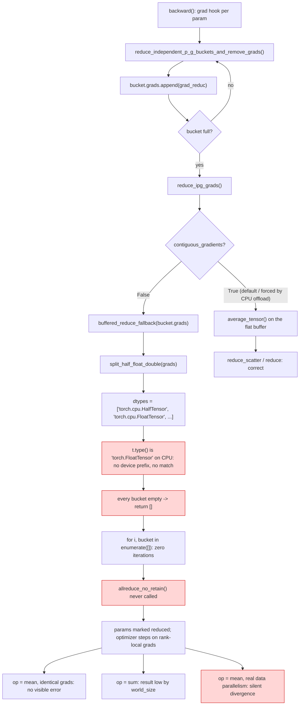
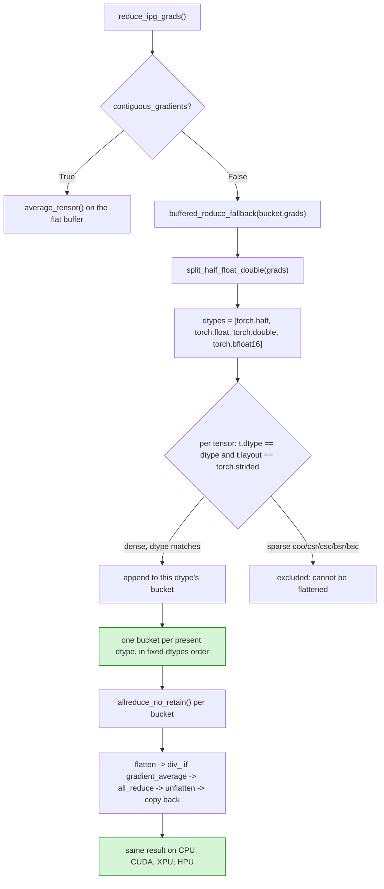
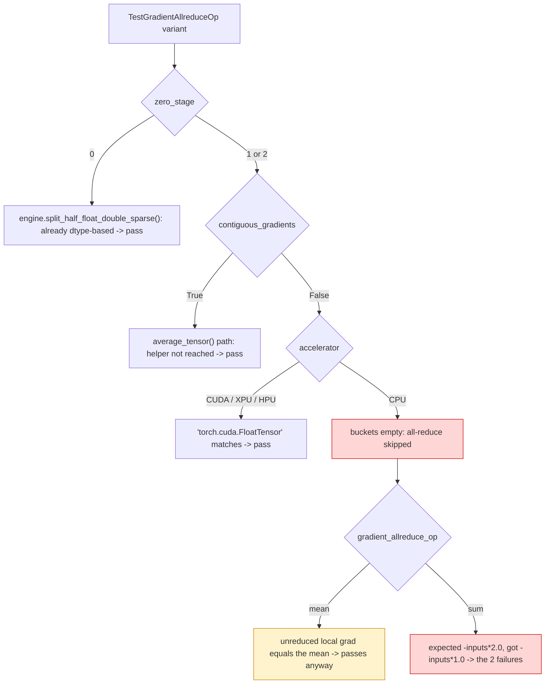

# Case study: the all-reduce that was skipped because a string did not match

| Field | Value |
|---|---|
| Issue | No standalone bug issue. The defect was surfaced by [#8381](https://github.com/deepspeedai/DeepSpeed/pull/8381) "[DON'T MERGE] Run multi-rank CPU unit tests in CI via LOCAL_SIZE" (`delock`), which switched on ~207 world_size=2 and ~85 world_size=4 CPU tests that had always been skipped |
| PR | [#8382](https://github.com/deepspeedai/DeepSpeed/pull/8382) "Fix silent gradient-bucket drop on CPU in ZeRO-1/2 non-contiguous reduction" |
| Author | `delock` (Guokai Ma) |
| Merged | 2026-09-21T03:40:18Z (merge commit `20a60f221ff24bd0b556c6651fb22625af543feb`) |
| Files touched | `deepspeed/runtime/zero/stage_1_and_2.py` (+8/-6), `tests/unit/v1/zero/test_zero.py` (+23/-0) |
| Diff size | 2 files, +31 / -6 |
| Difficulty | Difficult |
| Why this was hard | The wrong branch produced *no* error and *no* wrong answer on the default configuration: with `gradient_allreduce_op=mean` a skipped all-reduce is numerically indistinguishable from a performed one, so the bug could only be seen on CPU, with `sum`, with `contiguous_gradients=False`, in a multi-rank job - a cell of the matrix that CI had never executed. |

---

## 1. Symptom

From the PR body:

> "While investigating multi-rank CPU CI (deepspeedai/DeepSpeed#8381),
> `TestGradientAllreduceOp` failed for two variants (`sum` +
> `prescale_gradients=True` + ZeRO-1/2 + `contiguous_gradients=False` +
> `reduce_scatter=False`) with results off by a factor of world_size, and
> `TestUnmanagedGradientAccumulationOffload` showed a numeric mismatch.
> Separately, any test comparing tensors across ranks on CPU crashed with
> `RuntimeError: Invalid device string` or a gloo allgather error."

Two very different failure modes in one CI run. The second one is loud and was
a test-harness bug; the first is the interesting one. "Off by a factor of
world_size" in a *data-parallel gradient sum* is the signature of a reduction
that did not happen: each rank stepped on its own local gradient instead of the
sum over ranks.

The matching expectation in the test is explicit
(`tests/unit/v1/zero/test_zero.py:59-106`): with `gradient_allreduce_op="sum"`
and a world size of 2 the weight after one SGD step at `lr=1.0` must be
`-inputs * 2.0`; the run produced `-inputs * 1.0`.

What made it hard to believe: the same 18 `TestGradientAllreduceOp` variants
and 5 `TestGradientAllreduceOpTraining` variants were green on GPU CI
(`modal-torch-latest`). A bug in the core gradient reduction of ZeRO-1/2 that
only two of eighteen variants catch, on one accelerator, is easy to dismiss as
a test-harness or gloo problem - especially when the same CI run really does
contain an unrelated gloo crash.

---

## 2. Background

### 2.1 The three reduction paths in ZeRO-1/2

`DeepSpeedZeroOptimizer` buckets gradients as the backward pass produces them
(`reduce_independent_p_g_buckets_and_remove_grads`,
`deepspeed/runtime/zero/stage_1_and_2.py:1529`) and flushes each bucket in
`reduce_ipg_grads` (`deepspeed/runtime/zero/stage_1_and_2.py:2294`). An
`IPGBucket` (`deepspeed/runtime/zero/stage_1_and_2.py:117-138`) carries both a
flat `buffer` and a plain Python list of gradient tensors, `grads`:

```text
deepspeed/runtime/zero/stage_1_and_2.py:1591-1592
        bucket.grads.append(grad_reduc)
        bucket.params.append((i, param.param_idx_in_group, param_id))
```

`reduce_ipg_grads` then picks one of three paths:

```text
deepspeed/runtime/zero/stage_1_and_2.py:2301-2326
            if self.contiguous_gradients:
                if comm_dtype in self.extra_large_param_to_reduce:
                    ...
                    self.average_tensor(extra_large_grad_reduc_for_average, comm_dtype)
                else:
                    self.average_tensor(bucket.buffer[bucket.index].narrow(0, 0, bucket.elements), comm_dtype)
            else:
                if any(self._use_compact_grad_partition_buffer(group_idx) for group_idx, _, _ in bucket.params):
                    self._buffered_reduce_fallback_preserving_fp32(...)
                else:
                    self.buffered_reduce_fallback(None, bucket.grads, comm_dtype, elements_per_buffer=bucket.elements)
```

- **`contiguous_gradients=True`** (the default, and forced on whenever CPU
  offload is enabled - `deepspeed/runtime/zero/stage_1_and_2.py:301-302`):
  every gradient has already been copied into one flat buffer
  (`deepspeed/runtime/zero/stage_1_and_2.py:1574-1580`), so `average_tensor`
  narrows slices out of that single tensor and reduce-scatters or reduces them
  (`deepspeed/runtime/zero/stage_1_and_2.py:1804-1837`). It never needs to
  group tensors by type, because there is only one tensor.
- **`contiguous_gradients=False`** with a compact fp32 partition buffer:
  `_buffered_reduce_fallback_preserving_fp32`
  (`deepspeed/runtime/zero/stage_1_and_2.py:2602-2625`), which buckets with
  `buckets.setdefault(grad.dtype, [])` - already dtype-based.
- **`contiguous_gradients=False` otherwise**: `buffered_reduce_fallback`
  (`deepspeed/runtime/zero/stage_1_and_2.py:2627-2640`), the only path that
  calls `split_half_float_double`. This is the path with the bug.

### 2.2 What `split_half_float_double` is for

The dense all-reduce buffer is built with `_flatten_dense_tensors`
(`self.flatten(bucket)` at
`deepspeed/runtime/zero/stage_1_and_2.py:2456`), which requires every tensor in
the bucket to share a dtype and be flattenable. So the gradient list must first
be partitioned into one bucket per dtype. The current implementation:

```text
deepspeed/runtime/zero/stage_1_and_2.py:66-79
def split_half_float_double(tensors):
    # Legacy type strings omit the device prefix on CPU ("torch.FloatTensor"), so
    # building them from the accelerator device name matches nothing on CPU and
    # silently drops every gradient bucket, skipping the all-reduce entirely.
    # Compare dtypes directly so the buckets are device-independent. Only strided
    # tensors can be flattened into the dense all-reduce buffer, so every sparse
    # layout stays excluded.
    dtypes = [torch.half, torch.float, torch.double, torch.bfloat16]
    buckets = []
    for i, dtype in enumerate(dtypes):
        bucket = [t for t in tensors if t.dtype == dtype and t.layout == torch.strided]
        if bucket:
            buckets.append(bucket)
    return buckets
```

Before the fix the dtype list was built from legacy torch *type strings*:

```python
    device_type = get_accelerator().device_name()
    dtypes = [
        "torch.{}.HalfTensor".format(device_type), "torch.{}.FloatTensor".format(device_type),
        "torch.{}.DoubleTensor".format(device_type), "torch.{}.BFloat16Tensor".format(device_type)
    ]
```

and membership was `t.type() == dtype`.

### 2.3 `Tensor.type()` is not symmetric across devices

`torch.Tensor.type()` returns the pre-0.4 type name, which encodes device *and*
dtype *and* layout - but it omits the device segment for CPU:

| tensor | `t.type()` |
|---|---|
| `torch.zeros(2)` | `torch.FloatTensor` |
| `torch.zeros(2, device="cuda")` | `torch.cuda.FloatTensor` |
| `torch.zeros(2, device="xpu")` | `torch.xpu.FloatTensor` |
| `torch.sparse_coo_tensor(...)` (fp32, CPU) | `torch.sparse.FloatTensor` |
| `torch.sparse_csr_tensor(...)` | raises `RuntimeError: Unimplemented backend SparseCsrCPU` |

`CPU_Accelerator.device_name()` returns `'cpu'`
(`accelerator/cpu_accelerator.py:195-196`), so the generated strings were
`torch.cpu.FloatTensor` and friends - a spelling that `Tensor.type()` never
produces for any tensor on any device.

### 2.4 `gradient_allreduce_op` and why `mean` hides the bug

`DeepSpeedEngine` translates the config into a single boolean:

```text
deepspeed/runtime/engine.py:548
        self.gradient_average = config_class.gradient_allreduce_op == GRADIENT_ALLREDUCE_OP_MEAN
```

which is passed to the optimizer
(`deepspeed/runtime/engine.py:2789`) and consumed in `allreduce_bucket`:

```text
deepspeed/runtime/zero/stage_1_and_2.py:2468-2473
        if divide and self.gradient_average:
            tensor_to_allreduce.div_(dist.get_world_size(group=process_group) / float(self.sequence_parallel_size))

        if rank is None:
            #    "All Reducing"
            dist.all_reduce(tensor_to_allreduce, group=process_group)
```

So with `mean`, the correct result for a gradient `g_r` on rank `r` is
`sum_r(g_r) / world_size`. In the overwhelming majority of tests and real runs
every rank sees the same micro-batch shape and, in the unit tests, literally the
same inputs, so `g_r = g` for all `r` and the mean equals `g` - exactly the
value a rank already has in its local buffer. **Skipping the all-reduce is a
no-op under `mean` with identical per-rank gradients.** Under `sum`, the
division is skipped and the correct answer is `world_size * g`, so a skipped
all-reduce is off by exactly `world_size`.

### 2.5 The sibling function that was already correct

`deepspeed/runtime/engine.py:167-184` holds `split_half_float_double_sparse`,
used by the non-ZeRO (`zero_stage=0`) reduction path
(`deepspeed/runtime/engine.py:3997`, `:4023`). It iterates
`get_accelerator().supported_dtypes()` and tests `t.dtype == dtype`, splitting
sparse tensors into their own bucket list. It has no device-string problem. The
ZeRO-1/2 copy was simply older code that nothing had forced to keep up - which
is why `zero_stage=0` passed in the same CPU run while stages 1 and 2 failed.

---

## 3. Root cause

The exact condition for the defect:

> `split_half_float_double` is reached - i.e. ZeRO stage 1 or 2, with
> `contiguous_gradients=False` and no compact fp32 partition buffer - **and**
> `get_accelerator().device_name()` is not the string that `Tensor.type()`
> embeds for that device.

On CPU this is always true. The predicate `t.type() == "torch.cpu.FloatTensor"`
is false for every tensor, so every per-dtype `bucket` is empty, the
`if bucket:` guard means nothing is appended, and the function returns `[]`.
`buffered_reduce_fallback` then iterates an empty list:

```python
        split_buckets = split_half_float_double(grads)

        for i, bucket in enumerate(split_buckets):
            self.allreduce_no_retain(...)
```

Zero iterations. No exception, no warning, no log line. `reduce_ipg_grads`
continues to its post-reduction bookkeeping
(`deepspeed/runtime/zero/stage_1_and_2.py:2328-2380`) and marks the parameters
as reduced. The gradients in `bucket.grads` are still the rank-local gradients,
and that is what the optimizer steps on.

Severity by configuration:

| accelerator | `gradient_allreduce_op` | identical per-rank grads? | observable effect |
|---|---|---|---|
| CUDA / XPU / HPU | any | any | none - `torch.cuda.FloatTensor` matches, buckets are correct |
| CPU | `mean` | yes | none - unreduced local value equals the mean |
| CPU | `mean` | no (real data parallelism) | **silent convergence damage**: each rank trains on its own gradient only |
| CPU | `sum` | yes | result low by a factor of `world_size` |

The third row is the dangerous one, and it is the one no test covers: with
different data per rank, the ranks' parameters diverge, and nothing in the stack
complains. The bug had presumably been latent in CPU ZeRO-1/2 for as long as
`contiguous_gradients=False` has been supported there, because
`CPU_Accelerator.device_count()` reports NUMA nodes
(`accelerator/cpu_accelerator.py:210-222`) and CI's single-socket runner
reported 1, so every multi-rank CPU test was skipped
(`tests/unit/common.py`: "Skipping test because not enough GPUs are available:
2 required, 1 available"). #8381 set `LOCAL_SIZE=4` to lift that gate, and this
was one of the bugs that fell out.

A secondary, pre-existing membership quirk of `t.type()` also mattered, and the
reviewer pinned it down (section 5): the legacy string encodes *layout* too, so
sparse gradients were excluded from the dense buckets as a side effect, and four
of the five sparse layouts made `t.type()` itself raise.

### The two harness bugs (same CI run, different mechanism)

`reduce_boolean_flags` in `tests/unit/common.py` is the helper that makes a
cross-rank comparison fail on all ranks together. It had two independent
defects:

1. It used `get_accelerator().current_device()`, which on CPU returns the
   `LOCAL_RANK` *string* (`accelerator/cpu_accelerator.py:204-205`), not a
   device - hence `RuntimeError: Invalid device string`.
2. It passed a 0-dim tensor to `all_gather_into_tensor`, which gloo rejects.

Current tree:

```text
tests/unit/common.py:588-599
def reduce_boolean_flags(flag: bool, op=all) -> bool:
    if not dist.is_initialized():
        return flag
    # current_device() is a rank id on CPU, not a valid torch device; use the device name.
    device = get_accelerator().current_device_name()
    # gloo rejects 0-dim inputs to all_gather_into_tensor, so carry the flag in a 1-dim tensor.
    tensor_flag = torch.tensor([1 if flag else 0], dtype=torch.int, device=device)
```

These two lines were part of this PR's first commit
(`ad3c27e5`, "Fix silent gradient-bucket drop on CPU and CPU-invalid device in
test harness"), but **they are not in the PR's final merged diff**: an identical
change reached master first via
[#8397](https://github.com/deepspeedai/DeepSpeed/pull/8397) "Use device names,
not rank ids, for device placement in test helpers" (merged 2026-09-03), so by
the time #8382 merged on 2026-09-21 the net diff against its merge base
contained only `stage_1_and_2.py` and `test_zero.py`. The PR body still
describes the harness fix; this is a diff-vs-description discrepancy worth
knowing when reading the PR, not an error in either.

---

## 4. The fix

### 4.1 The product change

`deepspeed/runtime/zero/stage_1_and_2.py`

```diff
 def split_half_float_double(tensors):
-    device_type = get_accelerator().device_name()
-    dtypes = [
-        "torch.{}.HalfTensor".format(device_type), "torch.{}.FloatTensor".format(device_type),
-        "torch.{}.DoubleTensor".format(device_type), "torch.{}.BFloat16Tensor".format(device_type)
-    ]
+    # Legacy type strings omit the device prefix on CPU ("torch.FloatTensor"), so
+    # building them from the accelerator device name matches nothing on CPU and
+    # silently drops every gradient bucket, skipping the all-reduce entirely.
+    # Compare dtypes directly so the buckets are device-independent. Only strided
+    # tensors can be flattened into the dense all-reduce buffer, so every sparse
+    # layout stays excluded.
+    dtypes = [torch.half, torch.float, torch.double, torch.bfloat16]
     buckets = []
     for i, dtype in enumerate(dtypes):
-        bucket = [t for t in tensors if t.type() == dtype]
+        bucket = [t for t in tensors if t.dtype == dtype and t.layout == torch.strided]
         if bucket:
             buckets.append(bucket)
     return buckets
```

Three things are happening in these eight lines.

**`t.dtype == dtype` instead of `t.type() == string`.** This removes the device
from the predicate entirely. The comparison is now between `torch.dtype`
objects, which are singletons, so there is no string formatting and no
accelerator call. On CUDA the result is bit-identical to before: the four legacy
strings matched exactly the four dtypes, in the same order, so buckets and
bucket order are unchanged - which is what the PR means by "GPU behavior is
unchanged by construction (same buckets, same order)". Bucket order matters
because `allreduce_no_retain` is called once per bucket and collectives must be
issued in the same order on every rank; keeping the `dtypes` list order
preserves that invariant.

**`and t.layout == torch.strided`.** The dtype test alone is *more* permissive
than the old string test, because the old string encoded layout. Without this
clause, a sparse-COO fp32 gradient (`t.dtype == torch.float32`) would now enter
the float bucket and reach `_flatten_dense_tensors`, which raises
`RuntimeError: unsupported memory format option Contiguous`. The clause restores
the old membership and generalises it: `torch.strided` is the only layout that
can be flattened, so COO, CSR, CSC, BSR and BSC are all excluded by one
predicate. This is the deliberate outcome of two rounds of review (section 5).

**The comment.** Per `AGENTS.md`, comments explain why. The three sentences
record (a) the device-prefix asymmetry that caused the bug, (b) why the new
predicate is device-independent, and (c) why the layout clause exists. Without
(c) a future reader would reasonably simplify the predicate back to
`t.dtype == dtype` and reintroduce a crash on sparse gradients.

Note what the fix does *not* do: it does not add a warning or an assertion for
an empty bucket list. An empty `grads` list is legitimate (a bucket flush with
nothing to flush), so "empty means bug" is not a safe invariant to assert here.
The defence against a silent skip is the unit test in section 6, which pins the
membership function itself.

### 4.2 The harness change (landed via #8397, described in this PR)

```diff
-    device = get_accelerator().current_device()
-    tensor_flag = torch.tensor(1 if flag else 0, dtype=torch.int, device=device)
+    device = get_accelerator().current_device_name()
+    tensor_flag = torch.tensor([1 if flag else 0], dtype=torch.int, device=device)
```

`current_device_name()` is the accelerator API that returns a torch-parseable
device string on every backend (`'cpu'` for the CPU accelerator,
`accelerator/cpu_accelerator.py:207-208`); `current_device()` returns an index,
and on CPU a `LOCAL_RANK` string. The `[...]` makes the flag 1-dimensional
because gloo's `all_gather_into_tensor` rejects 0-dim inputs. Without this,
every cross-rank comparison on CPU dies inside the comparison helper - which is
why the PR had to fix the harness before it could even *see* the numeric
results of the ZeRO-3 and offload tests.

---

## 5. Why the obvious alternative fixes are wrong

**"Add `'cpu'` to the device-string formatting, or special-case CPU:**
`device_type = '' if cpu else name`.**"** This is the minimal-diff fix and it is
a trap. It keeps a predicate whose correctness depends on a string produced by a
deprecated torch API, for every present and future accelerator. The next
accelerator whose `device_name()` disagrees with the segment torch embeds in
`Tensor.type()` reintroduces exactly this bug, silently, on exactly the
configuration nobody tests. It also leaves four of the five sparse layouts
raising inside the predicate itself (see below). Comparing `torch.dtype`
objects removes the string from the system.

**"Just compare `t.dtype` and stop there."** This is what the PR originally
did, and the reviewer (`ebarkhordar`) showed it changes membership beyond CPU:

> "`t.type()` encodes layout as well as dtype, so this also changes membership
> for sparse gradients, not just on CPU. `sparse.type()` is
> `torch.sparse.FloatTensor`, which matches none of the four legacy strings on
> any device, so sparse grads were dropped from every bucket.
> `t.dtype == torch.float` does match them, and `allreduce_bucket` opens with
> `self.flatten(bucket)`, which is `_flatten_dense_tensors`."

with a reproduction on torch 2.14.0+cpu:

```text
>>> sparse = torch.sparse_coo_tensor(torch.tensor([[0, 2]]), torch.tensor([1., 2.]), (4,))
>>> sparse.type(), sparse.dtype
('torch.sparse.FloatTensor', torch.float32)
>>> _flatten_dense_tensors([torch.zeros(4), sparse])
RuntimeError: unsupported memory format option Contiguous
```

So an `nn.Embedding(sparse=True)` model on ZeRO-1/2 with
`contiguous_gradients=False` would have moved from a silently skipped all-reduce
to a hard crash. Neither reviewer nor author could find a path that actually
delivers a sparse gradient to this function (ZeRO-1/2 has no sparse handling of
its own, and the `is_sparse` routing the reviewer pointed at - current tree
`deepspeed/runtime/engine.py:3984-3987`, which wraps a sparse grad in
`SparseTensor` - is on the non-ZeRO path), but "probably unreachable" is not a
reason to widen membership.

**"Add `and not t.is_sparse`."** The author's first correction, and still wrong:

> "`is_sparse` is COO-only, so the CSR family still gets in. A `sparse_csr` grad
> has `is_sparse == False`, lands in the float bucket, and `flatten` then raises
> `Sparse CSR tensors do not have is_contiguous`. Same for csc, bsr and bsc."
>
> "Not a regression, to be clear. On those four layouts `t.type()` itself raises
> `RuntimeError: Unimplemented backend SparseCsrCPU`, so the old code died a few
> lines earlier instead."

`t.layout == torch.strided` is the predicate that covers all five sparse layouts
in one expression and states the actual requirement (flattenable into a dense
buffer) rather than enumerating the exclusions.

**"Make `buffered_reduce_fallback` raise or warn when the bucket list comes back
empty."** A useful belt-and-braces addition in principle, but not a fix: it
converts a silent wrong answer into a crash *for legitimate empty inputs* too,
since a flush can be called with no pending gradients. It also would not have
helped the CPU `mean` configuration, which is the one that damages convergence
without any test noticing - that needs the membership function to be right, not
louder.

**"Forbid `contiguous_gradients=False` on CPU."** Dodges the bug rather than
fixing it, and `contiguous_gradients=False` is a legitimate memory/latency
trade-off; the config is also reachable via `_configure_moe_settings`'s
ZeRO-1 warning path (`deepspeed/runtime/zero/stage_1_and_2.py:889-891`).

---

## 6. How it was verified

### The new unit test

`tests/unit/v1/zero/test_zero.py:37-56`, 23 added lines, a plain (non-dist)
test:

```python
class TestSplitHalfFloatDouble:

    def test_device_independent_buckets_exclude_sparse(self):
        # Pins two fixed membership bugs: the legacy accelerator-prefixed type
        # strings matched nothing on CPU, silently dropping every bucket, and
        # dtype-only matching would admit sparse layouts, which cannot be
        # flattened into a dense all-reduce buffer. The CSR sample also pins that
        # the exclusion covers layouts where is_sparse is False.
        dense_grads = [
            torch.zeros(2, dtype=dtype) for dtype in (torch.half, torch.float, torch.double, torch.bfloat16)
        ]
        sparse_grad = torch.sparse_coo_tensor(torch.tensor([[0]]), torch.tensor([1.0]), (1, ))
        csr_grad = torch.sparse_csr_tensor(torch.tensor([0, 1]), torch.tensor([0]), torch.tensor([1.0]), (1, 1))

        buckets = split_half_float_double(dense_grads + [sparse_grad, csr_grad])

        assert len(buckets) == 4
        for bucket, grad in zip(buckets, dense_grads):
            assert len(bucket) == 1
            assert bucket[0] is grad
```

What each assertion catches:

- `len(buckets) == 4` with CPU tensors catches the original bug directly. Under
  the old code this is `0`, because `torch.cpu.HalfTensor` and friends match
  nothing. It is a white-box test on a module-private helper, which `AGENTS.md`
  permits when pinning a specific fixed bug - and the comment says so.
- `bucket[0] is grad`, checked pairwise in `dtypes` order, pins bucket
  *identity* and *order*. Order is the invariant that keeps collectives aligned
  across ranks; a refactor that groups by `dict` insertion order of the input
  list would still produce four buckets but could emit them in a
  data-dependent order and deadlock a real job.
- The `sparse_coo` sample catches a regression to bare `t.dtype == dtype`
  (which would yield a 5-element float bucket and later a flatten error).
- The `sparse_csr` sample specifically catches the `and not t.is_sparse`
  variant, since CSR reports `is_sparse == False`. Without this sample the
  rejected intermediate fix would pass.

The test is deliberately device-free (`torch.zeros` on CPU): the function under
test is now device-independent, so running it on CPU is the strongest case - it
is the case that used to fail.

### Reported results

CPU/gloo, world sizes 2-3, from the PR body:

| Test | Before | After |
|---|---|---|
| `TestGradientAllreduceOp` (18 variants) | 2 failed | 18/18 pass |
| `TestGradientAllreduceOpTraining` (5) | crash in comparison helper | pass (3 locally + muon skips fp16) |
| `TestUnmanagedGradientAccumulationOffload` + `InactiveParams` (6) | crash + numeric mismatch | 6/6 pass |
| `TestZero3ParamPartitioningBase` / `TestZeroToFP32` (regression smoke) | - | pass |

The 18 `TestGradientAllreduceOp` variants are the cross product of
`zero_stage in {0, 1, 2}`, `gradient_allreduce_op in {mean, sum}` and three
`(reduce_scatter, contiguous_gradients, prescale_gradients,
gradient_predivide_factor)` tuples
(`tests/unit/v1/zero/test_zero.py:59-71`). Exactly two of the eighteen were
red, and the failing cell is predicted precisely by the root cause: `sum` (so
the skip is visible) x `(False, False, True, 1.0)` (so `contiguous_gradients`
is off and `split_half_float_double` is reached) x `zero_stage in {1, 2}` (so
the ZeRO-1/2 copy of the function is the one used - stage 0 goes through
`split_half_float_double_sparse` in `engine.py`, which was already
dtype-based).

Two caveats I could not resolve from the available material:

- The PR attributes `TestUnmanagedGradientAccumulationOffload`'s "numeric
  mismatch" to this CI run but does not say which of the two fixes resolved it.
  Mechanically it cannot be the bucket drop: CPU offload forces
  `contiguous_gradients = True`
  (`deepspeed/runtime/zero/stage_1_and_2.py:301-302`), so that test never
  reaches `split_half_float_double`. The harness fix is the likelier cause (the
  comparison previously crashed before reaching its assertion).
- GPU equivalence is argued by construction ("same buckets, same order") plus
  the pre-existing green GPU CI, not by a before/after GPU measurement.

The PR also records a deliberately out-of-scope follow-up: with the comparison
helper fixed, `test_unmanaged_varying_backward_count[3]` (ZeRO-3) now reaches
its numeric comparison and exposes a *separate* pre-existing unmanaged-vs-managed
mismatch on CPU that the harness crash had been masking.

---

## 7. Generalisable lessons

- **A skipped collective is the worst kind of bug.** It produces no error, and
  under the default averaging mode with identical per-rank inputs it produces no
  wrong number either. Any code path that loops over "the things to reduce" can
  reduce nothing; think about whether zero iterations is distinguishable from
  success.
- **Never derive a predicate from a legacy string API.** `Tensor.type()`
  encodes device, dtype and layout in one non-orthogonal string, and is not
  symmetric between CPU and accelerators. `t.dtype` and `t.layout` are the
  stable, structured facts; compare those.
- **`get_accelerator().device_name()` is not interchangeable with torch's
  internal device spelling.** Related trap in the same CI run:
  `current_device()` returns an *index* (and a `LOCAL_RANK` string on CPU) while
  `current_device_name()` returns a torch-parseable device. Pick the one whose
  contract matches the consumer.
- **Tightening and loosening are both membership changes.** Swapping `t.type()`
  for `t.dtype` fixed one leak and opened another, because the discarded string
  silently carried a layout test. When you replace a predicate, enumerate every
  property the old one happened to check.
- **Duplicate implementations drift.** `split_half_float_double` (ZeRO-1/2) and
  `split_half_float_double_sparse` (non-ZeRO) do the same job; only the second
  had been modernised. `AGENTS.md` asks contributors to check sibling paths
  before fixing one - here the sibling was the *reference implementation* of the
  fix.
- **Skipped tests are untested code, and a skip gate can hide a whole
  accelerator.** `CPU_Accelerator.device_count()` reporting NUMA nodes meant no
  multi-rank CPU test ever ran; the first run of ~290 of them surfaced this bug
  immediately. Audit what your CI *skips*, not only what it fails.
- **Review the predicate, not just the symptom.** The author's first two
  attempts (`t.dtype`, then `and not t.is_sparse`) were both defensible and both
  wrong in ways only a reviewer with a torch shell caught. Reproductions pasted
  into review comments, with the torch version named, are what moved this to the
  correct one-clause predicate.

---

## 8. Flowcharts

### 8.1 Buggy data flow: ZeRO-1/2 bucket flush on CPU



### 8.2 Fixed data flow



### 8.3 Why only two of eighteen variants were red



The amber node is the important one: that path is *green but wrong* whenever
per-rank gradients actually differ, which no unit test exercises.
