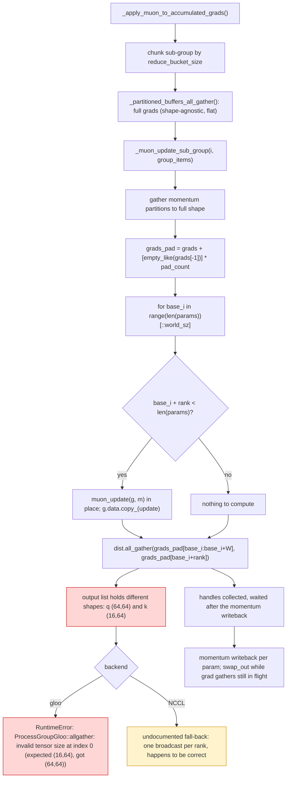
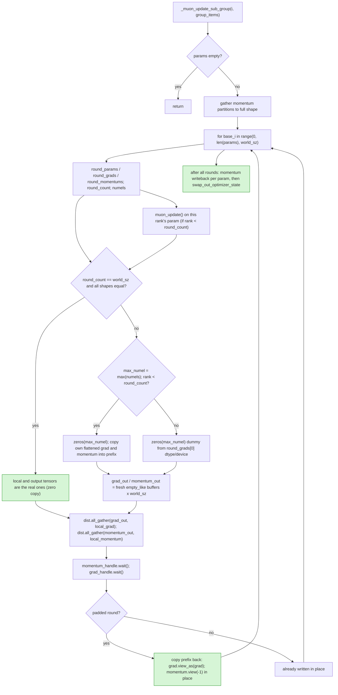
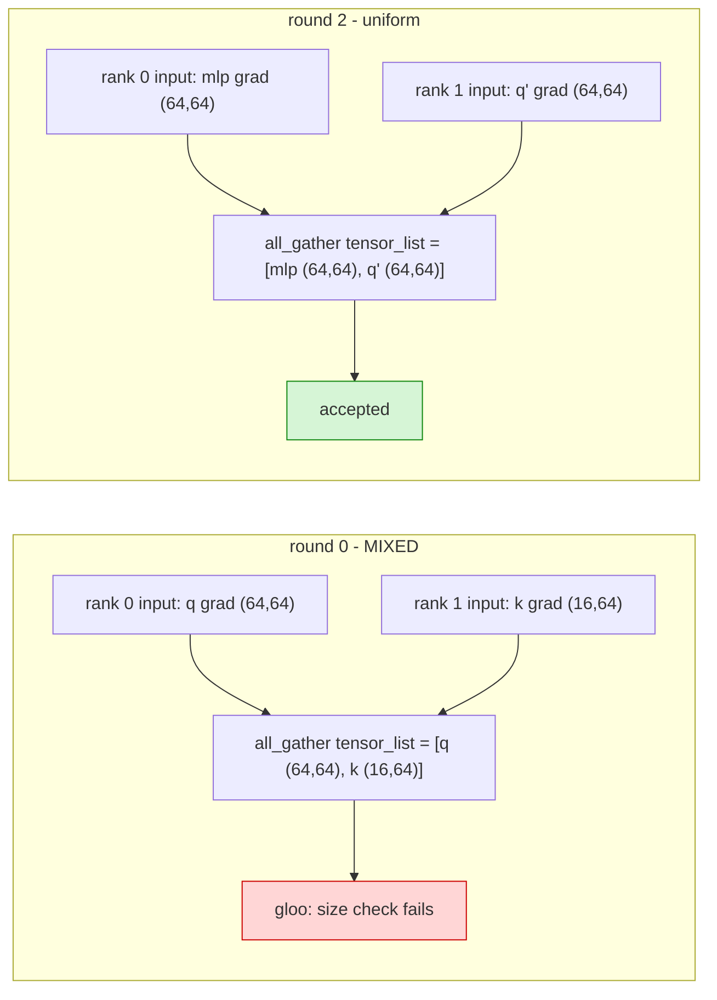
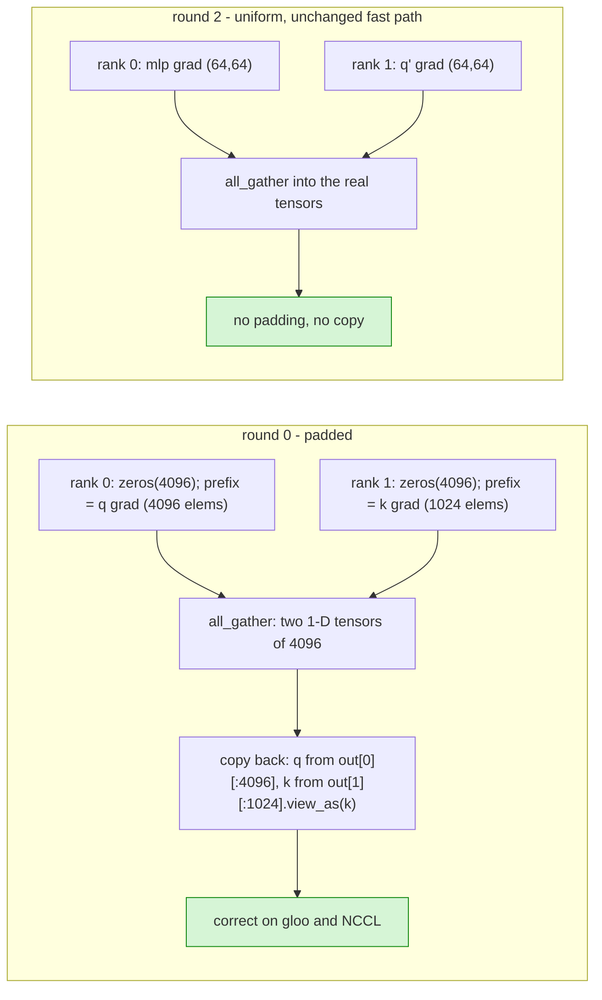

# Case study: a round-robin all-gather that assumed every parameter had the same shape

| Field | Value |
|---|---|
| Issue | No standalone bug issue. The defect was surfaced by [#8381](https://github.com/deepspeedai/DeepSpeed/pull/8381) "[DON'T MERGE] Run multi-rank CPU unit tests in CI via LOCAL_SIZE" (`delock`); the PR body of the fix points at GitHub Actions run `35675316100`, job `106580600974` |
| Related PR | [#8600](https://github.com/deepspeedai/DeepSpeed/pull/8600) "Run Muon once per optimizer step under ZeRO-3, not once per micro-batch" (`alanhuangyoo`, merged 2026-09-22) - the rebase target that moved the buggy code |
| PR | [#8628](https://github.com/deepspeedai/DeepSpeed/pull/8628) "Fix ZeRO-3 Muon all-gather for mixed parameter shapes" |
| Author | `jinyouzhi` (Jin, Youzhi) |
| Merged | 2026-09-28T18:46:06Z (merge commit `c9e1b4d2565ea66ccd426671939ea3b03acf4d31`) |
| Files touched | `deepspeed/runtime/zero/stage3.py` only (+108/-86) |
| Diff size | 1 file, +108 / -86 (a large share of the count is re-indentation from an early return) |
| Reviews | `alanhuangyoo` (two review comments, drove the rebase), approvals from `pengdurice` and `PKUWZP` |
| Difficulty | Difficult |
| Why this was hard | The code was correct on NCCL and wrong on gloo for the same inputs, because `torch.distributed.all_gather` silently supports differently sized output tensors on NCCL (it degrades to per-rank broadcasts) and rejects them on gloo; and the first, obvious predicate for "safe to gather directly" - equal `numel` - is still wrong, because both backends compare *shapes*. |

---

## 1. Symptom

The PR body is two lines:

> "Follow up #8381
> Fix 3 FAILED `unit/v1/ops/muon/test_per_head_muon_accelerator.py` in
> https://github.com/deepspeedai/DeepSpeed/actions/runs/35675316100/job/106580600974?pr=8381"

The three failures in that CPU/gloo job are exactly the ZeRO-3 variants of one
test class - `TestPerHeadMuonEndToEnd::test_opt_in_is_off_by_default[3]`,
`::test_training_makes_progress_either_way[3]` and
`::test_tags_reach_the_optimizer[3]`. The `[1]` and `[2]` variants of the same
three tests passed, as did every non-ZeRO-3 Muon test. The error, from the job
log:

```text
  File ".../deepspeed/runtime/zero/stage3.py", line 1698, in _apply_distributed_muon_update
    grad_handle = dist.all_gather(grads_pad[base_i:base_i + world_sz],
  ...
  File ".../torch/distributed/distributed_c10d.py", line 4018, in all_gather
    work = group.allgather([tensor_list], [tensor], opts)
RuntimeError: ProcessGroupGloo::allgather: invalid tensor size at index 0 (expected (16, 64), got (64, 64))
```

The two shapes name the defect precisely. In the test's `AttentionModel`
(`tests/unit/v1/ops/muon/test_per_head_muon_accelerator.py:165-185`,
`hidden_dim=64`, `q_heads=8`, `kv_heads=2`, `head_dim=8`):

| parameter | shape | numel |
|---|---|---|
| `q_proj.weight` | `(64, 64)` | 4096 |
| `k_proj.weight` | `(16, 64)` | 1024 |
| `v_proj.weight` | `(16, 64)` | 1024 |
| `o_proj.weight` | `(64, 64)` | 4096 |
| `mlp.weight` | `(64, 64)` | 4096 |

This is a grouped-query-attention (GQA) layer: the key/value projections have
one quarter of the query projection's rows. Rank 1 entered the collective
holding a `(16, 64)` gradient while the output list's slot 0 was a `(64, 64)`
gradient, and gloo refused.

Two things made this more than a one-line shape fix:

- The same code had been exercised for weeks on NCCL CI without complaint. As
  the reviewer put it: *"Btw NCCL seems fine with uneven all_gather, which is
  probably why only the gloo job failed."* So "it works on GPU" was true and
  useless.
- Mid-review, the surrounding code moved. #8600 relocated Muon from the
  gradient-reduction path (`__avg_scatter_contiguous_grads` ->
  `_apply_distributed_muon_update`, the frames in the traceback above) to the
  optimizer-step boundary (`_apply_muon_to_accumulated_grads` ->
  `_muon_update_sub_group`), changing where the full gradients come from. The
  first version of the fix had to be rebased onto a function that no longer
  existed under that name.

---

## 2. Background

### 2.1 Muon needs the *full* gradient matrix, but ZeRO-3 only has partitions

Muon's update is not elementwise. `muon_update`
(`deepspeed/runtime/zero/muon/original_muon.py:190-230`) blends the gradient
into a momentum buffer and then runs a Newton-Schulz orthogonalization on the
result:

```text
deepspeed/runtime/zero/muon/original_muon.py:214-230 (abridged)
    grad_is_finite = torch.isfinite(grad).all()
    momentum.copy_(torch.where(grad_is_finite, momentum.lerp(grad, 1 - beta), momentum))
    update = grad.lerp_(momentum, beta) if nesterov else momentum
    if num_heads is not None:
        return _per_head_orthogonalize(update, num_heads, ns_steps, ns_method).to(orig_dtype)
    ...
        update = zeropower_via_gram_newtonschulz(update, steps=ns_steps)
    update *= _aspect_ratio_scale(update.size(-2), update.size(-1))
```

Newton-Schulz is a matrix iteration, so it needs the whole `[out_features,
in_features]` matrix - a 1/world_size row-slice of it gives a different answer.
Two consequences matter here:

- `muon_update` mutates **both** arguments in place: `momentum.copy_(...)` and
  `grad.lerp_(momentum, beta)`. The caller gets the update in `grad` and an
  advanced momentum in `momentum`.
- Under ZeRO-3, where each rank holds `param.partition_numel()` elements, the
  gradient and momentum must be gathered to full shape before the call and the
  results redistributed after it.

`num_heads` is the per-head Muon opt-in: with it set, the matrix is viewed as
`[num_heads, head_dim, in_features]` and each head is orthogonalized separately.
The tag is attached per parameter (`param.muon_num_heads`) and is `8` for
`q_proj`, `2` for `k_proj`/`v_proj` and `None` for `o_proj`/`mlp` - which is what
`TestPerHeadMuonEndToEnd::test_tags_reach_the_optimizer`
(`tests/unit/v1/ops/muon/test_per_head_muon_accelerator.py:248-258`) asserts.
Per-head Muon is *why* a GQA-shaped test model with deliberately mismatched
projection shapes exists in the suite at all.

### 2.2 The round-robin design

Orthogonalizing an `n x n` matrix is expensive, and every rank needs the same
answer. Rather than have all ranks redundantly compute every update, ZeRO-3
Muon distributes the work: in a group of `W` ranks, rank `r` computes the
update for parameters `r, r + W, r + 2W, ...`, and then one all-gather per
"round" of `W` parameters broadcasts each rank's result to all the others.

The entry point is `_apply_muon_to_accumulated_grads`
(`deepspeed/runtime/zero/stage3.py:2006-2045`), called once per optimizer step
after the overflow check (`deepspeed/runtime/zero/stage3.py:3164`). It walks
each Muon sub-group, carves it into chunks bounded by `reduce_bucket_size`,
gathers the full gradients, and hands `(param, dest_offset, full_grad)` triples
to `_muon_update_sub_group`:

```text
deepspeed/runtime/zero/stage3.py:2035-2039
                params, chunk = group[start:end], partitions[start:end]
                full_grads = self._partitioned_buffers_all_gather(params, chunk, self.communication_data_type)
                group_items = [(param, self.grad_position[self.get_param_id(param)][1], full_grad)
                               for param, full_grad in zip(params, full_grads)]
                self._muon_update_sub_group(i, group_items, self.communication_data_type)
```

Note that the *gradient* gather uses `_partitioned_buffers_all_gather`
(`deepspeed/runtime/zero/stage3.py:2249-2311`), which is immune to mixed shapes:
it concatenates every partition into one flat local buffer of `local_numel`
elements, all-gathers equal-size flat buffers, and only then re-views each
result to `param.ds_shape` - nothing shape-typed crosses the wire. The same
function also gathers the momentum partitions inside `_muon_update_sub_group`
(`deepspeed/runtime/zero/stage3.py:1918-1919`). The bug is in the *second*
exchange - the one that redistributes the computed updates - which used
`dist.all_gather` on a list of per-parameter tensors instead.

### 2.3 `dist.all_gather`'s shape contract, and how backends differ

DeepSpeed's `dist.all_gather` (`deepspeed/comm/comm.py:251`,
`deepspeed/comm/torch.py:434`) is a thin pass-through to
`torch.distributed.all_gather(tensor_list, tensor, ...)`. The documented
contract is that `tensor_list[i]` receives rank `i`'s `tensor`, and that all of
them have the same shape and dtype. Backend behaviour when they do not:

- **gloo** validates: `ProcessGroupGloo::allgather` compares every output
  tensor against the input and raises `invalid tensor size at index N
  (expected ..., got ...)`.
- **NCCL** has an uneven fall-back: when the output tensors are not all the
  same size it abandons the flattened fast path and issues one broadcast per
  rank instead, with rank `i` as root. Because every rank passes the *same*
  output list (the same parameters in the same order), those broadcasts happen
  to be consistent, and the result is correct.

So the old code was not "accidentally working" on NCCL in the sense of
producing garbage; it was relying on an undocumented backend-specific
degradation of a collective. That is precisely the accelerator-portability trap
`AGENTS.md` asks contributors to check for.

### 2.4 The old implementation

As it stood before the fix (quoting the pre-image of the merged diff, where the
function had already been renamed to `_muon_update_sub_group` by #8600):

```python
            grads_pad = grads + [torch.empty_like(grads[-1])] * ((world_sz - len(params) % world_sz) % world_sz)
            gathered_momentums_pad = gathered_params_momentums + [torch.empty_like(gathered_params_momentums[-1])] * (
                (world_sz - len(gathered_params_momentums) % world_sz) % world_sz)
            grad_handles = []
            momentum_handles = []
            for base_i in range(len(params))[::world_sz]:
                if base_i + rank < len(params):
                    param = params[base_i + rank]
                    g = grads[base_i + rank]
                    m = gathered_momentums_pad[base_i + rank]
                    update = muon_update(g, m, beta=self.muon_beta,
                                         ns_method=getattr(self, 'muon_ns_method', 'gram'),
                                         num_heads=getattr(param, 'muon_num_heads', None))
                    g.data.copy_(update, non_blocking=False)
                grad_handle = dist.all_gather(grads_pad[base_i:base_i + world_sz],
                                              grads_pad[base_i + rank],
                                              group=process_group, async_op=True)
                grad_handles.append(grad_handle)
                momentum_handle = dist.all_gather(gathered_momentums_pad[base_i:base_i + world_sz],
                                                  gathered_momentums_pad[base_i + rank],
                                                  group=process_group, async_op=True)
                momentum_handles.append(momentum_handle)
```

Three design choices to note, because the fix reworks all of them:

1. The output list is a **slice of the real tensors**, so a successful
   all-gather writes the updates directly into the gradient tensors with no
   copy. Elegant - and only legal when all tensors in the slice have the same
   shape.
2. Padding exists, but only to make the *count* a multiple of `world_sz`, and it
   pads with the shape of the *last* gradient - an arbitrary choice.
3. All rounds are launched asynchronously and waited on at the end (the momentum
   handles before the writeback loop, the grad handles after it), overlapping
   communication across rounds.

---

## 3. Root cause

**Exact condition:** within one round of `world_sz` consecutive parameters of a
Muon sub-group, two parameters have different `shape`. Then the list passed as
`tensor_list` to `dist.all_gather` contains differently shaped tensors, and the
local input `grads_pad[base_i + rank]` differs in shape from other ranks'
inputs. On gloo this raises immediately; on NCCL it silently takes the
per-rank-broadcast path.

Concretely, for the test model with `world_size = 2` and the Muon parameter
order `[q(64,64), k(16,64), v(16,64), o(64,64), mlp(64,64), ...]`:

| round | params | shapes | uniform? |
|---|---|---|---|
| 0 | `q`, `k` | `(64,64)`, `(16,64)` | **no** |
| 1 | `v`, `o` | `(16,64)`, `(64,64)` | **no** |
| 2 | `mlp`, `q` (layer 1) | `(64,64)`, `(64,64)` | yes |

Round 0 is the one in the traceback: rank 1 owns `k` and enters with a
`(16, 64)` input, while `tensor_list[0]` is `q`'s `(64, 64)` gradient - "expected
(16, 64), got (64, 64)".

A second, latent instance of the same assumption sits in the padding expression.
`torch.empty_like(grads[-1])` gives the padding slots the shape of the chunk's
last parameter, and when the parameter count is not a multiple of `world_sz` the
ranks with no real parameter in the final round enter the collective with that
tensor as their input - a shape mismatch too, independent of the GQA mixture.

Why it had gone unnoticed:

- **Backend asymmetry.** NCCL's uneven fall-back made every GPU CI job green.
  Only the newly enabled multi-rank CPU/gloo job (#8381) validated the
  contract.
- **ZeRO-3 only.** ZeRO-1/2 Muon reduces through a different path, and the
  CPU-offloaded ZeRO-3 path (`_apply_muon_updates_cpu_offload`,
  `deepspeed/runtime/zero/stage3.py:2790`, update loop at `:2851-2869`) does not round-robin at all -
  it calls `muon_update` for every parameter on every rank, so it needs no
  exchange of updates. Hence `[1]`, `[2]` and the CPU-offload class all passed.
- **Uniform shapes are the common case.** A plain transformer MLP stack has
  identical matrices; you need GQA (or MLA, or any model mixing projection
  widths inside one Muon sub-group) to produce a non-uniform round. The test
  model that exposed it was written for per-head Muon, not for this.

---

## 4. The fix

The merged diff is one function, `_muon_update_sub_group`
(`deepspeed/runtime/zero/stage3.py:1880-2004`). Much of the +108/-86 is
re-indentation; there are four substantive hunks.

### 4.1 Early return instead of a wrapping `if params:`

`deepspeed/runtime/zero/stage3.py`

```diff
         params = [param for param, _, _ in group_items]
         grads = [grad for _, _, grad in group_items]
-        if params:
-            momentum_buffer = []
-            if self._swappable_optimizer_subgroup(i) and not self.save_muon_momentum_buffer_in_memory:
-                ...
+        if not params:
+            return
+
+        momentum_buffer = []
+        if self._swappable_optimizer_subgroup(i) and not self.save_muon_momentum_buffer_in_memory:
+            ...
```

Mechanical, and the reason the diff looks large - but not cosmetic churn: the
new round loop needs two more nesting levels (a per-round branch and a copy-back
loop), and the momentum writeback has to move out from under the old
`if params:` block. Dedenting by one level keeps the function inside the
119-column limit from `.style.yapf`.

A real behavioural change rides along: after the rewrite the writeback loop
(`deepspeed/runtime/zero/stage3.py:1977-2002`) and the swap-out (`:2003-2004`)
both run once per call, after all rounds. That is the correct structure - the
swap-out must happen after every round has written its momentum slice back, not
interleaved with the last round's outstanding collectives.

### 4.2 Decide per round whether a direct gather is legal

`deepspeed/runtime/zero/stage3.py`

```diff
+        process_group = self._get_sub_group_process_group(i)
+        world_sz = dist.get_world_size(process_group)
+        rank = dist.get_rank(process_group)
+        # A round can mix projection shapes under GQA, so use padded flat tensors when ranks do not
+        # contribute equally sized grads. Process one round at a time to bound temporary memory.
+        for base_i in range(0, len(params), world_sz):
+            round_params = params[base_i:base_i + world_sz]
+            round_grads = grads[base_i:base_i + world_sz]
+            round_momentums = gathered_params_momentums[base_i:base_i + world_sz]
+            round_count = len(round_grads)
+            numels = [g.numel() for g in round_grads]
+            uniform_shape = round_count == world_sz and all(g.shape == round_grads[0].shape for g in round_grads)
```

This replaces the global `grads_pad` / `gathered_momentums_pad` lists entirely:
instead of padding the parameter *count* up front and hoping the shapes line up,
each round decides for itself. `uniform_shape` has two conjuncts and both are
load-bearing:

- `round_count == world_sz`: a partial final round means some ranks have no
  real tensor to contribute, so they must synthesise a dummy of the agreed
  shape. Rather than reintroduce count padding, a short round always takes the
  general path - slightly pessimistic, much simpler to reason about.
- `all(g.shape == round_grads[0].shape ...)`: shape equality, not `numel`
  equality. See section 5 - the first version of this patch got this wrong.

### 4.3 Compute locally, then gather - padded and flat when shapes differ

`deepspeed/runtime/zero/stage3.py`

```diff
+            if rank < round_count:
+                param = round_params[rank]
+                g = round_grads[rank]
+                m = round_momentums[rank]
+                update = muon_update(g,
+                                     m,
+                                     beta=self.muon_beta,
+                                     ns_method=getattr(self, 'muon_ns_method', 'gram'),
+                                     num_heads=getattr(param, 'muon_num_heads', None))
+                g.data.copy_(update, non_blocking=False)
+
+            if uniform_shape:
+                local_grad = round_grads[rank]
+                local_momentum = round_momentums[rank]
+                grad_out = round_grads
+                momentum_out = round_momentums
+            else:
+                max_numel = max(numels)
+                if rank < round_count:
+                    local_grad = torch.zeros(max_numel, dtype=g.dtype, device=g.device)
+                    local_grad[:g.numel()] = g.view(-1)
+                    local_momentum = torch.zeros(max_numel, dtype=m.dtype, device=m.device)
+                    local_momentum[:m.numel()] = m.view(-1)
+                else:
+                    # This rank has no grad to contribute in this round; participate with a dummy
+                    # tensor of the agreed-upon shape so the collective still completes.
+                    ref_grad = round_grads[0]
+                    ref_momentum = round_momentums[0]
+                    local_grad = torch.zeros(max_numel, dtype=ref_grad.dtype, device=ref_grad.device)
+                    local_momentum = torch.zeros(max_numel, dtype=ref_momentum.dtype, device=ref_momentum.device)
+                grad_out = [torch.empty_like(local_grad) for _ in range(world_sz)]
+                momentum_out = [torch.empty_like(local_momentum) for _ in range(world_sz)]
+
+            grad_handle = dist.all_gather(grad_out, local_grad, group=process_group, async_op=True)
+            momentum_handle = dist.all_gather(momentum_out, local_momentum, group=process_group, async_op=True)
+            momentum_handle.wait()
+            grad_handle.wait()
+            if not uniform_shape:
+                for grad, momentum, gathered_grad, gathered_momentum in zip(round_grads, round_momentums, grad_out,
+                                                                            momentum_out):
+                    grad.data.copy_(gathered_grad[:grad.numel()].view_as(grad), non_blocking=False)
+                    momentum.view(-1).data.copy_(gathered_momentum[:momentum.numel()], non_blocking=False)
```

Why each piece:

- **`rank < round_count` guards the local compute**, replacing the old
  `base_i + rank < len(params)`. Same meaning, expressed against the round
  instead of the whole list, so there is no index arithmetic to get wrong.
- **The uniform branch is the old behaviour**, verbatim: gather straight into
  the real gradient and momentum tensors, zero copies, zero extra allocation.
  This matters because uniform rounds are the common case and this path carries
  the whole cost model of the feature.
- **`max_numel` 1-D buffers, not `max(shapes)`.** Flattening sidesteps the
  question of what "maximum shape" means for `(64, 64)` vs `(16, 64)`; one
  `max_numel` per round is the tightest common size, so the extra bandwidth is
  bounded by the largest tensor in the round rather than in the sub-group.
- **`torch.zeros`, not `torch.empty`, for the local buffer.** The tail beyond
  `g.numel()` is sent and then ignored by the receiver's prefix slice, but
  zero-filling keeps the padding deterministic rather than shipping
  uninitialised memory, and avoids NaN/Inf surprises if a future reader ever
  reduces instead of gathers.
- **Ranks with no parameter still enter both collectives**, with a dummy of
  `max_numel` derived from `round_grads[0]`'s dtype/device. If one rank skips a
  collective, the group deadlocks. The old code got this right too (via the
  padding slots); the new code makes it explicit and shape-consistent.
- **Copy-back by prefix.** `gathered_grad[:grad.numel()].view_as(grad)` undoes
  the flattening. The momentum copy-back is in place
  (`momentum.view(-1).data.copy_(...)`) rather than a rebinding, because
  `gathered_params_momentums[idx]` is read again by the writeback loop at
  `deepspeed/runtime/zero/stage3.py:1977-1989`; if the gathered momentum were
  assigned to a local name instead, the writeback would persist each rank's
  pre-gather momentum and the momentum state would silently diverge across
  ranks.
- **`zip` truncates to `round_count`**, so the dummy slots in `grad_out` /
  `momentum_out` are discarded without an explicit index guard.
- **Both handles are waited inside the round.** A deliberate trade: the old code
  overlapped the collectives of all rounds, the new code serialises them. It is
  required in the padded path (the copy-back must happen before the next round
  reuses the gradient tensors as inputs) and it is what the comment means by
  "Process one round at a time to bound temporary memory" - without it,
  `world_sz` output buffers of `max_numel` would be live for every round at
  once. The `momentum`-before-`grad` wait order is not semantically
  significant; both complete before the copy-back.

### 4.4 Momentum writeback moved out of the round loop

`deepspeed/runtime/zero/stage3.py:1977-2004` is the old writeback body,
dedented and now unconditionally after all rounds:

```diff
-            for handle in momentum_handles:
-                handle.wait()
-            for idx, (param, dest_offset, grad) in enumerate(group_items):
+        for idx, (param, dest_offset, grad) in enumerate(group_items):
                 ...
-            if self._swappable_optimizer_subgroup(i) and not self.save_muon_momentum_buffer_in_memory:
-                self.optimizer_swapper.swap_out_optimizer_state(parameter=self.fp32_partitioned_groups_flat[i])
-            for handle in grad_handles:
-                handle.wait()
+        if self._swappable_optimizer_subgroup(i) and not self.save_muon_momentum_buffer_in_memory:
+            self.optimizer_swapper.swap_out_optimizer_state(parameter=self.fp32_partitioned_groups_flat[i])
```

The dropped `for handle in grad_handles: handle.wait()` at the very end is the
tell that the old code let the gradient all-gathers stay in flight *past* the
momentum writeback and even past the swap-out. The new structure has no
outstanding handles at the writeback, so the per-parameter slicing of
`gathered_momentum` reads settled data in both branches.

### 4.5 The one-line follow-up commit

Commit `caf356b9` ("Check full gradient shapes for ZeRO-3 Muon all-gather",
co-authored with Copilot) changed the predicate after the main rewrite:

```diff
-            uniform_shape = round_count == world_sz and len(set(numels)) == 1
+            uniform_shape = round_count == world_sz and all(g.shape == round_grads[0].shape for g in round_grads)
```

This is the most instructive line in the PR; see section 5.

---

## 5. Why the obvious alternative fixes are wrong

**"Treat equal `numel` as safe to gather directly" (`len(set(numels)) == 1`).**
This was in the patch for several days and is wrong: both backends compare
*sizes*, not element counts. A sub-group containing a `(16, 64)` and a
`(64, 16)` matrix - or `(32, 32)` and `(16, 64)`, all 1024 elements - would be
classified uniform, gather straight into the real tensors, and hit the same
`ProcessGroupGloo::allgather: invalid tensor size` error the PR set out to fix.
The gloo message quotes shapes for exactly this reason. Only shape equality
licenses the fast path.

**"Rely on NCCL's uneven all-gather; it already works."** True on NCCL and
false everywhere else. `AGENTS.md` requires accelerator portability, and the
behaviour being relied on is an internal optimisation decision inside
`ProcessGroupNCCL` (flatten when sizes match, otherwise a coalesced sequence of
broadcasts), not part of the `all_gather` contract. A future NCCL or torch
release is free to validate sizes like gloo does.

**"Replace the all-gather with one broadcast per parameter, root = owning
rank."** Correct, portable, and needs no padding - it is what NCCL does
internally for the uneven case. Not chosen because it costs `2 * world_sz`
collectives per round instead of 2, and it loses the uniform fast path where the
gather writes directly into the destination tensors with no copy. On a model
with uniform shapes - the common case - that is a pure regression in latency
for no benefit.

**"Sort the sub-group's parameters by shape so every round is uniform."**
Deterministic and identical on all ranks, so it would not deadlock, and most
rounds would become uniform - but it does not remove the need for the general
path: each shape class still ends in a partial round, and a class with fewer
members than `world_sz` is never uniform by the `round_count == world_sz` test.
It also changes which rank orthogonalizes which matrix, wrecking load balance in
the exact case under discussion (one rank could receive every large `q_proj`
while another gets only the small `k_proj`/`v_proj`).

**"Pad every tensor in the sub-group to the largest shape once, up front."**
Simpler code, one padding decision instead of one per round, and the uniform
fast path disappears. Cost: every round pays the bandwidth of the largest
parameter in the whole chunk - for a sub-group mixing `(4096, 4096)` with
`(512, 4096)`, an 8x inflation on the small ones. Per-round `max_numel` keeps
the overhead local to the round that actually mixes shapes.

**"Have every rank compute every update, as the CPU-offload path does", or
"skip / fall back when shapes are mixed."** The first removes the exchange of
updates and therefore the bug - `_apply_muon_updates_cpu_offload`
(`deepspeed/runtime/zero/stage3.py:2790`, update loop at `:2851-2869`) does exactly that - at
`world_sz` times the Newton-Schulz work, which is the whole reason the
round-robin exists; the offload path can afford it only because it is already
bottlenecked on host/device transfers. The second changes *which* update is
applied, making ZeRO-3 numerically different from ZeRO-0/1/2 for GQA models -
precisely the invariant the reviewer checked after the rebase ("ZeRO-3 still
matches ZeRO-0 bit for bit with mixed shapes").

---

## 6. How it was verified

### No new tests - and that is appropriate here

The PR adds no test file and no test case. The three tests that catch the bug
already existed and were already red: `TestPerHeadMuonEndToEnd`, parametrized
over `zero_stage in [1, 2, 3]` with `world_size = 2`
(`tests/unit/v1/ops/muon/test_per_head_muon_accelerator.py:244-274`). They were
only ever *run* on a multi-rank gloo job once #8381 lifted the CPU skip gate.
What each would catch:

| test | what it asserts | what it catches here |
|---|---|---|
| `test_tags_reach_the_optimizer[3]` | `muon_num_heads` is 8 / 2 / 2 / None / None on the GQA projections, and all losses finite | reaches `engine.step()` through `_muon_update_sub_group` six times; any raise in the collective fails it |
| `test_opt_in_is_off_by_default[3]` | with `per_head_muon=False`, no parameter is tagged | the shape mixture exists independently of the per-head tag, so this fails on the collective too - proof the bug is about shapes, not about `num_heads` |
| `test_training_makes_progress_either_way[3]` | `losses[-1] < losses[0]` for both the per-head and the whole-matrix configuration | catches a "fix" that completes the collective but gathers the wrong bytes: a wrong update direction stops the loss decreasing |

The decisive property of the fixture is the model, not the assertions:
`AttentionModel` (`:165-193`) is a deliberately GQA-shaped stack - two layers of
`q_proj (64,64)`, `k_proj (16,64)`, `v_proj (16,64)`, `o_proj (64,64)`,
`mlp (64,64)` - so with `world_size = 2` the Muon parameter list contains
non-uniform consecutive pairs. `_config` (`:196-225`) sets
`reduce_scatter: False` (Muon does not support reduce-scatter) and `bf16`.

Because this is a pure correctness/portability fix on an existing, already
asserted path, "no new test" is the right call under `AGENTS.md`'s rule against
tests whose caught behaviour you cannot name. A unit test on `uniform_shape`
alone would test an internal expression, and would not have caught the
`len(set(numels)) == 1` mistake any better than a model with a
`(16,64)`/`(64,16)` pair does.

### Reported results

The PR body does not contain a results table; the evidence is in the review
thread. `alanhuangyoo`, the author of the Muon ZeRO-3 step-boundary change
(#8600), reported after the rebase:

> "Thanks, the rebased version looks good to me. The ZeRO-3 Muon tests pass on
> 2xH20, and ZeRO-3 still matches ZeRO-0 bit for bit with mixed shapes."

That second clause is the strongest statement available: bit-for-bit agreement
between ZeRO-3 and ZeRO-0 on a mixed-shape model establishes that the padded
path gathers and redistributes exactly the same updates as a single-rank
computation, not merely that it stops raising. Approvals followed from
`pengdurice` and `PKUWZP`.

What I could not verify from the available material:

- No post-fix CPU/gloo CI run is linked, so the gloo-side confirmation is by
  construction (equal-size outputs) plus the H20 run, not a re-run of job
  `106580600974`.
- No performance measurement is reported for the loss of cross-round
  communication overlap (section 4.3) or the padded path's extra copies; the
  2xH20 line covers correctness only.
- The PR body does not mention AI assistance, while commit `caf356b9` carries
  `Co-authored-by: Copilot`.

---

## 7. Generalisable lessons

- **Collective contracts are not what your backend tolerates.**
  `all_gather` requires identically shaped tensors; NCCL happens to degrade
  gracefully and gloo does not. Write to the documented contract, and treat
  "green on CUDA" as evidence about CUDA only.
- **Equal element count is not equal shape.** Both NCCL and gloo compare
  sizes. Any guard that decides whether a collective is safe must compare
  `shape`, and a fixture that mixes `(a, b)` with `(b, a)` is the cheapest way
  to pin it.
- **Round-robin work distribution quietly assumes homogeneity.** The moment a
  group can contain different shapes - GQA, MLA, MoE experts of different
  widths, fused vs split QKV - "rank r handles item r" needs an explicit
  per-round decision about what crosses the wire.
- **Every rank must enter every collective, including the ranks with nothing
  to say.** The dummy-participation branch is not defensive clutter; without it
  a short final round deadlocks. Derive the dummy's shape and dtype from a
  tensor every rank agrees on.
- **Keep the fast path, and mind the ordering of in-place collective outputs.**
  The fix preserves the zero-copy uniform branch and confines padding and
  copy-back to rounds that mix shapes; it also stops leaving gather handles in
  flight through the momentum writeback and the optimizer-state swap-out.
  Whenever a collective writes into a tensor someone else reads, the `wait()`
  belongs before that read.
- **When the code you are fixing moves under you, rebase rather than
  re-derive**, and remember that **enabling a skipped CI configuration is a
  bug-finding technique**: #8600 relocated Muon from the reduction path to the
  step boundary mid-review, and this defect and the one in `cs-02` both came out
  of a single PR whose only purpose was to stop skipping multi-rank CPU tests.

---

## 8. Flowcharts

### 8.1 Buggy control flow: one round of the Muon update exchange



### 8.2 Fixed control flow



### 8.3 Round assignment and the wire format, world_size 2

Before: the output list is the real tensors, so the wire shape is whatever the
parameter happens to be.



After: a mixed round is flattened and zero-padded to the round's `max_numel`, so
every tensor on the wire has the same 1-D shape and the receiver slices the
prefix it needs.


