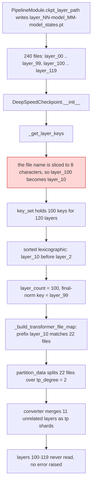
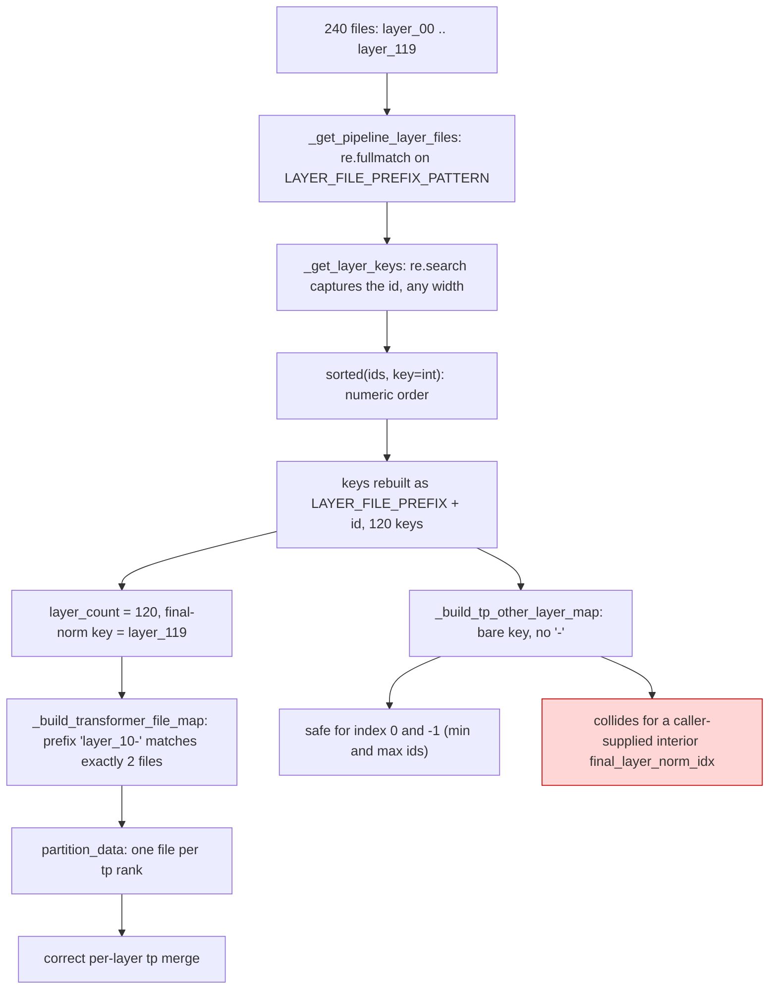

# Case study: checkpoint layer keys collide by prefix at 100+ pipeline layers

| | |
|---|---|
| **Issue** | [#3305](https://github.com/deepspeedai/DeepSpeed/issues/3305) "[BUG] incorrectly loading layer_keys in deepspeed_checkpoint.py", opened 2023-04-19 by `lqtrung1998`, labels `bug`, `compression` |
| **State** | **Still open** as of 2026-11-20, although the reported defect is fixed in master. The fix rode in on an unrelated feature PR and nobody closed the ticket. |
| **Fix** | [PR #5506](https://github.com/deepspeedai/DeepSpeed/pull/5506) "DeepSpeedCheckpoint: support custom final ln idx" by `nelyahu`, merged 2024-05-28 as `2fc702ed9`. The PR title and body never mention #3305. |
| **Files** | `deepspeed/checkpoint/deepspeed_checkpoint.py`, `deepspeed/checkpoint/reshape_utils.py`, `deepspeed/checkpoint/constants.py`, `deepspeed/checkpoint/reshape_3d_utils.py`, `deepspeed/runtime/pipe/module.py` |
| **Difficulty** | Medium |
| **Why instructive** | A one-line string slice silently changed the *number of layers* a checkpoint appeared to have. Nothing crashed, nothing warned; the conversion tool just produced a 100-layer model out of a 120-layer checkpoint. It also shows how a real fix can land without closing the issue, and that one sibling function still does the dangerous thing. |

---

## Symptom

The whole report is four lines:

> This function is to get `layer_keys` and it is not correct when number of layers is >= 100
> because "layer_100" will be seen as "layer_10".

The link in the issue points at `deepspeed_checkpoint.py#L256-L260`, which at the time was:

```python
def _get_layer_keys(self):
    key_set = set()
    key_len = len(LAYER_FILE_PREFIX) + 2
    for file_path in self.layer_files:
        _, fname = os.path.split(file_path)
        key_set.add(fname[:key_len])
    return sorted(list(key_set))
```

There is no traceback in the issue, because there is no exception. Everything downstream of
`layer_keys` -- the layer count, the pipeline-stage map, the per-layer file lists used by the
Megatron/universal checkpoint converters -- just quietly describes the wrong model. A
maintainer later confirmed on the ticket that on the pre-fix code "the old truncation, run over
the same file list, returns 100 keys, with layers 100 to 119 folded into `layer_10` and
`layer_11`".

---

## Background

### How a pipeline checkpoint is laid out on disk

`PipelineModule` writes one file per layer per model-parallel rank. The name is built at
`deepspeed/runtime/pipe/module.py:583`:

```python
def ckpt_layer_path(self, ckpt_dir, local_layer_idx):
    """Customize a prefix for a specific pipeline module layer. """
    idx = local_layer_idx + self._local_start
    layer_ckpt_path = os.path.join(ckpt_dir, f'layer_{idx:02d}')
    rank_repr = self._grid._topo.get_rank_repr(rank=self.global_rank)
    if rank_repr != '':
        layer_ckpt_path += f'-{rank_repr}'
    layer_ckpt_path += '-model_states.pt'
    return layer_ckpt_path
```

The critical property of `f'{idx:02d}'` is that two digits are a *minimum width*, not a fixed
width. Layer 7 is `layer_07`, layer 42 is `layer_42`, and layer 119 is `layer_119`. The prefix
`layer_` is the constant `LAYER_FILE_PREFIX` at `deepspeed/checkpoint/constants.py:44`.

A 120-layer model on `tp_degree=2` therefore produces 240 files named
`layer_00-model_00-model_states.pt` ... `layer_119-model_01-model_states.pt`.

### How `DeepSpeedCheckpoint` reads that layout

`DeepSpeedCheckpoint` is the reader used by the checkpoint conversion and reshaping tools
(`ds_to_universal`, the Megatron converters, `reshape_3d_utils`). Construction walks the folder
and then derives everything from the *file names*:

* `deepspeed/checkpoint/deepspeed_checkpoint.py:55` -- `self.layer_files = _get_pipeline_layer_files(self.file_list)`
* `deepspeed/checkpoint/deepspeed_checkpoint.py:66` -- `self.layer_keys = self._get_layer_keys()`
* `deepspeed/checkpoint/deepspeed_checkpoint.py:67` -- `self.layer_count = len(self.layer_keys)`
* `deepspeed/checkpoint/deepspeed_checkpoint.py:89-92` -- the four maps built out of `layer_keys`:
  `_build_pp_transformer_map`, `_build_transformer_file_map`, and two `_build_tp_other_layer_map`
  calls for the embedding and the final layer norm.

The file-matching primitive is a plain `str.startswith` filter, `deepspeed/checkpoint/reshape_utils.py:18`:

```python
def get_files_with_prefix(all_files, prefix):
    file_list = []
    for file_path in all_files:
        _, fname = os.path.split(file_path)
        if fname.startswith(prefix):
            file_list.append(file_path)

    return sorted(file_list)
```

So the identity of a layer is a *string prefix of a file name*, and the only thing that keeps
`layer_10` from being the same layer as `layer_100` is whatever separator the caller remembers
to append.

### Who consumes `layer_keys`

`layer_count` and the maps are the whole model description for the converters:
`get_embedding_layer_id()` is `layer_keys[0]` (line 192), `get_final_norm_layer_id()` is
`layer_keys[self.final_layer_norm_idx]` (line 195), and the transformer layers are
`layer_keys[1:self.final_layer_norm_idx]` (lines 287 and 302). `_sanity_check()` at line 320
checks only the model-state and ZeRO file counts -- it never cross-checks `layer_count`
against anything, so a wrong count has nothing to fail against.

---

## Root cause

`key_len = len(LAYER_FILE_PREFIX) + 2` encodes the assumption "a layer id is exactly two
characters". `fname[:key_len]` is then not a parse but a truncation, and truncation is
*lossy in a way that collides*: every id with three or more digits is folded onto the two-digit
id formed by its leading digits.

Two separate failures follow from the same line:

1. **The key set shrinks.** `layer_100` ... `layer_109` all truncate to `layer_10`, so a
   120-layer checkpoint yields 100 distinct keys. `layer_count` is 100. The last key is
   `layer_99`, so the "final layer norm" is read from layer 99 and layers 100-119 are never
   addressed at all.
2. **Each surviving key over-matches.** `_build_transformer_file_map` passed the bare key to
   `get_files_with_prefix`, so the key `layer_10` matched `layer_10-*`, `layer_100-*` ...
   `layer_109-*`: 22 files instead of 2 on `tp_degree=2`. `partition_data` then split those 22
   files across the 2 tp ranks, and the converter merged tensors from eleven *different* layers
   as if they were the tp shards of one layer.

A third, latent problem sits next to it: the old function returned `sorted(list(key_set))`, a
plain lexicographic sort. Even with correct, untruncated keys, lexicographic order gives
`layer_0, layer_1, layer_10, layer_100, layer_11, layer_2, ...`. Since `layer_keys` is indexed
positionally (`[0]` = embedding, `[1:-1]` = transformer, `[-1]` = final norm), lexicographic
order would scramble the stage map even after the truncation was repaired. The fix had to
change both.

### Worked example: 120 layers, tp_degree 2

Input file list (240 files):

```
layer_00-model_00-model_states.pt   layer_00-model_01-model_states.pt
layer_01-model_00-model_states.pt   layer_01-model_01-model_states.pt
...
layer_99-model_00-model_states.pt   layer_99-model_01-model_states.pt
layer_100-model_00-model_states.pt  layer_100-model_01-model_states.pt
...
layer_119-model_00-model_states.pt  layer_119-model_01-model_states.pt
```

Running both implementations over that list (real output, see the verification section):

```
layer_count: 120                      <- current master
keys[8:14]: ['layer_08', 'layer_09', 'layer_10', 'layer_11', 'layer_12', 'layer_13']
keys[-3:]: ['layer_117', 'layer_118', 'layer_119']

old layer_count: 100                  <- pre-#5506 truncation
old keys[-3:]: ['layer_97', 'layer_98', 'layer_99']
old files matched by 'layer_10':  22
new files matched by 'layer_10-':  2
```

So on the old code: 20 layers vanish, the final-norm key is off by 20 layers, and the layer-10
file group is 11x too large.

---

## The fix

### Current code

`deepspeed/checkpoint/deepspeed_checkpoint.py:26` defines the pattern, and
`deepspeed/checkpoint/deepspeed_checkpoint.py:333` does the parse:

```python
LAYER_FILE_PREFIX_PATTERN = r'layer_(\d+)-model_.*'
```

```python
def _get_layer_keys(self):
    key_set = set()
    for file_path in self.layer_files:
        _, fname = os.path.split(file_path)
        layer_id = re.search(LAYER_FILE_PREFIX_PATTERN, fname).group(1)
        key_set.add(layer_id)
    sorted_ids = sorted(list(key_set), key=int)
    layer_keys = [LAYER_FILE_PREFIX + str(layer_id) for layer_id in sorted_ids]
    return layer_keys
```

Three things changed: the id is *matched* (`(\d+)`, any width) instead of sliced, the sort is
numeric (`key=int`), and the key is rebuilt from the id that was actually found, so it still
equals the on-disk spelling including any zero padding (`'07'` stays `layer_07`).

The second half of the fix is the separator in `_build_transformer_file_map`,
`deepspeed/checkpoint/deepspeed_checkpoint.py:310`:

```python
for key_index, layer_key in enumerate(transformer_layer_keys):
    pp_index = key_index // layers_per_pp
    layer_files = get_files_with_prefix(self.layer_files, layer_key + '-')
```

`layer_key + '-'` makes the prefix unambiguous, because the character after the id in a real
file name is always `-`.

The same regex now also selects which files count as layer files at all,
`deepspeed/checkpoint/deepspeed_checkpoint.py:38` (added later, by
[PR #8198](https://github.com/deepspeedai/DeepSpeed/pull/8198)):

```python
def _get_pipeline_layer_files(file_list):
    return sorted(
        [file_path for file_path in file_list if re.fullmatch(LAYER_FILE_PREFIX_PATTERN, os.path.basename(file_path))])
```

### Before/after

The "before" side here is **not** reconstructed from the issue text: PR #5506 is a real merged
PR and the hunk below is taken verbatim from its diff (`GET /repos/deepspeedai/DeepSpeed/pulls/5506`
with `Accept: application/vnd.github.v3.diff`). Only the surrounding context has been trimmed.

```diff
--- a/deepspeed/checkpoint/deepspeed_checkpoint.py
+++ b/deepspeed/checkpoint/deepspeed_checkpoint.py
@@
 import os
+import re
 from typing import Dict
 import torch
@@
 ITERATION_KEY = 'iteration'
+LAYER_FILE_PREFIX_PATTERN = r'layer_(\d+)-model_.*'
@@ def _build_transformer_file_map(self):
     for key_index, layer_key in enumerate(transformer_layer_keys):
         pp_index = key_index // layers_per_pp
-        layer_files = get_files_with_prefix(self.layer_files, layer_key)
+        layer_files = get_files_with_prefix(self.layer_files, layer_key + '-')
         layer_file_partitions = partition_data(layer_files, self.tp_degree)
@@ def _get_layer_keys(self):
     def _get_layer_keys(self):
         key_set = set()
-        key_len = len(LAYER_FILE_PREFIX) + 2
         for file_path in self.layer_files:
             _, fname = os.path.split(file_path)
-            key_set.add(fname[:key_len])
-        return sorted(list(key_set))
+            layer_id = re.search(LAYER_FILE_PREFIX_PATTERN, fname).group(1)
+            key_set.add(layer_id)
+        sorted_ids = sorted(list(key_set), key=int)
+        layer_keys = [LAYER_FILE_PREFIX + str(layer_id) for layer_id in sorted_ids]
+        return layer_keys
```

The rest of PR #5506 is the feature it was actually about: threading a caller-supplied
`final_layer_norm_idx` through the class instead of hard-coding `-1`. That matters below.

### Residual risk: one sibling still matches on a bare key

`_build_tp_other_layer_map` was *not* given the `+ '-'` treatment.
`deepspeed/checkpoint/deepspeed_checkpoint.py:268`:

```python
def _build_tp_other_layer_map(self, layer_index: int):
    data_map = {}
    if len(self.layer_files) < 1:
        return data_map
    assert layer_index <= len(self.layer_files)
    layer_files = get_files_with_prefix(self.layer_files, self.layer_keys[layer_index])
    layer_file_partitions = partition_data(layer_files, self.tp_degree)
    data_map = {i: flist for i, flist in enumerate(layer_file_partitions)}
    return data_map
```

For the two call sites that existed before #5506 this is harmless, and the reason is worth
spelling out rather than assuming:

* `EMBEDDING_LAYER_INDEX = 0` picks the **numerically smallest** id. A key `layer_K` can only
  be a strict prefix of ids `10*K ... 10*K+9`, which are all larger than `K`, so the smallest
  id in the folder can never over-match (given the `{idx:02d}` spelling, where the only ids
  with leading zeros are the one-digit ones).
* `final_layer_norm_idx = -1` picks the **numerically largest** id, and a collider must be
  longer, hence larger. Also safe.

But #5506 made `final_layer_norm_idx` a constructor argument, so an *interior* index is now a
supported input -- and an interior key is exactly the case that collides. Measured on the same
120-layer / tp=2 file list, with `final_layer_norm_idx=11`:

```
key used: layer_11
files per tp rank: {0: 11, 1: 11}
tp0 first/last: layer_11-model_00-model_states.pt layer_114-model_00-model_states.pt
embedding map (idx 0): {0: ['layer_00-model_00-model_states.pt'], 1: ['layer_00-model_01-model_states.pt']}
default final norm (idx -1): {0: ['layer_119-model_00-model_states.pt'], 1: ['layer_119-model_01-model_states.pt']}
```

`layer_11` pulled in `layer_110` ... `layer_119` as well: 22 files, split 11/11, with tp rank 0
receiving a mixture of `model_00` and `model_01` shards from ten unrelated layers. The
defaults are fine; the configurable path is not. A one-character change (`self.layer_keys[layer_index] + '-'`)
would close it, and `assert layer_index <= len(self.layer_files)` on line 272 is also not a
bounds check worth having -- it is trivially true for any negative index and compares a layer
index against a *file* count.

A second, weaker residual: `deepspeed/checkpoint/reshape_3d_utils.py:114` infers the tp degree
by counting files with the hard-coded prefix `f'{LAYER_FILE_PREFIX}01'`:

```python
num_pp0_files = len(get_files_with_prefix(file_list, f'{LAYER_FILE_PREFIX}01'))
```

With DeepSpeed's own `{idx:02d}` naming this cannot collide (there is no `layer_010`), but it
does bake in both "the first layer is id 1" and "ids are zero-padded to exactly two digits". A
producer that padded to three digits would make this probe count `layer_010 ... layer_019`
and report a tp degree 11x too large. `_validate_folder` at line 360 carries the same
`f'{LAYER_FILE_PREFIX}01'` assumption, though only as an existence check.

---

## How to verify it yourself

CPU only, no GPU, no checkpoint files needed -- `_get_layer_keys` is pure string work, so we
feed it a synthetic file list. Save outside the repo (e.g. `/tmp/cs04.py`) and run from the
repo root with `PYTHONPATH=. DS_ACCELERATOR=cpu python3.13 /tmp/cs04.py`.

```python
import os
from deepspeed.checkpoint.deepspeed_checkpoint import DeepSpeedCheckpoint
from deepspeed.checkpoint.reshape_utils import get_files_with_prefix

# 120 pipeline layers, tp_degree = 2, named the way PipelineModule writes them
files = [f"/ckpt/layer_{i:02d}-model_{tp:02d}-model_states.pt" for i in range(120) for tp in (0, 1)]

ckpt = DeepSpeedCheckpoint.__new__(DeepSpeedCheckpoint)   # skip __init__, we only exercise key parsing
ckpt.layer_files = sorted(files)
keys = ckpt._get_layer_keys()
print("layer_count:", len(keys))
print("keys[8:14]:", keys[8:14])
print("keys[-3:]:", keys[-3:])

# the pre-#5506 implementation, for contrast
def old_get_layer_keys(layer_files):
    key_len = len("layer_") + 2
    key_set = set()
    for p in layer_files:
        key_set.add(os.path.basename(p)[:key_len])
    return sorted(key_set)

old = old_get_layer_keys(ckpt.layer_files)
print("old layer_count:", len(old))
print("old keys[-3:]:", old[-3:])
print("old files matched by 'layer_10':", len(get_files_with_prefix(ckpt.layer_files, "layer_10")))
print("new files matched by 'layer_10-':", len(get_files_with_prefix(ckpt.layer_files, "layer_10-")))

# residual risk: _build_tp_other_layer_map still matches on a bare key, no trailing '-'
ckpt.layer_keys = keys
ckpt.tp_degree = 2
ckpt.final_layer_norm_idx = 11          # a caller-supplied index, allowed since PR #5506
m = ckpt._build_tp_other_layer_map(ckpt.final_layer_norm_idx)
print("key used:", keys[11])
print("files per tp rank:", {k: len(v) for k, v in m.items()})
print("tp0 first/last:", os.path.basename(m[0][0]), os.path.basename(m[0][-1]))
print("embedding map (idx 0):", {k: [os.path.basename(f) for f in v] for k, v in ckpt._build_tp_other_layer_map(0).items()})
print("default final norm (idx -1):",
      {k: [os.path.basename(f) for f in v] for k, v in ckpt._build_tp_other_layer_map(-1).items()})
```

Real output on this tree (DeepSpeed 0.20.1, torch 2.15.0+cpu, python 3.13):

```
layer_count: 120
keys[8:14]: ['layer_08', 'layer_09', 'layer_10', 'layer_11', 'layer_12', 'layer_13']
keys[-3:]: ['layer_117', 'layer_118', 'layer_119']
old layer_count: 100
old keys[-3:]: ['layer_97', 'layer_98', 'layer_99']
old files matched by 'layer_10': 22
new files matched by 'layer_10-': 2
key used: layer_11
files per tp rank: {0: 11, 1: 11}
tp0 first/last: layer_11-model_00-model_states.pt layer_114-model_00-model_states.pt
embedding map (idx 0): {0: ['layer_00-model_00-model_states.pt'], 1: ['layer_00-model_01-model_states.pt']}
default final norm (idx -1): {0: ['layer_119-model_00-model_states.pt'], 1: ['layer_119-model_01-model_states.pt']}
```

The first block is the fix (120 keys, numeric order, two files per layer). The last three lines
are the residual risk: the default indices are clean, the configurable one is not.

---

## Lessons

* **Parse, do not slice.** `fname[:len(prefix) + 2]` encodes a field width that the writer never
  promised; `f'{idx:02d}'` is a *minimum* width. A regex with a capture group costs one line and
  cannot silently fold two layers into one.
* **A prefix is not an identifier.** Any `startswith` lookup over names that share a stem needs
  the delimiter included (`layer_10-`), or it needs to stop being a prefix lookup. The fix for
  #3305 is as much the `+ '-'` as the regex.
* **Numeric ids need numeric sorting.** `sorted()` on `['layer_2', 'layer_10']` is not the layer
  order, and `layer_keys` is consumed positionally. Fixing the parse without fixing the sort
  would have replaced one wrong model with another.
* **Check the whole family of call sites.** Three functions used the bare-prefix idiom;
  #5506 fixed one and left `_build_tp_other_layer_map` alone, and its own new feature
  (`final_layer_norm_idx`) is what turned the leftover into a reachable bug. DeepSpeed's own
  `AGENTS.md` asks for exactly this check on sibling paths.
* **Link fixes to tickets.** The repair shipped in May 2024 inside a PR about a custom final
  layer-norm index. Two and a half years later #3305 is still open, so the next reader has to
  re-derive from scratch whether master is affected.
* **Silent wrongness beats loud wrongness only for the author.** A missing-file exception would
  have found this in minutes; a 100-key dictionary found it after someone trained a 120-layer
  model.

---

## Flowcharts

### Buggy flow (pre-#5506)



### Fixed flow (current tree)


