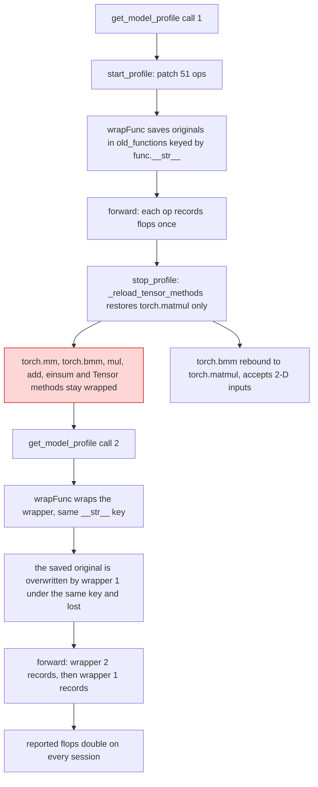
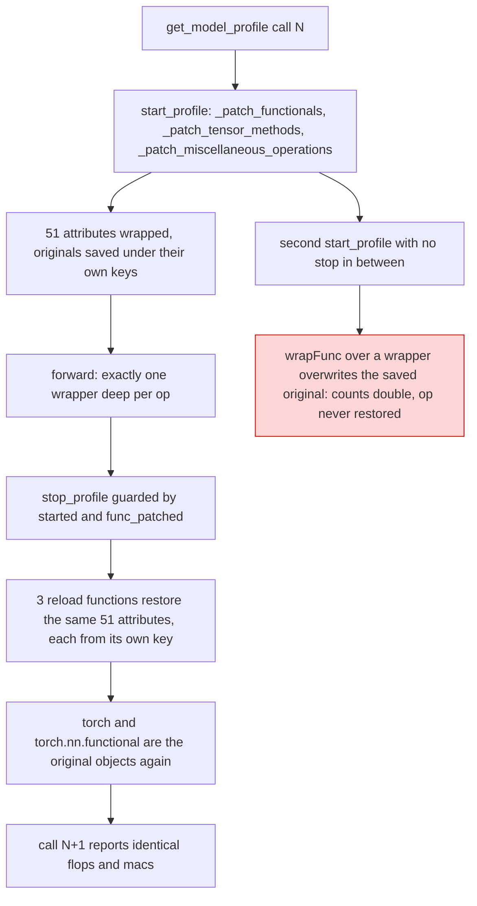

# Case study: the flops profiler leaked its own monkeypatches

| | |
|---|---|
| **Issue** | [#2231](https://github.com/deepspeedai/DeepSpeed/issues/2231) "[BUG] Patch and reload tensor methods in flops_profiler", opened 2022-08-17 by `pyf98`, label `bug` |
| **State** | **Still open** as of 2026-11-20. Both reported defects are fixed in master; the ticket was never closed. A related ticket, [#7413](https://github.com/deepspeedai/DeepSpeed/issues/7413), was opened in 2025 for the *same* symptom and closed 2026-08-23. |
| **Fixes** | [PR #2068](https://github.com/deepspeedai/DeepSpeed/pull/2068) "some fix in flops_profiler" by `lucasleesw`, merged 2023-02-01 as `e2a31d800` (defect 1, most of defect 2, plus the dictionary-key change). [PR #8246](https://github.com/deepspeedai/DeepSpeed/pull/8246) "Fix repeated FlopsProfiler metric accumulation" by `baremetaldevx86`, merged 2026-08-23 as `ebb75d7e8` (the last three missing restores, closing #7413). |
| **Files** | `deepspeed/profiling/flops_profiler/profiler.py`, `tests/unit/profiling/flops_profiler/test_flops_profiler.py` |
| **Difficulty** | Medium |
| **Why instructive** | The profiler measures a program by mutating global state (monkeypatching `torch`), so its correctness depends on an exact bijection between two hand-written lists 60 lines apart. Every failure mode here -- a wrong argument, a missing line, a colliding dictionary key -- is invisible at the call site and shows up as *numbers that change between identical runs*. |

---

## Symptom

From the issue:

> 1. In `_patch_tensor_methods`, should this line wrap `torch.Tensor.bmm` instead of `torch.bmm`?
> 2. In `_reload_tensor_methods`, only `torch.matmul` is reset to the old function. Should we
>    also reload other methods that are patched before? Otherwise, the other code in this
>    script will be affected. For example, if we call `get_model_profile` multiple times in a
>    script, the flops and macs can be different even for the same model.

And the expectation, stated plainly:

> The patched methods should be reloaded after profiling. Otherwise, it will affect other code.

Issue #7413 is the user-facing version of the same thing, three years later:

> I found that the value of MACs and FLOPs increases every time I call the same model with the
> same input. I would expect those metrics to stay the same.

PR #8246 recorded the numbers for a three-session run on one scaled-dot-product-attention
model: `[(65536, 32768), (131072, 65536), (196608, 98304)]` before the fix,
`[(65536, 32768)] * 3` after.

---

## Background

### How the profiler counts flops

`FlopsProfiler` does not trace the graph. It replaces a fixed list of `torch` and
`torch.nn.functional` callables with wrappers that record an analytic flop estimate into a
stack of per-module counters, then calls the original. The whole mechanism is three functions
and one module-level dict:

`deepspeed/profiling/flops_profiler/profiler.py:25`

```python
old_functions = {}
```

`deepspeed/profiling/flops_profiler/profiler.py:872`

```python
def wrapFunc(func, funcFlopCompute):
    oldFunc = func
    name = func.__str__
    old_functions[name] = oldFunc

    def newFunc(*args, **kwds):
        flops, macs = funcFlopCompute(*args, **kwds)
        if module_flop_count:
            module_flop_count[-1].append((name, flops))
        if module_mac_count and macs:
            module_mac_count[-1].append((name, macs))
        return oldFunc(*args, **kwds)

    newFunc.__str__ = func.__str__

    return newFunc
```

Patching happens in `_patch_functionals` (line 890), `_patch_tensor_methods` (line 949) and
`_patch_miscellaneous_operations` (line 972), all called from `start_profile`
(`profiler.py:84-86`). Unpatching happens in the mirror functions `_reload_functionals`
(line 976), `_reload_tensor_methods` (line 1017) and `_reload_miscellaneous_operations`
(line 1037), called from `stop_profile` (`profiler.py:140-142`) behind a
`self.started and self.func_patched` guard. `end_profile` (line 203) calls `stop_profile` and
then strips the per-module attributes.

`get_model_profile` (line 1196) is the convenience wrapper: warm-up forwards,
`start_profile()`, one forward, read the totals, `end_profile()` (line 1290). One patch/unpatch
pair per call -- *if* the unpatch is complete.

### Why the dictionary key is `func.__str__`

`old_functions` maps "which function was replaced" to "the original". The key cannot be the
function object itself for builtins in all torch versions, and it must survive being read back
through the *wrapper*: `_reload_functionals` looks up `old_functions[F.linear.__str__]` at a
point where `F.linear` is already the wrapper.

`func.__str__` is the bound `__str__` method-wrapper of that particular function object. Two
accesses of the same object's `__str__` compare equal and hash equal, and two different
function objects give unequal keys -- so it behaves as an identity key. The line
`newFunc.__str__ = func.__str__` copies the original's method-wrapper onto the wrapper as a
plain attribute, which is what makes the reload lookup resolve to the right slot. Clever, and
with one sharp edge (see "Residual risk").

---

## Root cause

### Defect 1: wrapping the wrong callable

`profiler.py` as of 2022:

```python
torch.bmm = wrapFunc(torch.bmm, _matmul_flops_compute)
torch.Tensor.bmm = wrapFunc(torch.bmm, _matmul_flops_compute)
```

The second line reads `torch.bmm` -- which has *already been replaced on the previous line* --
and installs that wrapper as `torch.Tensor.bmm`. Consequences, in order of nastiness:

1. `a.bmm(b)` was counted twice: once by the `torch.Tensor.bmm` wrapper and once by the
   `torch.bmm` wrapper nested inside it.
2. `torch.Tensor.bmm` was no longer the tensor method but the free function, so the
   `self` argument arrived as a positional `input`. For `torch.bmm` the signature happens to
   line up, which is exactly why this survived for months.
3. `old_functions` never received an entry for the real `torch.Tensor.bmm`, so there was
   nothing to restore it from.

### Defect 2: the reload list was a subset of the patch list

`_reload_tensor_methods` restored exactly one of the thirteen methods that
`_patch_tensor_methods` replaced:

```python
def _reload_tensor_methods():
    torch.matmul = old_functions[torch.matmul.__name__]
```

So after a profiling session the process was left with live wrappers on `torch.mm`,
`torch.bmm`, `torch.addmm`, `torch.mul`, `torch.add`, `torch.einsum`, and the `Tensor`
equivalents. A second `get_model_profile()` then wrapped the wrappers. Because the wrapper
installs itself as the recorder *and* calls the inner wrapper, which also records, each
additional session multiplies the reported count. `_reload_functionals` had the same shape of
hole: `F.silu`, `F.gelu`, `F.layer_norm`, `F.instance_norm` and `F.group_norm` were patched and
never restored.

### Defect 3 (found by PR #2068): the key collided

While fixing the lists, `lucasleesw` noticed that the dict was keyed by `func.__name__`:

> `torch.mm` and `torch.Tensor.mm` will have same `__name__` in `wrapFunc`, my suggestion is
> use `__str__` instead.

`torch.mm.__name__` and `torch.Tensor.mm.__name__` are both `'mm'`, so the second patch
overwrote the first entry and the two restores pulled the same object out of the dict. Adding
the missing restore lines without changing the key would have replaced "not restored" with
"restored to the wrong function".

### Defect 4 (found by PR #8246): one restore read the wrong key

PR #2068's expanded `_reload_tensor_methods` carried a copy/paste slip that lived for three and
a half years:

```python
torch.bmm = old_functions[torch.matmul.__str__]
```

By the time that line runs, `torch.matmul` has already been restored on line 1 of the same
function, so `torch.matmul.__str__` is the key of the *original* `torch.matmul` and
`torch.bmm` was rebound to `torch.matmul` for the remainder of the process. As PR #8246 put it:

> This changed normal PyTorch behavior after profiling: `torch.bmm` began accepting inputs
> supported by broadcasting matmul but invalid for bmm.

A 2-D input that `torch.bmm` should reject now silently succeeded -- a profiler that
*loosens type checking* in the program it measured.

### The mechanism in one paragraph

`wrapFunc` is not idempotent. Wrapping an already-wrapped function creates a new wrapper whose
`__str__` attribute is the *original's* method-wrapper, so `old_functions[key]` is overwritten
with the first wrapper and the original is lost. Any asymmetry between the patch list and the
reload list therefore does not merely "leak one wrapper"; it destroys the only reference to the
pristine function, and from that point on every count through that op is multiplied by the
number of sessions.

---

## The fix

### Current code

The two tensor-method lists, `deepspeed/profiling/flops_profiler/profiler.py:949` and
`deepspeed/profiling/flops_profiler/profiler.py:1017`:

```python
def _patch_tensor_methods():
    torch.matmul = wrapFunc(torch.matmul, _matmul_flops_compute)
    torch.Tensor.matmul = wrapFunc(torch.Tensor.matmul, _matmul_flops_compute)
    torch.Tensor.__matmul__ = wrapFunc(torch.Tensor.__matmul__, _matmul_flops_compute)
    torch.mm = wrapFunc(torch.mm, _matmul_flops_compute)
    torch.Tensor.mm = wrapFunc(torch.Tensor.mm, _matmul_flops_compute)
    torch.bmm = wrapFunc(torch.bmm, _matmul_flops_compute)
    torch.Tensor.bmm = wrapFunc(torch.Tensor.bmm, _matmul_flops_compute)

    torch.addmm = wrapFunc(torch.addmm, _addmm_flops_compute)
    torch.Tensor.addmm = wrapFunc(torch.Tensor.addmm, _tensor_addmm_flops_compute)

    torch.mul = wrapFunc(torch.mul, _mul_flops_compute)
    torch.Tensor.mul = wrapFunc(torch.Tensor.mul, _mul_flops_compute)

    torch.add = wrapFunc(torch.add, _add_flops_compute)
    torch.Tensor.add = wrapFunc(torch.Tensor.add, _add_flops_compute)

    torch.einsum = wrapFunc(torch.einsum, _einsum_flops_compute)

    torch.baddbmm = wrapFunc(torch.baddbmm, _tensor_addmm_flops_compute)


def _reload_tensor_methods():
    torch.matmul = old_functions[torch.matmul.__str__]
    torch.Tensor.matmul = old_functions[torch.Tensor.matmul.__str__]
    torch.Tensor.__matmul__ = old_functions[torch.Tensor.__matmul__.__str__]
    torch.mm = old_functions[torch.mm.__str__]
    torch.Tensor.mm = old_functions[torch.Tensor.mm.__str__]
    torch.bmm = old_functions[torch.bmm.__str__]
    torch.Tensor.bmm = old_functions[torch.Tensor.bmm.__str__]
    torch.addmm = old_functions[torch.addmm.__str__]
    torch.Tensor.addmm = old_functions[torch.Tensor.addmm.__str__]
    torch.mul = old_functions[torch.mul.__str__]
    torch.Tensor.mul = old_functions[torch.Tensor.mul.__str__]
    torch.add = old_functions[torch.add.__str__]
    torch.Tensor.add = old_functions[torch.Tensor.add.__str__]

    torch.einsum = old_functions[torch.einsum.__str__]

    torch.baddbmm = old_functions[torch.baddbmm.__str__]
```

### Item-by-item comparison of the two lists

Fifteen tensor-level attributes are patched, and the same fifteen are restored, each from its
own key. Walking the two function bodies with `ast` (output from the verification script
below):

```
tensor methods patched:  ['torch.matmul', 'torch.Tensor.matmul', 'torch.Tensor.__matmul__',
                          'torch.mm', 'torch.Tensor.mm', 'torch.bmm', 'torch.Tensor.bmm',
                          'torch.addmm', 'torch.Tensor.addmm', 'torch.mul', 'torch.Tensor.mul',
                          'torch.add', 'torch.Tensor.add', 'torch.einsum', 'torch.baddbmm']
tensor methods reloaded: ['torch.matmul', 'torch.Tensor.matmul', 'torch.Tensor.__matmul__',
                          'torch.mm', 'torch.Tensor.mm', 'torch.bmm', 'torch.Tensor.bmm',
                          'torch.addmm', 'torch.Tensor.addmm', 'torch.mul', 'torch.Tensor.mul',
                          'torch.add', 'torch.Tensor.add', 'torch.einsum', 'torch.baddbmm']
```

Same comparison over all three patch functions versus all three reload functions:

```
patched: 51 reloaded: 51
patched not reloaded: []
reloaded not patched: []
```

The 51 are 35 `torch.nn.functional` entries (including `F.silu` and
`F.scaled_dot_product_attention` behind their version guards, which the reload side now
mirrors), the 15 above, and `einops.einsum`. There is **no asymmetry left in the two lists**,
and no restore reads another op's key: every right-hand side in `_reload_tensor_methods` is
keyed by the attribute being assigned on the left.

### Before/after

Both halves come from **real merged PRs**, so the "before" below is quoted from the upstream
diffs (`GET /repos/deepspeedai/DeepSpeed/pulls/{2068,8246}` with the diff media type), not
reconstructed from the issue text.

PR #2068 (2023-02-01) -- defect 1, defect 3, and most of defect 2:

```diff
 def wrapFunc(func, funcFlopCompute):
     oldFunc = func
-    name = func.__name__
+    name = func.__str__
     old_functions[name] = oldFunc
@@
-    newFunc.__name__ = func.__name__
+    newFunc.__str__ = func.__str__
@@ def _patch_tensor_methods():
     torch.bmm = wrapFunc(torch.bmm, _matmul_flops_compute)
-    torch.Tensor.bmm = wrapFunc(torch.bmm, _matmul_flops_compute)
+    torch.Tensor.bmm = wrapFunc(torch.Tensor.bmm, _matmul_flops_compute)
@@
     torch.einsum = wrapFunc(torch.einsum, _einsum_flops_compute)
+
+    torch.baddbmm = wrapFunc(torch.baddbmm, _tensor_addmm_flops_compute)
@@ def _reload_tensor_methods():
-    torch.matmul = old_functions[torch.matmul.__name__]
+    torch.matmul = old_functions[torch.matmul.__str__]
+    torch.Tensor.matmul = old_functions[torch.Tensor.matmul.__str__]
+    torch.mm = old_functions[torch.mm.__str__]
+    torch.Tensor.mm = old_functions[torch.Tensor.mm.__str__]
+    torch.bmm = old_functions[torch.matmul.__str__]
+    torch.Tensor.bmm = old_functions[torch.Tensor.bmm.__str__]
+    torch.addmm = old_functions[torch.addmm.__str__]
+    torch.Tensor.addmm = old_functions[torch.Tensor.addmm.__str__]
+    torch.mul = old_functions[torch.mul.__str__]
+    torch.Tensor.mul = old_functions[torch.Tensor.mul.__str__]
+    torch.add = old_functions[torch.add.__str__]
+    torch.Tensor.add = old_functions[torch.Tensor.add.__str__]
+
+    torch.einsum = old_functions[torch.einsum.__str__]
+
+    torch.baddbmm = old_functions[torch.baddbmm.__str__]
```

(The same PR added the missing `F.silu`, `F.gelu`, `F.layer_norm`, `F.instance_norm` and
`F.group_norm` restores to `_reload_functionals`. Note the `torch.bmm` line it introduced --
that is defect 4, visible right there in the `+` lines.)

PR #8246 (2026-08-23) -- the remainder:

```diff
     F.embedding = old_functions[F.embedding.__str__]
+    if required_torch_version(min_version=2.0):
+        F.scaled_dot_product_attention = old_functions[F.scaled_dot_product_attention.__str__]
@@ def _reload_tensor_methods():
     torch.Tensor.matmul = old_functions[torch.Tensor.matmul.__str__]
+    torch.Tensor.__matmul__ = old_functions[torch.Tensor.__matmul__.__str__]
     torch.mm = old_functions[torch.mm.__str__]
     torch.Tensor.mm = old_functions[torch.Tensor.mm.__str__]
-    torch.bmm = old_functions[torch.matmul.__str__]
+    torch.bmm = old_functions[torch.bmm.__str__]
```

It also added `test_repeated_profile_restores_operations` at
`tests/unit/profiling/flops_profiler/test_flops_profiler.py:30`, which profiles the same model
three times and asserts both that the totals are identical and that
`F.scaled_dot_product_attention`, `Tensor.__matmul__` and `torch.bmm` are the original objects
after every session.

### Residual risk: the lists are symmetric, `start_profile` is not

`stop_profile` is guarded against a double unpatch (`if self.started and self.func_patched`),
but `start_profile` has no matching guard against a double *patch*. Calling it twice without an
intervening stop runs `wrapFunc` over the wrappers, which overwrites `old_functions[key]` with
the first wrapper, and the original is then unreachable forever. Measured on this tree:

```
extra start_profile calls=0 flops=128 restored=True
extra start_profile calls=1 flops=256 restored=False
extra start_profile calls=2 flops=512 restored=False
```

That is the exact symptom reported in #2231 and #7413 -- same model, doubling flops -- still
reachable through a different door. It is not a hypothetical API misuse: `start_profile` is
public and documented in the class docstring for use inside a training loop
(`profiler.py:39-59`), and an exception between a `start_profile` and its `stop_profile` leaves
the process in the same state.

Two smaller observations in the same area:

* `old_functions` is never cleared. It only grows, and it holds a strong reference to every
  function object it ever saw.
* The version guards are duplicated by hand on both sides (`if hasattr(F, "silu")`,
  `if required_torch_version(min_version=2.0)`). They agree today; nothing enforces that. A
  single table of `(container, attribute, flop_fn, guard)` driving both directions would make
  the whole class of bug unrepresentable.

---

## How to verify it yourself

CPU only. Save outside the repo and run from the repo root with
`PYTHONPATH=. DS_ACCELERATOR=cpu python3.13 /tmp/cs05.py`.

```python
import ast, torch, einops
import torch.nn.functional as F
from deepspeed.profiling.flops_profiler.profiler import get_model_profile
import deepspeed.profiling.flops_profiler.profiler as prof_mod

tree = ast.parse(open(prof_mod.__file__).read())

def targets(fn_names):
    out = []
    for node in ast.walk(tree):
        if isinstance(node, ast.FunctionDef) and node.name in fn_names:
            for stmt in ast.walk(node):
                if isinstance(stmt, ast.Assign):
                    out.append(ast.unparse(stmt.targets[0]))
    return out

patched = [t for t in targets({"_patch_functionals", "_patch_tensor_methods",
                               "_patch_miscellaneous_operations"}) if t not in ("oldFunc", "name")]
reloaded = targets({"_reload_functionals", "_reload_tensor_methods",
                    "_reload_miscellaneous_operations"})
print("patched:", len(patched), "reloaded:", len(reloaded))
print("patched not reloaded:", sorted(set(patched) - set(reloaded)))
print("reloaded not patched:", sorted(set(reloaded) - set(patched)))
print("tensor methods patched:", targets({"_patch_tensor_methods"}))
print("tensor methods reloaded:", targets({"_reload_tensor_methods"}))

class M(torch.nn.Module):
    def forward(self, q, k, v):
        return torch.bmm(q, k.transpose(1, 2)) @ v + F.scaled_dot_product_attention(q, k, v)

m = M()
args = [torch.randn(2, 4, 8) for _ in range(3)]
before = {name: eval(name) for name in set(patched)}
results = []
for _ in range(3):
    flops, macs, params = get_model_profile(m, args=args, print_profile=False, as_string=False)
    results.append((flops, macs))
after = {name: eval(name) for name in set(patched)}
print("repeated get_model_profile:", results)
print("not restored:", [n for n in before if before[n] is not after[n]])
print("torch.bmm is torch.matmul after profiling:", torch.bmm is torch.matmul)
```

Real output on this tree (DeepSpeed 0.20.1, torch 2.15.0+cpu, python 3.13; log lines removed):

```
patched: 51 reloaded: 51
patched not reloaded: []
reloaded not patched: []
tensor methods patched: ['torch.matmul', 'torch.Tensor.matmul', 'torch.Tensor.__matmul__', 'torch.mm', 'torch.Tensor.mm', 'torch.bmm', 'torch.Tensor.bmm', 'torch.addmm', 'torch.Tensor.addmm', 'torch.mul', 'torch.Tensor.mul', 'torch.add', 'torch.Tensor.add', 'torch.einsum', 'torch.baddbmm']
tensor methods reloaded: ['torch.matmul', 'torch.Tensor.matmul', 'torch.Tensor.__matmul__', 'torch.mm', 'torch.Tensor.mm', 'torch.bmm', 'torch.Tensor.bmm', 'torch.addmm', 'torch.Tensor.addmm', 'torch.mul', 'torch.Tensor.mul', 'torch.add', 'torch.Tensor.add', 'torch.einsum', 'torch.baddbmm']
repeated get_model_profile: [(2048, 1024), (2048, 1024), (2048, 1024)]
not restored: []
torch.bmm is torch.matmul after profiling: False
```

The residual risk reproduces with a second snippet:

```python
import torch
import torch.nn.functional as F
from deepspeed.profiling.flops_profiler.profiler import FlopsProfiler

m = torch.nn.Linear(8, 8)
for extra_starts in (0, 1, 2):
    orig = F.linear
    prof = FlopsProfiler(m)
    prof.start_profile()
    for _ in range(extra_starts):
        prof.start_profile()          # no stop_profile in between
    m(torch.randn(1, 8))
    prof.stop_profile()
    print(f"extra start_profile calls={extra_starts} flops={prof.get_total_flops()} "
          f"restored={F.linear is orig}")
    prof.end_profile()
```

Real output:

```
extra start_profile calls=0 flops=128 restored=True
extra start_profile calls=1 flops=256 restored=False
extra start_profile calls=2 flops=512 restored=False
```

For the upstream regression test, run
`pytest tests/unit/profiling/flops_profiler/test_flops_profiler.py -k restores_operations`.

---

## Lessons

* **Two parallel hand-written lists are a bug generator.** The patch list and the reload list
  are a bijection that nothing checks. A `(container, attr, flop_fn, guard)` table used in both
  directions removes defects 1, 2 and 4 by construction; a unit test comparing the two lists is
  the cheap version, and an `ast` walk is enough to write it.
* **Make the dangerous operation idempotent, or refuse it.** `wrapFunc` applied to its own
  output discards the saved original. `start_profile` could return early when
  `self.func_patched`, or `wrapFunc` could skip a callable that already carries a wrapper
  marker.
* **Restoring global state belongs in a context manager / `try: finally:`.** Any exception
  between `start_profile` and `stop_profile` leaves `torch` patched for the rest of the
  process, and nothing in the current API can recover it.
* **Measurement tools must not change the thing they measure.** The worst outcome here was not
  a wrong flop count: `torch.bmm = old_functions[torch.matmul.__str__]` left the program with
  a `bmm` that accepted inputs real `bmm` rejects.
* **Numbers that drift across identical runs are a state-leak signature.** "Flops increase on
  every call" was reported in 2022 and again in 2025; both reports describe accumulating
  wrappers. Treat non-reproducible measurements as a bug in the measuring code first.

---

## Flowcharts

### Buggy flow (two `get_model_profile` calls, pre-fix)



### Fixed flow (current tree)


