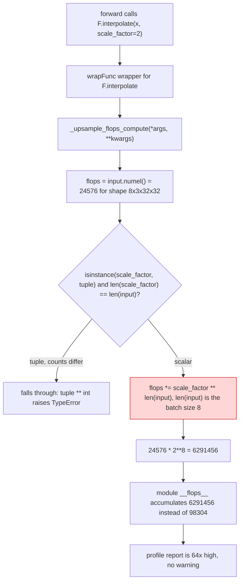
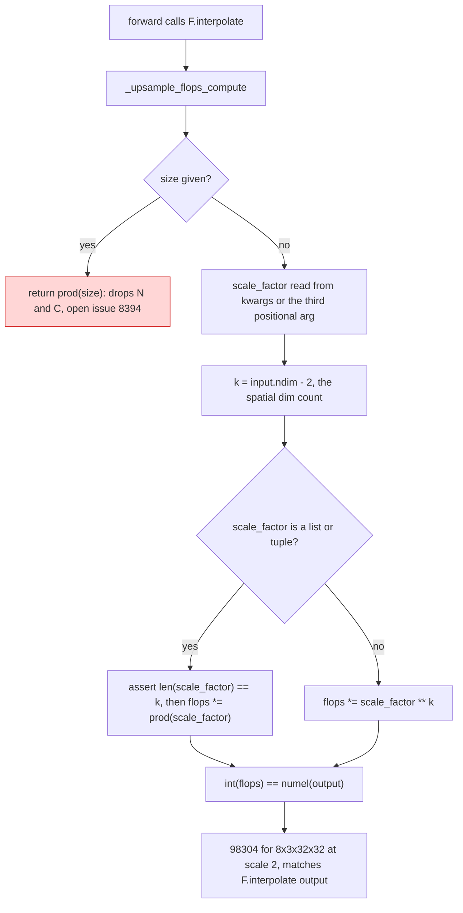

# Case study: upsample flops used the batch size as an exponent

| | |
|---|---|
| **Issue** | [#5537](https://github.com/deepspeedai/DeepSpeed/issues/5537) "[BUG] FlopsProfiler upsample flops compute bug", opened 2024-05-15 by `xgbj`, labels `bug`, `training` |
| **State** | **Still open** as of 2026-11-20. The two defects it reports are fixed in master; the PR that fixed them referenced a different ticket (`Fix #4504`), so #5537 was never closed. |
| **Fix** | [PR #7353](https://github.com/deepspeedai/DeepSpeed/pull/7353) "Flops profiler support for F.interpolate" by `sfc-gh-truwase` (credit `xmfbit`), merged 2025-06-20 as `25da6fc1a` |
| **Earlier patches to the same 10 lines** | [#2773](https://github.com/deepspeedai/DeepSpeed/pull/2773) (2023-02-01, stop crashing on unexpected kwargs), [#3782](https://github.com/deepspeedai/DeepSpeed/pull/3782) (2023-06-22, accept positional args), [#4500](https://github.com/deepspeedai/DeepSpeed/pull/4500) (2023-10-11, `flops * x` -> `flops *= x`) |
| **Related, still open** | [#8394](https://github.com/deepspeedai/DeepSpeed/issues/8394) -- the `size=` branch of the same function is still wrong |
| **Files** | `deepspeed/profiling/flops_profiler/profiler.py` |
| **Difficulty** | Medium |
| **Why instructive** | `len(tensor)` is legal Python that means something entirely different from what the author wanted, and the difference only shows up as a wrong *number*, never as an error. The wrong quantity was then used as an **exponent**, so the error grew geometrically with batch size -- and for one popular shape, `(2, 3, 8, 8)`, the buggy and correct formulas agree exactly, which is a good reminder to pick test shapes where the two candidate answers differ. |

---

## Symptom

The issue quotes the function and states the two fixes in one line each:

> ```python
> flops = input.numel()
> if isinstance(scale_factor, tuple) and len(scale_factor) == len(input):
>     flops *= int(_prod(scale_factor))
> else:
>     flops *= scale_factor**len(input)
> return flops, 0
> ```
>
> `len(scale_factor) == len(input)` -> `len(scale_factor) == len(input.size())`
> `flops *= scale_factor ** len(input)` -> `flops *= scale_factor ** (len(input.size())-1)`

The reporter also links `torchstat`'s upsample counter as the reference implementation.

There is no traceback for the scalar case: the profiler simply reports a number that can be
orders of magnitude too large or too small. (The tuple case *does* raise, see below.) The
reporter's diagnosis of defect 1 is exactly right; their proposed exponent for defect 2 is not,
and the merged fix differs -- a maintainer noted on the ticket:

> The exponent that got merged isn't the one proposed here, though: `len(input.size()) - 1` is 3
> for a 4D NCHW tensor, and interpolate scales the last n-2 dims, so 2 is right.

---

## Background

### What the profiler is trying to count

`_upsample_flops_compute` is the flop model for `F.interpolate` and `F.upsample`, installed as a
monkeypatch at `deepspeed/profiling/flops_profiler/profiler.py:935`:

```python
# upsample
F.upsample = wrapFunc(F.upsample, _upsample_flops_compute)
F.interpolate = wrapFunc(F.interpolate, _upsample_flops_compute)
```

The convention in this file for non-matmul ops is **one flop per output element, zero macs** --
the same convention `torchstat` uses, and the same the file uses for `F.softmax`
(`input.numel()`) and the pooling ops. Interpolation does different amounts of arithmetic per
output element depending on `mode` (`nearest` is a gather, `bilinear` is four weighted terms),
and the profiler deliberately ignores that; it is a size model, not an arithmetic model. So the
target answer is:

```
flops = numel(output) = N * C * prod(spatial output dims)
```

### What `F.interpolate` actually does to shapes

`F.interpolate` interprets its input as `(N, C, d_1, ..., d_k)`: the first two dims are batch
and channels and are **never** resampled, and the remaining `k = ndim - 2` dims are the spatial
dims. `scale_factor` is either a scalar applied to all `k` spatial dims, or a tuple/list with
exactly `k` entries. Hence, for a scalar `s`:

```
numel(output) = N * C * prod(floor(d_i * s))  =  numel(input) * s**k   (for integral s)
            k = input.ndim - 2
```

That is the entire derivation of the magic `- 2`: it is "all dims except batch and channel".
`3`, the reporter's suggestion (`len(input.size()) - 1`), would be "all dims except batch" and
would scale the channel dim as if it were spatial.

### Two things `len()` can mean

For a `torch.Tensor`, `len(t)` is the Python sequence length, i.e. `t.shape[0]` -- the batch
size. It is **not** the rank. The rank is `t.ndim` (or `len(t.size())`, which is what the
reporter wrote). For the common case of `(2, 3, 8, 8)`, `len(input) == 2` and `input.ndim - 2 == 2`,
so the two expressions coincide; that coincidence is a large part of why the bug lived from
the function's introduction until 2025.

`_prod` (`profiler.py:516`) is the local product helper.

---

## Root cause

The pre-#7353 body (as quoted in the issue and confirmed by the merged diff):

```python
flops = input.numel()
if isinstance(scale_factor, tuple) and len(scale_factor) == len(input):
    flops *= int(_prod(scale_factor))
else:
    flops *= scale_factor**len(input)
return flops, 0
```

Three distinct defects in five lines:

1. **Wrong quantity, used as an exponent.** `len(input)` is the batch size. The intended
   quantity is the number of spatial dims. The reported flops therefore scaled as
   `s ** batch_size` instead of `s ** (ndim - 2)` -- an error that *grows geometrically with
   the batch dimension*, which is the one dimension users routinely change between runs.
2. **Wrong guard on the tuple branch.** `len(scale_factor) == len(input)` compares the number
   of scale factors against the batch size. When they happen to be equal the branch is taken
   for the wrong reason; when they are not, a tuple `scale_factor` falls through to
   `scale_factor ** len(input)`, which raises
   `TypeError: unsupported operand type(s) for ** or pow(): 'tuple' and 'int'`. A profiler
   crash inside a user's forward pass.
3. **`list` was not accepted at all.** `isinstance(scale_factor, tuple)` misses
   `scale_factor=[2, 2]`, which `F.interpolate` accepts.

### Worked example

Take `input` of shape `(8, 3, 32, 32)` and `scale_factor=2`, `mode='nearest'`:

* `numel(input) = 8 * 3 * 32 * 32 = 24576`
* spatial dims `k = ndim - 2 = 2`, so the true output is `(8, 3, 64, 64)`,
  `numel(output) = 98304` -- and `24576 * 2**2 = 98304`. Correct.
* old code: `len(input) = 8`, so `24576 * 2**8 = 6291456`. **64x too high.**

The direction of the error depends on the shape, which makes it worse than a constant bias:

| input shape | `scale_factor` | true output numel | current code | pre-#7353 code |
|---|---|---|---|---|
| `(2, 3, 8, 8)` | `2` | 1536 | 1536 | 1536 (accidentally right: `len(input) == ndim - 2 == 2`) |
| `(8, 3, 32, 32)` | `2` | 98304 | 98304 | 6291456 (64x high) |
| `(2, 3, 8)` | `2` | 96 | 96 | 192 (2x high) |
| `(2, 3, 4, 4, 4)` | `2` | 3072 | 3072 | 1536 (2x **low**) |
| `(8, 3, 32, 32)` | `(2, 2)` | 98304 | 98304 | `TypeError` |

Note the fourth row: for a 5-D volumetric input with a small batch, the old formula
*under*-counted, so the bug could not even be characterised as "the profiler over-reports
upsampling".

The task description for this case study suggests `(2, 3, 8, 8)` with `scale_factor=2` as the
worked example. It is worth keeping precisely because it is the row where the buggy code is
**right**: batch 2 and 2 spatial dims make `len(input)` and `input.ndim - 2` the same number.
A regression test built on that shape would have passed against the bug.

### The function's track record

The same ten lines were patched three times before the real fix, which is itself part of the
story:

* **#2773** (2023-02-01): the signature was `(input, scale_factor=None, ...)` and crashed on
  the kwargs `F.interpolate` actually receives; changed to `**kwargs`.
* **#3782** (2023-06-22): positional callers (`F.interpolate(x, None, 2)`) were unsupported;
  changed to `*args`.
* **#4500** (2023-10-11): the body read `flops * int(_prod(scale_factor))` and
  `flops * scale_factor**len(input)` -- expression statements with no assignment, present ever
  since the function was written. Until that PR the function simply returned `input.numel()`,
  ignoring the scale factor entirely, which is also why defect 1 took so long to be noticed:
  for years the exponent had no effect on the reported number.

Each patch fixed the crash or typo in front of it without going back to the shape semantics.

---

## The fix

### Current code

`deepspeed/profiling/flops_profiler/profiler.py:720`:

```python
def _upsample_flops_compute(*args, **kwargs):
    input = args[0]
    size = kwargs.get('size', None)
    if size is None and len(args) > 1:
        size = args[1]

    if size is not None:
        if isinstance(size, tuple) or isinstance(size, list):
            return int(_prod(size)), 0
        else:
            return int(size), 0

    scale_factor = kwargs.get('scale_factor', None)
    if scale_factor is None and len(args) > 2:
        scale_factor = args[2]
    assert scale_factor is not None, "either size or scale_factor should be defined"

    flops = input.numel()
    if isinstance(scale_factor, (list, tuple)):
        # see documentation of `F.interpolate`
        # the spatial dims are defined as the last `n-2` dims of the tensor
        assert len(scale_factor) == input.ndim - 2
        flops *= _prod(scale_factor)
    else:
        flops *= scale_factor**(input.ndim - 2)

    return int(flops), 0
```

Four changes in the `scale_factor` path:

* the exponent is `input.ndim - 2`, the number of spatial dims;
* the tuple guard became an `assert` on the *correct* invariant
  (`len(scale_factor) == input.ndim - 2`), so a malformed call fails loudly instead of falling
  into a `TypeError` in an unrelated branch;
* `list` is accepted alongside `tuple`;
* the result is cast once at the end, so a float `scale_factor=2.0` (the usual spelling) still
  returns an `int`.

### Before/after

The "before" side is taken from the merged diff of PR #7353
(`GET /repos/deepspeedai/DeepSpeed/pulls/7353`, diff media type) -- **not** reconstructed from
the issue text, although the issue quotes the same code verbatim:

```diff
--- a/deepspeed/profiling/flops_profiler/profiler.py
+++ b/deepspeed/profiling/flops_profiler/profiler.py
@@ def _upsample_flops_compute(*args, **kwargs):
     assert scale_factor is not None, "either size or scale_factor should be defined"

     flops = input.numel()
-    if isinstance(scale_factor, tuple) and len(scale_factor) == len(input):
-        flops *= int(_prod(scale_factor))
+    if isinstance(scale_factor, (list, tuple)):
+        # see documentation of `F.interpolate`
+        # the spatial dims are defined as the last `n-2` dims of the tensor
+        assert len(scale_factor) == input.ndim - 2
+        flops *= _prod(scale_factor)
     else:
-        flops *= scale_factor**len(input)
-    return flops, 0
+        flops *= scale_factor**(input.ndim - 2)
+
+    return int(flops), 0
```

### Residual risk: the `size=` branch is still wrong

The early-return at the top of the function has never been fixed:

```python
if size is not None:
    if isinstance(size, tuple) or isinstance(size, list):
        return int(_prod(size)), 0
    else:
        return int(size), 0
```

`size` is the output **spatial** shape, so `_prod(size)` drops `N * C`; and a scalar `size`
applies to every spatial dim rather than being the whole answer. The same op therefore gets two
different flop counts depending on which keyword the caller used. Measured end-to-end through
`get_model_profile` on this tree, input `(8, 3, 32, 32)`:

```
{'scale_factor': 2.0, 'mode': 'nearest'} profiler=   98304 output numel=   98304
   {'size': (64, 64), 'mode': 'nearest'} profiler=    4096 output numel=   98304
         {'size': 64, 'mode': 'nearest'} profiler=      64 output numel=   98304
```

24x and 1536x low respectively. This is tracked in the still-open
[#8394](https://github.com/deepspeedai/DeepSpeed/issues/8394), which proposes multiplying by
`input.shape[:2]` and raising a scalar `size` to `input.ndim - 2`. Anyone citing the
`scale_factor` branch as "fixed" should not infer that `F.interpolate` profiling as a whole is
trustworthy.

Two smaller caveats, both by design rather than by defect:

* The model is one flop per output element regardless of `mode`, so `bilinear` and `bicubic`
  interpolation are under-counted relative to their real arithmetic. The docstring convention
  of this file accepts that.
* `recompute_scale_factor`, `align_corners` and non-integral scale factors make the true output
  size a floor/ceil computation; `input.numel() * s**k` is exact only for integral `s`.

---

## How to verify it yourself

CPU only. Save outside the repo and run from the repo root with
`PYTHONPATH=. DS_ACCELERATOR=cpu python3.13 /tmp/cs06.py`. The script compares the current
implementation and a local copy of the pre-#7353 body against `F.interpolate`'s real output
size, which is the oracle.

```python
import torch
import torch.nn.functional as F
from deepspeed.profiling.flops_profiler.profiler import _upsample_flops_compute, _prod

def old_upsample_flops_compute(*args, **kwargs):
    # pre-#7353 body, copied from the merged diff of PR #7353
    input = args[0]
    scale_factor = kwargs.get('scale_factor', None)
    if scale_factor is None and len(args) > 2:
        scale_factor = args[2]
    assert scale_factor is not None, "either size or scale_factor should be defined"
    flops = input.numel()
    if isinstance(scale_factor, tuple) and len(scale_factor) == len(input):
        flops *= int(_prod(scale_factor))
    else:
        flops *= scale_factor**len(input)
    return flops, 0

cases = [((2, 3, 8, 8), 2), ((8, 3, 32, 32), 2), ((2, 3, 8), 2), ((2, 3, 4, 4, 4), 2), ((8, 3, 32, 32), (2, 2))]
print(f"{'input':>18} {'scale':>8} {'truth':>10} {'current':>10} {'pre-7353':>12}")
for shape, sf in cases:
    x = torch.randn(*shape)
    truth = F.interpolate(x, scale_factor=sf, mode='nearest').numel()
    new = _upsample_flops_compute(x, None, sf)[0]
    try:
        old = old_upsample_flops_compute(x, None, sf)[0]
    except Exception as e:
        old = f"{type(e).__name__}"
    print(f"{str(shape):>18} {str(sf):>8} {truth:>10} {new:>10} {str(old):>12}")

# end-to-end through the profiler, and the still-open size= branch (#8394)
from deepspeed.profiling.flops_profiler.profiler import get_model_profile

class Up(torch.nn.Module):
    def __init__(self, **kw):
        super().__init__()
        self.kw = kw
    def forward(self, x):
        return F.interpolate(x, **self.kw)

x = torch.randn(8, 3, 32, 32)
for kw in [dict(scale_factor=2.0, mode='nearest'), dict(size=(64, 64), mode='nearest'), dict(size=64, mode='nearest')]:
    flops, macs, _ = get_model_profile(Up(**kw), args=[x], print_profile=False, as_string=False)
    truth = F.interpolate(x, **kw).numel()
    print(f"{str(kw):>48} profiler={flops:>8} output numel={truth:>8}")
```

Real output on this tree (DeepSpeed 0.20.1, torch 2.15.0+cpu, python 3.13; log lines removed):

```
             input    scale      truth    current     pre-7353
      (2, 3, 8, 8)        2       1536       1536         1536
    (8, 3, 32, 32)        2      98304      98304      6291456
         (2, 3, 8)        2         96         96          192
   (2, 3, 4, 4, 4)        2       3072       3072         1536
    (8, 3, 32, 32)   (2, 2)      98304      98304    TypeError
        {'scale_factor': 2.0, 'mode': 'nearest'} profiler=   98304 output numel=   98304
           {'size': (64, 64), 'mode': 'nearest'} profiler=    4096 output numel=   98304
                 {'size': 64, 'mode': 'nearest'} profiler=      64 output numel=   98304
```

The `current` column matches `truth` on every row, including the two rows where the old code
was 64x high and 2x low and the row where it raised. The last two lines are the unfixed
`size=` branch.

---

## Lessons

* **`len(tensor)` is the batch size, not the rank.** Any expression that wants "how many
  dimensions" must say `ndim` (or `len(t.size())`). The two agree often enough in NCHW examples
  to pass a casual test.
* **Derive the formula from the API contract, not from an example.** `F.interpolate`'s contract
  is "resample the last `ndim - 2` dims"; writing that literally (`input.ndim - 2`) makes the
  code self-documenting and shape-agnostic. The reporter's `len(input.size()) - 1` was derived
  from an example and is wrong for every rank.
* **Pick test shapes where the candidate answers differ.** `(2, 3, 8, 8)` with
  `scale_factor=2` gives the same number under both the buggy and the correct formula. The
  shapes that discriminate are the ones with `batch != ndim - 2`.
* **Assert the invariant you rely on, in the branch that relies on it.** The old tuple guard
  silently sent malformed input into a branch that raised a confusing `TypeError`; the new
  `assert len(scale_factor) == input.ndim - 2` fails at the right place with the right message.
* **A function that needed three drive-by patches deserves a read, not a fourth patch.** The
  crash fixes of #2773, #3782 and #4500 each touched these exact lines without questioning the
  shape math, and #8394 shows the remaining half is still unexamined.

---

## Flowcharts

### Buggy flow (pre-#7353)



### Fixed flow (current tree)


