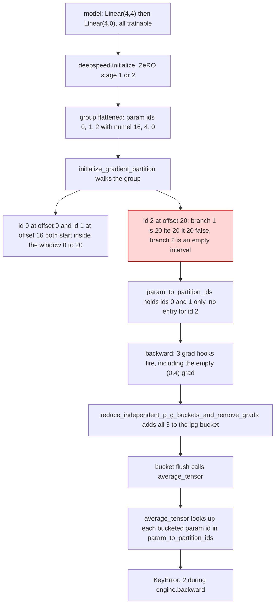
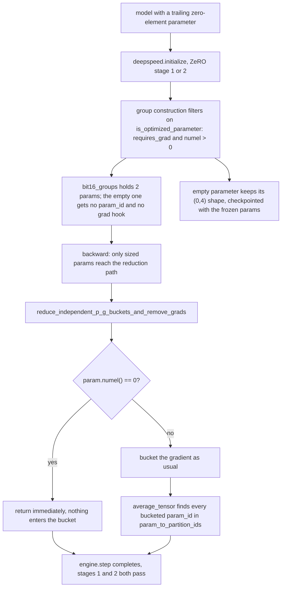

# Case study: ZeRO-1/2 KeyError on a trailing zero-sized parameter

| | |
|---|---|
| **PR** | [#8280](https://github.com/deepspeedai/DeepSpeed/pull/8280) "Fix ZeRO-1/2 with zero-sized parameters" by `fwerkor`, opened 2026-08-19, merged 2026-08-22, label `skip-gpu-test` |
| **Issue** | [#8279](https://github.com/deepspeedai/DeepSpeed/issues/8279) "[BUG] ZeRO-1/2 fail on trailing zero-sized trainable parameters", opened 2026-08-19, closed 2026-08-22 (both closed -- unlike cs-04 through cs-06) |
| **Found by** | A configuration fuzzer, not a workload. The reporter's interim fuzzing report in the issue thread lists three confirmed DeepSpeed bugs out of 1,050 single-target mutation intents over seven reduced training workloads: [#8260](https://github.com/deepspeedai/DeepSpeed/issues/8260) (`reduce_bucket_size=0` -> `ZeroDivisionError`), [#8276](https://github.com/deepspeedai/DeepSpeed/issues/8276) (16-byte alignment vs `grouped_mm`), and this one. |
| **Files** | `deepspeed/runtime/zero/stage_1_and_2.py` (the merged diff is +3/-0 in one function) |
| **Difficulty** | Medium |
| **Why instructive** | A degenerate-but-legal shape (`numel == 0`) walks straight through parameter registration and only fails three layers later, in the communication path, as `KeyError: 2`. The root cause is an *interval* test that silently has no true branch for a zero-width interval at the end of the buffer -- and the eventual project-wide answer was not to harden the reduction path but to stop admitting such parameters at all. |

---

## Symptom

From issue #8279:

> DeepSpeed ZeRO stage 1 and stage 2 fail during backward when a zero-sized trainable parameter
> appears at the end of a parameter group and participates in autograd.
>
> A minimal example using `nn.Linear(4, 0, bias=False)` fails with:
>
> ```text
> KeyError: 2
> ```

with the traceback:

```text
File "deepspeed/runtime/zero/stage_1_and_2.py", line 1265, in average_tensor
    partition_ids = self.param_to_partition_ids[i][param_id]
KeyError: 2
```

The reporter's controls are the valuable part of the report:

> - ZeRO stage 0: passes.
> - PyTorch DDP with the same zero-sized parameter: passes.
> - ZeRO stage 1, one GPU, FP32: fails with the same `KeyError`.
> - ZeRO stage 2, one GPU, FP32: fails with the same `KeyError`.
> - If the zero-sized parameter does not participate in backward, the run passes.

and the diagnosis, which names the exact inconsistency:

> The internal parameter ids for the minimal model are `0`, `1`, and `2`, but after ZeRO
> initialization the mapping is:
>
> ```text
> param_to_partition_ids = {0: {0: [0], 1: [0]}}
> ```
>
> The trailing zero-sized parameter (`param_id == 2`) is therefore absent from
> `param_to_partition_ids`, while its empty gradient can still enter the reduction bucket
> during backward.

Asked by a maintainer how zero-sized trainable parameters arise in practice, the reporter was
candid:

> We found this automatically while developing a configuration fuzzer, not from a real-world
> workload. Maybe zero-sized trainable parameters should simply be treated as invalid?

That question is what the final shape of the fix in current master answers (see "Afterwards").

---

## Background

### The flat buffer and the partition map

`DeepSpeedZeroOptimizer` (stages 1 and 2) flattens each parameter group into one contiguous
16-bit buffer and assigns each data-parallel rank a contiguous slice of it. Gradient reduction
is driven by two pieces of bookkeeping built at init time:

* `self.param_to_partition_ids[group_index][param_id] -> [partition ids]` --- which ranks own
  any part of this parameter's gradient. Declared at
  `deepspeed/runtime/zero/stage_1_and_2.py:675`, reset per group at line 1019.
* `self.grad_start_offset[group][partition][param_id]` --- where this parameter's gradient
  starts inside that partition.

Both are populated by `initialize_gradient_partition`
(`deepspeed/runtime/zero/stage_1_and_2.py:1208`), which walks the group in buffer order and
compares each parameter's extent against the partition's `[start_index, end_index)` window:

```python
partition_size = self.partition_size[i]

start_index = partition_size * partition_id
end_index = partition_size * (partition_id + 1)

current_index = 0
first_offset = 0

for param, padding in zip(param_group, self.round_robin_bit16_padding[i]):

    param_size = param.numel()
    param_id = self.get_param_id(param)

    if start_index <= current_index < end_index:
        set_key_value_list(self.param_to_partition_ids[i], param_id, partition_id)
        ...
    elif current_index < start_index < (current_index + param_size):
        ...
        set_key_value_list(self.param_to_partition_ids[i], param_id, partition_id)
        ...

    current_index = current_index + param_size + padding
```

There are exactly two branches: "this parameter *starts* inside the partition", and "the
partition starts inside this parameter".

### The reduction path that reads the map

On the backward pass, each parameter's gradient hook leads to
`reduce_ready_partitions_and_remove_grads` -> `reduce_independent_p_g_buckets_and_remove_grads`
(`deepspeed/runtime/zero/stage_1_and_2.py:2381-2384`), which appends the parameter to the
in-progress gradient bucket (`ipg_buckets`). When the bucket is flushed,
`average_tensor` (`deepspeed/runtime/zero/stage_1_and_2.py:1709`) walks the bucket contents and
looks up, at line 1762:

```python
for i, param_idx_in_group, param_id in bucket.params:
    param = self.bit16_groups[i][param_idx_in_group]
    ...
    partition_ids = self.param_to_partition_ids[i][param_id]
```

This is an unguarded `dict[...]` on a map that was built by a *different* function under a
*different* condition. Any parameter that can reach the bucket but not the map is a `KeyError`.

---

## Root cause

A zero-sized parameter has `param_size == 0`, so:

* branch 1 `start_index <= current_index < end_index` is a point test. It is true only if the
  parameter's start offset falls strictly inside the partition window.
* branch 2 `current_index < start_index < (current_index + param_size)` becomes
  `current_index < start_index < current_index`, which is **false for every input** -- an empty
  interval cannot contain anything.

So a zero-sized parameter is registered if and only if its offset happens to land inside some
partition window. For a parameter at the **end** of the group, `current_index` has already
advanced to the total (padded) numel of the group, which equals `end_index` of the last
partition. `start_index <= current_index < end_index` is then `N <= N < N` -- false. The
parameter gets no entry in `param_to_partition_ids`, no entry in `grad_start_offset`, and is
not counted in `total_grads_in_partition`.

Nothing else cares. Registration of `param_id` itself (`self.param_id`) is independent of the
partition walk, so the parameter has an id (`2` in the minimal model). Its gradient hook is
installed like any other parameter in the group, and `nn.Linear(4, 0)` *does* produce a
gradient -- an empty one, shape `(0, 4)` -- as long as the parameter participates in the loss.
That empty gradient enters the bucket, the bucket is flushed at the end of backward, and
`average_tensor` dereferences `param_to_partition_ids[0][2]`.

This is why every control in the bug report behaves the way it does:

| Configuration | Why |
|---|---|
| ZeRO-0 passes | no partitioning, no `param_to_partition_ids`, no lookup |
| DDP passes | torch reduces a zero-element gradient as a no-op |
| stage 1 and 2 fail | both build the partition map and both flush buckets through `average_tensor` |
| 1 GPU, FP32 fails | the defect is in index arithmetic, not in communication or dtype |
| parameter not in backward passes | no gradient hook fires, so the parameter never reaches the bucket |
| *trailing* parameter fails | an interior zero-sized parameter lands inside a partition window and does get an entry |

### Worked example

The reporter's minimal model, one rank, FP32, ZeRO-1:

```python
self.main = nn.Linear(4, 4)            # weight -> param_id 0 (16 elements)
                                       # bias   -> param_id 1 (4 elements)
self.zero = nn.Linear(4, 0, bias=False)  # weight -> param_id 2 (0 elements)
```

With `world_size == 1` there is a single partition, `partition_size == 20`, so
`start_index = 0`, `end_index = 20`. The walk:

| param_id | `param_size` | `current_index` at entry | branch 1 `0 <= c < 20` | branch 2 `c < 0 < c + size` | registered |
|---|---|---|---|---|---|
| 0 | 16 | 0 | true | - | yes |
| 1 | 4 | 16 | true | - | yes |
| 2 | 0 | 20 | **false** | false | **no** |

Result, exactly as printed in the issue:

```
param_to_partition_ids = {0: {0: [0], 1: [0]}}
```

Backward then produces three gradients, three hooks fire, three entries go into the bucket, and
`average_tensor` raises `KeyError: 2`. In the reporter's original (larger) model the same
failure appeared as `KeyError: 110`, which is the same thing with more parameters in front of
the empty one.

---

## The fix

### Current code

`deepspeed/runtime/zero/stage_1_and_2.py:1529`:

```python
def reduce_independent_p_g_buckets_and_remove_grads(self, param, i):

    if param.numel() == 0:
        return

    grad_reduc = self.get_gradient_for_reduction(param)
    if grad_reduc is None:
        # The hook also fires when the backward delivered no gradient for a parameter in the graph, as when
        # AutoEP stages an expert weight gradient for a later backward. There is nothing to reduce yet.
        return
    comm_dtype = self.get_param_comm_dtype(param)
    bucket = self.ipg_buckets[comm_dtype]
    ...
```

The guard sits at the single entry point into the reduction path, before anything is read from
the partition bookkeeping. A zero-element gradient contributes nothing to any reduction, so
dropping it is numerically exact, not an approximation: the all-reduce/reduce-scatter result for
the rest of the bucket is unchanged, and there is no slice of the flat buffer for it to be
written back into.

(The `grad_reduc is None` early return directly below it is unrelated -- it comes from the
AutoEP work in this tree.)

### Before/after

This one is a genuine merged PR, so no reconstruction is needed. The diff below is the complete
merged change, verbatim from `GET /repos/deepspeedai/DeepSpeed/pulls/8280` with
`Accept: application/vnd.github.v3.diff`:

```diff
diff --git a/deepspeed/runtime/zero/stage_1_and_2.py b/deepspeed/runtime/zero/stage_1_and_2.py
index 6b2e0272a3cb..bc7c2a99c472 100755
--- a/deepspeed/runtime/zero/stage_1_and_2.py
+++ b/deepspeed/runtime/zero/stage_1_and_2.py
@@ -1192,6 +1192,9 @@ def flatten_dense_tensors_aligned(self, tensor_list, alignment, use_cpu_data=Fal
     ############### Independent Partition Gradient ########################
     def reduce_independent_p_g_buckets_and_remove_grads(self, param, i):

+        if param.numel() == 0:
+            return
+
         grad_reduc = self.get_gradient_for_reduction(param)
         comm_dtype = self.get_param_comm_dtype(param)
         bucket = self.ipg_buckets[comm_dtype]
```

Worth noting what the merged diff does **not** contain. The PR description says:

> - skip zero-sized parameters before ZeRO-1/2 gradient reduction
> - add regression coverage for stages 1 and 2
>
> ## Testing
> - `pytest -q tests/unit/runtime/zero/test_zero_empty_param.py -s`
> - original #8279 reproducer on A6000 with PyTorch 2.13.0+cu126 for ZeRO-1 and ZeRO-2

but the PR's file list is a single file, `deepspeed/runtime/zero/stage_1_and_2.py`, +3/-0.
`tests/unit/runtime/zero/test_zero_empty_param.py` is not in the merged tree. The behaviour is
covered now, but by the later and broader `tests/unit/runtime/zero/test_zero_numel_param_shape.py`
(see below), not by this PR.

### Alternatives the fix did not take

* **Register the parameter in `param_to_partition_ids` anyway.** Changing branch 1 to
  `start_index <= current_index <= end_index` or special-casing `param_size == 0` would make the
  map complete, but then `grad_start_offset`, `total_grads_in_partition` and the
  `remaining_grads_in_partition` countdown all have to agree about a zero-width slice, and
  `average_tensor` would build a zero-length communication slice. More code on the hot path for
  a parameter that cannot affect the result.
* **Guard the lookup in `average_tensor`.** That hides the inconsistency at the point where it
  is observed rather than where it is created, and leaves the same trap for the other four
  `param_to_partition_ids[...][param_id]` dereferences in the file (lines 2060, 2206, 2389).
* **Reject zero-sized parameters at `deepspeed.initialize`.** The reporter suggested this
  ("Maybe zero-sized trainable parameters should simply be treated as invalid?"). It is a
  breaking change for anyone whose model has one, since ZeRO-0 and DDP accept them.

### Afterwards: the project chose the structural answer

The three-line guard was the right minimal fix for an internal `KeyError`, but it is not where
the story ended. Two later changes moved the decision upstream:

* [PR #8467](https://github.com/deepspeedai/DeepSpeed/pull/8467) -- "A zero-element parameter
  loses its shape when it is bound to a flat buffer". `torch.unflatten_dense_tensors`
  special-cases `numel == 0` and returns a fresh 1-D `zeros({0})` instead of a view with the
  requested shape, so binding a `(0, 8)` parameter to a flat buffer turned it into `(0,)` and
  the module's own forward then failed with
  `RuntimeError: size mismatch, got input (1), mat (1x8), vec (0)`. The resolution: zero-element
  parameters are left out of the optimizer groups the way frozen parameters are, via
  `is_optimized_parameter` (`deepspeed/runtime/utils.py:890`), and are checkpointed with the
  frozen parameters so they keep their shape.
* [PR #8375](https://github.com/deepspeedai/DeepSpeed/pull/8375) -- the same treatment for
  ZeRO-3 partitioning (`Init._leave_unpartitioned`), after a zero-element parameter tripped an
  assertion in the all-gather path.

In this tree, `deepspeed/runtime/zero/stage_1_and_2.py:432` filters the group:

```python
trainable_parameters = []
for param in param_group['params']:
    if is_optimized_parameter(param):
        param.grad_accum = None
        param.param_idx_in_group = len(trainable_parameters)
        trainable_parameters.append(param)
self.bit16_groups.append(trainable_parameters)
```

So a zero-element parameter never joins `bit16_groups`, never gets a `param_id`, and never gets
a reduction hook -- the `numel() == 0` guard from #8280 is now defence in depth for direct
callers of the reduction entry point (the unit tests in
`tests/unit/v1/zero/test_zero2_gradient_safety.py` call it directly) rather than the thing that
keeps the fuzzer's model alive. Both are verified below.

---

## How to verify it yourself

CPU only, single process, `gloo`. Save outside the repo and run from the repo root with
`PYTHONPATH=. DS_ACCELERATOR=cpu python3.13 /tmp/cs07.py 1` (and `2` for stage 2). The model is
the reproducer from issue #8279 with `.cuda()` removed.

```python
import os, sys, torch, torch.nn as nn
import deepspeed

os.environ.setdefault("MASTER_ADDR", "127.0.0.1")
os.environ.setdefault("MASTER_PORT", "29571")
os.environ.setdefault("RANK", "0")
os.environ.setdefault("LOCAL_RANK", "0")
os.environ.setdefault("WORLD_SIZE", "1")

class Model(nn.Module):
    def __init__(self):
        super().__init__()
        self.main = nn.Linear(4, 4)
        self.zero = nn.Linear(4, 0, bias=False)   # trailing zero-sized trainable parameter
    def forward(self, x):
        return self.main(x).pow(2).mean() + self.zero(x).sum() * 0

# this box has no C++ compiler, so skip the JIT shared-memory comm op and use plain gloo
import deepspeed.comm.torch  # noqa: F401
sys.modules["deepspeed.comm.torch"].build_shm_op = lambda: None
deepspeed.init_distributed(dist_backend="gloo")

stage = int(sys.argv[1])
config = {
    "train_micro_batch_size_per_gpu": 1,
    "gradient_accumulation_steps": 1,
    "zero_optimization": {"stage": stage, "overlap_comm": False, "reduce_scatter": True},
    "steps_per_print": 1000,
}
model = Model()
optimizer = torch.optim.AdamW(model.parameters(), lr=1e-4)
engine, _, _, _ = deepspeed.initialize(model=model, model_parameters=model.parameters(),
                                       optimizer=optimizer, config=config)
x = torch.randn(2, 4, device=engine.device)
loss = engine(x)
engine.backward(loss)
engine.step()
opt = engine.optimizer
print(f"stage={stage} ok global_steps={engine.global_steps} "
      f"empty_param_shape={engine.module.zero.weight.shape} "
      f"param_to_partition_ids={getattr(opt, 'param_to_partition_ids', None)}")

empty = engine.module.zero.weight
in_groups = any(p is empty for g in opt.bit16_groups for p in g)
print("empty param in bit16 groups:", in_groups, "group sizes:", [len(g) for g in opt.bit16_groups])
print("registered param ids:", sorted(opt.param_id.values()))
# the guarded entry point returns without touching the mapping that has no entry for it
print("direct call returns:", opt.reduce_independent_p_g_buckets_and_remove_grads(empty, 0))
```

Real output on this tree (DeepSpeed 0.20.1, torch 2.15.0+cpu, python 3.13; log lines removed):

```
stage=1 ok global_steps=1 empty_param_shape=torch.Size([0, 4]) param_to_partition_ids={0: {0: [0], 1: [0]}}
empty param in bit16 groups: False group sizes: [2]
registered param ids: [0, 1]
direct call returns: None

stage=2 ok global_steps=1 empty_param_shape=torch.Size([0, 4]) param_to_partition_ids={0: {0: [0], 1: [0]}}
empty param in bit16 groups: False group sizes: [2]
registered param ids: [0, 1]
direct call returns: None
```

Reading the four lines:

1. Both stages now complete a full forward/backward/step, and the empty parameter keeps its
   `(0, 4)` shape (that part is #8467's doing).
2. `param_to_partition_ids` is still `{0: {0: [0], 1: [0]}}` -- the map that produced
   `KeyError: 2` is *unchanged*. The bug was never fixed by completing the map.
3. The empty parameter is not in `bit16_groups` and has no registered `param_id` at all, which
   is #8467 keeping it out of the optimizer entirely.
4. The `numel() == 0` guard from #8280 still does its job for a direct call: it returns `None`
   instead of walking into `get_param_id`, which on this tree would itself raise
   `KeyError` for an unregistered parameter.

Two environment notes. `deepspeed.init_distributed(dist_backend="gloo")` is needed because the
CPU accelerator prefers `ccl`; and `build_shm_op` is stubbed out only because this sandbox has
no C++ compiler, so the JIT build of `deepspeed_shm_comm` fails. Neither has anything to do with
the bug. On a machine with a compiler, drop the stub.

The repository's own coverage for this area is
`tests/unit/runtime/zero/test_zero_numel_param_shape.py`
(`pytest tests/unit/runtime/zero/test_zero_numel_param_shape.py`), which parametrises stage 0,
stage 1 with fp32 grad accumulation, stage 1 and stage 2 over a model whose trailing parameter
is `nn.Linear(hidden, 0, bias=False)`.

---

## Lessons

* **Zero is a shape, and interval tests do not have a true branch for it.**
  `current_index < start_index < current_index + param_size` is vacuous when `param_size == 0`,
  and `start <= c < end` is false at the right-hand boundary. Any loop that classifies
  parameters by their extent needs to be read once with `numel == 0` substituted in.
* **A map built in one function and dereferenced unguarded in another is a latent `KeyError`.**
  `param_to_partition_ids` is written under the partition-overlap condition and read under the
  "is in the reduction bucket" condition. Those two sets were assumed equal and nothing checked
  it; `average_tensor` has four more dereferences of the same shape.
* **Fix at the boundary, then ask whether the object should exist.** #8280's three lines were
  correct and sufficient to stop the crash; #8467 and #8375 then concluded that a zero-element
  parameter has no business in an optimizer group or a ZeRO-3 partition at all. The cheap guard
  bought the time to make the structural change deliberately.
* **Degenerate-input fuzzing pays for itself on frameworks with lots of index arithmetic.** One
  fuzzer campaign produced three confirmed bugs (`reduce_bucket_size=0`, a 16-byte alignment
  violation, and this one), none of which a realistic workload would have produced, all of
  which are real failures in supported configurations.
* **Check the sibling implementations.** ZeRO-3 has its own
  `reduce_independent_p_g_buckets_and_remove_grads` (`deepspeed/runtime/zero/stage3.py:1749`)
  and a separate partitioning path; it had the same class of defect and needed its own fix
  (#8375). DeepSpeed's `AGENTS.md` asks for this explicitly, and here it was warranted.

---

## Flowcharts

### Buggy flow (pre-#8280)



### Fixed flow (current tree)


