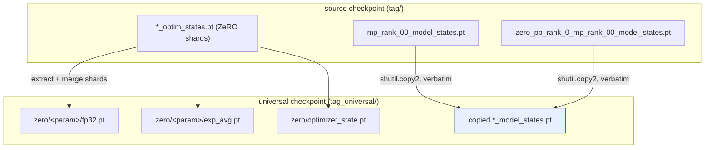
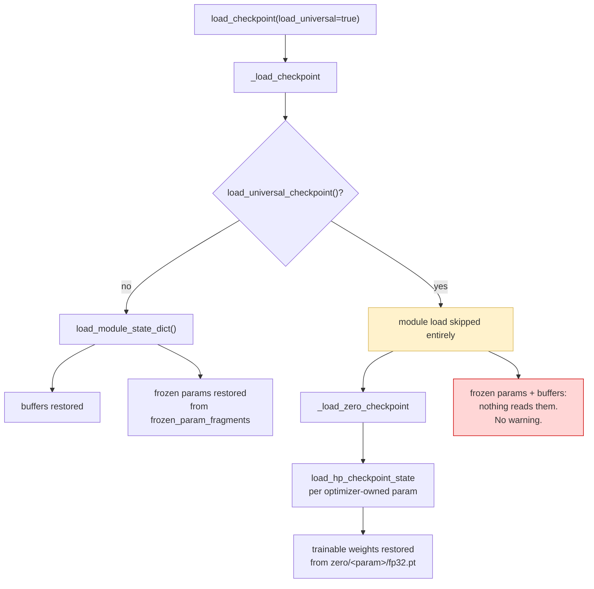
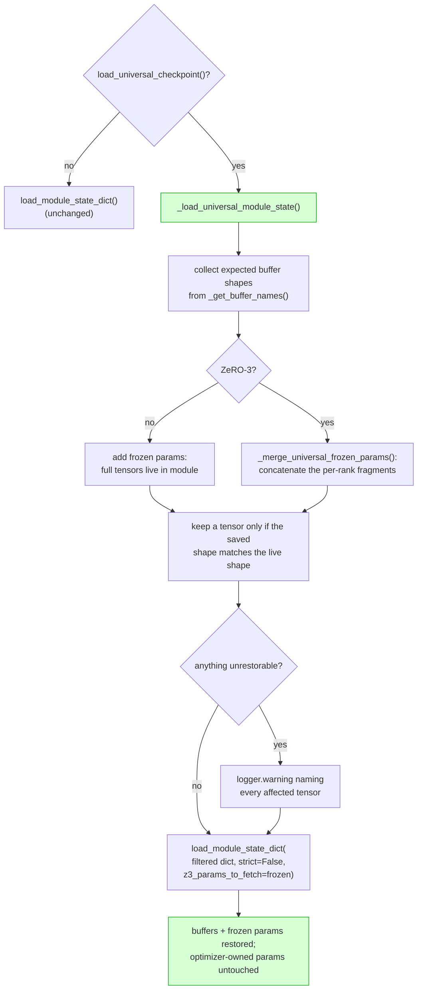
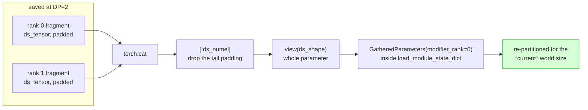

# Fix: universal checkpoint load never restores frozen parameters or buffers

Upstream issue **[#9134](https://github.com/deepspeedai/DeepSpeed/issues/9134)**.

| | |
| --- | --- |
| Issue | `[BUG] Universal checkpoint load never restores frozen parameters or buffers` |
| Reported | 2026-11-20 |
| Severity | Silent data loss on resume — no exception, no warning |
| Difficulty | Medium-hard: the symptom is in the load path, the cause is split across the load path, the converter, and the save format |
| Base commit | `d70adc32` (`deepspeedai/DeepSpeed` `master`) |
| Branch | `fix/uc-frozen-params` |
| Files changed | `deepspeed/runtime/engine.py` (+99/-1), `tests/unit/checkpoint/test_universal_checkpoint.py` (+94) |
| Validated on | CPU only (aarch64, gloo, torch 2.15.0+cpu). No GPU was available. |

---

## 1. The symptom

Save a model under ZeRO, convert the checkpoint with `ds_to_universal`, then resume with
`checkpoint: {load_universal: true}`. Trainable weights come back correctly. Everything else does
not:

- frozen parameters (`requires_grad=False`) — a frozen backbone, an adapter's base weights
- `BatchNorm` `running_mean`, `running_var`, `num_batches_tracked`
- every other registered buffer

They silently keep whatever the freshly constructed model happened to have. There is no warning,
so a resumed run looks healthy and is quietly wrong: a frozen backbone reverts to its
initialisation, and normalisation statistics reset.

Measured on this tree before the fix, saving at DP=2 and reloading into a model built with a
different seed (`max |loaded - saved|` per tensor):

```
stage 1: 1.running_mean=0.7604, 1.running_var=0.1719, 1.num_batches_tracked=2.0, 3.weight=0.3506, 3.bias=0.2357
stage 2: 1.running_mean=0.7604, 1.running_var=0.1719, 1.num_batches_tracked=2.0, 3.weight=0.3506, 3.bias=0.2357
stage 3: 1.running_mean=0.7604, 1.running_var=0.1719, 1.num_batches_tracked=2.0, 3.weight=0.3506, 3.bias=0.2357
```

Those are not small numerical differences. `3.weight` is the frozen linear layer: it is simply the
new model's random initialisation.

---

## 2. Background: what a universal checkpoint actually contains

`ds_to_universal` converts a parallelism-specific checkpoint into a layout that can be resumed at a
different parallel topology. It writes one directory per **optimizer-owned** parameter, and copies
the original model-state files in verbatim.



The key asymmetry: `zero/<param>/fp32.pt` exists **only** for parameters the optimizer owns, because
it is derived from the optimizer's shards. A parameter with `requires_grad=False` has no optimizer
state and no fp32 master copy; a buffer is not a parameter at all. Those tensors live only in the
copied `*_model_states.pt` files (blue above).

Where each category is physically stored:

| Tensor category | ZeRO 1/2 source | ZeRO-3 source |
| --- | --- | --- |
| Trainable parameter | `zero/<param>/fp32.pt` | `zero/<param>/fp32.pt` |
| Frozen parameter | full tensor in `module` | one padded fragment **per saved rank** in `frozen_param_fragments` |
| Registered buffer | full tensor in `module` | full tensor in `module` |
| Optimizer moments | `zero/<param>/exp_avg*.pt` | same |

Under ZeRO-3 the `module` dict holds a `(0,)` placeholder for every *parameter* (the model was
partitioned before saving), which is why frozen parameters need the separate
`frozen_param_fragments` entry, written by `_get_param_fragment_func`
(`deepspeed/runtime/engine.py:5666`) as `param.ds_tensor` — this rank's padded shard.

---

## 3. Root cause

`DeepSpeedEngine._load_checkpoint` guarded the entire module load behind a non-universal check
(`deepspeed/runtime/engine.py:4780` before the fix):

```python
if not self.load_universal_checkpoint():
    self.load_module_state_dict(checkpoint=checkpoint,
                                strict=load_module_strict,
                                custom_load_fn=custom_load_fn,
                                fetch_z3_params=fetch_z3_params,
                                z3_params_to_fetch=z3_params_to_fetch,
                                allowed_missing_keys=allowed_missing_keys)
```

The reasoning was sound as far as it went: on the universal path, weights come from the `zero/`
shards, so re-applying `checkpoint['module']` would be redundant — and under ZeRO-3 it would be
actively wrong, since `module` holds empty placeholders.

But `load_module_state_dict` is the **only** code that does two other things:

1. calls `self.module.load_state_dict(...)`, which is what restores **buffers**;
2. copies `checkpoint['frozen_param_fragments']` into frozen parameters
   (`deepspeed/runtime/engine.py:4425-4435`).

And the universal restore path never covers them either. `enable_universal_checkpoint()`
(`deepspeed/checkpoint/universal_checkpoint.py:394`) attaches `load_hp_checkpoint_state` only to
members of `lp_param_group` (`deepspeed/runtime/zero/stage_1_and_2.py:806`,
`deepspeed/runtime/bf16_optimizer.py:314`), and the ZeRO-3 loader iterates `self.fp16_groups`
(`deepspeed/runtime/zero/stage3.py:4058`). Frozen parameters and buffers are in none of those
groups. So the tensors fell through every branch:



There is a second, quieter part of the defect. For stage <= 2, the converter's fallback loop
(`deepspeed/checkpoint/ds_to_universal.py:1212-1227`) *does* emit a `zero/<name>/fp32.pt` for
leftover `module` keys, including buffers — but **nothing ever reads those files**, because the load
side enumerates the optimizer's parameter groups rather than the `zero/` directory. They are inert
bytes. Worse, that loop casts with `tensor.float()`, which would turn `num_batches_tracked` (int64)
into a float if it ever were read. The stage-3 conversion path has no such loop at all.

---

## 4. The fix

Replace the skip with a targeted restore of precisely the remainder that the `zero/` layout does not
carry, and make any residual gap loud.



### 4.1 Why `strict=False` and a filtered dict

The dict handed to `load_module_state_dict` deliberately contains *only* buffers and frozen
parameters. Every optimizer-owned parameter is absent, so a strict load could never pass; and
omitting them is what guarantees the fix cannot disturb the `zero/` restore that owns them.

### 4.2 The ZeRO-3 fragment merge

Under ZeRO-3 no single rank's file holds a whole frozen parameter. Each saved rank holds its own
padded shard, so the whole parameter is the concatenation of all of them, truncated to `ds_numel`:



This is what makes frozen parameters survive a DP resize, which is the entire point of a universal
checkpoint. Note that each rank reads all `dp_world_size` model-state files; see the tradeoff in
section 7.

Rather than writing into `param.ds_tensor` directly, the merged full tensor is handed to
`load_module_state_dict` with `z3_params_to_fetch` set. That reuses DeepSpeed's own
`GatheredParameters` machinery to gather, copy and re-partition, instead of re-deriving partition
rank, partition size and padding offsets by hand.

### 4.3 Loud instead of silent

A tensor the checkpoint cannot supply — or whose saved shape does not match the live model, which is
what a tensor-parallel reshard looks like — is named in a warning rather than loaded wrongly:

```
[WARNING] Universal checkpoint carries no usable state for these buffers and frozen parameters,
which keep the values of the freshly constructed model: ['3.bias', '3.weight']
```

This is the part of the change that matters most. The original bug was not only that tensors were
skipped, but that nothing said so.

---

## 5. Verification

Hardware: 1x aarch64 CPU host, **no GPU, no C++ compiler**, torch 2.15.0+cpu, Python 3.13,
`DS_ACCELERATOR=cpu`, gloo backend, `world_size=2`.

### 5.1 The regression test fails before and passes after

```bash
DS_ACCELERATOR=cpu LOCAL_SIZE=4 PYTHONPATH=. python3.13 -m pytest \
  tests/unit/checkpoint/test_universal_checkpoint.py -q -k "FrozenParamsAndBuffers"
```

| Tree | Result |
| --- | --- |
| With the fix | **3 passed** (ZeRO stages 1, 2, 3) |
| `engine.py` reverted to `d70adc32`, test kept | **3 failed** — `AssertionError: frozen.weight was not restored` at all three stages |

The test trains a model with a frozen `Linear` and a `BatchNorm1d`, saves, converts with
`ds_to_universal`, then loads into a model built from a **different seed** so that every tensor
under test differs from the checkpoint and the BatchNorm statistics are still at their defaults. It
asserts on the loaded state dict through the public interface, not on engine internals.

### 5.2 Issue reproducer

The issue's own script, before and after:

```
before -> stage 1/2/3: 5 tensors differ (values in section 1)
after  -> stage 1/2/3: 0 tensors differ
```

### 5.3 Additional checks run in this environment

| Check | Result |
| --- | --- |
| ZeRO-3 DP resize 2->1, 2->2, 2->3, 4->2 (frozen numel 992, not divisible by world size, so padding is exercised) | all tensors match |
| ZeRO-1/2 DP resize 2->1, 2->3, 4->2 | all tensors match |
| bf16 frozen parameters, stages 1/2/3 | differ before, match after |
| `exclude_frozen_parameters=True` at save | buffers restore; omitted frozen weights named in the warning instead of diverging silently |
| Non-universal load, stages 1/2/3 | unchanged, still exact |
| `pre-commit run --files <both files>` | all hooks pass (yapf, flake8, check-torchdist, check-license, codespell, ...) |
| Adjacent suite: `TestZeROUniversalCheckpointDP`, fp32 / `sub_group_size=-1` slice, DP 2->2, 4->2, 2->4 | **12 passed, 12 errors** — every error is `Error building extension 'fused_adam'` with `code=127` (no C++ compiler on this host), i.e. the `use_torch_adam=False` cells. A Python-level change cannot produce a compiler-absent build failure; all 12 `use_torch_adam=True` cells pass. |

### 5.4 What was NOT validated

Stated plainly, because an unstated gap wastes a maintainer's hardware time:

- **No GPU run of any kind.** No CUDA, no NCCL. fp16 cells skip on CPU.
- **No DeepSpeed fused optimizers.** `FusedAdam` / `DeepSpeedCPUAdam` need a compiler that this box
  lacks, so all runs used torch Adam. Adjacent suites that require them error identically on the
  unmodified tree.
- **Tensor parallelism:** the shape-mismatch guard is the intended behaviour for a TP reshard, but it
  was never exercised against a real one.
- **Pipeline parallelism:** not fixed by this change, by design — see below.
- **Offload (CPU/NVMe), MoE/AutoEP:** untested.

---

## 6. Scope limit: pipeline parallelism

`PipelineEngine.module_state_dict()` returns `None` and stores weights in per-layer
`layer_*-model_states.pt` files, which `ds_to_universal` does not copy into the universal folder. A
pipeline-parallel universal checkpoint therefore contains **no source at all** for buffers and frozen
parameters. This change handles that case without crashing (`checkpoint['module'] or {}`) and emits
the warning, but it cannot restore what is not there. Fixing that needs a converter-side change and
is deliberately out of scope.

---

## 7. Alternatives considered

| Alternative | Why not |
| --- | --- |
| Merge the ZeRO-3 frozen fragments in `ds_to_universal` instead of at load time | Cheaper for very large frozen backbones, and arguably the tidier home. But it would not help any checkpoint already converted, so a load-time fallback would be needed anyway. Chosen approach keeps the fix in one file and works on existing universal folders. Worth revisiting if maintainers prefer it. |
| Read buffers from the `zero/<buffer>/fp32.pt` files the converter already emits for stage <= 2 | Those are written with `tensor.float()`, which would corrupt the int64 `num_batches_tracked`, and the stage-3 path emits none. Reading `module` preserves dtype and works for both. |
| Just drop the `if not self.load_universal_checkpoint():` guard | Under ZeRO-3 `module` holds `(0,)` placeholders for every parameter, so a full load would overwrite correctly restored trainable weights with empty tensors. |
| Raise instead of warning on unrestorable tensors | Would break pipeline-parallel and TP-reshard universal loads that "work" today. The warning removes the silence, which is the actual defect. One-line change if maintainers disagree. |
| Forward `custom_load_fn` on the universal path | It was never called there before, and handing a user's loader a partial, DeepSpeed-internal state dict (buffers and frozen params only) would likely break a loader that assumes a complete one. |

---

## 8. Pull request description as submitted

> ### Restore frozen parameters and buffers on a universal checkpoint load
>
> Fixes #9134.
>
> Loading a universal checkpoint never restored any tensor the optimizer does not own. Frozen
> parameters, BatchNorm running statistics and every other registered buffer silently kept the
> values of the freshly constructed model, with no warning. Trainable weights were restored
> correctly, so a resumed run looked healthy and was quietly wrong.
>
> **Root cause.** `_load_checkpoint` skipped `load_module_state_dict` entirely on the universal path
> (`deepspeed/runtime/engine.py:4780`), because trainable weights come from `zero/<param>/fp32.pt`
> instead. But `ds_to_universal` only writes those files for optimizer-owned parameters, and the
> universal readers are keyed off optimizer ownership too: `enable_universal_checkpoint()` attaches
> `load_hp_checkpoint_state` only to `lp_param_group` members, and the ZeRO-3 loader iterates
> `fp16_groups`. Frozen parameters and buffers are in none of those groups, and
> `load_module_state_dict` is the only code that calls `module.load_state_dict()` or applies
> `frozen_param_fragments`. So they fell through every branch. The model-state files that
> `ds_to_universal` copies into the universal folder still carry them.
>
> **Change.** The universal path now restores exactly that remainder:
> - Buffers, and for ZeRO stage 1/2 frozen parameters, come from the copied model-state dict,
>   filtered to the tensors the `zero/` layout does not carry and applied with `strict=False` so
>   optimizer-owned parameters are still restored from their shards.
> - Under ZeRO-3 the model-state files hold frozen parameters as one padded fragment per saved rank,
>   so the fragments of all saved ranks are concatenated into the whole parameter and handed to
>   `load_module_state_dict`, which repartitions it for the current world size. Frozen parameters
>   therefore survive a DP resize.
> - A tensor the checkpoint cannot supply, or whose saved shape does not match the live model (a TP
>   reshard), is named in a warning instead of being loaded wrongly or ignored in silence.
>
> Pipeline-parallel universal checkpoints are unchanged: `ds_to_universal` does not copy the
> per-layer weight files, so the folder carries no source for these tensors. The load now warns
> instead of continuing quietly; fixing it needs a converter-side change and is out of scope here.
>
> **Not a duplicate.** GitHub search returns no open PR referencing #9134, and no open PR in the
> universal-checkpoint area addresses this defect. #9080 (`[UCP] Load universal checkpoints across
> ZeRO stages`) touches the same files but fixes cross-stage loading. #8378 (`Return frozen
> parameters, as fp32, from ZeRO checkpoints`) concerns the dtype of frozen parameters in
> `get_fp32_state_dict_from_zero_checkpoint`, a different code path. #9015 concerns
> `offload_states()` with frozen parameters.
>
> **Sibling paths checked**, as `AGENTS.md` requires: ZeRO stage 1/2 and stage 3 are separate
> implementations here and were both exercised; the fp16 and bf16 optimizer paths share the
> `lp_param_group` mechanism and bf16 was tested directly; the non-universal load path is unchanged
> and re-verified.
>
> **Validation.** 1x aarch64 CPU host, no GPU, no C++ compiler, torch 2.15.0+cpu, Python 3.13,
> `DS_ACCELERATOR=cpu`, gloo, `world_size=2`.
>
> ```bash
> DS_ACCELERATOR=cpu LOCAL_SIZE=4 PYTHONPATH=. python3.13 -m pytest \
>   tests/unit/checkpoint/test_universal_checkpoint.py -q -k "FrozenParamsAndBuffers"
> ```
>
> - With the fix: 3 passed (stages 1, 2, 3). With `engine.py` reverted and the test kept: 3 failed,
>   `AssertionError: frozen.weight was not restored`.
> - The issue's own reproducer: 5 tensors differ before, 0 after, at every stage.
> - ZeRO-3 DP resize 2->1, 2->2, 2->3, 4->2 with a frozen parameter whose numel is not divisible by
>   the world size: all tensors match. ZeRO-1/2 resize 2->1, 2->3, 4->2: all match.
> - bf16 frozen parameters: differ before, match after. `exclude_frozen_parameters=True`: buffers
>   restore, omitted frozen weights are named in the warning.
> - Non-universal load round-trip, stages 1/2/3: unchanged.
> - `pre-commit run --files deepspeed/runtime/engine.py tests/unit/checkpoint/test_universal_checkpoint.py`:
>   all hooks pass.
>
> **Compatibility matrix.** Validated: ZeRO 1/2/3; fp32 and bf16; DP resize; no offload; TP=1;
> non-pipeline; torch Adam. **Not validated:** any GPU/accelerator path (no device available), fp16
> (unsupported on the CPU accelerator), DeepSpeed `FusedAdam`/`CPUAdam` (no compiler), tensor
> parallelism (the shape guard is untested against a real reshard), pipeline parallelism (not fixed
> by design), CPU/NVMe offload, MoE/AutoEP.
>
> This change affects checkpoint correctness, not numerics, throughput or memory, so no convergence
> or performance numbers are reported. The one performance consideration is that under ZeRO-3 each
> rank now reads all `dp_world_size` model-state files once per universal load to merge the frozen
> fragments; a converter-side merge would avoid that and I am happy to switch if preferred.
>
> **AI assistance was used** for this change: the investigation, the patch and the test were produced
> with an AI coding agent, and the validation above was executed in that environment. Per
> `AGENTS.md` I want to be explicit that this is AI-assisted work rather than imply otherwise, and
> that the gaps listed above are real gaps. Reviewers should weigh the untested matrix cells
> accordingly.

---

## 9. Lessons

- A guard that is correct for one tensor category can silently strand the others. The original
  `if not self.load_universal_checkpoint():` was right about trainable weights and wrong about
  everything else in the same dict.
- "Restored from the optimizer's shards" and "restored from the module state dict" partition the
  model's tensors. Any code path that disables one must account for what only the other covers.
- When a restore cannot happen, say so. The difference between this bug and a merely incomplete
  feature was the absence of a warning.
- Under ZeRO-3, saved tensors are per-rank fragments. Any load path that reads a single rank's file
  is wrong the moment the world size changes — and `_get_all_ckpt_names` passes
  `pp_placeholder="0"` on universal loads, so every rank would have read rank 0's fragment.
